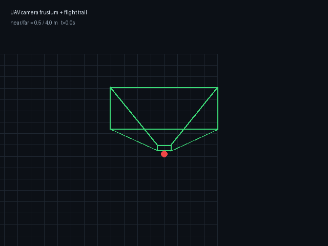

# 无人机相机视锥与飞行轨迹可视化

把 `/uav/odom` 和 `/camera/camera_info` 转成 RViz `MarkerArray`：相机视锥、飞行轨迹和无人机位置。用于检查相机安装方向、FOV、近远平面和飞行路径。



> 动图由示例飞行轨迹生成；RViz 中订阅 `/uav/camera_frustum` 可看实时数据。

## 接口

| 方向 | 话题 | 类型 |
|---|---|---|
| 订阅 | `/uav/odom` | `nav_msgs/Odometry` |
| 订阅 | `/camera/camera_info` | `sensor_msgs/CameraInfo` |
| 发布 | `/uav/camera_frustum` | `visualization_msgs/MarkerArray` |

## 运行

```bash
roslaunch uav_camera_frustum_viz main.launch near:=0.5 far:=8.0
```

RViz 添加 `MarkerArray`，话题选 `/uav/camera_frustum`，Fixed Frame 设为 `world`。

## 参数

| 参数 | 默认 | 说明 |
|---|---|---|
| `near` | 0.5 | 近平面距离 m |
| `far` | 8.0 | 远平面距离 m |
| `max_trail` | 300 | 轨迹最多保留点数 |

## 测试

纯几何测试不依赖 ROS：

```bash
python3 test/test_frustum_local.py
# 7/7 通过
```

覆盖视锥角点、光学系→机体系、世界系变换、12 条边。
