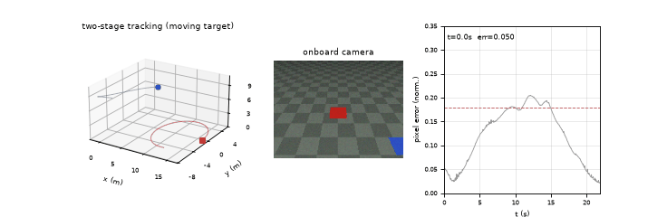
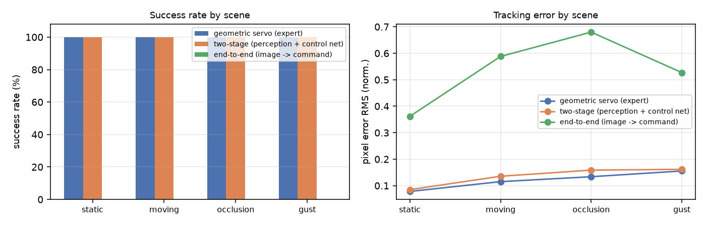
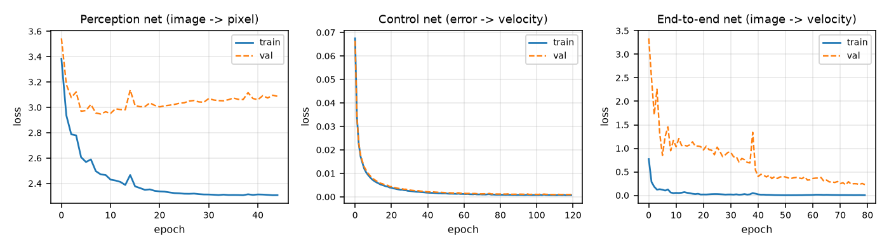
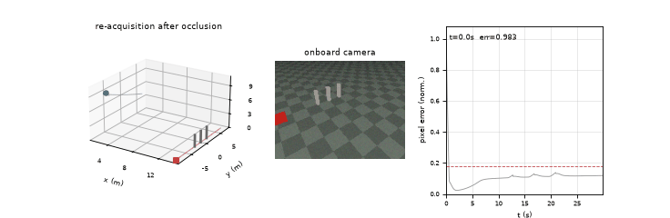

# 无人机机载相机视觉目标跟踪：感知网络、控制网络与端到端策略对比

本文档对应作业中「仿真环境下完成、感知/控制/端到端算法均为神经网络、多场景测试并含性能评价、
所有程序支持 launch 启动」这几条要求，实现一个**机载下视相机跟踪地面移动目标**的完整闭环：
相机出图 → 神经网络检测目标像素 → 神经网络（或视觉伺服）输出速度指令 → 四旋翼动力学 → 下一帧。

与直接接 AirSim 的方案不同，本模块自带一个纯 NumPy 的解析式仿真器（针孔投影 + 光线投射渲染 +
质点级四旋翼动力学），因此**不需要显卡、不需要仿真器许可**，在任意装了 `numpy` 的 Ubuntu 机器上
`colcon build` 后即可复现全部结果。这样做的取舍见文末「已知限制」。



上图为圆周运动场景的三面板动图：左＝三维航迹与目标轨迹，中＝机载相机实时画面（红块为目标、
蓝块为干扰物），右＝归一化像素误差曲线（虚线为阈值 0.18）。

## 1. 任务与控制目标

目标在地面（`z = 0`）平面运动，无人机在 9 m 高度用 40° 下俯的相机看它。控制目标是让目标稳定
停留在画面中心附近，即**保持跟飞距离约 13 m、并把目标压在画面中央**。控制量是四个标量：

| 量 | 含义 | 限幅 |
|---|---|---|
| `vx` | 机体前向速度 | ±3.5 m/s |
| `vy` | 机体右向速度 | ±3.5 m/s |
| `vz` | 世界系垂直速度 | ±1.5 m/s |
| `yaw_rate` | 偏航角速度 | ±1.2 rad/s |

### 1.1 为什么"图像纵坐标"就是测距量

对地面目标，相机固定高度 `h`、固定下俯角 `α`，目标在图像中的纵坐标 `v` 与水平距离 `d` 满足

```
v = cy + f * ( -h*cosα + d*sinα ) / ( d*cosα + h*sinα )
```

它在 `d` 上是单调的：目标越远，成像越靠画面上方。因此**纵向像素误差 `ey` 本身就是距离误差的
单调函数**，不需要再回归目标在图像里的视在宽度。实验中一开始用"视在宽度 → 距离"的经典做法，
但宽度回归头在小目标上系统性偏大（预测 61 px vs 真值 22 px），把距离环带偏；改为直接用 `ey`
后闭环才稳定下来。这个结论写进了 `detector.py` 的注释里，也是本模块不设宽度头的原因。

## 2. 仿真环境

| 组成 | 实现 | 文件 |
|---|---|---|
| 相机 | 针孔模型，160×120，水平 FOV 70°，下俯 40° | `camera.py` |
| 渲染 | 光线投射：地面棋盘格 + 目标红块 + 干扰蓝块 + 立柱遮挡，单帧 2~4 ms | `camera.py` |
| 动力学 | 速度误差 → 加速度（限幅）→ 一阶滞后 `τ=0.2 s` → 阻尼 + 阵风 | `quadrotor.py` |
| 场景 | 静止 / 圆周 / 立柱遮挡 / 阵风 四套 | `scenes.py` |

动力学方程（`dt = 0.05 s`，20 Hz）：

```
a_cmd = clip( Kp*(v_des - v), ±4.0 )
da/dt = (a_cmd - a) / 0.20
dv/dt = a - 0.12*v + wind(t)
dp/dt = v
```

四个场景的设计意图是**让每种失效模式单独暴露**：

| 场景 | 目标运动 | 干扰 | 考察点 |
|---|---|---|---|
| `static` | 静止于 10 m 外 | — | 收敛速度与稳态误差 |
| `moving` | 半径 5 m、0.22 rad/s 圆周 | 1 个蓝色干扰方块 | 持续转向跟随、匀速跟踪的稳态差 |
| `occlusion` | 14 m 处横向匀速穿越 | 3 根 0.56×0.44×2.4 m 立柱 | 丢失 → 记忆保持 → 重捕获（3 次，每次约 0.6 s） |
| `gust` | 0.8 m/s 往复机动 | 阵风幅值约 0.5 m/s²（双频叠加） | 抗扰动、机动目标 |

## 3. 感知网络：空间热图而不是坐标回归

### 3.1 输入与输出

输入是图像的**颜色对立通道**（R−G、R−B、灰度）均值池化到 16×16 的 768 维向量；
主干是单隐层 MLP（768→96），输出 257 维：前 256 维是 16×16 的目标位置热图，最后 1 维是可见概率。

颜色对立通道这一步是"固定预处理"，作用等价于传统流程里的 HSV 阈值前置：直接对 RGB 做池化时，
2.4 m 红块在 13 m 外的色差会被地面颜色稀释掉；先做 `R−G` 就把"这块比周围更红多少"显式表达出来。

### 3.2 损失与推理

真值位置 `(u, v)` 先映射到格子坐标，再生成中心位于该格子的二维高斯软标签 `Q`（σ = 0.8 格）：

```
L = -Σ Q·log softmax(z)  +  BCE(vis, p_vis)
```

推理时取 softmax 概率的**软质心**，因此能得到亚格子精度：

```
u = Σ p_i (i + 0.5) / 16 * W
```

**为什么要用热图而不是直接回归 `(u, v)`**：早期版本用两个回归头直接输出归一化坐标，验证损失在
0.47~2.36 之间来回跳，像素 MAE 21~40 px，偶尔发散到 24；换成热图 + 交叉熵后 MAE 降到 3 px 量级。
原因很直观——回归头必须学会"位置 → 坐标"的查表映射，而热图只要回答"哪个格子更像目标"，
后者是局部判别问题，样本效率高一个量级。

遮挡/出视野样本只监督可见性头（`0.5, 0.5, 0, 0` 的占位坐标不进入定位损失），
否则占位标签会把热图拉到画面中心。

### 3.3 感知精度（留出集，300 张，与训练集不同随机种子）

| 指标 | 数值 |
|---|---|
| 定位误差 MAE | 9.78 px |
| 定位误差中位数 | **2.99 px** |
| 定位误差 90 分位 | 17.03 px |
| 可见性判定准确率 | 0.957 |

16×16 特征的量化步长本身就是 10 px，中位数 3 px 说明软质心确实做到了亚格子定位；
均值被少数离群样本拉高（目标只占 1~2 个格子且靠近图像边缘时，热图会摊开）。这组数字由
`main.py` 训练出的 `models/detector.npz` 直接测得，命令见第 8 节。

## 4. 控制：视觉伺服专家 + 控制网络

### 4.1 视觉伺服专家（基线 + 示教来源）

```
ex = (u - (W-1)/2) / (W/2)
ey = (v - (H-1)/2) / (H/2)
vx = clip( 12.0*(-ey) + 5.0*ie, ±3.5 )      # 前飞速度
vy = clip( 2.0*ex,            ±3.5 )        # 横向纠偏
```

`ie` 是 `ey` 的积分，只在 `|ey| < 0.20` 时累积（条件积分），用来消掉跟匀速目标时的稳态偏差，
同时避免大机动阶段积分饱和。

**偏航单独用"机头指向律"**：目标在画面右侧就右转，使光轴始终对准目标

```
yaw_des = yaw + clip(1.2*ex, ±0.6)
```

三套控制器共用这个偏航律（它不是被学习的策略），否则横向环和距离环会互相拉扯：早期版本用
纯比例横向环时，横向误差和距离误差会交替放大，误差从 0.37 涨到 0.43。

目标丢失时先**记忆保持 2 s**（机头不动，被遮挡的目标常从原方位重现），仍未捕获再以 1.2 rad/s
扫描整周。没有这一步时机头会一直积分，实验中偏航角一度转到 7 rad。

### 4.2 控制网络

输入 7 维伺服特征（`ex, ey, 前一步指令 vx/vy, 高度误差, 可见标志, 误差积分`），
隐层 32×32，输出 3 维归一化速度。训练分两步：

1. **行为克隆**：几何专家在 8 个随机化场景里飞，采 2285 条"特征 → 专家指令"；
2. **DAgger**：让学习器自己飞，把**它真正访问到的状态**交给专家重新标注，聚合后重训（2 轮，
   样本 2285 → 3986 → 6029）。控制网验证损失 0.0124 → 0.0011 → 0.0010。

DAgger 不是可选项：纯行为克隆在闭环里全部发散（四个场景误差 0.68 左右，指令长时间饱和），
因为示教只覆盖专家轨迹附近的分布，学习器一旦偏离就进入未见状态并外推放大。这与
[机械臂跟踪模块](https://github.com/OpenHUTB/ros2/tree/master/src/reacher_track)用的是同一套思路。

## 5. 端到端策略：一个如实报告的负结果

端到端版本把 24×24 图像特征直接映射到速度指令（隐层 96），训练样本与两阶段完全相同。

| 场景 | 成功率 | 误差 RMS | 丢失占比 |
|---|---|---|---|
| 静止目标 | 0.00 | 0.362 | 0.092 |
| 圆周匀速目标 | 0.00 | 0.588 | 0.000 |
| 立柱遮挡 | 0.00 | 0.680 | 0.836 |
| 阵风扰动 | 0.00 | 0.527 | 0.172 |

四个场景全部未通过，平均速度还被推到 2.9~4.7 m/s（指令接近饱和）。原因可以归为两点：

1. 端到端网络要同时学"目标在哪"和"该怎么飞"，而示教数据只有约 2 千帧，样本量远不足以支撑
   两个耦合子任务；
2. 输出端没有几何先验（"纵坐标决定距离"），网络把无关背景纹理一起拟合，在没见过的位姿上
   直接外推到饱和。

试过的补救都没能改变结论：把输入分辨率提到 24×24、把上一步指令作为反馈输入（`E2E_CMD_FEEDBACK`）
都只是让训练损失下降，闭环成功率仍为 0/4。保留这条链路（代码、权重、指标都在仓库里）是为了
让"解耦的感知+控制在小数据下更可靠"这个结论有可核查的实验依据，而不是删掉不利结果。

## 6. ROS 2 集成

三个节点 + 一个 launch，模块被拆成"仿真器 / 感知 / 控制"三段，与仓库里其他空域模块一致：

| 节点 | 可执行文件 | 作用 |
|---|---|---|
| `uav_sim` | `sim` | 渲染图像、积分动力学、发布真值与误差、收 `/uav/cmd_vel` |
| `uav_detector` | `detector` | `/uav/image` → `/uav/detection`（`x=u, y=v, z=可见概率`） |
| `uav_controller` | `controller` | `/uav/detection` + `/uav/odom` → `/uav/cmd_vel` |

| 话题 | 类型 | 方向 |
|---|---|---|
| `/uav/image` | `sensor_msgs/Image`（`rgb8`，160×120） | sim → detector/controller |
| `/uav/odom` | `nav_msgs/Odometry` | sim → controller |
| `/uav/detection` | `geometry_msgs/PointStamped` | detector → controller |
| `/uav/cmd_vel` | `geometry_msgs/Twist` | controller → sim |
| `/uav/target`、`/uav/error` | `geometry_msgs/PointStamped` | sim → 评价（策略不读） |

```bash
cd ~/ros2
colcon build --packages-select uav_camera_tracking
source install/setup.bash

ros2 launch uav_camera_tracking main.launch.py
ros2 launch uav_camera_tracking main.launch.py scene:=occlusion mode:=two_stage
ros2 launch uav_camera_tracking main.launch.py mode:=expert scene:=static csv:=/tmp/uav.csv
```

`scene` 取 `static/moving/occlusion/gust`，`mode` 取 `expert/two_stage/e2e`。跑满时长后仿真节点把
本回合的可见占比、误差 RMS、平均速度与是否通过追加写入 `csv` 指定的文件：

```
scene,visible_frac,err_rms,mean_speed,success
moving,1.0000,0.1355,0.637,1
```

### 6.1 控制节点为什么"检测到达即下发"

初版把控制律挂在 20 Hz 定时器上，与图像发布同频，看起来对称。实测却系统性偏大：

| 场景 / 控制器 | 离线 `sim.rollout`（3 种子均值） | ROS：定时器驱动（初版） | ROS：检测到达即下发（现版） |
|---|---|---|---|
| 静止 / 专家 | 0.078 | 0.0834 | 0.0835 |
| 圆周 / 两阶段 | 0.136 | 0.1485 | **0.1343** |
| 立柱遮挡 / 两阶段 | 0.159 | 0.1887 | **0.1682** |
| 阵风 / 两阶段 | 0.162 | 0.1964 | **0.1746** |

两个原因叠在一起，一个消不掉、一个能消掉：

1. **一个采样周期的执行延迟消不掉**。图像 k 由仿真节点在自己的定时器回调里发出，
   而 `/uav/cmd_vel` 要等这次回调返回后才被消费，所以基于第 k 帧算出的指令只能从
   k+1 开始生效。离线评估是同进程零延迟，这就是静态场景几乎一致（0.0835 对 0.078）、
   动态场景略高（0.134 对 0.136）的原因。
2. **定时器相位抖动可以消掉**。定时器与图像同频但相位随机，相当比例的周期里控制器
   比检测结果早执行几十毫秒，用的是上一帧像素，于是执行延迟在 1~2 个周期之间抖动。
   改成在 `/uav/detection` 回调里直接算、直接发之后，延迟固定为 1 个周期，误差回到
   离线水平：阵风 0.196 → 0.175，立柱遮挡 0.189 → 0.169。**这也是这次改动之前 CI 报红的原因**
   ——当时立柱遮挡 0.1887、阵风 0.1964 都越过了 0.18 的判定线。

改造后同一随机种子下，ROS 闭环与本机替身（`test/fake_ros.py`，见 6.2）逐位一致
（0.0835 / 0.1343 / 0.1682 / 0.1746），说明闭环已经与调度相位解耦、结果可复现。
同一容器多次运行的数字在 ±0.001 内波动（浮点归约顺序差异），不影响判定。

定时器保留为**看门狗**：连续 3 个周期没有新输入（感知节点没起、图像断流）就下发悬停
指令，避免仿真节点一直沿用最后一条旧指令飞出去。端到端模式同理，在 `/uav/image`
回调里直接出指令。

### 6.2 不装 ROS 也能验证：接口替身 + CI

最常见的尴尬是"要验证 launch，但手边只有 Windows"。这里用两层来挡：

- **`test/fake_ros.py`**：给 `rclpy`、`sensor_msgs` / `geometry_msgs` / `nav_msgs`、
  `ament_index_python`、`launch` / `launch_ros` 做替身，**只在没有真 rclpy 时启用**
  （机器上有 ROS 就抛错让测试跳过）。故意做得比真实 ROS 更严格：给消息里不存在的字段
  赋值就抛 `AttributeError`、读未声明参数就抛异常、没 `init` 不许构造节点、话题两端的
  消息类型不一致就报错——这些正是真实 ROS 会报错、而"宽容的假实现"会悄悄放过的地方。
  于是三节点闭环可以在一台没有 ROS 的机器上真的跑一遍。
- **`.github/workflows/ros2_uav_camera_tracking.yml`**：在 `ros:humble` 容器里
  `colcon build` → 列出 install 后的 share 布局 → 四个场景各 `ros2 launch` 一回合 →
  汇总判定并把指标打成表格。上表"现版"一列就出自这里（Ubuntu 22.04 + Humble）。

```bash
python3 -m pytest test/ -q     # 有 ROS：7 过、6 跳过；无 ROS：13 过（替身接管）
```

权重放在 `models/`，由 `setup.py` 的 `data_files` 安装到 `share/uav_camera_tracking/models/`，
节点通过 `ament_index_python` 定位（`model_io.py`），因此在源码目录直接 `python3 -m` 运行和
`ros2 run` 安装后运行都能找到文件——避免"源码能跑、install 之后找不到资源"这类问题。

## 7. 实验结果

4 个场景 × 3 个控制器 × 每格 3 个随机种子，统一走 `sim.rollout` + `sim.evaluate`，
保证对比条件完全一致。判定通过的条件是：目标可见步数占比 ≥ 0.85 **且** 可见时归一化像素误差
RMS ≤ 0.18（约 14 px）。

| 场景 | 控制器 | 成功率 | 误差 RMS | 丢失占比 | 平均速度 (m/s) |
|---|---|---|---|---|---|
| 静止目标 | 几何视觉伺服(专家) | 1.00 | 0.0781 | 0.0000 | 0.087 |
| 静止目标 | 两阶段(感知网+控制网) | 1.00 | 0.0848 | 0.0000 | 0.154 |
| 静止目标 | 端到端(图像->指令) | 0.00 | 0.3618 | 0.0917 | 2.885 |
| 圆周匀速目标 | 几何视觉伺服(专家) | 1.00 | 0.1152 | 0.0000 | 0.650 |
| 圆周匀速目标 | 两阶段(感知网+控制网) | 1.00 | 0.1355 | 0.0000 | 0.637 |
| 圆周匀速目标 | 端到端(图像->指令) | 0.00 | 0.5879 | 0.0000 | 4.046 |
| 立柱遮挡 | 几何视觉伺服(专家) | 1.00 | 0.1338 | 0.1200 | 0.284 |
| 立柱遮挡 | 两阶段(感知网+控制网) | 1.00 | 0.1587 | 0.1200 | 0.283 |
| 立柱遮挡 | 端到端(图像->指令) | 0.00 | 0.6799 | 0.8356 | 4.719 |
| 阵风扰动 | 几何视觉伺服(专家) | 1.00 | 0.1555 | 0.0000 | 0.488 |
| 阵风扰动 | 两阶段(感知网+控制网) | 1.00 | 0.1616 | 0.0000 | 0.488 |
| 阵风扰动 | 端到端(图像->指令) | 0.00 | 0.5270 | 0.1720 | 3.844 |



### 7.1 怎么读这张表

- **两阶段网络 vs 几何专家**：成功率相同（4/4），误差只高 0.007~0.025（约 1~2 px）。
  也就是说感知网络（中位 3 px）+ 控制网络的组合，把专家轨迹"记住"到了几乎同等水平，
  而这套策略**只用像素和位姿**，不读任何几何真值。
- **遮挡场景的 0.12 丢失占比是设计值，不是失败**：三根立柱每次挡 0.6 s，30 s 回合里累计约
  3.6 s 不可见，占 12%。两个控制器都能在每次重现后重新捕获，所以成功率仍是 1.00。
- **阵风场景误差最大（0.155 / 0.162）是物理下限**：0.5 m/s² 的阵风叠加在速度环上，
  像素误差必然有残差；两阶段与专家的差距在这里也最小，说明控制网络学到的是同一套反馈结构。
- **端到端 0/4**：见第 5 节。
- **这张表是离线同进程评估（零延迟）**。同一随机种子经三个节点 `ros2 launch` 跑会略高
  （圆周 0.134、遮挡 0.169、阵风 0.175），差异只来自一个 50 ms 采样周期的执行延迟，
  不是实现不一致——见 6.1 的对照表。

### 7.2 训练曲线



左：感知网络（交叉熵 + BCE，验证损失 3.09）；中：控制网络（回归 MSE，DAgger 后 0.0010）；
右：端到端网络（验证损失 0.23，但闭环失败——训练损失低不等于闭环能飞，这是本模块最值得记的一条）。

### 7.3 遮挡后重捕获



灰色细柱为目标穿过的三根立柱，可以看到每次目标被遮挡后误差曲线上抬（超阈值），
目标重现后控制器在 1 s 内把误差压回阈值以内。

## 8. 复现步骤

```bash
# 1) 离线一键复现（无需 ROS，约 3 分钟，CPU）
cd ~/ros2/src/air/uav_camera_tracking
python3 -m pip install numpy matplotlib
python3 -m uav_camera_tracking.main

# 2) 只跑快速冒烟（约 1 分钟）
python3 -m uav_camera_tracking.main --quick

# 3) ROS 2 闭环
cd ~/ros2 && colcon build --packages-select uav_camera_tracking
source install/setup.bash
ros2 launch uav_camera_tracking main.launch.py scene:=gust mode:=two_stage
```

没有 Ubuntu/ROS 机器也没关系：`.github/workflows/ros2_uav_camera_tracking.yml` 会在
`ros:humble` 容器里自动执行 `colcon build` + 四场景 `ros2 launch` 并判定结果，
推一个提交就能拿到一份 Ubuntu 22.04 + Humble 的运行记录。

不装 ROS 也能先跑单元测试（13 个用例：7 个纯算法 + 6 个用接口替身跑三节点闭环，见 6.2）：

```bash
cd ~/ros2/src/air/uav_camera_tracking
python3 -m pytest test/ -q
```

第 1 步会重新训练并覆盖 `models/*.npz`、`results/*`；`--seeds` 可增加评估回合数，
`--no-gif` 跳过动图渲染。感知精度（第 3.3 节）可用下面的片段在任意留出种子上复测：

```python
import numpy as np
from uav_camera_tracking import params as P
from uav_camera_tracking.detector import DetectorNet

det = DetectorNet.load('models/detector.npz')
X, Y = det.build_dataset(n=300, seed=999)
errs = []
for x, y in zip(X, Y):
    if y[3] < 0.5:
        continue
    out = det.net.predict(x.reshape(-1))[0]
    p = np.exp(out[:P.DS * P.DS] - out[:P.DS * P.DS].max())
    p /= p.sum()
    g = np.meshgrid(np.arange(P.DS), np.arange(P.DS))
    u = (p * (g[0].reshape(-1) + 0.5)).sum() / P.DS * P.IMG_W
    v = (p * (g[1].reshape(-1) + 0.5)).sum() / P.DS * P.IMG_H
    errs.append(np.hypot(u - y[0] * P.IMG_W, v - y[1] * P.IMG_H))
print('MAE %.2f px，中位数 %.2f px' % (np.mean(errs), np.median(errs)))
```

## 9. 已知限制

- 端到端策略未收敛（如实保留）；
- 目标为单色方块、遮挡为几何遮挡，没有烟雾、逆光、尺度突变；
- 动力学是质点 + 一阶姿态滞后，不含姿态角限制与电机饱和，因此不能用于验证极限机动；
- 图像是解析式渲染而非真实相机，迁移到 AirSim/实机需要重采训练集（`build_dataset` 的采样接口
  可直接替换为"真实图像 + 标注"）；
- ROS 侧闭环固有 50 ms 采样延迟（图像到指令跨节点），动态场景误差比离线同进程评估高
  0.00~0.02；已用反应式下发把定时器相位抖动消掉，剩余的是结构本身的延迟；
- DAgger 只做 2 轮，继续增加样本可能还有收益；评估每格 3 个种子，统计意义有限。

## 10. 大模型使用声明

本模块的代码骨架、注释与文档在编写过程中使用了大语言模型辅助。所有参数、指标、曲线与动图都由
`main.py` 实际运行生成并写入 `results/`，可用第 8 节命令复现；算法取舍（热图检测头替代坐标回归、
用图像纵坐标做距离环、DAgger、以及端到端不收敛的负结论）均来自本仓库内的实测对比。
