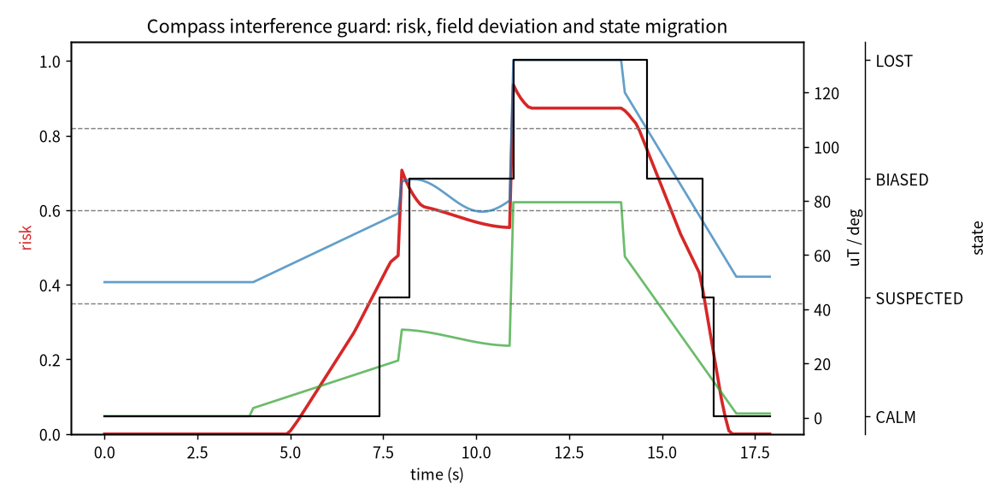

# 无人机磁罗盘外部干扰与航向漂移监测

本项目面向多旋翼无人机在钢筋建筑、高压输电线、金属屋顶、车辆附近或大电流 PWM 走线附近飞行时磁罗盘被外部硬磁/软磁材料或 EMI 干扰的情况。模块不依赖已知的绝对航向真值，只利用磁强计合模强度、磁航向与 GPS 航迹向（高速段可信）、VIO 航向的交叉一致性，以及电机电流突增，估计磁罗盘是否被污染并给出相应的融合建议。

与已有模块的区别：

- `uav_gps_integrity_monitor`（PR #1124）关注 GPS 卫星几何与定位完整性；
- `uav_neural_safety_filter` / `uav_neural_residual_control` 关注控制残差与执行层安全；
- 本模块专门关注**航向参考源本身**是否被磁干扰污染，属于姿态参考层的健康监测。

## 1. 干扰风险量化

磁强计合模强度偏离当地地磁场标称值（中国大部分地区约 \\(B_0=50\ \mu T\\)）的归一化偏差：

\\[
R_{field}=\mathrm{clip}_{[0,1]}\!\left(\frac{|B-B_0|-6}{18}\right)
\\]

磁航向与 GPS 航迹向的角度差（已绕回 \\([-180^\circ,180^\circ]\\)），仅在对地速度 \\(v>3\ \mathrm{m/s}\\) 时计入，因为悬停或慢飞时 GPS 航迹向本身不可信：

\\[
R_{gps}=\mathrm{clip}_{[0,1]}\!\left(\frac{|\Delta\psi_{mag-gps}|-8^\circ}{45^\circ}\right)
\\]

磁航向与 VIO 航向的差：

\\[
R_{vio}=\mathrm{clip}_{[0,1]}\!\left(\frac{|\Delta\psi_{mag-vio}|-10^\circ}{50^\circ}\right)
\\]

电机电流相对滑动均值的突增（PWM/动力线 EMI 的间接迹象）：

\\[
R_{cur}=\mathrm{clip}_{[0,1]}\!\left(\frac{I-\bar I_{ewma}-1.5}{4.0}\right)
\\]

低高度加权（近铁磁建筑/车辆）：

\\[
R_{alt}=\mathrm{clip}_{[0,1]}\!\left(\frac{15-h}{15}\right)
\\]

综合风险：

\\[
R=0.30R_{field}+0.30R_{gps}+0.20R_{vio}+0.10R_{cur}+0.10R_{alt}
\\]

硬阈值（任一触发即立即进入 `COMPASS_LOST`，不等待迟滞）：

- \\(B<10\ \mu T\\) 或 \\(B>120\ \mu T\\)；
- 磁航向与 GPS/VIO 航向差 \\(\ge 60^\circ\\)。

## 2. ROS 2 接口

| 话题 | 类型 | 方向 | 说明 |
|---|---|---|---|
| `/uav_compass/sample` | `std_msgs/String` | 输入 | 磁航向、GPS 航迹向、VIO 航向、磁模长、电机电流、对地速度、相对高度 |
| `/uav_compass/assessment` | `std_msgs/String` | 输出 | 综合风险、模长偏差、两路航向差、电流 EWMA、低空标志 |
| `/uav_compass/advice` | `std_msgs/String` | 输出 | 继续 / 监视磁罗盘 / 融合 GPS+VIO 航向 / 弃用磁罗盘 |

## 3. 构建与运行

```bash
source /opt/ros/humble/setup.bash
colcon build --symlink-install --packages-select uav_compass_interference_guard
source install/setup.bash
ros2 launch uav_compass_interference_guard main.launch.py duration:=20
```

CSV 默认写入 `/tmp/uav_compass_runtime.csv`。

## 4. 核心逻辑单元测试与确定性仿真

在无 ROS 2 的纯 Python 环境下运行 `python3 -m unittest tests.test_core`，11 项用例全部通过，覆盖：

- 角度差绕回 \\([-180^\circ,180^\circ]\\)；
- 干净输入保持 `CALM`；
- SUSPECTED 状态需要连续若干帧才翻转（迟滞）；
- GPS 航向差只在对地速度 \\(>3\ \mathrm{m/s}\\) 时计入；
- 持续航向偏差异步进入 `BIASED`；
- 磁模长越过硬限或航向差 \\(\ge 60^\circ\\) 立即进入 `COMPASS_LOST`；
- 低高度标志、非法输入、时间戳非递增、阈值反号等异常分支。

`scenario.py` 内置一段 18 秒循环的确定性场景，端到端跑出的状态迁移：

```text
CALM → SUSPECTED (7.4s) → BIASED (8.2s) → COMPASS_LOST (11.0s)
→ BIASED (14.6s) → SUSPECTED (16.1s) → CALM (16.4s)
```

故障段磁模长冲到 132 μT，磁航向与 GPS 航迹向差约 80°；远离后磁模长回到 65 μT 左右，航向差收敛到 13° 以内。

风险、磁模长、航向差与状态迁移曲线：



> 说明：`launch/`、`package.xml`、`setup.py` 按 ament_python 标准书写，依赖 `rclpy`/`std_msgs`/`launch_ros`；本次提交在无 ROS 2 Humble 的纯 Python 环境下完成核心逻辑与单元测试验证，未在 Ubuntu 22.04 虚拟机内执行 `colcon build`。

## 5. 限制

1. 输入由确定性仿真生成，未在真实机架上用铁磁物体实测标定。
2. \\(B_0=50\ \mu T\\) 是中国中东部地区典型值，高纬度或高磁异常带需重新标定。
3. 未区分硬磁干扰、软磁干扰和电机 EMI，三类被融合成同一风险分。
4. GPS 航迹向在转弯段本身会滞后，高速但大转弯时 \\(\Delta\psi\\) 会被高估。
5. 模块不直接切换飞控航向源，只输出建议。

## 6. 大模型使用声明

使用大模型辅助完成代码、测试和文档初稿；作者已逐项复核状态机、风险公式和仿真数据，并对提交内容负责。
