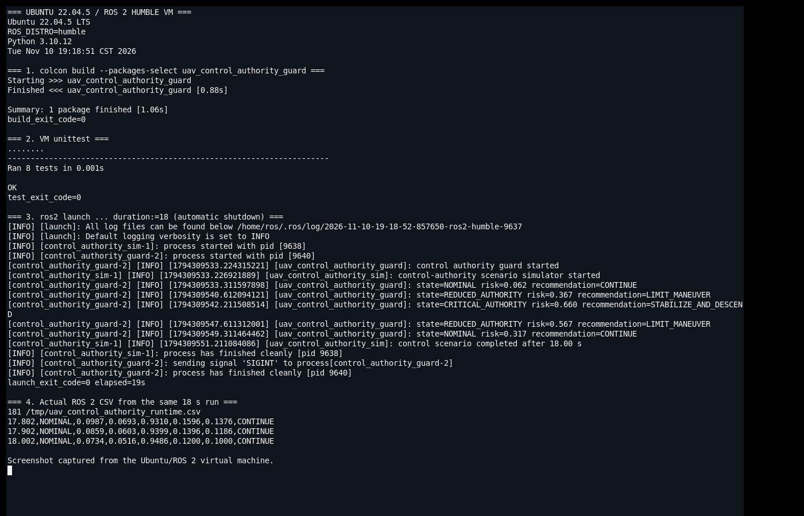
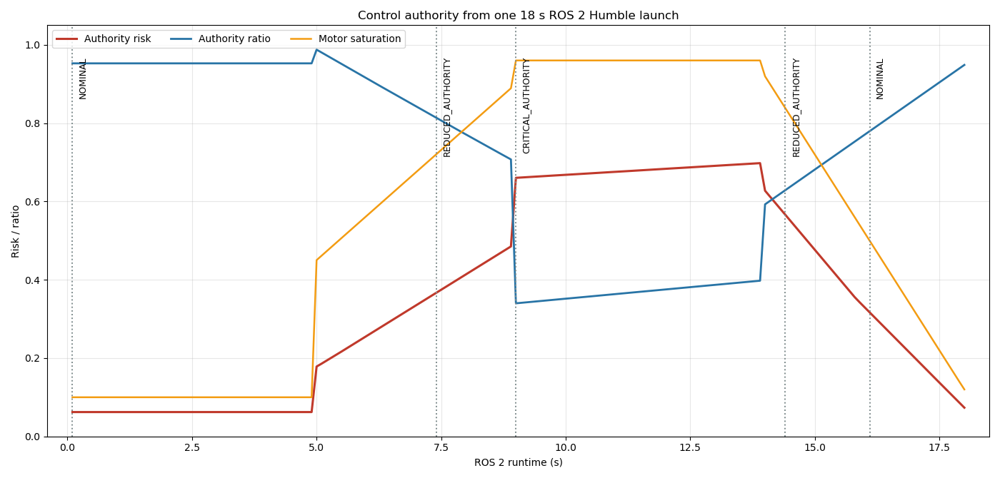

# 无人机控制权限饱和与积分饱和监测

本项目面向无人机在高机动、低电压或执行器受限时“指令发出但姿态跟不上”的问题。模块比较期望与实际滚转/俯仰角速度，并结合电机饱和比例、积分器幅值和单体最低电压，判断控制权限是否下降。

## 1. 风险模型

\[
R=0.36R_{\mathrm{error}}+0.29R_{\mathrm{saturation}}
+0.20R_{\mathrm{integral}}+0.15R_{\mathrm{voltage}}
\]

- 跟踪误差：期望与实际滚转/俯仰角速度向量的相对差；
- 饱和比例：电机输出接近上限的程度；
- 积分饱和：控制器积分项相对配置上限的占比；
- 电压下降：单体最低电压低于安全区间时的归一化风险。

状态迁移为：

```text
NOMINAL → REDUCED_AUTHORITY → SATURATION_RISK → CRITICAL_AUTHORITY
```

当电机饱和 ≥ 0.92 且跟踪误差或积分饱和明显时，可立即进入 `CRITICAL_AUTHORITY`。

## 2. ROS 2 接口

| 话题 | 类型 | 方向 | 说明 |
|---|---|---|---|
| `/uav_control/authority_sample` | `std_msgs/String` | 输入 | 期望/实际角速度、饱和、积分和电压 |
| `/uav_control/authority_assessment` | `std_msgs/String` | 输出 | 风险、权限比例和状态 |
| `/uav_control/authority_advice` | `std_msgs/String` | 输出 | 继续、限制机动、撤销机动或稳定下降 |

## 3. 构建与运行

```bash
source /opt/ros/humble/setup.bash
colcon build --symlink-install --packages-select uav_control_authority_guard
source install/setup.bash
ros2 launch uav_control_authority_guard main.launch.py duration:=18
```

CSV 默认写入 `/tmp/uav_control_authority_runtime.csv`。

当 `duration` 大于 0 时，模拟器结束会触发整个 launch 自动关闭；默认 `duration:=0.0` 表示持续运行，此时使用 `Ctrl+C` 手动停止。

## 4. Humble 虚拟机实测

Ubuntu 22.04.5 / ROS 2 Humble 下真实构建成功，VM 内 8 项 `unittest` 全部通过。`ros2 launch` 启动两个节点，运行 18 秒并记录 180 条状态。

实际状态迁移：

```text
NOMINAL → REDUCED_AUTHORITY → CRITICAL_AUTHORITY → REDUCED_AUTHORITY → NOMINAL
```

故障段控制风险达到约 0.66，电机饱和接近 0.96；恢复后控制权限比例回到 0.95 左右。

VM 内实际终端截图同时记录了 Ubuntu/ROS 版本、`colcon build`、8 项单元测试、两个节点启动、实际状态迁移和 CSV 尾部：



根据同一轮 CSV 生成的控制权限曲线：



## 5. 限制

1. 命令、响应和饱和数据均来自确定性仿真，没有接入真实飞控日志。
2. 角速度环带宽、执行器动态、机体惯量变化和风扰没有完整建模。
3. 积分器比例是配置估计值，不是从具体 PID 控制器内部直接读取。
4. 电压下降只作为风险因素，未实现电芯级故障诊断。
5. 输出不直接发送姿态、电机或降落命令，必须由飞控安全逻辑独立处理。

## 6. 大模型使用声明

使用 OpenAI Codex 辅助完成代码、测试、文档和运行图生成；作者已逐项复核代码、参数和结果，并对提交内容、数据真实性和后续维护负责。
