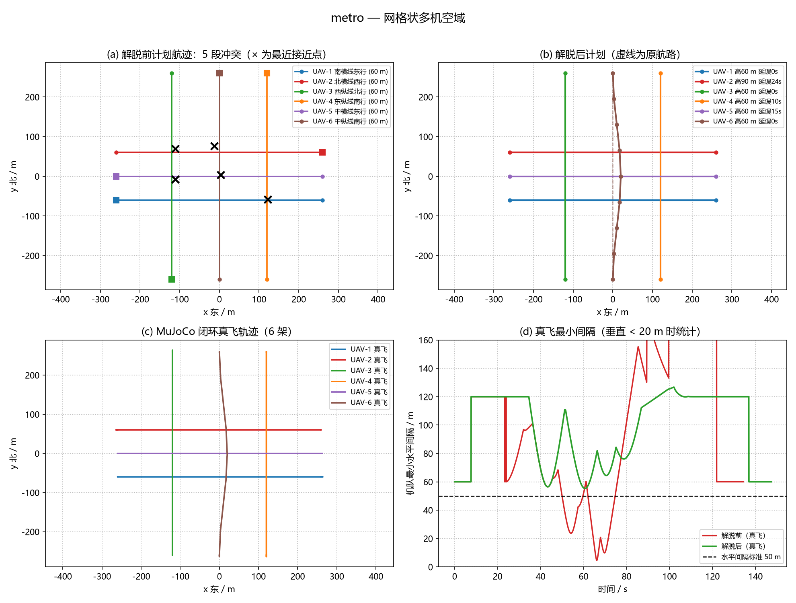
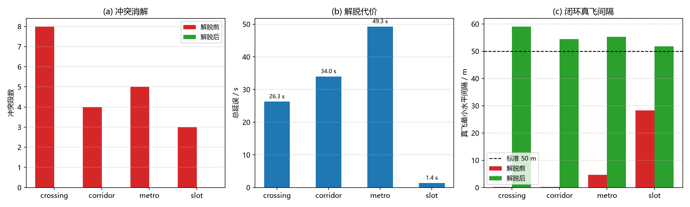

# 低空多机 4D 航迹冲突检测与解脱（MuJoCo 闭环验证）

## 1. 背景与定位

城市低空物流里，一次高峰时段会有十几架无人机在同一个空域里各飞各的
航路。航路在平面图上不相交并不代表安全——**还要看时间**：两架飞机先后
穿过同一个路口，间隔够；同时穿过，就是冲突。

已有的模块解决了这个问题的其它层面：

* `uav_mujoco_sim` 提供了单机 MuJoCo 物理仿真底座（本模块直接复用）；
* `uav_formation_flight` 研究编队**保持**；
* `no_fly_zone_check` 研究静态禁飞区。

本模块补的是**空域流量管理**这一层：输入一批"都要飞"的任务，输出一份
两两间隔达标的执行计划，并用 MuJoCo 真物理闭环证明它真的达标。

## 2. 问题模型

### 2.1 4D 航迹

一条任务由「二维航路点 + 巡航高度 + 起飞时刻」描述，运动分三段：

$$
\text{垂直爬升}\ (v_{climb})\ \rightarrow\ \text{沿折线平飞}\ (v)\ \rightarrow\ \text{垂直下降}
$$

每一段都是匀速直线运动，因此任意时刻 $t$ 的位置 $p(t)$ 是解析的；
两条航迹之间的相对运动在每个时间重叠区间内也是匀速直线。

### 2.2 圆柱间隔与冲突区间

低空运行使用**圆柱间隔**：水平间隔 $R_h$ 与垂直间隔 $R_v$ 必须**同时**
满足。在两条航迹的一对重叠航段内（起点时刻 $t_0$，相对初距 $\mathbf{d}_0$，
相对速度 $\mathbf{v}$），两个条件分别为：

$$
\|\mathbf{d}_{0,xy} + \mathbf{v}_{xy}\tau\| < R_h,\qquad
|d_{0,z} + v_z\tau| < R_v,\qquad \tau \in [0, T]
$$

第一个是二次不等式（闭式解），第二个是一次不等式，各自解出区间后求交，
即得到冲突时段 $[t_{start}, t_{end}]$ 与该时段内的最小水平/垂直间隔。
**全程没有采样步长**，结果可以与手算解析解逐位对照（见测试）。

### 2.3 解脱手段与代价

| 手段 | 做法 | 代价 |
| --- | --- | --- |
| 地面等待 | 推迟起飞时刻 | 延误 $\Delta t$ |
| 高度层调整 | 巡航高度 $\pm$15/30/45 m（限 30~120 m） | 额外爬升/下降时间 |
| 侧向绕行 | 航段叠加平滑 S 形横向偏移 | 额外航程 |

约定：`priority` 高的任务不让路（场景中 priority=10 的医疗急救机在
全部场景中未被延误一次）；同级任务起飞较晚者让（先到先得）。

算法是贪心的：每次取一个冲突，为让路机枚举全部候选动作，用**整队重新
检测**后的（冲突数，总代价）评分，只接受严格减少冲突数的动作，迭代至
无冲突。贪心不保证全局最优，但每一步可解释、可复现，且从不制造新的
冲突对。

### 2.4 侧向绕行为什么必须平滑

早期实现只在航段中点插一个折点。折点处航向在一帧内突变（metro 场景
实测 8.8°），几何控制器姿态回路被激励出 10 Hz 增幅振荡，整机翻转坠落，
跟踪误差发散到 $2\times10^5$ m。改为余弦剖面

$$
w(s) = \tfrac{1}{2}\left(1 - \cos 2\pi s\right),\quad s\in[0,1]
$$

后（两端为零、中点为设定偏移、两端斜率为零），同一场景的最大跟踪误差
回到 3 m。这是一个真实的工程教训：**解脱给出的航迹必须是可飞的**。

## 3. 仿真验证

闭环复飞使用课程底座 `uav_mujoco_sim`（同一份 `quadrotor.xml` 刚体模型
与几何控制器），每架飞机独立实例化，按解脱后的 4D 航迹飞行，记录刚体
积分出的真实位置再统计间隔。参考速度前馈经一阶低通（τ=0.5 s）——分段
航迹的速度阶跃会激励姿态回路，真实飞控同样有轨迹平滑器。



上图为 metro 场景（6 机网格空域）：(a) 解脱前计划与 5 段冲突的最近接近点；
(b) 解脱后计划（虚线为原航路）；(c) MuJoCo 闭环真飞轨迹；(d) 真飞最小
水平间隔时间曲线——红线多次跌破 50 m 标准线，绿线全程高于标准线。

## 4. 实测结果

间隔标准：水平 50 m / 垂直 20 m。「真飞最小间隔」来自 MuJoCo 刚体积分
的真实位置，不是计划值；「侵入采样」为 20 Hz 记录中同时侵入水平与垂直
间隔的点数。

| 场景 | 冲突(前→后) | 解脱动作 | 总延误 | 基线真飞最小间隔 | 解脱后真飞最小间隔 | 侵入采样 |
| --- | --- | --- | --- | --- | --- | --- |
| crossing 十字交叉+斜穿（5 机） | 8 → 0 | 高度×2 + 绕行×1 | 26.3 s（另有提前 24.0 s） | **0.17 m** | **59.1 m** | 1090 → 0 |
| corridor 走廊对头+追越（4 机） | 4 → 0 | 高度×1 + 等待×1 | 34.0 s | **0.24 m** | **54.5 m** | 618 → 0 |
| metro 网格多机（6 机） | 5 → 0 | 等待×2 + 绕行×1 + 高度×1 | 49.3 s | **4.66 m** | **55.3 m** | 767 → 0 |
| slot 固定时隙禁等待（3 机） | 3 → 0 | 绕行×2 | 1.4 s | **28.28 m** | **51.8 m** | 367 → 0 |

几点观察：

* **检测精度**：slot 场景基线真飞最小间隔 28.28 m，与解析值 28.28 m
  完全一致——分段线性航迹 + 几何控制器在巡航段的跟踪误差 ≤ 1 m；
* **解脱有效**：四个场景共 20 段冲突全部消解，闭环复飞侵入采样全部归零；
* **手段分工**：允许等待时优先用等待（最便宜）；`slot` 场景禁等待后
  自动切换为纯几何手段（高度层/绕行），说明代价模型在起作用；
* **代价合理**：医疗急救机从未被延误；高度层下压的飞机会提前到达，
  报告中单独计为"提前量"而不与延误相抵。



## 5. 复现步骤

```bash
# 依赖：Python ≥ 3.10, numpy, mujoco（pip install mujoco）,
#       同仓库 src/air/uav_mujoco_sim 仿真底座
cd src/air/uav_deconflict
python main.py                    # 全部场景 + 闭环复飞，约 3~4 分钟
python main.py --no-sim           # 仅算法层，秒级
python -m pytest test/ -q         # 32 项测试，约 3 s
python tools/make_figures.py      # 重新生成本页两张图（全部来自真实运行）
```

机读结果写入 `result_all.json`（含每个场景的逐机延误、动作清单与
真飞统计）。`ros2 run uav_deconflict monitor` 可启动在线间隔监视节点
（订阅各机 odom，发布最小间隔状态与最接近机对 Marker）。

## 6. 已知限制

* 圆柱间隔是简化模型：未建模机体尺寸、尾流、通信延迟与定位误差；
* 贪心消解不保证全局最优解；
* 未考虑风场与执行器降级；`slot` 场景的"禁等待"是人为设定的运行约束，
  用于演示无等待时的解脱能力；
* ROS 节点只做**监视与告警**，不在线修改航迹——线上改航迹需要空域
  管理方批准，这条边界是刻意保留的。

## 7. 作业信息

* 姓名：黄家欣　学号：2535030010
* 仿真器：MuJoCo（经课程底座 `uav_mujoco_sim`，模型与话题契约与其一致）
* 本作业使用大模型辅助编写代码与文档，全部运行结果由本机实测产生。
