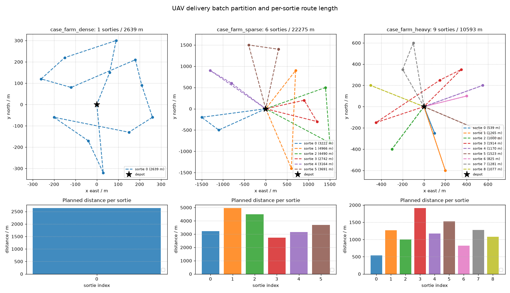

# 末端物流多站点配送与换电调度（MuJoCo 闭环验证）

## 1. 这个模块解决什么

一个配送中心 + 12 个农户收发站的末端配送：包裹重量差异大（0.4~2.3 kg），
无人机载重上限 2.5 kg、电池满电续航 18 min，站点最远 1.6 km。真正难的
不是"把 12 个点串起来"，而是三本账互相耦合：

* **载重**决定一趟能带几件；
* **电量**决定一趟能飞多远，而功率随载重线性变化（满载 85 W、空载 40 W）；
* **换电**只能在配送中心做，一次 90 s，架次切得越碎换电开销越大。

规划器必须同时把这三本账算在一起，否则会出现"载重允许但电量飞不回来"
的航迹，或者"为了省电切得稀碎、换电时间吃掉全部收益"的方案。

## 2. 怎么做的

核心三件事：**扇区分组定序 → 电量/载重双判据切架次 → 首架次真飞复核**。

| 环节 | 文件 | 做法 |
| --- | --- | --- |
| 能耗模型 | `core/energy.py` | `P = 40 W + 18 W/kg × m`；电池容量由"满载巡航 18 min"反推 91800 J；剩余电量 < 1.25 × 返航所需即换电 |
| 航线构造 | `core/planner.py` | 按方位角分 3 个扇区 → 簇内最近邻串接 → 2-opt 改进 → 逐站判断"装得下 & 飞得到"，否则封口回中心换电 |
| 方案校验 | `core/checker.py` | 逐架次查电量不超容量、任意时刻载重 ≤ 2.5 kg、每站恰好服务一次，输出违反清单 |
| 闭环复核 | `core/flyer.py` | 首个架次在 `uav_mujoco_sim` 真飞，统计刚体积分出的真实航程与到站误差 |
| 在线调度 | `ros/dispatch_node.py` | 薄壳节点，复用 `decide_next` 判定，JSON 发布下一目标站与换电时机 |

能耗随载重线性增长这一点是切批判据的核心：带满 2.5 kg 时功率是空载的
2.1 倍，所以"回程电量"必须按**当前载重**算，而不是按平均载重算。

## 3. 三个 case 的实测结果

固定坐标、可复现，`python main.py` 一次跑完（闭环墙钟合计约 38 s），
checker 违反清单全为空：

| case | 站点 | 架次 | 换电 | 计划总航程/m | 计划总时长/s |
| --- | --- | --- | --- | --- | --- |
| `case_farm_dense`（站近包裹轻） | 12 | 1 | 0 | 2638.95 | 533.22 |
| `case_farm_sparse`（0.8~1.6 km） | 12 | 6 | 5 | 22275.05 | 3165.01 |
| `case_farm_heavy`（5 件 2.2 kg+） | 12 | 9 | 8 | 10593.39 | 2137.04 |

heavy 场景里 5 件接近载重上限的重包裹各自占一个架次，其余轻包裹拼装，
所以架次数被"重件数"顶上去——这正是载重约束在起作用，不是规划器切碎了。

### 3.1 首架次真飞复核

| case | 计划航程/m | 仿真时长/s | 实际航程/m | 偏差 | 平均到站误差/m | 最大到站误差/m |
| --- | --- | --- | --- | --- | --- | --- |
| dense | 2638.95 | 535.72 | 2683.39 | +1.7% | 0.059 | 0.767 |
| sparse | 3221.58 | 400.45 | 3231.87 | +0.3% | 0.261 | 0.782 |
| heavy | 538.52 | 82.34 | 545.33 | +1.3% | 0.383 | 0.767 |

实际航程普遍比计划略长：几何控制器跟踪分段航迹存在微小超调与切角，
量级 0.3%~1.7%；到站误差全部在 0.8 m 以内，说明计划层的航程与能耗账目
和真实飞行是一致的，不是"纸面上算得漂亮"。

### 3.2 架次划分图

每个柱是一批，标了该架次的站点数与航程：



## 4. 复现

```bash
python main.py                      # 三个 case + MuJoCo 闭环（约 38 s）
python main.py --no-sim             # 仅算法层（秒级）
python main.py --case case_farm_heavy
python tools/make_figures.py        # 从 results/*.json 重新生成图片
python -m pytest test/ -q           # 25 项（含 3 项 MuJoCo 冒烟）
bash tools/ci_tests.sh              # CI 入口：无 mujoco 时冒烟用例自动跳过
ros2 run uav_delivery_route dispatch     # 在线调度节点
```

## 5. 已知限制

- 能耗是线性近似，只计载重对功率的一阶影响，未建模风速、温度与放电曲线；
  1.25 的返航安全系数吸收了一部分误差，长航线建议实测标定 `p_base_w`
  与 `load_coef_w_per_kg`；
- 换电点只在配送中心，未考虑分布式换电柜；
- 闭环只复飞每个 case 的第一个架次，其余架次仍是计划层结论；
- ROS 节点按单机编排，odom 与电量话题需外部仿真或真机提供（开发机无 ROS 2，
  节点未在 ROS 环境实跑，判定逻辑已下沉到 `core/` 并有单测覆盖）。

## 6. 与仓库已有模块的关系

`uav_mujoco_sim` 提供刚体底座与几何控制器；`uav_inspection_cover`（PR #802）
解决"巡检点怎么覆盖"，本模块解决"多站点包裹怎么分批、何时换电"，两者都是
路径规划但约束不同——前者是覆盖几何，后者是载重与电量的耦合优化。
