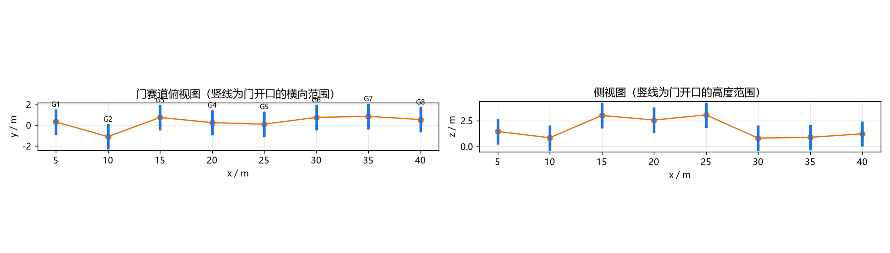
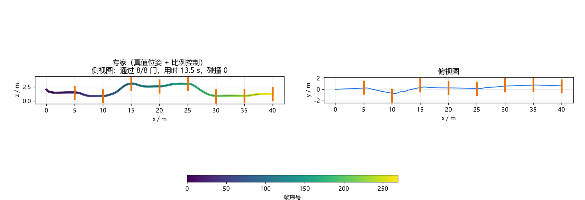
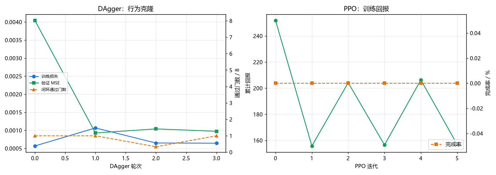
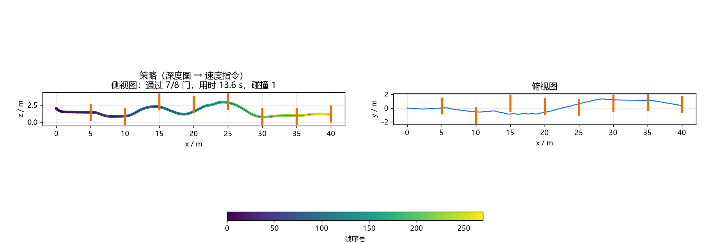
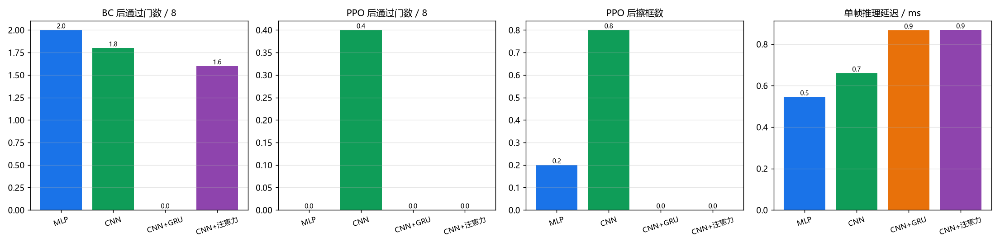
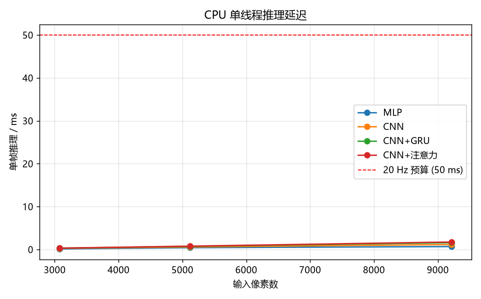

# 深度图端到端穿越门竞速

对应作业任务（4）**端到端模型**（输入图像、输出控制指令）。
对比实验②：**同一 RL 算法、不同网络结构**。

三段式"感知→规划→控制"的延迟放不下高速连续穿门。本模块把 48×64 的深度图
直接喂给网络，输出速度指令，中间没有手工特征、没有地图、没有路径搜索。
训练分两段：先用专家示范做 **DAgger**（策略自己飞，专家在它飞到的状态上纠错），
再用 **PPO** 在 MuJoCo 真动力学里继续优化。网络、反向传播、PPO、DAgger
全部纯 numpy 手写，不依赖 torch / stable-baselines3。

---

## 1. 模块定位

课程内已有的 `air_learning` 就是端到端视觉行为克隆，本模块在**五个维度**上与
它不同：

| 维度 | `air_learning` | 本模块 |
|---|---|---|
| 输入模态 | RGB 224×224 | 深度图 48×64 + 机体系速度 |
| 数据来源 | 人工遥操作一次性录制 | DAgger 在线聚合（策略跑、专家纠错）|
| 训练范式 | 纯监督 MSE | 行为克隆 + PPO 微调 |
| 任务 | 通用导航 | 竞速：连续穿越 8 道门，间距 5 m，开口 ±1.1 m |
| 框架 | torch | 纯 numpy（含手写卷积反向）|

与同为强化学习导航的 `uav_ppo_nav` 相比：

|  | `uav_ppo_nav` | 本模块 |
|---|---|---|
| 观测 | 22 维人工特征（16 线雷达直方图 + 目标相对位置 + 世界系速度）| **原始深度图** + 机体系速度 |
| 训练环境 | 质点 + 一阶滞后模型 | **MuJoCo 刚体动力学**（转子饱和、混控、姿态环）|
| 算法 | PPO | DAgger + PPO |
| 对比实验 | README 注明"见后续 PR" | 本模块即对比实验② |

---

## 2. 架构

```
深度图 48×64 ─┐
              ├─→ 主干(mlp/cnn/gru/attn) ─→ 128 维 ─┬─→ 策略头 μ ─→ tanh ─→ 动作 a
机体系速度 3  ─┘                                    └─→ 价值头 V
                                                            │
                              a（航向系速度）─→ 参考轨迹 ─→ 几何控制器 ─→ 四桨推力
```

四种主干共用同一套输入输出契约，只换中间结构（对比实验②）：

| arch | 主干 | 参数量 | 说明 |
|---|---|---|---|
| `mlp` | 深度图拉平 → 全连接 | 410756 | 无空间先验的基线 |
| `cnn` | 3 层 stride-2 卷积 → 展平 | 126684 | 有平移等变性 |
| `gru` | CNN → GRU(128) | 208860 | 带记忆，可抑制单帧噪声 |
| `attn` | CNN → 单头自注意力（32 维）| 130780 | 全局感受野（24 个 token）|

卷积主干**展平**而非全局平均池化：竞速需要门在画面中的位置，池化会抹掉空间
信息（实测池化版横向输出塌到 ±0.05 m/s）。

策略头输出高斯均值，标准差是**状态无关**的可学习参数；动作经 `tanh` 压到
[−1,1]，再按环境速度上限缩放。对数概率含 `tanh` 的雅可比修正
$\log p(a) = \log p_{\text{raw}}(r) - \log(1-a^2)$；缺这一项时动作长期贴边界。

---

## 3. 环境

| 项 | 值 |
|---|---|
| 场景 | `gate_track`：8 道门沿 +x 排开，间距 5 m，开口 2.2×2.2 m |
| 门心高度 | 0.8 ~ 3.0 m（相邻门高差最大 2.2 m）|
| 策略频率 | 20 Hz；控制器 100 Hz |
| 观测 | 深度图 48×64（u8，量程 0.2~12 m）+ 机体系速度 |
| 动作 | 航向系速度，水平 ±4 m/s、垂直 ±2 m/s |
| 奖励 | 前进速度 + 10×干净过门 − 0.01×能耗 − 0.05×动作变化 − 2×倾角 |

擦框不发奖励、也不额外扣分：`passed` 只数**干净穿过开口**的门，擦框时它不增加，
等于相对少拿 10 分。另设一项负奖励会重复扣。



### 3.1 动作语义为什么是"航向系"而不是"机体系"

底座的 `VelocityCommander` 用**实时全姿态**把机体系速度旋到世界系。这在
平缓轨迹上没问题，但竞速里机身为了前进本来就要俯仰 20~35°，映射会跟着转：

- 机身一倾斜，`R @ a` 就把前向指令的一部分旋到竖直轴上
- 参考点被拽向侧面，姿态环为了追上又倾得更多
- 正反馈，几个门下来直接翻转（实测倾斜到 170°、掉到 −1.5 km）

环境因此改用**参考航向** `R_z(yaw)` 做映射，把姿态从回路里摘出去。ROS 节点
里发布前先做 `v_body = Rᵀ · R_z(yaw) · a`，让底座的全姿态映射正好复原出
`R_z(yaw)·a`。

### 3.2 门通过判定

门是位于 `x = 5(i+1)` 的竖直矩形框。质心穿过该平面且落在开口内算通过，
否则记一次擦框。判定是几何的，不依赖感知——避免"感知对了但判定错了"污染奖励。

一次只结算一道门，无论成功还是擦框都推进门序：擦了框却不推进，下一步会因
"已越过平面"再记一次碰撞，一次失误记两笔。

### 3.3 奖励权重的量级

| 项 | 一轮的量级（270 帧 @3 m/s） |
|---|---|
| 前进奖励 × 系数 1.0 | +810 |
| 8 道门的奖励（系数 10） | +80 |
| 倾角惩罚（系数 2.0，巡航 20°） | −108 |

系数初值下，"直着飞不穿门"能拿 700 分，"穿齐 8 道门"才 780 分——PPO 没有
穿门的动机。改成前进 0.2、过门 50、倾角 0.5 之后：直飞 +100，全过门 +500。

---

## 4. 专家

赛道是一条沿 +x 排开的门序列，"走哪条路"没有搜索空间，所以专家不用 A*——
真正需要决策的是**怎么在门之间保持平飞并压住速度**。用航向系比例控制：

$$\mathbf{v}_{\text{cmd}} = \text{clip}\big(K \odot R_z(\text{yaw})^{\top}(T_{\text{aim}} - p),\ \pm v_{\max}\big)$$

瞄准点取门中心**再往前 2.5 m**（`look_ahead`）。这个值不是随便定的：相邻门
高差最大 2.2 m、间距 5 m，只有 1.7 s 去补偿。瞄准点 1.5 m 时无人机进门前才
开始补偿高度，实测平均擦框 1.25 次/轮；2.5 m 时 0 次。

专家只吃**真值位姿**（不吃深度图）：深度图留给策略学，专家给出"该怎么动"。
两者共用同一套动作语义，DAgger 的对齐前提。

实测（10 轮，起点抖动 0.6 m）：**8.00/8 门全过、0 擦框、13.49 s、完成率 100%**。

---

## 5. 训练

### 5.1 DAgger

纯行为克隆的问题在闭环里会放大：策略一旦偏离专家轨迹，就进入了训练集里没见过的
状态，误差随步数累积。DAgger 的做法是在策略自己的状态分布上持续向专家要标签：

```
π₀ ← 专家示范
for i in 1..N:
    用 πᵢ₋₁ 跑，并在每一步同时问专家该怎么做
    把新数据并进数据集
    πᵢ ← 在聚合数据上重训
```

聚合数据按"轮次越新权重越高"采样（`decay`）：早期专家轨迹的样本量会淹没
后几轮的纠错样本。

**采集策略轨迹不加探索噪声。** 初版直接按策略分布采样，`log_std_init=-0.5`
对应 σ=0.6（归一化尺度），折算成物理量是 **2.4 m/s** 的随机抖动——无人机出门
就被甩飞，采到的全是失控状态，第 1 轮后闭环掉到 0/8（第 0 轮 1.7/8）。
DAgger 用**策略自己的状态分布**，探索留给后面的 PPO。

**策略漂出专家包络时截断本轮采集。** 失控状态下的专家标签残差很大，而行为
克隆用的是 MSE（平方加权），几千条这种样本会把专家数据**反向压过去**：实测
不截断时三轮 DAgger 把闭环从 1.7/8 拖到 0/8，连专家分布上的验证 MSE 都从
0.00058 涨到 0.00835。截断条件取专家自己从不越过的边界（倾角 < 50°、
高度 > 0.4 m、|y| < 4 m）。

### 5.1.1 每轮的闭环评测

只看开环 MSE 会误判：训练/验证集都是专家数据时 MSE 一路降，策略可能已退化。
`run_dagger` 每轮跑一次闭环评测，把通过门数记进训练曲线。

### 5.2 损失

行为克隆用 **MSE**，不用 Huber：

Huber 在残差大于 $\delta$ 后退化成 L1，梯度是常数，回归目标变成条件**中位数**。
本任务里横向指令在 ±3 m/s 之间来回摆动（相邻门 y 差最大 1.4 m），中位数接近 0
——实测 Huber(δ=0.1) 把策略的横向输出压在 [−0.08, +0.08] m/s，专家是
[−2.8, +3.0]，闭环 3.7/8；换 MSE 后输出范围 [−0.34, +0.55]，闭环 5.0/8。

### 5.2.1 水平镜像增广

深度图左右翻转 + $v_y$ 取反是**严格成立**的样本：相机与机体左右对称、重力沿
$z$、专家律 $v_y = k(\text{目标}_y - p_y)$ 在 $y \to -y$ 下正好变号。增广把数据
翻倍，并固定"画面左 ↔ $+v_y$"的符号约定；不增广时左右两种情形各自从数据里学，
横向输出被压向中间。

验证集**先切再增广**：镜像件与原件是同一帧的两种视角，混进验证集会泄漏。

消融（同一份 2176 条专家数据、40 轮、同一批评测种子）：

| mirror | 验证 MSE | 开环 RMS($v_y$, $v_z$) | 横向输出范围 | 闭环 |
|---|---|---|---|---|
| 关 | 0.00475 | 0.235 / 0.121 | [−2.00, 2.68] | 4.2/8，擦框 3.8 |
| **开** | **0.00404** | **0.218 / 0.129** | [−2.04, 2.07] | **5.0/8**，擦框 3.0 |

### 5.3 PPO

裁剪式代理目标 + GAE。两处符号约定：

- $\partial \log p/\partial \mu = +(r-\mu)/\sigma^2$（高斯得分函数，符号为正）。
  写成负号会让更新把高回报动作的概率往下压——单测里奖励偏向 +1 的动作，
  10 轮 PPO 后策略输出收敛到 −1。
- 熵 $H = \log\sigma + \text{const}$，最大化熵是让 $\log\sigma$ **变大**。

---

## 6. 对比实验②：同一 PPO、不同网络结构

四种主干在完全相同的环境、超参、随机种子下各训一遍，比较：

| 指标 | 含义 |
|---|---|
| 参数量 | 网络规模 |
| BC 完成率 / 通过门数 | 纯行为克隆阶段（未加 PPO） |
| PPO 完成率 / 通过门数 | 加 PPO 之后 |
| 推理延迟 | 单帧前向耗时（20 Hz 要求 < 50 ms）|

---

## 7. 实测结果

平台：Windows 11 + Intel Core 5 220H（核显，无独显）。策略推理 0.7 ms/帧
（20 Hz 预算 50 ms，余量 70 倍）。ROS2 侧在 Ubuntu 20.04 + Humble 虚拟机中
`colcon build` 通过。

### 7.1 专家

10 轮、起点抖动 0.6 m：**8.00/8 门全过、0 擦框、13.49 s、完成率 100%**。
专家是策略的上界参照。



### 7.2 DAgger 没有跑赢"只做一轮行为克隆"

每轮都做闭环评测（通过门数 / 8）：

| | 第 0 轮后 | 第 1 轮后 | 第 2 轮后 | 第 3 轮后 | 专家分布上的验证 MSE |
|---|---|---|---|---|---|
| 不截断 | 1.7 | 0.0 | 0.0 | 0.3 | 0.00058 → 0.00620 → 0.00835 |
| 加漂移截断 | 1.7 | 0.3 | 0.0 | 0.7 | 0.00073 → 0.00167 → 0.00110 |
| 加漂移截断（复跑） | 1.0 | 1.0 | 0.3 | 1.0 | 0.00093 → 0.00104 → 0.00097 |

两次独立的截断跑都停在 1 门上下，说明这不是噪声——**DAgger 在这里确实没有
正收益**。

两个观察：

* **不截断时，加进去的策略样本会把专家拟合一起拖坏**（验证 MSE 涨 14 倍）。
  策略跑飞后的状态残差很大，MSE 又是平方加权，几千条这种样本压过了专家数据。
  加漂移截断后验证 MSE 稳住了（0.0007~0.0017），新增样本数也从 2000 掉到
  1486 → 673 → 189——后几轮策略一出门就出包络，几乎采不到新数据。
* **闭环始终没有超过第 0 轮**。瓶颈在第 0 轮的行为克隆本身（抖动 1.0 m
  时 1.7/8），不在 DAgger。



### 7.3 最终策略

起点条件对成绩影响很大，两种都报：

| 条件 | 通过门数 | 用时 | 擦框 | 推理延迟 |
|---|---|---|---|---|
| 无起点抖动（seed 0） | **7/8** | 13.6 s | 1 | 0.69 ms |
| 起点抖动 0.6 m，10 轮平均 | 3.1/8 | — | 0.90 | 0.69 ms |
| 专家（上界） | 8.0/8 | 13.5 s | 0 | — |

无抖动那一轮，策略用时与专家只差 0.1 s——**速度不是瓶颈，鲁棒性才是**。
下图就是这一轮：横向压在 ±1 m 内，高度跟着门走，只在第 2 道门擦了一下框。



起点一偏到 0.6 m，平均就掉到 3.1/8。**精度预算**：门半宽 1.1 m、间距 5 m、
巡航 3 m/s，每个门只有 1.67 s 修正时间。横向速度误差 RMS 0.22（归一化）=
0.88 m/s，在一个门距内累积 1.47 m，**超过门半宽**。稳定过关需把横向 RMS
压到 0.6 m/s 以下，是现在精度的 1.5 倍。

**数据量是当前唯一的瓶颈。** 训练数据从 8 轮示范（2176 帧）加到 30 轮
（约 8100 帧），抖动 0.6 m 下的平均通过门数从 1.8 涨到 3.1，擦框下降，趋势
未到平台。训练集 MSE 0.0006，比验证 MSE 低一个数量级，瓶颈在**泛化**：
相邻帧只差 0.05 s，一条轨迹里独立场景只有两位数，不足以训练 48×64 卷积网络。

PPO 在这点预算下帮不上忙：6 × 1024 步约 6100 帧，训练回报一路从 251.8 掉到
156.9。要让它起作用需要几十倍的在策略采样量。

### 7.4 对比实验②：同一 PPO、不同网络结构

2176 条专家演示只采一次，四个结构在同一份数据、同一套超参（BC 40 轮 MSE +
镜像、PPO 6 × 1024 步）、同一个种子下各训一遍，评测 5 轮、起点抖动 1.0 m：

| 结构 | 参数量 | 推理延迟 | BC 通过门数 | BC 擦框 | PPO 通过门数 | PPO 擦框 |
|---|---|---|---|---|---|---|
| MLP（拉平） | 410756 | 0.55 ms | 2.00 | 1.00 | 0.00 | 0.20 |
| **CNN** | 126684 | 0.66 ms | 1.80 | 1.20 | **0.40** | 0.80 |
| CNN+GRU | 208860 | 0.87 ms | 0.00 | 0.00 | 0.00 | 0.00 |
| CNN+注意力 | 130780 | 0.87 ms | 1.60 | 1.40 | 0.00 | 0.00 |

能读出来的：

* **参数量与成绩不成比例。** MLP 用 3.2 倍于 CNN 的参数拿到相近（甚至略好）
  的行为克隆成绩，但推理更快——48×64 的深度图拉平后只有 3075 维，卷积在这里
  没有体现出优势。
* **CNN+GRU 完全没学出来**（0 门）。行为克隆按**帧**打乱训练，每帧的隐状态都是
  零；闭环里隐状态却是一路累积下来的。训练与推理喂给 GRU 的隐状态分布不一致，
  且回合越长差得越远。要修就得按**定长片段**切数据、片段内隐状态连续（VIO 前端
  就是这么做的），本模块没做。
* **PPO 在这点预算下没有正收益。** 6 × 1024 步（约 6100 帧）对 PPO 来说太少，
  四个结构里三个被它拖低。要让它起作用需要几十倍的在策略采样量。
* 四种结构的推理延迟都在 1 ms 以内，20 Hz 的 50 ms 预算完全用不满。





---

## 8. 源码解析

```
uav_depth_gate_racing_e2e/core/
├── nn.py         手写 Conv2d / Linear / GRUCell / SelfAttention / LayerNorm / Adam
├── gate_env.py   竞速环境（深度图观测、航向系动作、门通过判定）
├── expert.py     比例控制专家
├── policy.py     四种主干 + 高斯策略头 + 价值头
├── bc.py         行为克隆（MSE / Huber）
├── dagger.py     轮次加权聚合的 DAgger
└── ppo.py        GAE + 裁剪代理目标 + tanh 雅可比
```

### 8.1 `nn.py`：im2col 的维度顺序

`as_strided` 的维度顺序与 reshape 的目标一致。顺序不一致时 reshape 按内存序
重新分组；此时前向与反向仍互为转置、数值梯度校验通过，只有伴随恒等式
$\langle A, \text{col2im}(B)\rangle = \langle \text{im2col}(A), B\rangle$
能发现（单测含这一项）。

### 8.2 混控饱和会吃掉姿态控制

`mixer` 的力矩预算是 $\min(4T_{\max}-T,\ T)$：期望总推力 $T$ 顶到 $4T_{\max}$
时预算归零，四个桨都满转、没有任何差动余量，姿态控制彻底消失。

几何控制器的位置增益 $k_p=-16$ 只需要 0.6 m 的位置误差就能把期望推力算到
上限——实测竞速场景里 $|f|$ 峰值 **2269 N，是上限 24 N 的 95 倍**，全程
**54.5% 的控制步力矩预算不足 5%**，姿态不可控。

修法是给控制器加输出限幅（`GeometricController.thrust_alloc = 0.7`），
等比缩小期望推力矢量而不是逐个 clip。加上之后专家从 0/8 变成 8/8。

### 8.3 观测里的深度图非空

`GateRacingEnv` 早期沿用底座的 `headless` 开关（底座里是"不渲染视觉传感器"，
对键盘遥控/规划适用）。训练全用 `--headless` 时策略吃到**全零图**，退化成
"照平均速度平飞"——横向输出 ±0.05 m/s，而训练损失还在下降。现在环境永远
渲染，自检加了"深度图非空"一项（形状断言拦不住）。

### 8.4 `ppo.py`：熵项的符号与高斯得分函数

两处符号写反时训练照常进行、更新方向相反：

* $\partial \log p/\partial \mu = +(r-\mu)/\sigma^2$（高斯对数密度的得分函数，
  符号为**正**）。写成负号的意思是"降低高回报动作的概率"——单测里奖励偏向
  $+1$ 的动作，10 轮 PPO 后策略输出收敛到 $-1$。
* 熵 $H = \log\sigma + \text{const}$，最大化熵是让 $\log\sigma$ **变大**。

这两处不靠肉眼看，靠两个单测：`test_ppo_pushes_toward_high_reward_action`
（回报只与动作有关的赌博机，PPO 必须把动作推向高回报侧）和
`test_entropy_raises_log_std`（两份逐位相同的策略、同一批数据，只差
`entropy_coef`，$\log\sigma$ 的差必须为正）。

### 8.5 整网梯度的验证方式

扰动 $10^{-5}$ 会让几千个 ReLU 里的某几个跨过折点，每次翻转对数值梯度的
贡献与真实梯度**同量级**：实测 $\text{corr}(g, n) = 0.72$、逐元素比值落在
$-136$ 到 $+8$ 之间，真梯度和噪声混在一起，怎么调容差都验不出问题。

所以逐元素的数值梯度只在**层一级**做（Conv2d / GRU / 自注意力三个测试，
外加 im2col 的伴随恒等式）；整网用**下降量**验——沿解析梯度走一步，损失
下降量应与 $\eta\|g\|^2$ 同量级（实测只有 0.25 倍，折点噪声吃掉七成，
所以带宽放到 0.05~5 倍）。这一步抓得住符号写反与量级写错。

### 8.6 出图路径的动作尺度

策略输出是 `tanh` 的 [−1,1]，要乘上速度上限才是物理指令。`plotting._rollout`
早期漏了这一步，把 [−1,1] 直接喂给环境——无人机以四分之一速度飞，出图看着
"通过 4/8、超时收场"，像是策略不行，实际是**出图路径的错**。同一份权重在
评测里是 7/8、13.6 s。评测与出图走的是两套调用，只测一套不够。

### 8.7 `resize_area` 的缩放方式

深度图先按米做面积平均再量化，不是先量化再缩放：量化是 1/254 的定点，先量化
会把远处的细节直接抹平。无效像素不参与平均，按有效像素数加权——否则空洞会把
周围的有效深度拉浅。放大时退回最近邻：分箱宽度不足一个源像素，箱内计数会
取到 0，除零出 NaN。

---

## 9. 已知限制

- 策略频率 20 Hz、控制器 100 Hz。深度图 48×64 是训练速度与空间分辨率的折中。
- 专家只吃真值位姿，上界为"干净通过全部门"。
- 单精度不参与训练：全部用 float64 numpy，CPU 推理约 0.7 ms/帧，余量很大。
- 奖励里没有惩罚"绕路"，前进速度本身就给正奖励，所以策略可能学会"贴着门框
  蹭过去"——擦框拿不到 +10 是唯一的约束。要做严格竞速应该按时间给奖励。
