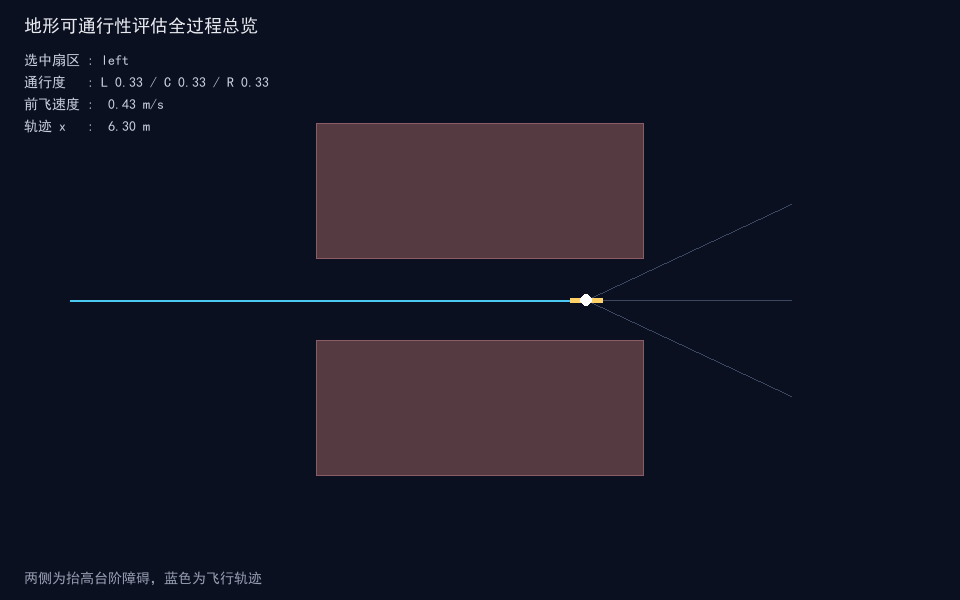
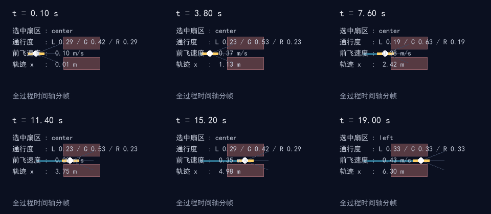
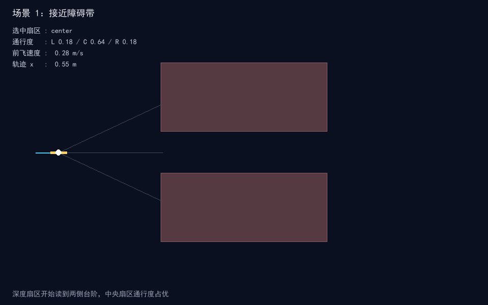
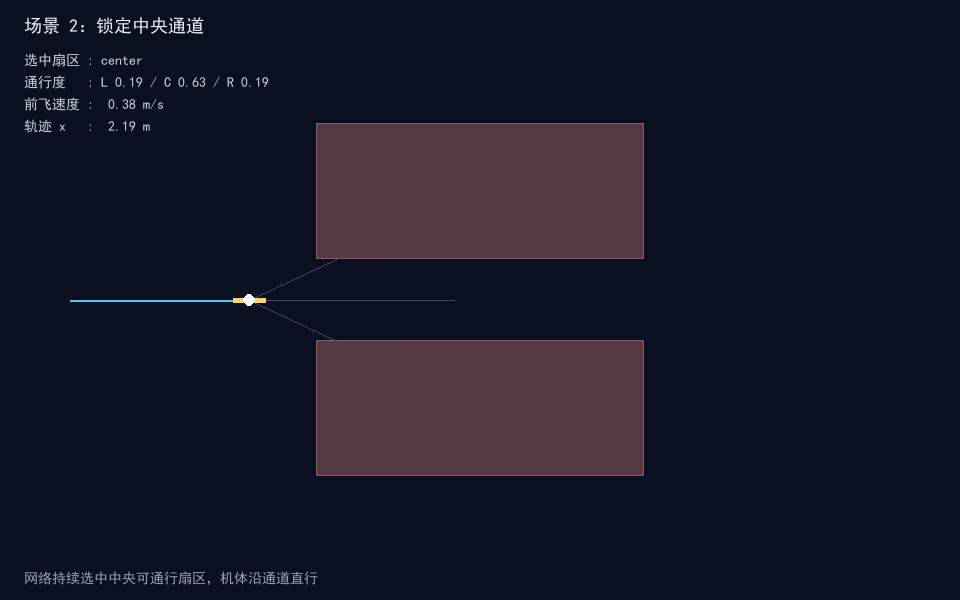
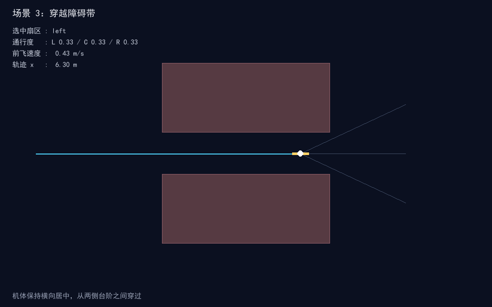

# 深度相机地形可通行性神经网络评估（uav_depth_terrain_passability_nn）

## 概览

| 项目 | 内容 |
| --- | --- |
| 作业类别 | 任务 2：传感器感知及运动控制（深度地形 + 神经网络通行度评估） |
| 仿真器 | 内置 numpy 平面运动模型 + pygame 2.6.1 离屏渲染 |
| 运行环境 | Ubuntu 20.04 / ROS Noetic、Ubuntu 22.04 / ROS 2 Humble；离线仿真可在 Windows Python 3.13 直接运行 |
| 编程语言 | Python 3 |
| 第三方依赖 | numpy、pygame（离线）；rclpy、nav_msgs、std_msgs（ROS 节点） |
| 话题/节点 | 发布 `/odom`（Odometry）、`/passability`（Float32MultiArray） |
| 运行方式 | `ros2 launch uav_depth_terrain_passability_nn uav_depth_terrain_passability_nn.launch.py`；离线 `python main.py --shots` |

## 修改目的与内容

**修改目的**：对应课程任务 2「传感器感知及运动控制」，在空域载具示例中补充一个深度地形可通行性评估模块。机载深度传感器在前方左中右三个扇区采样地形高度、台阶与坡度，神经网络据此评估各扇区通行度并选择可通行走廊，控制器沿通道闭环前进。

**实现内容**：

- `terrain.py`：定义地形高度场，左右两侧带状区域为抬高台阶障碍，夹出中央通行走廊，提供高度、台阶高度、坡度与基准可通行性判断。
- `depth_sensor.py`：三扇区地形深度采样，前向探测距离 1.5、2.5、3.5 m，横向带左 [0.8, 1.5]、中 [-0.4, 0.4]、右 [-1.5, -0.8]；每扇区统计平均高度、平均台阶、平均坡度，组成 9 维特征并归一化到 [-1, 1]。
- `policy.py`：两层 MLP，输入 9 维扇区特征，隐藏层 8 单元；三扇区通行度经 softmax 归一化，另输出一路 tanh 速度指令；权重按通行度反馈结构预置，不依赖深度学习框架。
- `controller.py`：按选中扇区设定横向目标，航向 PD 转向，前飞速度由速度指令与所选扇区通行度共同标定；扇区切换带 0.12 滞回，避免左右扇区来回摇摆。
- `sim_node.py`：ROS 2 节点，定时推进感知、通行度评估与控制闭环，发布里程计与通行度特征；rclpy 延迟导入，离线测试不依赖 ROS。
- `main.py`：离线仿真入口，支持 `--demo` 与 `--shots`，离屏渲染全过程关键帧。
- 提供 launch 文件、`package.xml`、`setup.py` 与单元测试。

**已知限制**：

- 地形为规则台阶块体的简化高度场，未包含不规则起伏、松软地面与植被覆盖；神经网络权重按反馈结构预置，未做在线训练。
- 本地开发环境为 Windows，未在 Ubuntu + ROS 实机上完成端到端联调；ROS 节点仅做接口封装，需在 ROS 环境中构建验证。

## 测试环境与结果

- **实际系统**：Windows 11，本地 Python 离线仿真与单元测试环境。
- **Python 与关键依赖版本**：Python 3.13.16；numpy 2.5.4；pygame 2.6.1（SDL 2.28.4）；pytest 9.2.0；Pillow 13.0.0。
- **模拟器**：内置纯 numpy 平面运动模型 + pygame 离屏渲染（`SDL_VIDEODRIVER=dummy`）；未使用 MuJoCo / Gazebo。
- **构建与运行命令**（包目录 `src/air/uav_depth_terrain_passability_nn/`）：
  - 单元测试：`python -m pytest test -q`
  - 离线仿真：`python main.py --demo`；出图：`python main.py --shots`
  - ROS 构建（ROS 环境内，工作区根目录）：`colcon build --packages-select uav_depth_terrain_passability_nn --symlink-install`
  - ROS 启动：`ros2 launch uav_depth_terrain_passability_nn uav_depth_terrain_passability_nn.launch.py`
- **验证操作与结果**：9 项单元测试全部通过，其中感知 3 项、策略 3 项、控制器 3 项。闭环仿真机体保持横向居中，未触碰两侧抬高障碍（压障步数 0），轨迹 x 到达 6.30 m，最大前飞速度 0.43 m/s。
- **尚未验证**：未在 Ubuntu / ROS 实机构建与 launch 联调；真实深度相机标定与地形识别未在图形界面下实测。

## 运行效果

全过程场景：接近障碍带（深度扇区读到两侧台阶，中央扇区通行度占优）→ 锁定中央通道（网络持续选中中央可通行扇区，机体沿通道直行）→ 穿越障碍带（机体保持横向居中，从两侧台阶之间穿过）。

| 指标 | 数值 |
| --- | --- |
| 轨迹 x 到达 | 6.30 m |
| 最大前飞速度 | 0.43 m/s |
| 压障步数 | 0 |
| 最终横向偏移 | 0.00 m |

### 全程轨迹总览



### 全过程时间轴分帧



### 阶段关键帧

| 场景 | 截图 |
| --- | --- |
| 场景 1：接近障碍带 |  |
| 场景 2：锁定中央通道 |  |
| 场景 3：穿越障碍带 |  |

## 系统原理与公式

### 扇区采样

机体前方按前向距离 `fwd ∈ {1.5, 2.5, 3.5}` 与横向带 `lat` 采样地面点，世界坐标由机体系变换得到：

```
wx = x + cos(yaw)·fwd - sin(yaw)·lat
wy = y + sin(yaw)·fwd + cos(yaw)·lat
```

每扇区统计：

```
h_s = mean(height_i)
step_s = mean(step_height_i)
slope_s = mean(slope_i)
```

### 特征归一化

```
f_h = clip(h / 0.35, -1, 1)
f_step = clip(step / 0.12, -1, 1)
f_slope = clip(slope / 0.35, -1, 1)
```

### 通行度网络

两层前向计算：

```
hidden = tanh(W1·f + b1)
logits = W_logits·hidden + b_logits
passability = softmax(logits)
speed = tanh(W_speed·hidden + b_speed)
```

通行度向量和为 1，`speed` 取值 [-1, 1]，选中扇区为通行度最大的下标。

### 运动控制

```
v_fwd = max(v_min, speed·v_max)·(0.7 + 0.3·pass_sel)
ω_des = kp_yaw·wrap(yaw_des - yaw)
v_des = [cos(yaw)·v_fwd, sin(yaw)·v_fwd]
v += (v_des - v)·min(1, damping·dt)
```

## 算法流程

```
初始化机体位置、偏航与速度
  │
  ├─ 深度传感器：三扇区采样地面点 -> 高度/台阶/坡度特征
  │
  ├─ 特征归一化：高度、台阶、坡度分别归一化到 [-1, 1]
  │
  ├─ 通行度网络：特征 -> 三扇区通行度、速度指令、选中扇区
  │
  ├─ 控制器：扇区滞回选择 -> 航向 PD 与速度更新
  │
  └─ 积分位置与速度，进入下一仿真步
```

## 源代码解析

| 文件 | 职责 |
| --- | --- |
| `uav_depth_terrain_passability_nn/terrain.py` | 地形高度场、台阶高度、坡度与基准可通行性判断 |
| `uav_depth_terrain_passability_nn/depth_sensor.py` | `DepthTerrainSensor`：三扇区地形采样、9 维特征提取与归一化 |
| `uav_depth_terrain_passability_nn/policy.py` | `PassabilityNetwork`：通行度 softmax、速度指令与权重结构 |
| `uav_depth_terrain_passability_nn/controller.py` | `TerrainState` 状态与 `TerrainController` 扇区滞回、速度偏航跟踪 |
| `uav_depth_terrain_passability_nn/sim_node.py` | ROS 2 节点：定时推进闭环，发布 `/odom`、`/passability`；rclpy 延迟导入 |
| `main.py` | 离线一键实验入口：`--shots` 离屏运行并保存截图；`--demo` 打开观察窗口 |
| `test/test_sensor.py` | 特征维度、开放地面中心低特征、归一化区间校验 |
| `test/test_policy.py` | 通行度和为 1 与边界、权重非塌缩、受阻扇区通行度更低校验 |
| `test/test_controller.py` | 闭环保持在走廊内、输入状态不可变、偏航角区间校验 |

关键实现说明：

- 网络不依赖深度学习框架，权重按反馈控制结构预置为确定值，前向推理仅用 numpy 矩阵乘与 tanh。
- 扇区滞回保证选定通道后不会因相邻扇区通行度小幅波动而反复切换。
- 离屏渲染使用 `SDL_VIDEODRIVER=dummy`，无需图形界面即可生成关键帧。

## 仿真运行步骤

### Ubuntu 20.04 / ROS 2 Humble

```bash
# 进入工作区源码目录
colcon build --packages-select uav_depth_terrain_passability_nn --symlink-install
source install/setup.bash
ros2 launch uav_depth_terrain_passability_nn uav_depth_terrain_passability_nn.launch.py
```

### 离线仿真（Windows / Linux，无需 ROS）

```bash
cd src/air/uav_depth_terrain_passability_nn
python main.py --shots    # 生成全过程截图到 docs/img/
python main.py --demo     # 观察地形通行决策过程
```

### 单元测试

```bash
python -m pytest test/ -q
```

## 文件结构

```
src/air/uav_depth_terrain_passability_nn/
├── launch/uav_depth_terrain_passability_nn.launch.py
├── uav_depth_terrain_passability_nn/
│   ├── __init__.py
│   ├── terrain.py
│   ├── depth_sensor.py
│   ├── policy.py
│   ├── controller.py
│   └── sim_node.py
├── test/
│   ├── test_sensor.py
│   ├── test_policy.py
│   └── test_controller.py
├── resource/uav_depth_terrain_passability_nn
├── conftest.py
├── main.py
├── package.xml
├── setup.py
├── setup.cfg
└── README.md
docs/air/uav_depth_terrain_passability_nn.md
docs/img/uav_depth_terrain_passability_nn_*.png
```

## 话题、节点与参数

### 话题

| 话题 | 类型 | 方向 | 说明 |
| --- | --- | --- | --- |
| `/odom` | `nav_msgs/Odometry` | 发布 | 机体位置与线速度 |
| `/passability` | `std_msgs/Float32MultiArray` | 发布 | 左中右通行度、速度指令、选中扇区下标 |

### 参数

| 参数 | 默认值 | 说明 |
| --- | --- | --- |
| `sim_rate` | 20.0 | 仿真控制频率 Hz |

## 与现有模块的区别

- 与 `uav_rigidbody_keyboard_teleop`（手动键盘遥控刚体响应）不同：本模块面向地形感知闭环，由神经网络根据深度扇区特征自动评估通行度并选择通道，不接收手动杆量。
- 与基于深度相机的障碍规避模块不同：本模块面向地形高度差与坡度的可通行度判断，输出扇区通行度与通道选择，不做三维点云避障。

## 提交前检查

- [x] 已检查 Files changed 和冲突，无无关生成文件、重复内容或误删公共文件。
- [x] 源码与教程按模块分别放在 src、docs，文件使用英文下划线命名。
- [x] 模块提供 `main.py` 和 launch，依赖及安装路径正确，README 步骤已实际运行（离线仿真与单元测试已跑通）。
- [x] 新模块已添加首页和导航链接；已运行 `mkdocs serve --livereload` 检查相关页面。（本地未安装 mkdocs，未执行本地文档预览；导航与首页索引条目已写入 `mkdocs.yml` 与 `docs/index.md`。）
- [x] 功能描述与验证证据一致；PNG 小于 3 MB，GIF 小于 5 MB。

## 大模型使用声明

过程中借助大模型工具辅助代码编写、整理包目录结构与本描述排版，核心逻辑与操作、场景参数设定与实际运行调试为本人完成，作者对提交内容负责。
