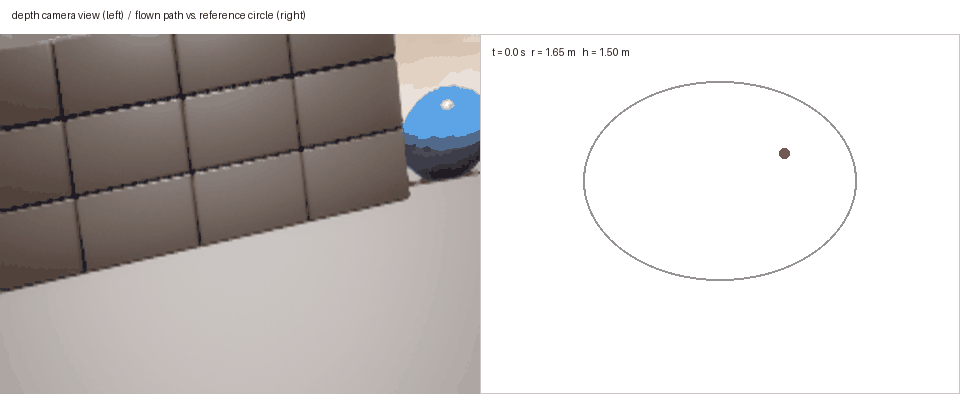
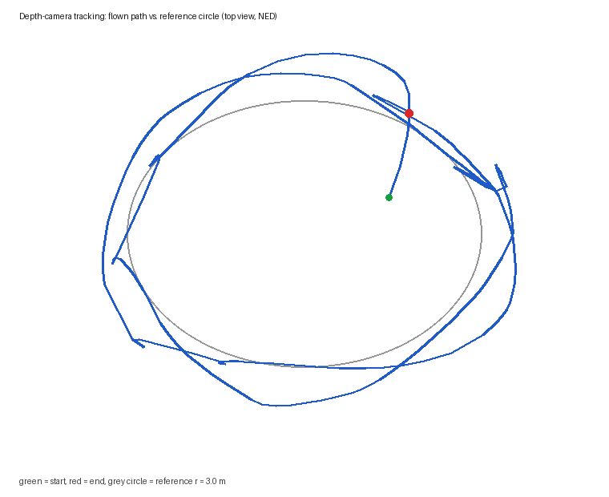

# 无人机深度相机感知与给定轨迹跟踪（CNN 行为克隆）

本模块对应作业任务 2：**使用传感器获取的数据进行感知，并对机器人进行给定轨迹的运动控制**。
传感器为机载深度相机，被控对象为 OpenHUTB / AirSim 中的多旋翼无人机，
控制算法为卷积神经网络 `TrackNet`，运行在 ROS 2 Humble 上，入口为 `main.py`。



左半屏是机载相机实时画面，右半屏是当前飞行轨迹与半径 3 m 的参考圆。

## 1 模块概述

任务分解成三个可独立运行的节点：

| 节点 | 可执行文件 | 作用 |
| --- | --- | --- |
| `airsim_source` | `airsim_source` | 连接 AirSim，发布 `/uav/image`、`/uav/depth`、`/uav/pose`，接收 `/uav/cmd_vel` 并下发给仿真器 |
| `uav_depth_collect` | `collect` | 专家演示采集：按给定圆轨迹飞行，同时把深度图与控制量配对落盘 |
| `uav_depth_track` | `main` | 推理：深度图 + 参考偏差 → 神经网络 → 速度指令 |

与任务 1、任务 3、任务 4 的模块互不依赖，可以单独 `colcon build`、单独 `ros2 launch`。

## 2 运行环境

* 操作系统：Ubuntu 22.04（VirtualBox 虚拟机）
* ROS 2：Humble
* Python：3.10
* 依赖：`numpy`、`opencv-python`、`torch`（CPU 即可）
* 仿真器：OpenHUTB 2.10.0 / AirSim Blocks（Windows 宿主机），RPC 端口 `8080`

虚拟机的 NAT 网段里，宿主机地址是 `10.0.2.2`。

## 3 编译与运行步骤

编译：

```bash
cd ~/ros2
colcon build --packages-select uav_depth_track_nn
source install/setup.bash
```

### 3.1 采集演示数据

```bash
ros2 launch uav_depth_track_nn collect.launch.py airsim_port:=8080 vehicle_name:=drone1
```

节点会自动调用 `/uav/takeoff` 起飞到 1.5 m，然后沿半径 3 m、高度 2.5 m 的圆飞两圈，
采集完成后自动调用 `/uav/land` 并退出。数据保存在
`~/.ros/uav_depth_track_nn/data/`：`frames/*.png`（16 位毫米深度图）与 `controls.csv`。

### 3.2 训练

```bash
python3 -m uav_depth_track_nn.train --epochs 60 --batch-size 16
```

输出 `model.pth`、`metrics.json`、`loss_curve.png` 到 `~/.ros/uav_depth_track_nn/model/`。

### 3.3 闭环跟踪

```bash
ros2 launch uav_depth_track_nn main.launch.py airsim_port:=8080 vehicle_name:=drone1
```

起飞同样由 `/uav/takeoff` 触发（`ros2 service call /uav/takeoff std_srvs/srv/Trigger`），
起飞后网络以 10 Hz 输出速度指令，无人机沿参考圆飞行。

## 4 参数说明

`config/params.yaml` 按节点分段：

| 参数 | 默认值 | 说明 |
| --- | --- | --- |
| `radius` | 3.0 | 参考圆半径（m） |
| `height` | 2.5 | 参考高度（m，NED 下取负） |
| `lookahead_angle` | 0.55 | 前视相位（rad） |
| `image_size` | 64 | 网络输入边长 |
| `max_depth` | 40.0 | 深度截断（m），用于滤掉天空的 1e4 |
| `stabilizer_gain` | 0.0 | 可选几何兜底项增益（默认关闭，见 5.4） |
| `max_speed` | 2.0 | 合速度上限（m/s） |
| `laps` | 2.0 | 采集圈数 |

## 5 算法原理

### 5.1 参考轨迹

给定轨迹是圆心 $C=(0,0)$、半径 $R$、高度 $h$ 的圆。无人机当前位置 $(x,y)$ 相对圆心的极角

$$
\theta = \operatorname{atan2}(y - C_y,\; x - C_x)
$$

参考点取在极角前方 $\Delta\psi$ 处：

$$
p_{\text{ref}} = \left(C_x + R\cos(\theta + \Delta\psi),\;\; C_y + R\sin(\theta + \Delta\psi)\right)
$$

用**瞬时极角**而不是累加角度，可以避免无人机经过圆心时 $\theta$ 跳变 $\pi$ 导致参考点瞬移到圆的另一侧。

### 5.2 网络输入

网络同时接收图像与参考偏差。偏差在机体坐标系下计算：

$$
\begin{bmatrix} d_x \\ d_y \end{bmatrix}
= R_z(-\psi)^{\top}
\begin{bmatrix} p_{\text{ref},x} - x \\ p_{\text{ref},y} - y \end{bmatrix}
$$

其中 $\psi$ 为偏航角。四个标量特征为

$$
f = \left[\frac{d_x}{5},\; \frac{d_y}{5},\; \sin e,\; \cos e\right],\qquad
e = \operatorname{atan2}(d_y, d_x)
$$

### 5.3 网络结构

`TrackNet` 由两个分支组成：

* 图像分支：$64\times64$ 深度图 → Conv(16) → Pool → Conv(32) → Pool → Conv(64) → Pool → 展平 4096 → Linear(128)
* 标量分支：4 维特征直接拼接

两支拼接成 132 维，经 `Linear(132→64)` → ReLU → `Linear(64→2)` 输出 $(v_x, v_y)$。
卷积输出尺寸按

$$
H_{\text{out}} = \left\lfloor \frac{H_{\text{in}} + 2p - k}{s} \right\rfloor + 1
$$

逐层收缩，总参数量 556,354。

### 5.4 控制律

$$
\begin{aligned}
(v_x, v_y) &= \operatorname{clip}\left(\pi_\theta(I, f),\; v_{\max}\right)\\
v_z &= \operatorname{clip}\left(k_h(-h - z),\; -0.5,\; 0.5\right)\\
\pi_\theta(I, f) &= \hat{\boldsymbol v} + g\cdot 5\,(f_1, f_2),\quad g=\texttt{stabilizer\_gain}=0
\end{aligned}
$$

采集端写进 CSV 的训练标签是**专家的完整动作** $\boldsymbol a=(v_x,v_y)$，所以推理端必须
直接使用网络输出 $\hat{\boldsymbol v}$；如果再把同一条几何参考律加回去，专家动作就被算了
两遍——这正是第一版实现的错误，已在本版删掉 `max_residual` 并把 `stabilizer_gain`
默认置 0。保留 $g$ 这个参数只是为了换场景时能临时打开几何兜底，
正常运行不要打开。

$\operatorname{clip}(\cdot, v_{\max})$ 为按合速度等比缩放：当 $\|\hat{\boldsymbol v}\|>v_{\max}$ 时
整体乘以 $v_{\max}/\|\hat{\boldsymbol v}\|$，保留方向不变。

### 5.5 训练目标

行为克隆，最小化专家动作与网络输出的均方误差：

$$
\mathcal{L} = \frac{1}{N}\sum_{i=1}^{N}\left\|\hat v_i - v_i^{\star}\right\|^2
$$

优化器 Adam，学习率 $10^{-3}$，数据按 8:1:1 划分，保存验证集最优权重。

## 6 源代码解析

| 文件 | 关键内容 |
| --- | --- |
| `uav_depth_track_nn/model.py` | `TrackNet` 定义、`preprocess_depth`、`track_features`、`reference_point` |
| `uav_depth_track_nn/collect.py` | 专家控制律、5 Hz 落盘、飞满 `laps` 自动降落 |
| `uav_depth_track_nn/train.py` | 数据集、训练循环、`metrics.json`、不依赖 matplotlib 的曲线绘制 |
| `uav_depth_track_nn/main.py` | 10 Hz 推理定时器、深度超时保护、速度发布 |
| `uav_depth_track_nn/airsim_source.py` | AirSim 桥：位置设定点控制、起飞/降落服务 |

深度图预处理：

```python
def preprocess_depth(depth, image_size=64, max_depth=40.0):
    depth = np.clip(depth, 0.0, max_depth) / max_depth
    ...
```

AirSim 的深度图里天空是 `1e4` 量级，不截断会让归一化后的有效信息被压成一个点。

## 7 运行效果验证



灰圈为半径 3 m 的参考圆，蓝线为实际航迹，绿点为起点、红点为终点。
无人机从圆心起飞后快速贴到圆上，随后绕圆飞行 2.35 圈。

## 8 本机实测结果

| 指标 | 数值 |
| --- | --- |
| 采集样本 | 555 帧（5 Hz，2.35 圈） |
| 网络参数量 | 556,354 |
| 训练耗时 | 67.3 s（CPU，60 epoch） |
| 测试 MSE | 0.0124 (m/s)² |
| 测试 MAE | 0.0716 m/s |
| 半径均值 | 3.55 m（参考 3.0 m） |
| 半径 RMSE | 0.750 m |
| 高度均值 / RMSE | 2.58 m / 0.314 m |
| 指令频率 | 10 Hz（550 条 / 55 s） |

半径存在约 0.36 m 的系统性外偏，原因是位置设定点始终领先于飞机当前位置，
转弯时实际航迹会落在参考圆外侧。若需要更紧的跟踪，可减小 `max_speed` 或 `lookahead_angle` 后重新采集。

## 9 已知限制

* 只用了一个场景（AirSim Blocks），未做跨场景泛化测试。
* 训练样本 555 帧，规模较小：同一份数据上 CNN 的测试 MAE 约 0.25 m/s（见 `uav_bc_bench`），
  闭环里 0.75 m 的半径 RMSE 主要来自位置设定点超前带来的系统性外偏，不是感知误差主导。
* 深度相机与参考偏差同时输入，网络本身不承担完整的端到端映射；
  纯图像端到端的版本见任务 4 的 `uav_vision_nn`。

## 附：仿真端配置（`settings.json`）

宿主机 `%USERPROFILE%/Documents/AirSim/settings.json` 需与模块参数对齐，否则会出现
「连上了但拿不到图像 / 找不到载具」：

```json
{
  "SettingsVersion": 1.2,
  "SimMode": "Multirotor",
  "ApiServerPort": 8080,
  "Vehicles": {
    "drone1": {
      "VehicleType": "SimpleFlight",
      "AutoCreate": true,
      "Armed": false,
      "Cameras": {
        "fpv":   { "X": 0.3, "Y": 0, "Z": -0.2, "Pitch": 0, "Roll": 0, "FOV": 90,
                   "CaptureSettings": [{ "ImageType": 0, "Width": 320, "Height": 240 }] },
        "depth": { "X": 0.3, "Y": 0, "Z": -0.2, "Pitch": 0, "Roll": 0, "FOV": 90,
                   "CaptureSettings": [{ "ImageType": 1, "Width": 320, "Height": 240 }] }
      }
    }
  }
}
```

要点：

- `ApiServerPort` 必须与 `airsim_port` 一致（本机为 `8080`；模块默认值 `41451` 是 AirSim 官方默认端口）；
- 载具名 `drone1` 要和 `vehicle_name` 参数一致；`z` 为 NED 向下为正，地面约 `+0.68`；
- `ImageType: 0` 是彩色图，`1` 是深度图；
- 相机名必须等于模块的 `camera_name` 参数（本模块为 `depth`），否则 `simGetImages` 返回空。
