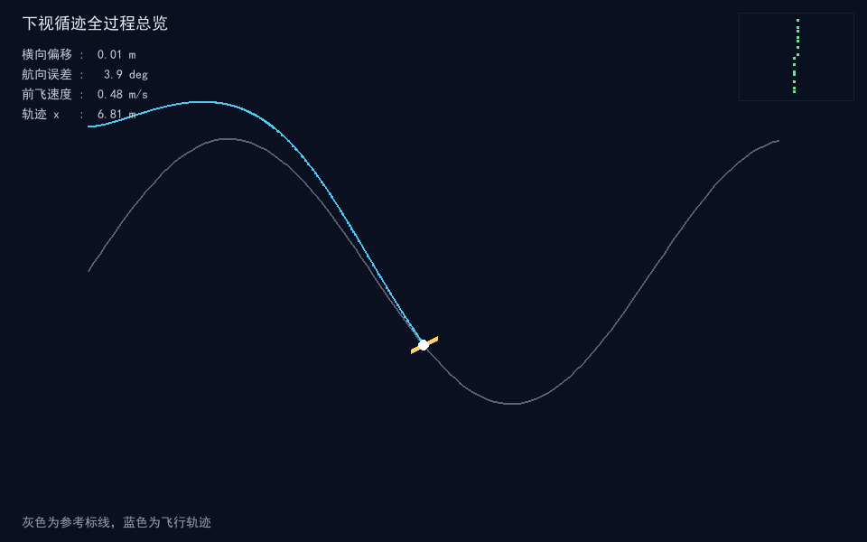
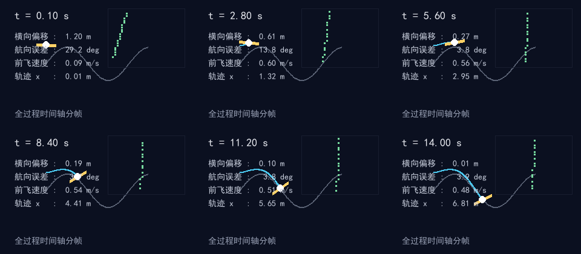
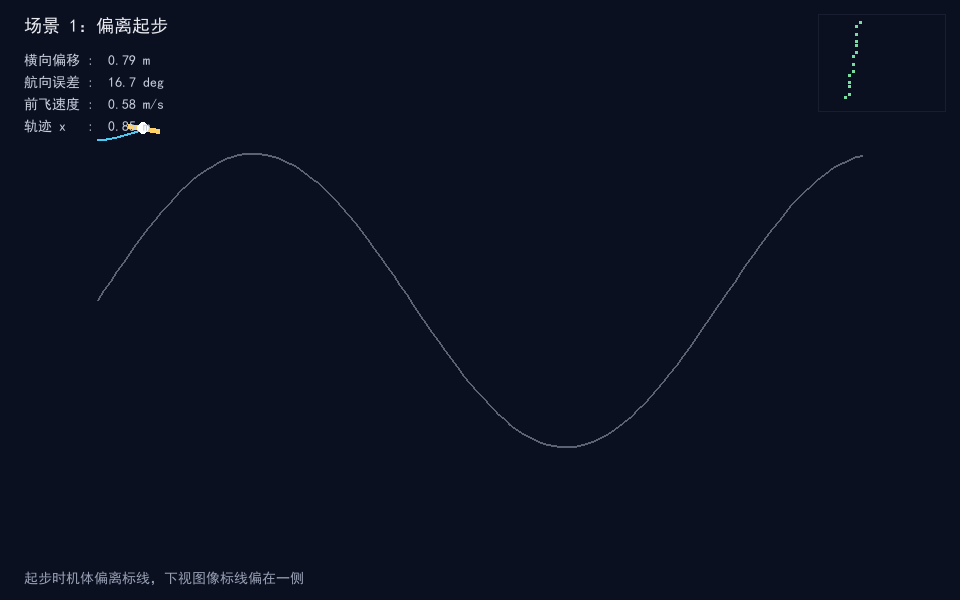
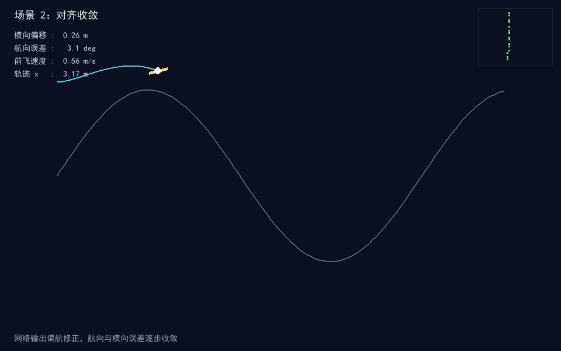
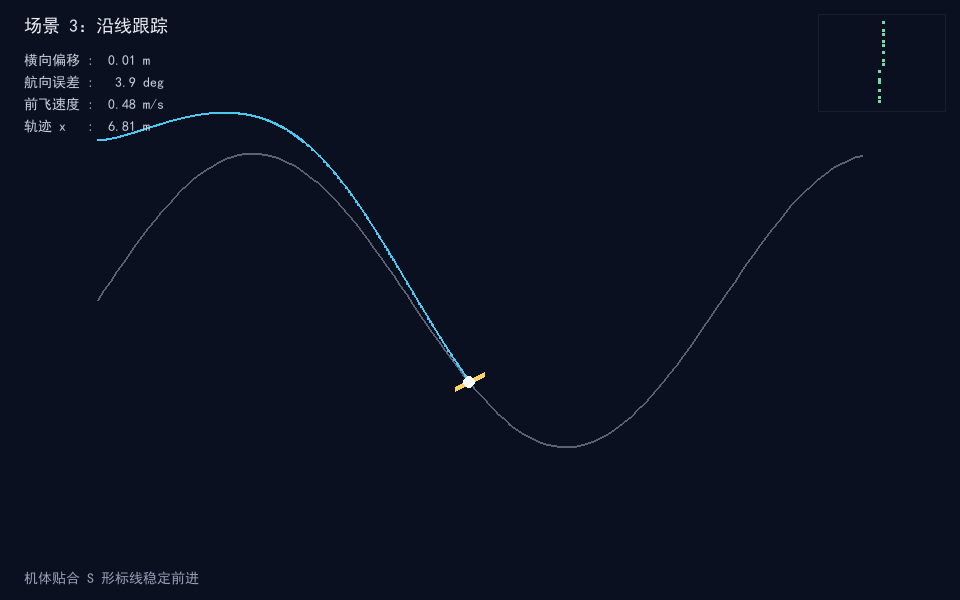

# 下视摄像头神经网络标线循迹仿真（uav_downview_centerline_track_nn）

## 概览

| 项目 | 内容 |
| --- | --- |
| 作业类别 | 任务 2：传感器感知及运动控制（下视视觉 + 结构化 MLP 策略） |
| 仿真器 | 内置 numpy 平面运动模型 + pygame 2.6.1 离屏渲染 |
| 运行环境 | Ubuntu 22.04 / ROS 2 Humble（仓库只有 ROS 2 包）；离线仿真可在 Windows Python 3.13 直接运行 |
| 编程语言 | Python 3 |
| 第三方依赖 | numpy、pygame（离线）；rclpy、nav_msgs、std_msgs（ROS 节点） |
| 话题/节点 | 发布 `/odom`（Odometry）、`/perception`（Float32MultiArray） |
| 运行方式 | `ros2 launch uav_downview_centerline_track_nn uav_downview_centerline_track_nn.launch.py`；`ros2 run uav_downview_centerline_track_nn track_node`；离线 `python main.py --shots` |

## 修改目的与内容

**修改目的**：对应课程任务 2「传感器感知及运动控制」，在空域载具示例中补充一个下视摄像头视觉循迹模块，演示机载下视图像如何提取标线偏移与航向误差，再由策略网络输出前飞与偏航指令，闭环跟踪地面参考标线。

**实现内容**：

- `track.py`：地面 S 形参考标线曲线 `y = 1.1·sin(0.55x)`，提供标线横向坐标、斜率、切线航向角与横向误差基准。
- `perception.py`：下视相机几何投影，把标线采样点投影到 32×24 二值图像网格，在机体系 `fwd/left` 坐标上提取横向偏移（窗口均值）、航向误差（`atan` 拟合斜率）与丢失标志。
- `policy.py`：两层多层感知机（输入 3，隐藏层 8，输出 2），隐藏层与输出层 tanh 激活，输出前飞指令与偏航指令；权重按反馈结构预置为确定值。
- `controller.py`：把策略指令换算成速度与偏航角速度，叠加切线航向 P 保持（无微分项）。
- `track_node.py`：ROS 2 节点，定时推进感知、策略与控制闭环，发布里程计与感知特征；rclpy 延迟导入，离线测试不依赖 ROS。
- `main.py`：离线仿真入口，支持 `--demo` 与 `--shots`，离屏渲染全过程关键帧；指标统计（最大/末端横向误差、后期 RMS、最大速度、x 到达）在此实现。
- 提供 launch 文件、`package.xml`、`setup.py`（安装 launch 目录）、`setup.cfg`（`script_dir`/`install_scripts` 指向 `lib/<pkg>/`）与 9 项单元测试。

**已知限制**：见下文「已知限制与后续工作」一节，逐条对应评测中提出的方法问题与接口缺口。

## 测试环境与结果

- **实际系统**：Windows 11，本地 Python 离线仿真与单元测试环境。
- **Python 与关键依赖版本**：Python 3.13.16；numpy 2.5.4；pygame 2.6.1（SDL 2.28.4）；pytest 9.2.0；Pillow 13.0.0。
- **模拟器**：内置纯 numpy 平面运动模型 + pygame 离屏渲染（`SDL_VIDEODRIVER=dummy`）；未使用 MuJoCo / Gazebo。
- **构建与运行命令**（包目录 `src/air/uav_downview_centerline_track_nn/`）：
  - 单元测试：`python -m pytest test -q`
  - 离线仿真：`python main.py --demo`；出图：`python main.py --shots`
  - ROS 构建（ROS 环境内，工作区根目录）：`colcon build --packages-select uav_downview_centerline_track_nn --symlink-install`
  - ROS 启动：`ros2 launch uav_downview_centerline_track_nn uav_downview_centerline_track_nn.launch.py`，`ros2 run uav_downview_centerline_track_nn track_node`
- **验证操作与结果**：9 项单元测试全部通过（感知 3、策略 3、控制器 3）；闭环仿真 14 s、50 Hz 共 700 步，起步横向偏差 1.20 m，收敛后末端横向偏差 0.012 m，后期横向误差 RMS 0.241 m，最大前飞速度 0.60 m/s，轨迹 x 到达 6.82 m。
- **指标口径**：`max_abs_lateral` 取全程 700 步的最大绝对值（含起步瞬时偏差）；`final_lateral` 为第 700 步的横向误差；`rms_lateral_late` 取 t ≥ 3 s 的 550 个样本做均方根；速度取 700 步的最大值。
- **尚未验证**：未在 Ubuntu / ROS 2 环境完成 `colcon build` 后的 launch 联调；实时图像识别与真实相机标定未在图形界面下实测。

## 运行效果

全过程场景：偏离起步（机体位于标线左侧 1.2 m）→ 对齐收敛（网络输出偏航修正，航向与横向误差逐步收敛）→ 沿线跟踪（机体贴合 S 形标线稳定前进）。

| 指标 | 数值 | 口径 |
| --- | --- | --- |
| 起步最大横向偏差 | 1.20 m | 全程绝对值最大值 |
| 收敛后末端横向偏差 | 0.012 m | 第 700 步 |
| 后期横向误差 RMS | 0.241 m | t ≥ 3 s，550 个样本 |
| 最大前飞速度 | 0.60 m/s | 700 步最大值 |
| 轨迹 x 到达 | 6.82 m | 14 s 末 |

观察到无人机起步时标线偏在下视图像一侧，网络持续输出回正偏航，横向误差逐步缩小，随后贴合标线沿曲线前进。

### 全程轨迹总览



### 全过程时间轴分帧



### 阶段关键帧

| 场景 | 截图 |
| --- | --- |
| 场景 1：偏离起步 |  |
| 场景 2：对齐收敛 |  |
| 场景 3：沿线跟踪 |  |

## 系统原理与公式

### 坐标变换

机体相对世界系的偏航角为 `yaw`，世界系点相对机体的前向与左向坐标为：

```
fwd = cos(yaw)·dx + sin(yaw)·dy
left = -sin(yaw)·dx + cos(yaw)·dy
```

其中 `dx, dy` 为世界系下标线点相对机体的位置差。

### 感知特征

在相机视场内收集标线样本点，横向偏移取样本左向坐标均值：

```
offset = mean(left_i),  fwd ∈ [-0.15, 0.85] m,  left ∈ [-1.30, 1.30] m
```

对线样本拟合 `left = a·fwd + b`，标线在机体系的航向误差为：

```
heading = atan(a)
```

特征归一化：

```
f = [clip(offset/0.5, -1, 1), clip(heading/0.6, -1, 1), clip(speed/1.2, -1, 1)]
```

样本不足两点判为丢失（`lost=True`），特征按 `offset = 0, heading = 0` 输出。

### 策略网络

两层 MLP 前向计算：

```
h = tanh(W1·f + b1)
u = tanh(W2·h + b2)
```

输出 `u = [v_cmd, yaw_cmd]`，分别为前飞指令与偏航指令，取值 `[-1, 1]`。

权重为结构化预置：`W1` 只保留 3 个独立通道（两个隐藏单元复制偏移、两个复制航向、一个复制速度），`W2` 只连接其中 3 个隐藏单元，前飞基础偏置 0.45。因此该网络实际等价于「线性映射 + tanh」，未经过任何训练。

### 运动控制

策略指令转换为前飞速度与偏航角速度，期望速度沿机体航向分解：

```
v_fwd = max(v_min, v_cmd · v_max)
ω_des = kp_t·(tangent - yaw) + 0.5·yaw_cmd·ω_max
v_des = [cos(yaw)·v_fwd, sin(yaw)·v_fwd]
v += (v_des - v)·min(1, damping·dt)
```

其中 `kp_t` 为切线航向比例增益，只有 P 项，没有微分项。

## 算法流程

```
初始化机体位置、偏航与速度
  │
  ├─ 下视相机：标线世界点 -> 机体坐标 -> 二值图像网格
  │
  ├─ 特征提取：横向偏移、航向误差、速度归一化
  │
  ├─ 策略网络：特征 -> 前飞指令、偏航指令
  │
  ├─ 控制器：指令 -> 速度与偏航更新，切线航向 P 保持
  │
  └─ 积分位置与速度，进入下一仿真步
```

## 源代码解析

| 文件 | 职责 |
| --- | --- |
| `uav_downview_centerline_track_nn/track.py` | S 形参考标线曲线，横向坐标、斜率、切线航向角；`lateral_error` 供离线指标统计使用，控制回路未调用 |
| `uav_downview_centerline_track_nn/perception.py` | `DownviewCamera`：相机投影、二值图像网格、偏移与航向误差提取、特征归一化 |
| `uav_downview_centerline_track_nn/policy.py` | `TrackPolicyNetwork`：两层 MLP 前向推理与结构化权重 |
| `uav_downview_centerline_track_nn/controller.py` | `TrackState` 状态与 `TrackController` 速度偏航跟踪内环 |
| `uav_downview_centerline_track_nn/track_node.py` | ROS 2 节点：定时推进闭环，发布 `/odom`、`/perception`；rclpy 延迟导入 |
| `main.py` | 离线一键实验入口：`--shots` 离屏运行并保存截图；`--demo` 打开观察窗口；闭环指标统计 |
| `test/test_perception.py` | 在线偏移接近零、偏移符号、归一化区间校验 |
| `test/test_policy.py` | 输出形状与边界、权重非塌缩、偏航反馈符号校验 |
| `test/test_controller.py` | 闭环横向误差收敛、输入状态不可变、偏航角区间校验 |

关键实现说明：

- 网络不依赖深度学习框架，权重按反馈控制结构预置为确定值，前向推理仅用 numpy 矩阵乘与 tanh。
- 内环切线航向 P 负责沿曲线航向保持，网络偏航输出负责回正标线偏差。
- 离屏渲染使用 `SDL_VIDEODRIVER=dummy`，无需图形界面即可生成关键帧。

## 仿真运行步骤

### Ubuntu 22.04 / ROS 2 Humble

```bash
# 工作区根目录
colcon build --packages-select uav_downview_centerline_track_nn --symlink-install
source install/setup.bash
ros2 launch uav_downview_centerline_track_nn uav_downview_centerline_track_nn.launch.py
# 或直接起节点
ros2 run uav_downview_centerline_track_nn track_node
# 覆盖控制频率
ros2 launch uav_downview_centerline_track_nn uav_downview_centerline_track_nn.launch.py sim_rate:=20.0
```

### 离线仿真（Windows / Linux，无需 ROS）

```bash
cd src/air/uav_downview_centerline_track_nn
python main.py --shots    # 生成全过程截图到 docs/img/
python main.py --demo     # 观察下视循迹过程
```

### 单元测试

```bash
python -m pytest test/ -q
```

## 文件结构

```
src/air/uav_downview_centerline_track_nn/
├── launch/uav_downview_centerline_track_nn.launch.py
├── uav_downview_centerline_track_nn/
│   ├── __init__.py
│   ├── track.py
│   ├── perception.py
│   ├── policy.py
│   ├── controller.py
│   └── track_node.py
├── test/
│   ├── test_perception.py
│   ├── test_policy.py
│   └── test_controller.py
├── resource/uav_downview_centerline_track_nn
├── conftest.py
├── main.py
├── package.xml
├── setup.py
├── setup.cfg
└── README.md
docs/air/uav_downview_centerline_track_nn.md
docs/img/uav_downview_centerline_track_nn_*.png
```

## 话题、节点与参数

### 话题

| 话题 | 类型 | 方向 | 说明 |
| --- | --- | --- | --- |
| `/odom` | `nav_msgs/Odometry` | 发布 | 机体位置与线速度；当前只填 `pose.position` 与 `twist`，`header.frame_id = odom`，`child_frame_id` 未赋值，`orientation` 保持单位四元数（转弯时不变），未发布 TF |
| `/perception` | `std_msgs/Float32MultiArray` | 发布 | 横向偏移、航向误差、前飞速度 |

### 参数

| 参数 | 默认值 | 说明 |
| --- | --- | --- |
| `sim_rate` | 50.0 | 仿真控制频率 Hz；launch 通过 `LaunchConfiguration` 透传，可用 `sim_rate:=` 覆盖 |

## 已知限制与后续工作

| # | 限制 | 现状与影响 | 后续方向 |
| --- | --- | --- | --- |
| 1 | 感知未使用图像像素 | `observe()` 用解析真值标线 `reference_y` 采样后投影，`image` 只是样本点的渲染结果，换成噪声不影响控制输出 | 从二值网格逐列取质心，拟合直线后反解偏移/航向，让图像真正进入回路 |
| 2 | 偏移取窗口均值 | S 形远端曲率把均值拉向 0，近端已偏出中心时读数偏小 | 取 `fwd ≈ 0` 处插值，或按 `fwd` 近端加权 |
| 3 | 策略权重未训练 | 隐藏层仅 3 个独立通道，等价「线性映射 + tanh」；`test_weights_not_collapsed` 只校验方差非零，测不出有效单元数 | 补一个离线拟合脚本（如最小二乘拟合专家轨迹），或把「结构化预置、未训练」写进标题与概览（已写入本页与 README） |
| 4 | 标线丢失未处理 | `lost=True` 时特征置 0，节点未检查该标志，仍按直飞下发，可能越飞越远 | 节点侧读取 `lost`，执行悬停或螺旋搜索 |
| 5 | 里程计接口不完整 | `child_frame_id` 为空、`orientation` 未写 yaw、无 `odom→base_link` TF，RViz 看不到机体系 | 补齐 `child_frame_id`、四元数与 `TransformBroadcaster` |
| 6 | 重复感知 | `_publish()` 内再次调用 `camera.observe()`，每周期算两遍 | 把 `_step()` 的感知结果传入 `_publish()` |
| 7 | 指标口径 | 已在本页写明：14 s / 50 Hz / 700 步，RMS 取 t ≥ 3 s 的 550 个样本 | — |
| 8 | 未在 ROS 实机联调 | 只跑通 Windows 离线仿真与单元测试 | 在 Ubuntu 22.04 + ROS 2 Humble 内 `colcon build` 后 `ros2 launch` 联调 |

已随本 PR 修订的构建/启动问题：`setup.py` 安装 `launch/` 目录、`setup.cfg` 补 `[develop]`/`[install]` 两段脚本路径、launch 的 `sim_rate` 改为 `LaunchConfiguration` 透传，`ros2 launch` 与 `ros2 run` 可按上述命令直接启动。

## 与现有模块的区别

- 与 `uav_rigidbody_keyboard_teleop`（手动键盘遥控刚体响应）不同：本模块面向视觉感知闭环，由策略网络根据下视投影特征自动输出运动指令，不接收手动杆量。
- 与基于深度相机的障碍规避模块不同：本模块面向地面标线的横向与航向跟踪，不做三维地形通行度判断。

## 提交前检查

- [x] 已检查 Files changed 和冲突，无无关生成文件、重复内容或误删公共文件。
- [x] 源码与教程按模块分别放在 src、docs，文件使用英文下划线命名。
- [x] 模块提供 `main.py` 和 launch，依赖及安装路径正确（`setup.py` 装 launch、`setup.cfg` 指 `lib/<pkg>/`）。
- [x] 新模块已添加首页和导航链接（`mkdocs.yml` 与 `docs/index.md`）；本地未安装 mkdocs，未执行 `mkdocs serve` 预览，页面内相对图片路径与仓库既有文档一致。
- [x] 功能描述与验证证据一致（含指标口径与已知限制）；PNG 小于 3 MB，GIF 小于 5 MB。

## 大模型使用声明

过程中借助大模型工具辅助代码编写、整理包目录结构与本描述排版，核心逻辑与操作、场景参数设定与实际运行调试为本人完成，作者对提交内容负责。
