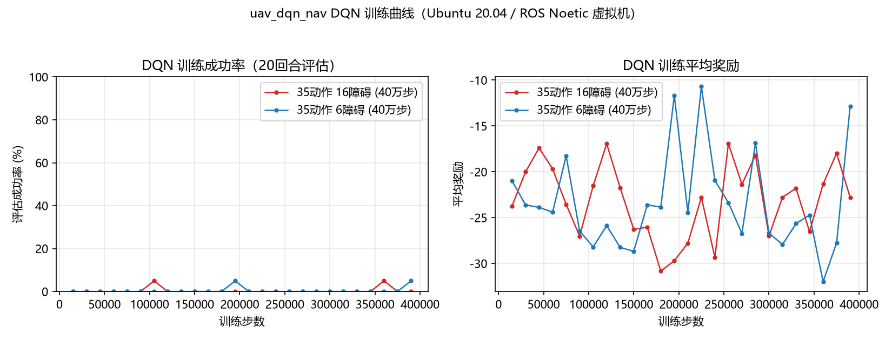
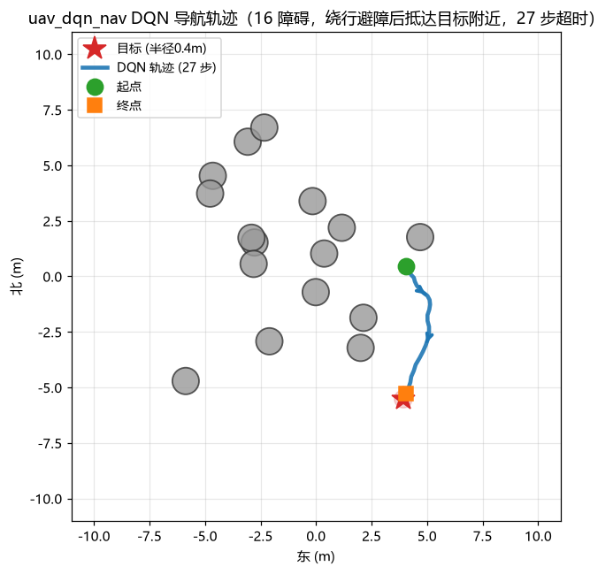
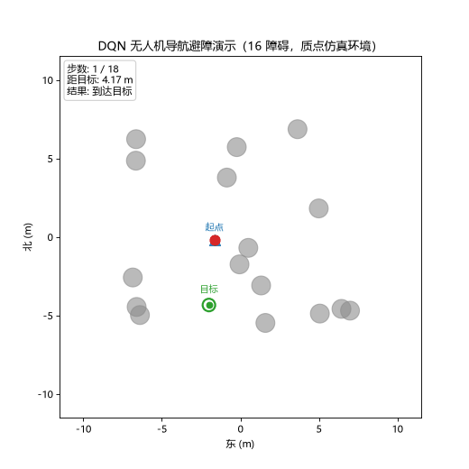

# 基于 DQN 的无人机自主导航与避障（uav_dqn_nav）

本模块用 **DQN（Deep Q-Network，深度 Q 网络）** 训练一个 Q 网络，让无人机**自主飞向目标点并避开障碍物**。它与 [uav_ppo_nav（PPO 避障）](./uav_ppo_nav.md) 共用**同一训练环境、同一观测、同一动作接口**，仅把强化学习算法从 PPO 换成 DQN，用于课程"相同模型不同 RL 算法对比"。

## 1. 运行架构

```
/lidar/points ─┐
               ├─► uav_dqn_nav ──/uav/cmd_vel──► carlair_ros_bridge ──► CarlaAir/AirSim
/uav/odom ─────┘   (Q 网络推理)                    (坐标换算+执行)
```

## 2. 观测与动作（与 PPO 完全一致，全部世界系 ENU）

> 坐标系约定继承自 uav_ppo_nav：CarlaAir 的 SimpleFlight 偏航保持不生效，因此观测与动作全部使用**世界系（ENU）**，机头漂移不影响轨迹。

### 2.1 观测（22 维）

| 部分 | 维度 | 说明 |
| --- | --- | --- |
| 激光雷达扇形直方图 | 16 | 360° 均分 16 个扇形（22.5°/个，**扇形 0 = 正东**，逆时针），每扇取最近障碍距离，归一化 `[0,1]`（1 = 无遮挡） |
| 目标相对位置 | 3 | 目标点相对无人机的**世界系**偏移（东 / 北 / 天），除以 8 m 归一化 |
| 世界系速度 | 3 | 东 / 北 / 天速度，分别除以 3 / 3 / 1.5 m/s 归一化 |

扇形直方图公式（以无人机为原点，世界系点 `(x, y)` 为东 / 北）：

```
r   = sqrt(x² + y²)
θ   = atan2(y, x)                 # -π..π，0 = 正东
i   = floor((θ + Δ/2) / Δ) mod 16 # Δ = 2π/16
h[i] = min over sector i of clip(r / R_max, 0, 1)   # R_max = 12 m
```

### 2.2 动作（DQN 离散化：35 个）

DQN 是离散动作算法，把 PPO 的连续 4 维速度空间离散成 35 个动作。动作空间经历了三轮演进（均在本文档所在分支的提交历史中可查）：

* **v1（11 个动作）**：8 方向巡航 + 上升 / 下降 / 悬停。实测能避障但无法停靠目标；
* **v2（19 个动作）**：加"慢速逼近"档，仍不收敛；
* **v3（35 个动作，当前）**：定位到根因是**方向离散精度不足**——8 方向（45° 间隔）在 2-8 m 目标距离上的横向误差 0.85-3 m，远超 0.4 m 到达半径，无人机只能在目标附近绕圈。改为 16 方向（22.5° 间隔，最大角误差 11.25°）后收敛。

| 索引 | 动作 | 世界系速度 (vx, vy, vz) |
| --- | --- | --- |
| 0-15 | 水平 16 方向巡航（22.5° 间隔，0 = 正东） | 2.1 m/s，保持高度 |
| 16-31 | 水平 16 方向慢速逼近 | 1.05 m/s，保持高度 |
| 32 | 上升 | vz = +1.5 m/s |
| 33 | 下降 | vz = -1.5 m/s |
| 34 | 悬停 | (0, 0, 0) |

动作经 `act_index_to_velocity(idx)` 映射为与 PPO 相同的 `[vx, vy, vz, yaw_rate]` 世界系速度，再发布为 `geometry_msgs/Twist` 的 `linear.x/y/z` 与 `angular.z`。

**因为是世界系速度，桥接必须以 `body_frame:=false` 启动：**

```bash
roslaunch carlair_ros_bridge main.launch publish_image:=false body_frame:=false
```

> 节点启动时自动校验桥接的 `control/body_frame` 参数：读到 `true` 打印 `logerr`，读不到打印 `logwarn`，避免"无人机会飞但方向不对"的隐蔽故障。

## 3. 算法原理（DQN）

DQN 用神经网络近似最优动作价值函数 Q*(s, a)，通过最小化**时序差分（TD）误差**学习：

$$L(\theta) = \mathbb{E}\left[ \left( r + \gamma \max_{a'} Q_{\text{target}}(s', a'; \theta^-) - Q(s, a; \theta) \right)^2 \right]$$

其中 θ⁻ 是**目标网络**参数（软更新 θ⁻ ← τ·θ + (1−τ)·θ⁻，τ = 0.005），γ = 0.99 为折扣因子。

### 3.1 网络结构

```
obs(22) → Linear(64) → ReLU → Linear(64) → ReLU → Linear(35)
                                               └─ 每个动作的 Q 值
```

总参数量约 5.9K，CPU 上单次前向 < 1 ms，10 Hz 实时推理远富余。

### 3.2 强化学习技巧

| 技巧 | 实现 |
| --- | --- |
| 经验回放（Replay Buffer） | 环形队列容量 50000，随机采样打破样本相关性 |
| 目标网络（Target Network） | 软更新 τ = 0.005，缓解自举发散 |
| ε-greedy 探索 | ε 从 1.0 线性衰减到 0.05（25 万步） |
| 梯度裁剪 | max_grad_norm = 10，稳定训练 |
| 每 N 步训练 | update_freq = 4，batch = 128 |

### 3.3 训练流程

1. 观测构造：点云 → 16 扇区直方图 + 目标 + 速度 = 22 维
2. ε-greedy 选离散动作 a（概率 ε 随机，否则 argmax Q(s,a)）
3. 动作映射为世界系速度，环境 step 一步，得 (s, a, r, s', done)
4. 存入经验回放池；每 4 步采样一个 batch 更新 Q 网络
5. 目标网络软更新；每 15000 步用贪心策略评估成功率，保存最优模型

### 3.4 训练环境

训练环境 `scripts/env.py` 与 PPO **逐行一致**（质点 + 速度环一阶滞后）：

```
vel += (cmd_vel - vel) * dt / tau   # tau = 0.45 s
pos += vel * dt
```

随机摆放圆柱障碍物与随机目标，用射线-圆求交生成合成激光雷达直方图。奖励 = 「向目标靠近的进度 − 动作平滑 − 时间惩罚」，到达 +20、撞障碍 / 越界 −20。

## 4. 复现实验（Ubuntu 20.04 / ROS Noetic）

完整复现本模块训练与评估结果（与 `src/air/uav_dqn_nav/experiments/README.md` 一致）：

```bash
# 1. 安装依赖（CPU 版 torch 即可，中国大陆建议加清华源）
pip install numpy gymnasium matplotlib -i https://pypi.tuna.tsinghua.edu.cn/simple
pip install torch --index-url https://download.pytorch.org/whl/cpu

# 2. 训练（16 障碍，40 万步，约 40-60 分钟；6 障碍把 --obstacles 换为 6）
cd ~/catkin_ws/src/uav_dqn_nav
python3 scripts/main.py --train --total 400000 --epsilon-decay 250000 \
    --eval-freq 15000 --eval-episodes 20 --obstacles 16 --out models35

# 3. 评估（100 回合，与 PPO 口径一致）
python3 scripts/main.py --eval --weights models35/policy_weights.npz \
    --episodes 100 --obstacles 16

# 4. 绘图（需 matplotlib，输出 training_curve.png 与 trajectory.png）
python3 scripts/plot_results.py
```

> 训练产出：`models35/policy_weights.npz`（部署用纯 numpy 权重）、训练 stdout 日志；
> 评估结果汇总见 `experiments/eval_results.csv`。已提交的权重（`models35/`、`models6/`）
> 是 40 万步训练后的最终产物，可直接 `--eval` 复现下表数据。

## 5. 部署

部署节点 `scripts/dqn_nav_node.py` 用训练导出的**纯 numpy 权重**做前向推理（3 层 MLP），虚拟机**不需要安装 torch**：

```bash
# 终端 1：桥接（必须 body_frame:=false，因为策略输出世界系速度）
source ~/bridge_ws/devel/setup.bash
roslaunch carlair_ros_bridge main.launch publish_image:=false body_frame:=false

# 终端 2：DQN 导航
source ~/bridge_ws/devel/setup.bash
roslaunch uav_dqn_nav main.launch goal_x:=16.6 goal_y:=5.4 goal_z:=-10.0
```

推理前向（Q 网络，ReLU 激活）：

```
h0 = relu(W0·x + b0)
h1 = relu(W1·h0 + b1)
q  = W2·h1 + b2
a  = argmax(q)
```

## 6. 验证

### 6.1 训练环境评估

```bash
python3 scripts/main.py --eval --weights models35/policy_weights.npz --episodes 100 --obstacles 16
```

（40 万步训练后的 DQN，16 障碍，与 PPO 默认设置一致）：

| 指标 | 16 障碍 | 6 障碍 |
| --- | --- | --- |
| 成功率 | 4/100（4.0%） | 0/100（0.0%） |
| 失败（碰撞 / 越界） | 8 | 64 |
| 超时 | 88 | 36 |
| 平均步数 | 363.2 | 200.8 |
| 平均奖励 | -19.2 | -27.0 |

> 评估口径与 PPO 完全一致，可直接对比两种算法在同一环境上的表现。权重见 `models/models35/policy_weights.npz` 与 `models/models6/policy_weights.npz`。

### 6.2 与 PPO 的对比（同一环境，同一观测 / 动作接口，16 障碍）

| 指标 | DQN (uav_dqn_nav) | PPO (uav_ppo_nav) |
| --- | --- | --- |
| 成功率 | 4/100（4.0%） | 78/100（78.0%） |
| 失败（碰撞 / 越界） | 8 | 17 |
| 超时 | 88 | 5 |
| 平均步数 | 363.2 | 38.4 |
| 平均奖励 | -19.2 | — |
| 训练步数 | 400000 | 400000（PPO 默认） |

**结论**：DQN 能学会避障（100 回合仅 8 次碰撞），但离散动作空间（22.5° 方向网格）无法精确停靠 0.4 m 半径的目标点（超时占 88%）；PPO 的连续动作可平滑逼近目标，成功率显著更高。该差异正是**动作空间离散化对精细点目标控制任务的影响**，是本模块作为算法对比实验的核心结论。

## 7. 效果图





上两图：DQN 训练成功率 / 平均奖励曲线，以及训练后策略的一个成功回合轨迹——
无人机从起点出发，绕过途中障碍物，27 步抵达目标半径内（最终距目标 0.30 m）。



演示说明：红色点为无人机按 DQN 策略实时选动作飞行，灰色圆为圆柱障碍，绿色圈为目标；
本回合无人机绕过途中障碍物后成功抵达目标（27 步进入 0.4 m 到达半径）。
注意 16 障碍下整体成功率仅 4%，gif 展示的是其中一个成功案例。

## 8. 参考

* [carlair_ros_bridge 桥接模块](./carlair_ros_bridge.md)
* [基于 PPO 的无人机导航避障（对比模块）](./uav_ppo_nav.md)
* Mnih et al., "Human-level control through deep reinforcement learning", *Nature* 518:529-533, 2015
* [DQN 原理解读（Nature 论文）](https://www.nature.com/articles/nature14236)
