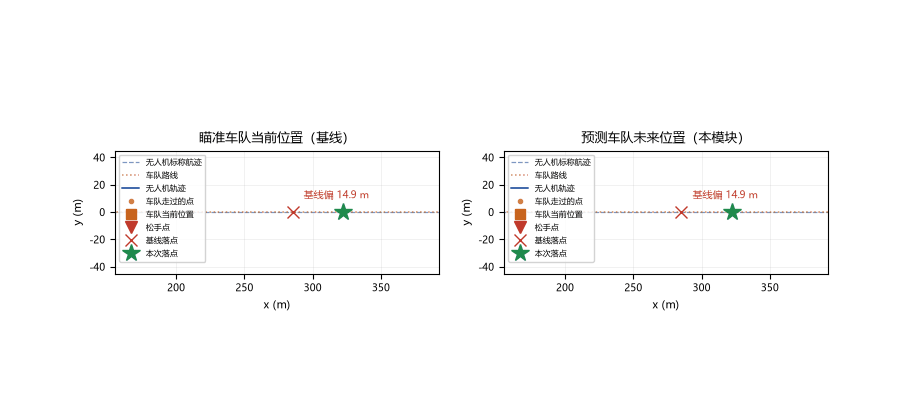
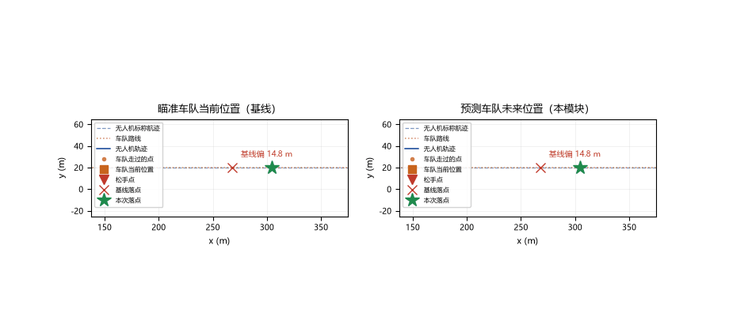
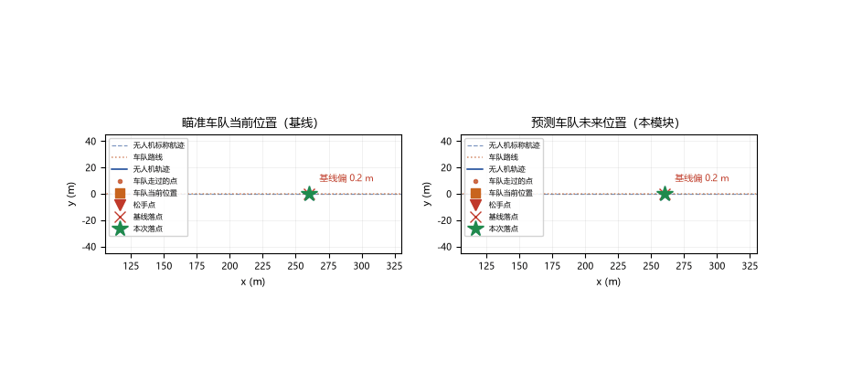
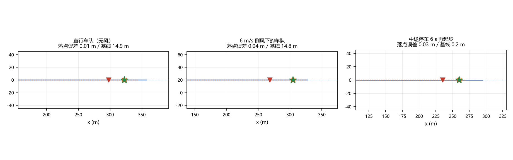

# 给行驶中的车队投送物资（uav_drop_on_moving_target）

无人机沿道路追上一辆行驶中的接收车，把物资投到它头顶。这件事的误差不在
弹道本身——平抛解析解是准的——而在**目标是移动的**：货从 30 m 高度落地要
2.47 s，这段时间 6 m/s 的车队又走了 14.8 m。瞄准车辆"此刻"的位置，落点必然
偏出 6 m 的接受半径。

与 [应急物资投送](./uav_emergency_drop.md) 的区别：那边投给**固定**需求点，
误差全部来自弹道与风；这里目标在移动，误差来自弹道、风与"车辆未来位置"三
项的叠加，核心多了一层对时对位的解算。

## 1. 问题拆解

投放要满足的是**同一个时刻、同一个位置**：

$$\left\| \underbrace{p_{uav}(t_r) + v_{uav}\,t_{fall} + w\,t_{fall}\cdot 0.8}_{落点} \;-\; \underbrace{p_{veh}(t_r + t_{fall})}_{车队未来位置} \right\| \le R$$

三个量各自独立：前抛量 24.7 m 由巡航速度决定，风偏 11.9 m（6 m/s 侧风 ×
0.8 拖曳）与航向无关，车队位移 14.8 m 由车速决定——所以侧风算例里两者必须
**分开补偿**：风偏把瞄准点反向平移，车队位移用未来位置预测。

## 2. 释放时刻怎么解

无人机标称航迹与车辆轨迹都是解析的（折线 + 分段恒速 + 指定航点停留），
落点误差是时间 $t_r$ 的一维函数：

1. 以 0.05 s 步长粗扫全程，取误差最小处；
2. 在其邻域以 2 ms 步长加密，得到释放时刻与瞄准点；
3. 车队停住、无人机停住的时刻直接记为不可行——否则解算会退化成
   "悬停在车队终点等它开过来"。

不可行时给出具体建议（拉长进场航段 / 提高巡航速度），并保留全时段最小误差。

## 3. 运行效果

左栏是"瞄准车队当前位置"的基线，右栏是按未来位置解算的策略；两栏飞的是
同一条 MuJoCo 真实轨迹，只有松手时刻不同：



侧风算例：风偏 11.9 m 比接受半径大一倍，释放点因此比无风时提前约 3 s：



中途停车算例：按匀速规划会把释放时刻算到停车窗口之后，落点偏 36 m；按真实
轨迹（含停留）解算则在车队停稳的窗口投放：



三个算例的总览（蓝线无人机轨迹、橙线车队路线、红三角松手点、绿星落点）：



## 4. 结果

| 算例 | 场景 | 释放时刻 | 闭环落点误差 | 基线一：瞄准当前位置 | 基线二：按匀速规划 |
| --- | --- | --- | --- | --- | --- |
| convoy_straight | 直行车队 6 m/s，无风 | 51.28 s | 0.01 m | 14.91 m | — |
| convoy_crosswind | 同上 + 6 m/s 侧风 | 48.31 s | 0.04 m | 14.84 m | — |
| convoy_stopgo | 中途停车 6 s 再起步 | 45.03 s | 0.03 m | 0.23 m（恰在停车窗口） | 36.00 m |

- 闭环落点误差 = MuJoCo 刚体积分的真实释放状态喂给弹道模型、与车队真实
  位置对比；`results/<case>_result.json` 有逐项机读记录；
- 航迹跟踪：巡航段最大 0.34 m，投放窗口 ±1 s 内 ≤0.01 m（起飞加速段另计，
  属于一次性瞬态）；
- 闭环实际松手时刻与解析解一致（差 <0.01 s）。

## 5. 复现

```bash
cd src/air/uav_drop_on_moving_target
python main.py                 # 三个算例各真飞一次，墙钟约 4 s
python main.py --no-sim        # 仅算法层，秒级
python -m pytest test/ -q      # 28 项（含 MuJoCo 冒烟）
python tools/make_gif.py       # 重录四张图
```

ROS 2 Humble 下：

```bash
colcon build --packages-select uav_drop_on_moving_target
source install/setup.bash
ros2 launch uav_drop_on_moving_target main.launch.py
```

## 6. 已知局限

- 弹道按无阻力质点平抛 + 常值风建模，散布 σ = 0.15h 是工程近似，表中偏差
  是模型预测偏差，不等同实物命中精度；
- 车辆模型支持折线/匀速/停留，不支持连续变速；连续变速可按段折算；
- 本机为 Windows + Python 3.12 开发环境、没有 ROS 2，`ros2 launch` 链路未
  实跑，构建/launch 步骤如上，可供有环境时验证。
