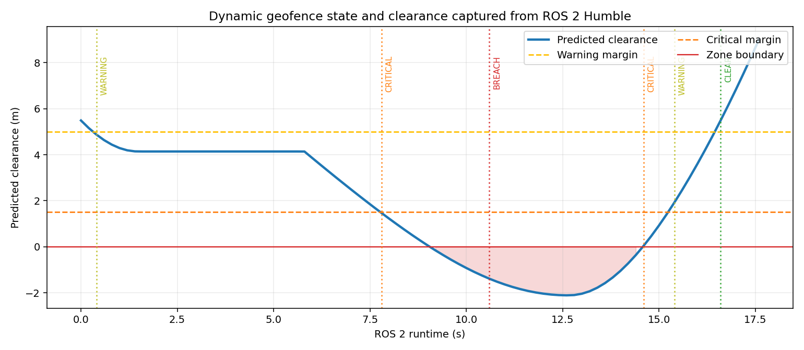

# 无人机动态电子围栏预测预警与规避方向

本项目面向施工区、临时活动区和移动风险区域等“会移动的禁飞圆柱体”。模块根据无人机和围栏当前速度，在短时域内预测最近接近距离，提前输出 `CLEAR / WARNING / CRITICAL / BREACH`，并给出限制围栏的编号、最近接近时间和二维规避方向。

与仓库已有空域模块的区别：

- `no_fly_zone_check` 主要检查给定点是否位于禁飞区；
- `multi_uav_airspace_monitor` 面向多架无人机的静态多边形围栏和机间冲突；
- 本模块只处理单架无人机与移动圆形临时围栏的相对运动预测，可直接生成提前预警。

## 1. 预测方法

在预测时域 \(H\) 内假设无人机和围栏保持当前速度。相对位置为

\[
\mathbf r = \mathbf p_z - \mathbf p_u,\qquad
\mathbf v = \mathbf v_z - \mathbf v_u
\]

最近接近时刻为：

\[
t^* = \operatorname{clip}\left(
-\frac{\mathbf r\cdot\mathbf v}{\|\mathbf v\|^2}, 0, H
\right)
\]

预测净空为：

\[
c = \|\mathbf r(t^*) - \mathbf v_z t^* + \mathbf v_u t^*\|
- R_z
\]

其含义是无人机到围栏边界的距离。默认判定：

| 状态 | 条件 | 建议 |
|---|---|---|
| `CLEAR` | `c > 5 m` | 继续 |
| `WARNING` | `1.5 m < c ≤ 5 m` | 准备规避 |
| `CRITICAL` | `0 m ≤ c ≤ 1.5 m` | 立即转向 |
| `BREACH` | 当前已进入围栏 | 立即退出 |

存在多个围栏时，按最严重状态和最小净空选取限制围栏。规避方向由预测最近点处“无人机位置减围栏中心”的径向向量归一化得到。

## 2. ROS 2 接口

| 话题 | 类型 | 方向 | 说明 |
|---|---|---|---|
| `/uav_geofence/scene` | `std_msgs/String` | 输入 | 无人机位置、速度和活动围栏 JSON |
| `/uav_geofence/assessment` | `std_msgs/String` | 输出 | 每个围栏的净空、最近时刻和规避向量 |
| `/uav_geofence/advice` | `std_msgs/String` | 输出 | 限制围栏、状态和建议 |

模块只提供预警和单位规避方向，不直接发送速度或航向指令。

## 3. 构建与运行

```bash
source /opt/ros/humble/setup.bash
colcon build --symlink-install --packages-select uav_dynamic_geofence_guard
source install/setup.bash
ros2 launch uav_dynamic_geofence_guard main.launch.py duration:=18
```

查看：

```bash
ros2 topic list | grep uav_geofence
ros2 topic echo /uav_geofence/assessment
ros2 topic echo /uav_geofence/advice
```

评估 CSV 默认写入 `/tmp/uav_dynamic_geofence_runtime.csv`。

## 4. Humble 虚拟机实测

2026-11-10 在 Ubuntu 22.04.5 / ROS 2 Humble 的 VMware 虚拟机中执行：

```text
Starting >>> uav_dynamic_geofence_guard
Finished <<< uav_dynamic_geofence_guard [0.64s]
Summary: 1 package finished [0.80s]
```

VM 内 9 项 `unittest` 全部通过。`ros2 launch` 实际启动动态围栏仿真器和预警节点，连续运行 18 秒并记录 90 条有效评估。

实际状态变化：

```text
CLEAR → WARNING → CRITICAL → BREACH → CRITICAL → WARNING → CLEAR
```

实际状态首次进入 `BREACH` 时预测净空约 **-1.39 m**，之后继续下探，整轮记录的最低值约 **-2.11 m**（见 CSV 和曲线）；随后围栏轨迹弯回并逐渐远离，系统恢复到 `CLEAR`。



## 5. 限制

1. 围栏被简化为二维移动圆形，尚未支持三维、多边形或按高度变化的动态空域。
2. 预测假设短时间内速度恒定，急转弯、加减速和通信延迟会影响最近接近距离。
3. 风险区域与轨迹由确定性仿真生成，不是真实航管数据。
4. 规避向量只表示初始方向，后续仍需接入局部轨迹规划、速度约束和飞控安全边界。
5. 不能替代适航认证的电子围栏设备。

## 6. 大模型使用声明

使用 OpenAI Codex 辅助完成代码、测试、文档和运行图生成；作者已逐项复核代码、参数和结果，并对提交内容、数据真实性和后续维护负责。
