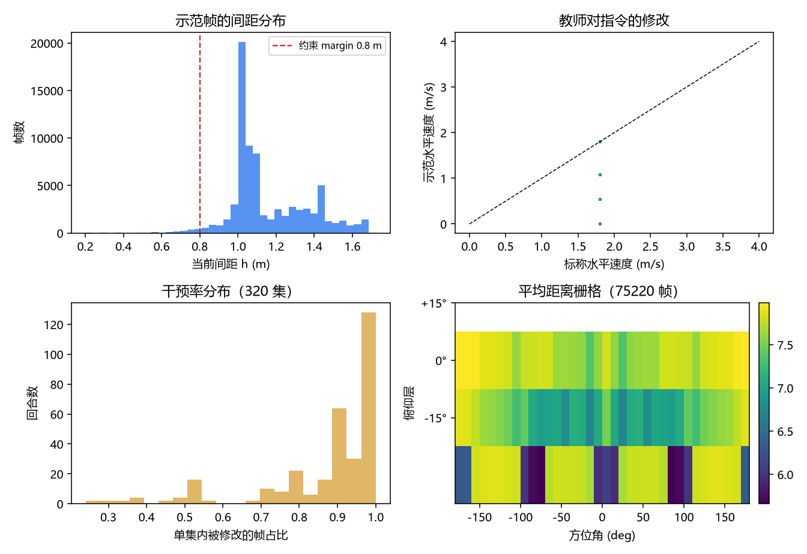
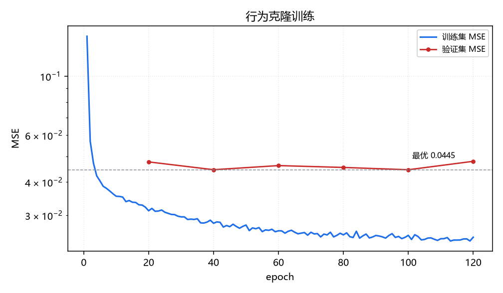
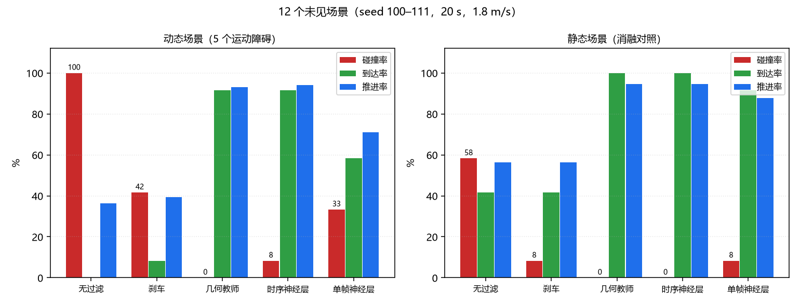
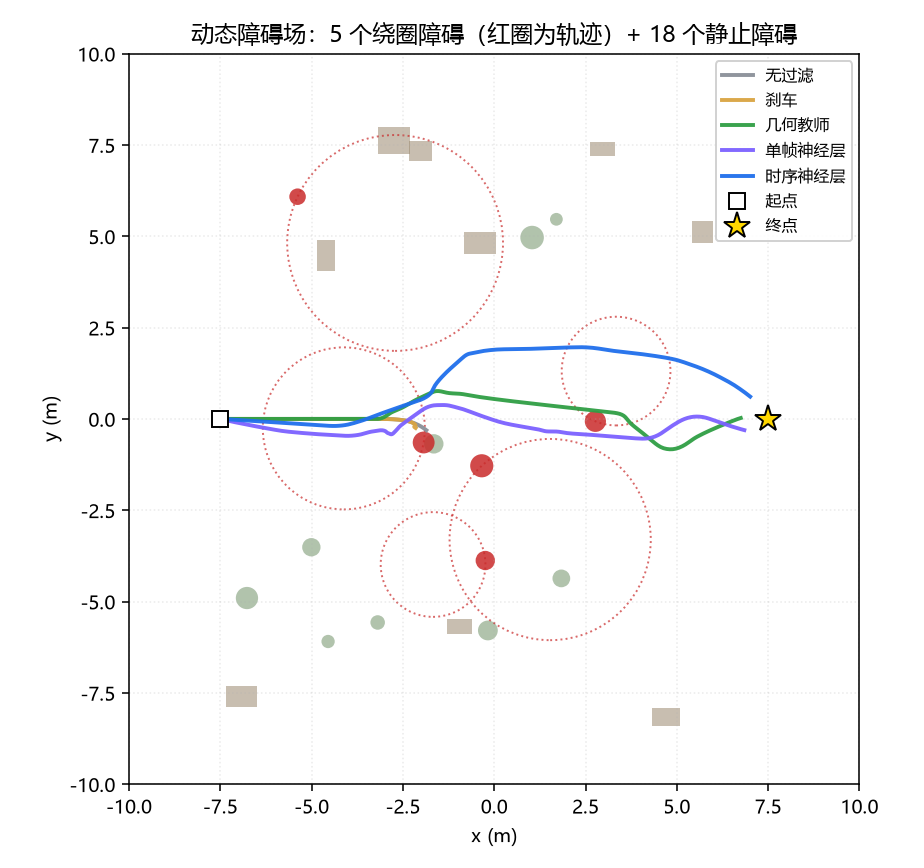
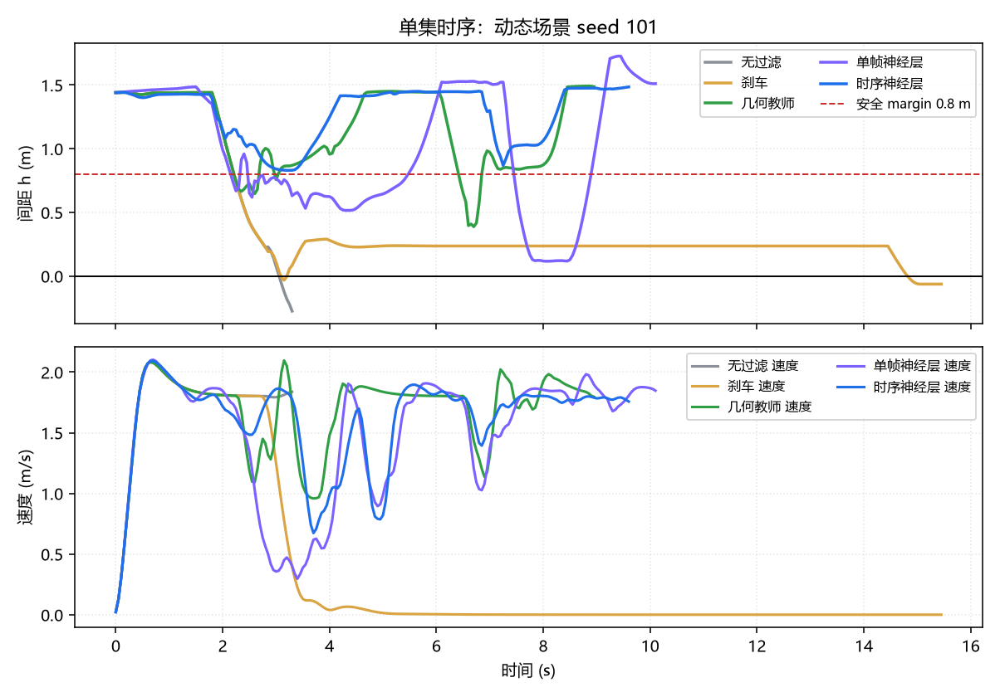
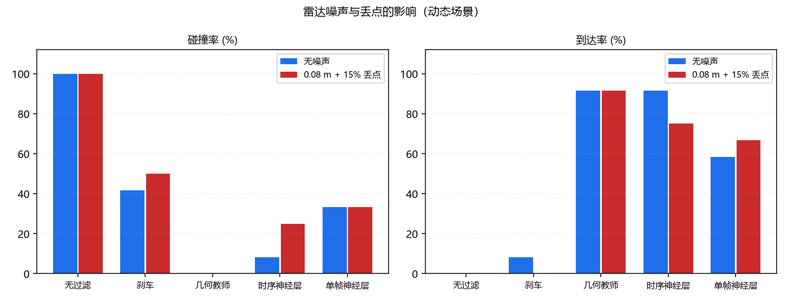

# 动态障碍下的时序神经安全层

对应作业任务（2）**传感器感知**与任务（3）**导航控制**。

输入 360° 激光的三帧距离栅格与当前速度，输出修正后的速度指令。几何安全层
用障碍的真值轨迹做 0.6 s 外推，作为教师生成示范；神经网络只看到雷达历史，
必须自己把“障碍在动”从三帧栅格里读出来。源码：
`src/air/uav_dynamic_safety_guard/`。

---

## 1. 模块定位

课程内的无人机模块大多是“一个控制器/策略直接输出指令”，没有独立的指令级
安全层；有安全层的模块（`uav_neural_safety_filter`）只处理静止障碍，单帧
观测。运动障碍在单帧栅格里只会让回波变近，网络看不到切向速度。

| 已有模块 | 区别 |
|---|---|
| `uav_neural_safety_filter` | 单帧 3×36 栅格 + 静态障碍；本模块是同一任务在**动态障碍**上的版本，观测带三帧历史 |
| `uav_ppo_nav` / `uav_depth_gate_racing_e2e` | 端到端策略，避障编进训练目标，不能叠加在别人的控制器上 |
| `octree_uav_3d_pathfinding` | 几何规划，默认位姿已知，不处理底层速度指令 |
| `uav_formation_flight` | 编队保持，不含指令级安全约束 |

同一套代码、同一份数据既可以只喂单帧（对照组）也可以喂三帧（本模块），
所以“时序到底有没有用”是能测出来的。

---

## 2. 架构

```
/lidar/points ──→ 3×36 距离栅格 ──→ 3 帧历史 ─┐
/uav/odom ─────→ 机头系速度 ──────────────────┼─→ 332 维观测 ──┬─→ 几何教师（真值外推）
/uav/goal ─────→ 目标方向 ────────────────────┘   + 标称指令   └─→ 神经安全层（部署）
/uav/cmd_vel_nominal ──→ 标称指令 ────────────────────────────→ 修正指令
```

两个实现共用同一套观测与动作语义：

| | 几何教师 | 神经安全层 |
|---|---|---|
| 障碍位置 | 仿真真值（含运动轨迹） | 三帧雷达 |
| 决策 | 86–87 个候选 + 0.6 s 外推 | 一次前向 |
| 延迟 | 2.4 ms | 0.06 ms |
| 用途 | 示范 / 上界 | 部署 |

---

## 3. 环境与数据

`DynamicEnv`：`safety_field` 场景，18 个静止盒/柱（高 1.2–2.8 m）+ 5 个绕圈
运动的柱体（圆周半径 1.4–3.2 m、速度 0.4–1.0 m/s、柱高 1.2–2.0 m），范围
±9 m。运动障碍每帧改写 MuJoCo 的 `model.geom_pos` 后 `mj_forward`，因此
激光、碰撞与间距三者用的是同一份几何。

动作是机头系速度，经加速度限幅（4 m/s²）、一阶速度低通（τ=0.12 s）与航向
跟随（1.5 rad/s）变成参考轨迹，再由几何控制器跟踪。

| 项 | 值 |
|---|---|
| 控制频率 | 20 Hz |
| 雷达 | 36 方位 × 3 俯仰，8 m |
| 机体半径 | 0.16 m |
| 标称速度 | 1.8 m/s |
| 训练场景 | seed 0–19，每个 8 集 |
| 测试场景 | seed 100–111 |

**示范数据**（`dynamic_imitation.npz`）：几何教师在 20 个场景里闭环飞行
160 集，逐帧记录 (三帧栅格, 速度, 目标方向, 距离/高度, 标称指令, 教师指令)，
左右镜像后用于行为克隆。



---

## 4. 几何教师

对候选速度 $u$，按环境的参考动力学外推 0.6 s：

$$
v_{k+1} = v_k + \mathrm{clip}\!\left(\frac{\Delta t}{\tau}(R_z(\psi_k)u - v_k),\ \pm a_{max}\Delta t\right),\quad
p_{k+1} = p_k + v_k \Delta t
$$

航向按速度方向以 1.5 rad/s 跟随；每一步取到障碍表面与地面的最小距离，$q(u)$
是整段路径的最小值。候选集是速度缩放 × 方位偏转（0/±30°/±60°/±90°/±120°）×
高度偏置，去重后 86–87 个；约束 $q(u) \ge$ margin，可行者取离标称指令最近的
一个，无可行候选时取 $q$ 最大的动作。

外推必须与执行侧一致。早期用“直线扫掠 + 2.5 rad/s 航向跟随”代替，教师会
把转弯后的路径当成安全；改成与环境相同的加速度限幅后，闭环碰撞率明显下降。

---

## 5. 神经安全层

输入 332 维观测 + 3 维标称指令，输出 3 维修正指令：

```
Linear(335,192) → ReLU → Linear(192,192) → ReLU → Linear(192,3)
```

102147 个参数，纯 numpy 前向，CPU 单帧 0.06 ms。

训练用行为克隆：按 episode 切 12% 验证集，MSE，Adam（lr=2e-3，weight decay
1e-4），120 轮，保留验证最优。示范时教师用 1.0 m 的间距余量（评测时 0.8 m），
给学生留出回归误差的缓冲。



---

## 6. 闭环评测

12 个未见场景（seed 100–111），每场景一集，起点/终点对穿障碍场，初始扫掠
间距 >1.0 m。碰撞判据是机体中心到障碍表面 <0.16 m；到达判据是离目标 <0.8 m；
推进率 $= (d_0-d_\text{end})/d_0$。

## 7. 实测结果

12 个未见场景（seed 100–111），每个场景一集：

| 过滤器 | 碰撞率 | 到达率 | 推进率 | 最小间距 | 延迟 |
|---|---|---|---|---|---|
| 无过滤 | 100% | 0% | 36% | −0.04 m | 0.002 ms |
| 刹车 | 42% | 8% | 39% | 0.13 m | 0.005 ms |
| 几何教师 | 0% | 92% | 93% | 0.82 m | 2.464 ms |
| **时序神经层** | 8% | 92% | 94% | 0.42 m | 0.058 ms |
| 单帧神经层（消融） | 33% | 58% | 71% | 0.30 m | 0.040 ms |

时序层与教师只有 8 个百分点的碰撞率差距，到达率、推进率基本持平，延迟低
42 倍。无过滤在动态场景里 12 集全撞——标称控制器根本不等障碍过去。



单集时序（seed 101：无过滤 3.5 s 撞上障碍，时序层减速绕过后到达终点）：





静态场景（把 5 个运动障碍拿掉，其余不变）：

| 过滤器 | 碰撞率 | 到达率 | 推进率 | 最小间距 | 延迟 |
|---|---|---|---|---|---|
| 无过滤 | 58% | 42% | 56% | 0.45 m | 0.002 ms |
| 刹车 | 8% | 42% | 56% | 0.57 m | 0.005 ms |
| 几何教师 | 0% | 100% | 94% | 0.92 m | 2.117 ms |
| **时序神经层** | 0% | 100% | 95% | 0.75 m | 0.055 ms |
| 单帧神经层（消融） | 8% | 92% | 88% | 0.81 m | 0.040 ms |

两者都贴着教师，说明静态障碍本来就是单帧能解决的问题；动态障碍才需要历史。

测距噪声 0.08 m + 15% 丢点：

| 过滤器 | 碰撞率 | 到达率 | 推进率 | 最小间距 | 延迟 |
|---|---|---|---|---|---|
| 无过滤 | 100% | 0% | 36% | −0.04 m | 0.002 ms |
| 刹车 | 50% | 0% | 41% | 0.08 m | 0.005 ms |
| 几何教师 | 0% | 92% | 93% | 0.82 m | 2.431 ms |
| **时序神经层** | 25% | 75% | 84% | 0.30 m | 0.058 ms |
| 单帧神经层（消融） | 33% | 67% | 80% | 0.18 m | 0.041 ms |




---

## 8. 源码解析

```
uav_dynamic_safety_guard/core/
├── nn.py          Linear / MLP / Adam（纯 numpy）
├── geometry.py    盒·柱·球有符号距离、批处理、按时外推
├── field.py       动态障碍场：静态几何 + 圆周运动障碍
├── ranges.py      3×36 栅格、单帧 116 维 / 时序 332 维特征
├── env.py         MuJoCo 环境、geom_pos 逐帧同步、标称控制器
├── dataset.py     教师闭环示范采集
├── samples.py     镜像增广、特征拼接、训练用 XY
├── network.py     安全层网络与 npz 存取
├── training.py    行为克隆训练与离线指标
├── filter.py      候选集、几何教师、神经层
└── experiment.py  闭环评测与汇总
```

### 8.1 `field.py`：把运动障碍做进 MuJoCo

障碍用 `(kind, pos, size)` 表示，静态部分堆叠一次反复使用，运动障碍按
$pos(t) = c + R(\cos\phi,\sin\phi)$ 求值；`batch_at(t)` 把两者合并成按类型
分组的数组批，教师每帧外推 13 个时间片也只花 2 ms 量级。

### 8.2 `env.py`：几何同步

每帧把运动障碍的真值位置写回 `model.geom_pos` 并 `mj_forward`，于是激光、
接触与 `clearance_at` 三者不会出现“雷达看到而碰撞判定没看到”的错位。

### 8.3 `ranges.py`：为什么是 332 维

单帧 3×36 栅格 + 速度 + 目标 + 距离/高度 = 116 维；再拼两帧历史 = 332 维。
单帧与三帧共用同一份记录（`samples.slice_features`），消融只改一个开关。

### 8.4 `filter.py`：无可行候选时的退路

可行集为空时取 $q$ 最大的候选，而不是“最接近标称”。面对运动障碍，停下来
只会被撞；往空隙里躲至少要留出一点余量。

---

## 9. 复现步骤

```bash
# 仿真侧（Python ≥3.10，需要 mujoco 与 numpy）
python main.py --collect-imitation --out data/dynamic_imitation.npz \
               --seeds 20 --episodes 8 --mirror 1 --teacher-margin 1.0
python main.py --train-policy --data data/dynamic_imitation.npz \
               --out data/dynamic_policy_seq.npz --temporal 1
python main.py --train-policy --data data/dynamic_imitation.npz \
               --out data/dynamic_policy_single.npz --temporal 0 --hidden 128

# 任意机器（只需 numpy）
python main.py --selftest
python main.py --evaluate --eval-episodes 12 --moving 5 --max-time 20 \
               --out results.json
python main.py --figures --results results.json \
               --outdir ../../docs/img/air/uav_dynamic_safety_guard
```

ROS2 在线运行见包内 `README.md`。

---

## 10. 依赖

* [MuJoCo 四旋翼仿真与 ROS2 桥接底座](uav_mujoco_sim.md)
  （提供 `/lidar/points`、`/uav/odom` 与 `/uav/cmd_vel`）
* [神经安全过滤器](uav_neural_safety_filter.md)（同一任务在静态障碍上的版本）
