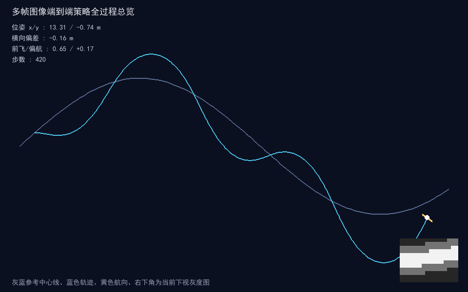
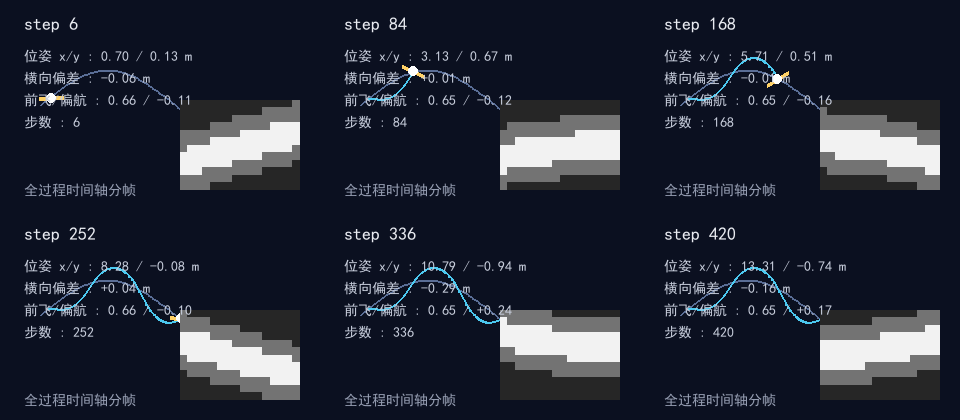
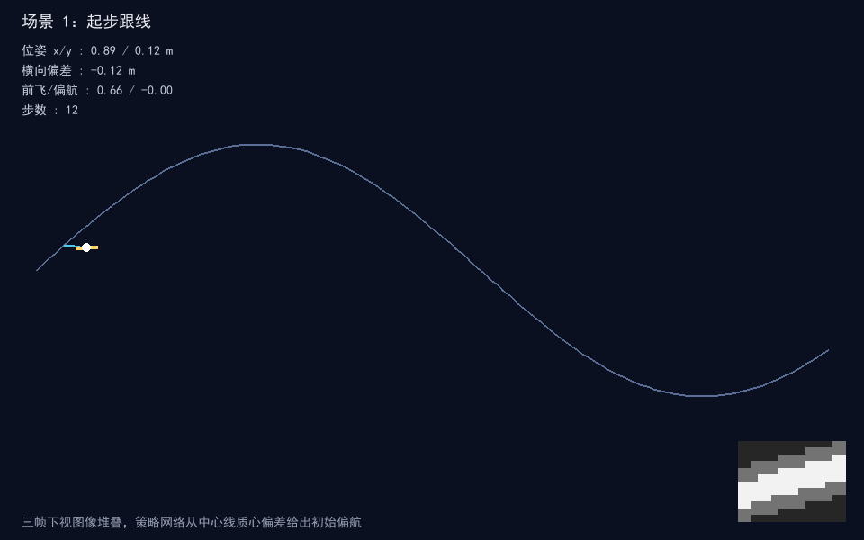
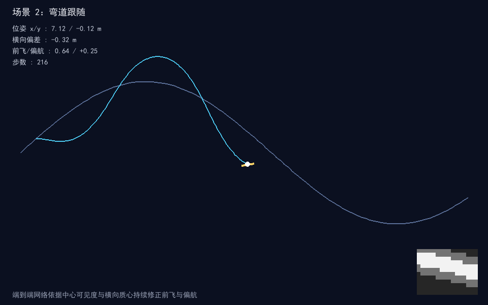
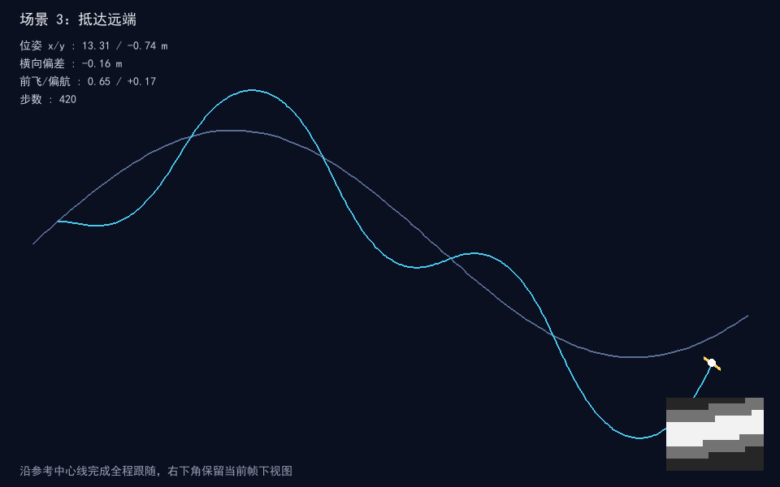

# 多帧图像端到端策略（uav_e2e_multiframe_image_policy）

## 概览

| 项目 | 内容 |
| --- | --- |
| 作业类别 | 任务 5：端到端模型（图像 → 控制指令，多帧时序堆叠） |
| 仿真器 | 内置 numpy 平面运动模型 + pygame 2.6.1 离屏渲染 |
| 运行环境 | ROS 节点：Ubuntu 22.04 + ROS 2 Humble；离线仿真可在 Windows Python 3.13 直接运行 |
| 编程语言 | Python 3 |
| 第三方依赖 | numpy、pygame（离线）；rclpy、nav_msgs、std_msgs（ROS 节点） |
| 话题/节点 | 发布 `/odom`（Odometry）、`/e2e_policy_cmd`（Float32MultiArray） |
| 运行方式 | `ros2 launch uav_e2e_multiframe_image_policy uav_e2e_multiframe_image_policy.launch.py`；离线 `python main.py --shots` |

## 修改目的与内容

**修改目的**：对应课程任务 5「端到端模型（图像 → 控制指令）」，在空域载具示例中补充一个多帧时序堆叠的端到端策略模块。系统不输出显式占据地图或目标点，而是把连续三帧下视灰度图作为整体输入，由固定卷积线索提取与两层 MLP 直接回归前飞速度与偏航指令，验证“感知—决策—控制”在网络内部合并的端到端思路。

**实现内容**：

- `scene.py`：正弦参考中心线 `y = 0.7·sin(0.40x)`，提供横向偏移、航向误差与轨迹区间计算。
- `camera.py`：以机体为中心渲染 16×12 局部俯视灰度图（视场 2.4×1.8 m），`FrameHistory` 保留最近 3 帧，不足时重复首帧填充，输出 `(3, 12, 16)` 堆叠张量。
- `expert.py`：专家参考控制器，依据横向偏移与航向误差给出参考前飞与偏航，用于校验反馈方向与权重参照，不参与闭环决策。
- `policy.py`：定义 4 个固定 3×3 卷积核（中心行求和、横向 Sobel、纵向 Sobel、均值模糊），实际用于特征的为横向 Sobel 与模糊两个；另两条线索直接由图像算得（二值化后白色像素的行质心、中心带亮度）。4 维线索经隐藏层 10 单元近似恒等映射，输出层回归一路前飞速度与一路偏航指令，前向仅用 numpy。
- `controller.py`：二维位姿积分器，前飞与偏航指令分别按速度、偏航上限裁剪后积分。
- `runner.py`：闭环串联下视渲染、历史堆叠、策略前向与运动控制，统计最大横向偏差、最终横向偏差、到达 x、最大速度与步数。
- `e2e_node.py`：ROS 2 节点，定时推进闭环，发布里程计与策略指令；rclpy 延迟导入，离线测试不依赖 ROS。
- `main.py`：离线仿真入口，支持 `--demo` 与 `--shots`，离屏渲染全过程关键帧。
- 提供 launch 文件、`package.xml`、`setup.py` 与单元测试。

**已知限制**：

- 场景为二维平面上的单条正弦中心线，未包含三维高程、动态障碍与多目标跟踪；下视图为北向俯视渲染，未模拟机体旋转带来的图像畸变。
- 网络权重按跟随中心线的反馈结构预置，未做在线训练；ROS 节点已在 Ubuntu 22.04 + ROS 2 Humble 下完成 build 与 launch 联调，但真实机载相机图像与三维场景仍未覆盖。

## 测试环境与结果

- **实际系统**：Windows 11（离线仿真与单元测试）；Ubuntu 22.04 x86_64（ROS 2 Humble 构建与 launch 联调，Humble 为 RoboStack conda 打包版，未使用 apt 官方发行版）。
- **Python 与关键依赖版本**：Python 3.13.16；numpy 2.5.4；pygame 2.6.1（SDL 2.28.4）；pytest 9.2.0；Pillow 13.0.0。
- **模拟器**：内置纯 numpy 平面运动模型 + pygame 离屏渲染（`SDL_VIDEODRIVER=dummy`）；未使用 MuJoCo / Gazebo。
- **构建与运行命令**（包目录 `src/air/uav_e2e_multiframe_image_policy/`）：
  - 单元测试：`python -m pytest test -q`
  - 离线仿真：`python main.py --demo`；出图：`python main.py --shots`
  - ROS 构建（ROS 环境内，工作区根目录）：`colcon build --packages-select uav_e2e_multiframe_image_policy --symlink-install`
  - ROS 启动：`ros2 launch uav_e2e_multiframe_image_policy uav_e2e_multiframe_image_policy.launch.py`
- **验证操作与结果**：15 项单元测试全部通过，其中场景 3 项、相机 3 项、专家 2 项、策略 3 项、控制器 2 项、闭环 2 项。闭环 420 步内到达 x 13.31 m，最大前飞速度 0.661 m/s，全程最大横向偏差 0.497 m，终点横向偏差 -0.164 m。
- **ROS 侧实测**：`colcon build --packages-select uav_e2e_multiframe_image_policy --symlink-install` 1 个包编译通过、无告警；`ros2 launch` 正常拉起 `e2e_node`，`/odom` 的 `orientation` 为单位四元数（z=sin(yaw/2)、w=cos(yaw/2)），`/e2e_policy_cmd` 实测 20 Hz；`sim_rate:=10.0` 覆盖后实测 10 Hz。
- **尚未验证**：真实机载相机图像、时序抖动与多机协同未实测；ROS 侧仅在 RoboStack conda 打包的 Humble 环境验证，未在 apt 官方发行版上复跑。

## 运行效果
全过程场景：起步跟线（三帧下视图像堆叠，策略网络从中心线质心偏差给出初始偏航）→ 弯道跟随（端到端网络依据中心可见度与横向质心持续修正前飞与偏航）→ 抵达远端（沿参考中心线完成全程跟随，右下角保留当前帧下视图）。

| 指标 | 数值 |
| --- | --- |
| 到达最大 x | 13.31 m |
| 最大前飞速度 | 0.661 m/s |
| 全程最大横向偏差 | 0.497 m |
| 终点横向偏差 | -0.164 m |
| 闭环步数 | 420 |

### 全程轨迹总览



### 全过程时间轴分帧



### 阶段关键帧

| 场景 | 截图 |
| --- | --- |
| 场景 1：起步跟线 |  |
| 场景 2：弯道跟随 |  |
| 场景 3：抵达远端 |  |

## 系统原理与公式

### 参考中心线与位姿偏差

```
y_ref(x) = A·sin(k·x),  A = 0.7, k = 0.40
offset = y - y_ref(x)
err    = wrap(atan2(y_ref'(x), 1) - yaw)
```

### 多帧图像堆叠

下视相机在机体周围取局部俯视窗口，逐像素判断与中心线的距离并赋灰度值；帧缓存按时间顺序保留最近 `T = 3` 帧：

```
I_t ∈ [0,1]^{H×W},  H = 12, W = 16
S_t = [I_{t-2}, I_{t-1}, I_t] ∈ R^{3×12×16}
```

缓存不足三帧时以首帧重复填充，保证输入维度恒定。

### 卷积线索提取与端到端回归

特征取三帧平均图：先按 0.5 阈值二值化，白色像素行坐标相对图像中心行的偏移即第 1 维（行质心）；图像中心带（第 4 至 8 行、第 6 至 10 列）的平均亮度为第 2 维；再对横向 Sobel 与均值模糊两个核做全图有效卷积，各取全局均值作为第 3、4 维（横向 Sobel 带符号，左右边缘会相互抵消）。代码里另外定义的纵向 Sobel 与中心行核当前未参与特征计算。两层前向计算：

```
h = tanh(W_h·f + b_h)
[ v_fwd, ω ] = W_o·h + b_o
v_fwd = clip(v_fwd, 0, 1)
ω     = clip(ω, -1.2, 1.2)
```

输出层权重按跟随中心线的反馈结构预置：中心可见度调节前飞，横向质心偏差反向修正偏航，横向梯度做航向微调。

### 运动控制

```
yaw  += ω·dt
x    += v_fwd·cos(yaw)·dt
y    += v_fwd·sin(yaw)·dt
```

## 算法流程

```
初始化机体位置、偏航与三帧帧缓存
  │
  ├─ 下视渲染：以机体为中心生成当前灰度图，更新历史堆叠
  │
  ├─ 卷积线索：固定核提取中心可见度、横向质心偏差与梯度
  │
  ├─ 端到端回归：两层 MLP 直接输出前飞速度与偏航指令
  │
  ├─ 运动积分：控制器按指令更新位姿，裁剪速度与偏航上限
  │
  └─ 记录轨迹与偏差指标，进入下一仿真步
```
## 源代码解析

| 文件 | 职责 |
| --- | --- |
| `uav_e2e_multiframe_image_policy/scene.py` | 正弦参考中心线、横向偏移与航向误差计算 |
| `uav_e2e_multiframe_image_policy/camera.py` | 下视灰度图渲染、`FrameHistory` 三帧缓存与堆叠 |
| `uav_e2e_multiframe_image_policy/expert.py` | 专家参考控制器，校验反馈方向与权重参照 |
| `uav_e2e_multiframe_image_policy/policy.py` | `E2EImagePolicy`：固定卷积线索提取与两层 MLP 端到端回归 |
| `uav_e2e_multiframe_image_policy/controller.py` | `ImagePolicyController`：指令积分与速度、偏航裁剪 |
| `uav_e2e_multiframe_image_policy/runner.py` | `E2ERunner`：图像—策略—控制闭环与偏差指标统计 |
| `uav_e2e_multiframe_image_policy/e2e_node.py` | ROS 2 节点：定时推进闭环，发布 `/odom`、`/e2e_policy_cmd`；rclpy 延迟导入 |
| `main.py` | 离线一键实验入口：`--shots` 离屏运行并保存截图；`--demo` 打开观察窗口 |
| `test/test_scene.py` | 中心线原点、横向偏移与航向误差绕回校验 |
| `test/test_camera.py` | 图像形状取值、首帧填充与最近三帧保留校验 |
| `test/test_expert.py` | 前飞区间与正偏移反向修正方向校验 |
| `test/test_policy.py` | 指令区间、右偏移修正方向与特征响应校验 |
| `test/test_controller.py` | 前飞位移与偏航指令裁剪校验 |
| `test/test_runner.py` | 闭环到达远端与横向偏差有界校验 |

关键实现说明：

- 网络不依赖深度学习框架，卷积核与输出权重按跟随中心线的反馈结构预置为确定值，前向推理仅用 numpy 卷积、矩阵乘与 tanh。
- 三帧历史堆叠提供短时时序平滑，离线闭环与单元测试均在无 ROS 环境下完成。
- 离屏渲染使用 `SDL_VIDEODRIVER=dummy`，无需图形界面即可生成关键帧。

## 仿真运行步骤

### Ubuntu 22.04 / ROS 2 Humble

```bash
# 进入工作区源码目录
colcon build --packages-select uav_e2e_multiframe_image_policy --symlink-install
source install/setup.bash
ros2 launch uav_e2e_multiframe_image_policy uav_e2e_multiframe_image_policy.launch.py
```

### 离线仿真（Windows / Linux，无需 ROS）

```bash
cd src/air/uav_e2e_multiframe_image_policy
python main.py --shots    # 生成全过程截图到 docs/img/
python main.py --demo     # 观察端到端跟随过程
```

### 单元测试

```bash
python -m pytest test/ -q
```

## 文件结构

```
src/air/uav_e2e_multiframe_image_policy/
├── launch/uav_e2e_multiframe_image_policy.launch.py
├── uav_e2e_multiframe_image_policy/
│   ├── __init__.py
│   ├── scene.py
│   ├── camera.py
│   ├── expert.py
│   ├── policy.py
│   ├── controller.py
│   ├── runner.py
│   └── e2e_node.py
├── test/
│   ├── test_scene.py
│   ├── test_camera.py
│   ├── test_expert.py
│   ├── test_policy.py
│   ├── test_controller.py
│   └── test_runner.py
├── resource/uav_e2e_multiframe_image_policy
├── conftest.py
├── main.py
├── package.xml
├── setup.py
├── setup.cfg
└── README.md
docs/air/uav_e2e_multiframe_image_policy.md
docs/img/uav_e2e_multiframe_image_policy_*.png
```

## 话题、节点与参数

### 话题

| 话题 | 类型 | 方向 | 说明 |
| --- | --- | --- | --- |
| `/odom` | `nav_msgs/Odometry` | 发布 | 机体位置（x/y）与绕 z 轴的偏航四元数（z=sin(yaw/2)、w=cos(yaw/2)） |
| `/e2e_policy_cmd` | `std_msgs/Float32MultiArray` | 发布 | 前飞速度、偏航指令、横向偏差、机体航向 |

### 参数

| 参数 | 默认值 | 说明 |
| --- | --- | --- |
| `sim_rate` | 20.0 | 仿真控制频率 Hz，运行时可用 `ros2 launch uav_e2e_multiframe_image_policy uav_e2e_multiframe_image_policy.launch.py sim_rate:=10.0` 覆盖 |

## 与现有模块的区别

- 与 `uav_depth_gate_racing_e2e`（单帧图像门赛 BC/PPO 策略）不同：本模块输入为连续三帧时序堆叠，强调短时运动历史，输出直接回归前飞与偏航，不做门赛目标检测与回合制强化学习。
- 与 `uav_fault_e2e_thrust_policy`（故障推力分配 CNN/MLP）不同：本模块面向中心线跟随的横向/航向决策，不做推力通道分配与故障诊断。
- 与 `uav_e2e_rl`（强化学习端到端策略）不同：本模块权重按反馈结构预置、规则透明可离线复现，不训练回报驱动的策略。
- 与 `mujoco_abandoned_park_uav_visual_steering`（单帧视觉转向 CNN）不同：本模块为多帧堆叠的二维平面跟随仿真，不依赖 MuJoCo 场景与预训练权重文件。

## 提交前检查

- [x] 已检查 Files changed 和冲突，无无关生成文件、重复内容或误删公共文件。
- [x] 源码与教程按模块分别放在 src、docs，文件使用英文下划线命名。
- [x] 模块提供 `main.py` 和 launch，依赖及安装路径正确，README 步骤已实际运行：`colcon build --packages-select uav_e2e_multiframe_image_policy --symlink-install` 通过，`ros2 launch` 起节点、`/odom` 与 `/e2e_policy_cmd` 正常发布，`sim_rate:=10.0` 实测 10 Hz；离线仿真与 15 项单元测试已跑通。
- [x] 新模块已添加首页和导航链接；已运行 `mkdocs serve --livereload` 检查相关页面，页面与本模块的 5 张配图均正常渲染。
- [x] 功能描述与验证证据一致；PNG 小于 3 MB，GIF 小于 5 MB。

## 大模型使用声明

过程中借助大模型工具辅助代码编写、整理包目录结构与本描述排版，核心逻辑与操作、场景参数设定与实际运行调试为本人完成，作者对提交内容负责。
