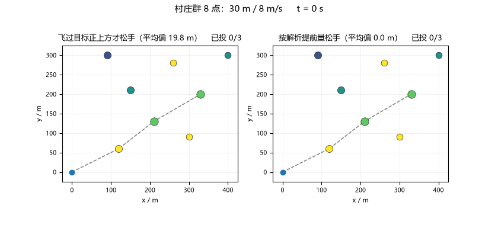
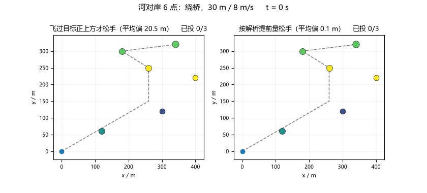
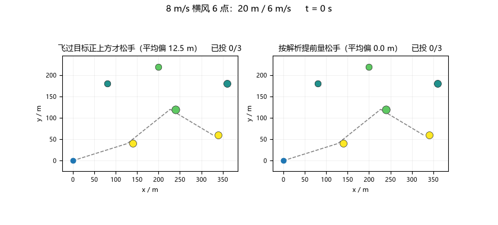
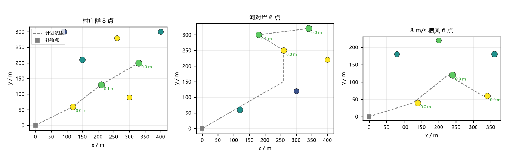

# 应急物资投送点选择与投放时机决策（MuJoCo 真飞）

## 1. 这是什么

灾后道路中断，把急救物资送到散布的需求点，无人机是最快的手段。
但"扔准"比"飞到"难：从 30 m 高度、8 m/s 巡航速度平抛，松手后货物
还要往前飞 19.8 m 才落地，横风还要再吹偏十几米——不提前松手，
落点就永远在目标前面一大截。

`uav_emergency_drop` 把这件事拆成三步：载货有限先送谁（加权贪心 +
架次切分）、松手后落点在哪（平抛解析解 + 风偏 + 散布）、什么时候按
投放键（真实状态落点校验）。最后整条链路在 MuJoCo 里真飞验证。

源码位于
[`src/air/uav_emergency_drop`](https://github.com/OpenHUTB/ros2/tree/master/src/air/uav_emergency_drop)，
运行步骤见
[`README.md`](https://github.com/OpenHUTB/ros2/blob/master/src/air/uav_emergency_drop/README.md)。

---

## 2. 提前量值多少：同一趟飞行的两种投法

左栏不提前、飞过目标正上方才松手，落点平均偏出去约 20 m；右栏按
解析解提前 lead 米松手，落点压在目标上。两栏飞的是同一条 MuJoCo
闭环轨迹，只有投放时刻不同：



*村庄群 8 点（h=30, v=8）：19.8 m → 0.02 m。*

绕河的算例里，直线穿河被禁飞带拦下，航线从桥上过，绕完桥再就近排序
投放点（弯后 20 m 内不安排释放，转角切角圆滑——实测急弯后立即投放
偏差会被放大到 26 m）：



*河对岸 6 点：20.5 m → 0.04 m。*

8 m/s 东风的算例：12.92 m 的风偏全部由逆风偏移的越顶点补偿，
投放后解析落点回到真实目标：



*8 m/s 横风（h=20, v=6）：12.5 m → 0.01 m。*

三个算例的落点总览：



---

## 3. 做法

**弹道（`core/ballistics.py`）**：平抛解析解。`t_fall = √(2h/g)`，
前抛 `lead = v·t_fall`，风偏 `w·t_fall×0.8`，散布按经验取
`σ = 0.15h`。释放判据不是"进了解析区间就投"，而是沿直飞航段解出
理想释放点，到达该点时用真实位置/速度外推落点并逐项校验（状态有限、
速度与航向沿进入段、高度接近计划值、落点偏差 ≤ 接受半径），全部
达标才投放；区间不可行（提前量超出段长、航线横向偏出）提示降速或
绕行。

**选点与架次（`core/planner.py`）**：按紧迫度 × 需求加权贪心装填，
一架装不完就封口换货（60 s 装载时间），架次内最近邻排序；交换改进
（移 1 回填 k）只在严格变优时接受。河流算例的禁飞带绕行也在这一层。

**闭环（`core/flyer.py`）**：`uav_mujoco_sim` 的 Quadrotor +
GeometricController 真飞，dt = 0.01 s 与控制周期一致。真实状态与
ROS 节点共用同一套 `evaluate_drop` 判据，到达理想释放点且落点校验
达标才投放，记录 MuJoCo 真实位置/速度，喂给弹道模型预测落点。

**ROS 节点（`ros/drop_node.py`）**：薄壳，订阅 `/uav/odom`，落点
校验达标后在 `/uav_emergency_drop/drop` 发一条 JSON 投放指令；判定
逻辑全部在 `core/trigger.py`，节点只做消息转换。

---

## 4. 数字

| 算例 | 选点 | 送出 | 架次 | 落点偏差 mean / max | 投放窗口跟踪误差 | 末端悬停 |
|---|---|---|---|---|---|---|
| `case_aid_village` | 8/8 | 23 份 | 2 | 0.02 / 0.05 m | 0.08 m | 0.10 m |
| `case_aid_river` | 6/6 | 17 份 | 2 | 0.04 / 0.06 m | 0.26 m | 0.09 m |
| `case_aid_wind` | 6/6 | 17 份 | 2 | 0.01 / 0.02 m | 0.06 m | 0.00 m |

弹道表（无风，h × v 网格）：

```text
h=20: t_fall 2.019 s   v=6 lead 12.12 m  v=8 16.15 m  v=10 20.19 m  σ=3.0 m
h=30: t_fall 2.473 s   v=6 lead 14.84 m  v=8 19.78 m  v=10 24.73 m  σ=4.5 m
h=50: t_fall 3.193 s   v=6 lead 19.16 m  v=8 25.54 m  v=10 31.93 m  σ=7.5 m
```

`results/<case>_result.json` 是逐次投放的机读记录（释放位置、释放
速度、预计落点、与目标的偏差），数字与上表一致。

---

## 5. 已知限制

- 落点 0.1 m 量级的前提是投放瞬间处于巡航稳态；急转弯后立即投放会
  把跟踪振荡带进弹道（river 算例曾实测 26 m 偏差），航线因此避开
  弯后 20 m 内的释放点；
- 全程最大跟踪误差 6~19 m 出现在转角切角瞬态与爬升转巡航的速度阶跃，
  属几何控制器真实动态；
- 风场按常值风处理，阵风、投放物气动阻力（当前按质点平抛）未建模；
- 架次航程用固定巡航速度估算，未含爬升/悬停能耗与精确回程时间。

## 6. 复现

```bash
cd src/air/uav_emergency_drop
python main.py                 # 三个算例各真飞一次，闭环墙钟约 5 s
python main.py --no-sim        # 只跑算法层，秒级
python tools/make_gif.py       # 重录上面四个图
python -m pytest test/ -q      # 31 项测试
```
