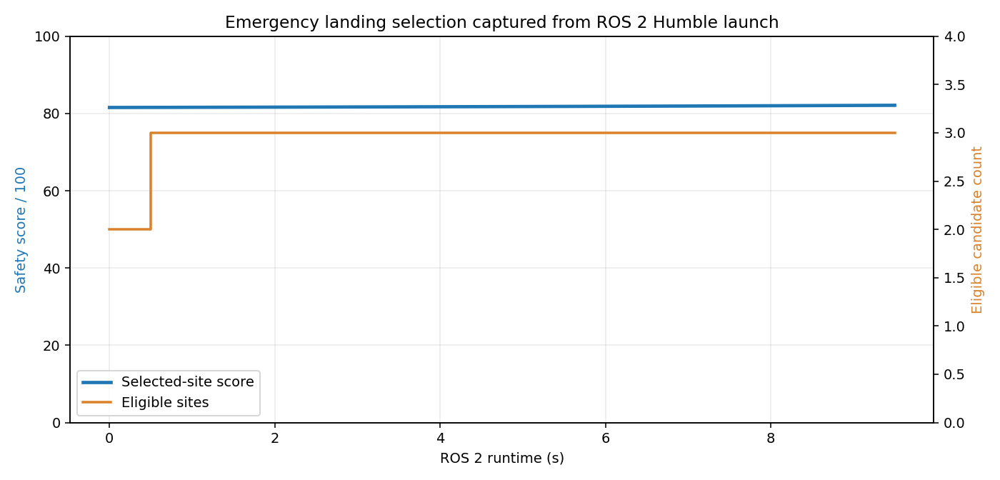

# 无人机应急着陆点安全评估与 ROS 2 运行验证

本项目面向低空无人机在动力不足、任务中止或局部故障后的应急降落决策。模块接收无人机状态和若干候选着陆点，先剔除不满足硬约束的地点，再用可解释的加权代价选择落点，并持续发布选择结果、得分和拒绝原因。

与仓库已有降落模块的区别：

- `rooftop_landing` 和 `rooftop_landing_nn` 解决屋顶落点几何检测与学习式定位；
- `uav_landing_monitor` 检查降落指令与实际高度变化的一致性；
- `uav_moving_platform_landing` 面向移动平台预测相遇点；
- 本模块处理“多个地面候选点中选哪一个”的应急安全决策，包括坡度、粗糙度、障碍、人员、距离和返航能量裕量。

## 1. 方法

候选点输入字段：

| 字段 | 含义 |
|---|---|
| `slope_deg` | 地面坡度 |
| `roughness_m` | 地形粗糙度 |
| `obstacle_risk` | 静态障碍风险，范围 `[0,1]` |
| `people_risk` | 人员暴露风险，范围 `[0,1]` |
| `surface_confidence` | 地表检测可信度，范围 `[0,1]` |

硬约束包括最大坡度、最大粗糙度、障碍风险、人员风险、最大距离和能量裕量。只有全部约束满足的候选点进入排序：

\[
J = 0.23s + 0.14r + 0.20o + 0.27p + 0.10d + 0.03w + 0.03(1-c)
\]

其中 \(s,r,d,w,1-c\) 分别表示归一化坡度、粗糙度、距离、风影响和地表不确定性。代价越低越好，对外分数为：

\[
Q = 100\max(0,1-J)
\]

决策状态为 `SELECTED`、`CAUTION`、`NO_SAFE_SITE` 或 `NO_CANDIDATE`。`CAUTION` 表示存在可行点，但代价超过阈值。

## 2. ROS 2 接口

| 话题 | 类型 | 方向 | 说明 |
|---|---|---|---|
| `/uav_landing/sites` | `std_msgs/String` | 输入 | 无人机状态和候选点 JSON |
| `/uav_landing/selection` | `std_msgs/String` | 输出 | 最佳点、坐标、得分和逐点评估 |
| `/uav_landing/status` | `std_msgs/String` | 输出 | 状态、可行点数量和拒绝原因 |

节点不发送飞控指令。输出应交给任务安全管理器或人工确认，之后才能执行下降。

## 3. 构建与运行

```bash
source /opt/ros/humble/setup.bash
colcon build --symlink-install --packages-select uav_emergency_landing_selector
source install/setup.bash
ros2 launch uav_emergency_landing_selector main.launch.py duration:=10
```

查看实际话题：

```bash
ros2 topic list | grep uav_landing
ros2 topic echo --once /uav_landing/selection
ros2 topic echo /uav_landing/status
```

选择器默认把每次评估写入 `/tmp/uav_landing_selector_runtime.csv`，便于复查得分和可行点数量。

## 4. Humble 虚拟机实测

2026-11-10 在 Ubuntu 22.04.5 / ROS 2 Humble 的 VMware 虚拟机中执行：

```text
Starting >>> uav_emergency_landing_selector
Finished <<< uav_emergency_landing_selector [0.63s]
Summary: 1 package finished [0.79s]
```

VM 内 7 项 `unittest` 全部通过。`ros2 launch` 实际启动 `uav_landing_site_sim` 和 `uav_landing_site_selector` 两个节点，并列出三个运行话题：

```text
/uav_landing/selection
/uav_landing/sites
/uav_landing/status
```

10 秒运行中记录 21 条状态 CSV 样本。选择器稳定选择 A 点，运行初期有 2 个可行点，随后变为 3 个；选择得分约 81.5 到 82.1。



## 5. 限制

1. 候选点和风险字段来自确定性仿真，尚未接入真实点云、相机或数字高程模型。
2. 风险权重是工程默认值，没有经过真实事故数据标定。
3. 当前不规划下降轨迹，也不校验旋翼下洗流、局部风和地面效应。
4. `std_msgs/String` JSON 便于演示和跨包集成，但正式系统建议定义稳定字段的 ROS 消息。
5. 未连接真实飞控，不能把推荐结果直接视为可执行飞行动作。

## 6. 大模型使用声明

使用 OpenAI Codex 辅助完成代码、测试、文档和运行图生成；作者已逐项复核代码、参数和结果，并对提交内容、数据真实性和后续维护负责。
