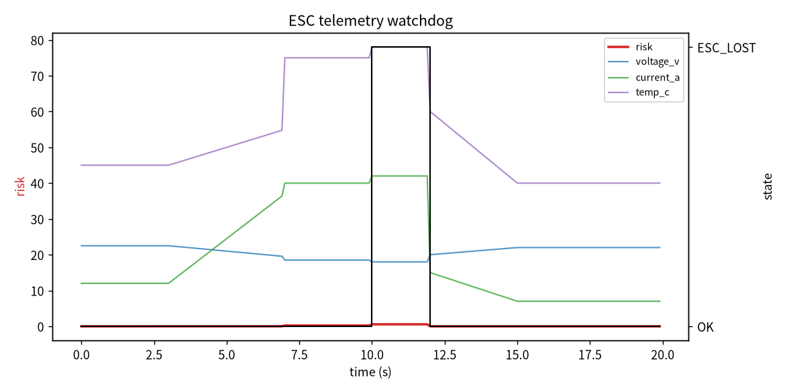

# 无人机 ESC 遥测看门狗

本项目面向电调遥测帧丢失、电池电压跌落、电机电流突增或 ESC 温度过高时的动力链健康监测。模块融合电压、电流、温度、遥测帧陈旧度四个维度，给出从继续飞行到电机故障保护的分级建议。

## 1. 风险量化

- 电压跌落风险：\\(R_v=\mathrm{clip}((V_{sag}-V)/4)\\)
- 电流突增风险：\\(R_i=\mathrm{clip}((I-I_{max}+10)/20)\\)
- 温度风险：\\(R_t=\mathrm{clip}((T-T_{over}+20)/25)\\)
- 帧陈旧风险：\\(R_a=\mathrm{clip}((age-80)/150)\\)

综合：\\(R=0.30R_v+0.25R_i+0.20R_t+0.25R_a\\)

硬阈值（任一触发立即 ESC_LOST）：

- 电压 ≤ 18.0 V（6S 标称）；
- 帧陈旧度 ≥ 200 ms；
- ESC 温度 ≥ 80°C。

## 2. 状态

| 状态 | 建议 |
|---|---|
| OK | CONTINUE |
| WATCH | MONITOR |
| DEGRADED | REDUCE_THROTTLE |
| ESC_LOST | MOTOR_FAILSAFE |

## 3. ROS 2 接口

| 话题 | 类型 | 说明 |
|---|---|---|
| `/uav_esc/sample` | `std_msgs/String` | 电压、电流、转速、温度、帧陈旧度 |
| `/uav_esc/assessment` | `std_msgs/String` | 风险、状态、建议 |

## 4. 验证

纯 Python 下 6 项 unittest 全部通过：正常、低压、帧超时、过温、退化状态、非法输入。

## 5. 限制

1. 阈值按 6S 电池、40A 级 ESC 示例，不同动力系统需调整；
2. 未区分单 ESC 和多 ESC 平均；
3. 模块不直接切断动力，只输出建议。

## 6. 大模型使用声明

使用大模型辅助完成代码、测试和文档初稿；作者已复核状态机和风险公式，对提交内容负责。

作者：2535010018

### 风险与状态曲线

