# 无人机ppo模块研究

本页把 `uav_keyboard_control`、`uav_ppo_nav`、`uav_rl_benchmark`、`uav_route_cruise`、
`uav_traffic_nav` 五个实验合并到一页。每个实验保留原有的小节结构与图，顺序按
「先打通指令通道 → 单目标导航 → 算法/结构对比 → 固定航线 → 动态交通」组织。

## 总览

| 实验 | 任务与方法 | 主要证据 |
| --- | --- | --- |
| 键盘控制 | 终端按键 → 机体系速度，ROS 桥接 | 按键映射、运行截图、实测记录 |
| PPO 导航 | 随机目标点 + 静态障碍，PPO（MLP） | 训练曲线、部署步骤、效果动图 |
| 算法对比 | PPO / SAC / TD3 同环境，100k 步 | 成功率、平滑度、成本图 |
| 航线巡航 | 固定闭合航线，航点投影 + 局部避障 | 轨迹对比、CarlaAir 实测轨迹 |
| 动态交通 | 穿越车流，专家示范 + BC + DAgger | 多种子成功率表、对比图 |

代码位置：`src/air/uav_keyboard_control`、`src/air/uav_ppo_nav`、`src/air/uav_rl_benchmark`、
`src/air/uav_route_cruise`、`src/air/uav_traffic_nav`。

> 五个实验的独立页面仍然保留；本页只是把内容合并，便于连续阅读和整体汇报。

## 1. 无人机键盘控制（遥控链路）

把终端按键转换成机体系速度指令，经 `carlair_ros_bridge` 执行；验证 ROS 指令通道与仿真器联动。

任务①「无人机仿真 + 键盘控制」的 ROS 侧实现：把终端按键转换为**机体系速度指令**，
发布到 `/uav/cmd_vel`，由 `carlair_ros_bridge` 连仿真器执行。仿真/坐标换算/安全限幅
集中在桥接层，键盘、规划器、神经网络控制器共用同一条指令通道。

### 运行架构

```text
终端按键 ──► uav_keyboard_control ──/uav/cmd_vel──► carlair_ros_bridge ──► CarlaAir/AirSim
            (raw 模式读键)        (geometry_msgs/Twist)   (坐标换算+执行)     (无人机)
```

### 按键映射

机体系（x 前 / y 左 / z 上）：

| 按键 | 动作 | Twist 分量 |
|---|---|---|
| `W` / `S` | 前进 / 后退 | `linear.x = ±horiz_speed` |
| `A` / `D` | 左移 / 右移 | `linear.y = ±horiz_speed` |
| `R` / `F` | 上升 / 下降 | `linear.z = ±vert_speed` |
| `Q` / `E` | 右转 / 左转 | `angular.z = ±yaw_rate` |
| 松开 | 悬停 | 全零 |
| `ESC` | 退出 | — |

`Q`/`E` 的方向遵循 AirSim 机体系 `yaw_rate` 约定（`Q=+yaw_rate` 机头右转）。

### 编译与运行

```shell
# 终端 1：桥接（连仿真 + 执行 + 自动起飞悬停）
source ~/bridge_ws/devel/setup.bash
roslaunch carlair_ros_bridge main.launch

# 终端 2：键盘控制
source ~/bridge_ws/devel/setup.bash
roslaunch uav_keyboard_control main.launch
```

把焦点放在键盘控制终端，按 `W/A/S/D/R/F/Q/E` 操控，松开即悬停，`ESC` 退出。

### 实现要点

#### 终端 raw 模式

Linux 终端默认行缓冲（要按回车），用 `termios`+`tty` 进入 raw 模式即可单键即时响应：

```python
with RawKeyReader() as reader:        # __enter__ 切 raw，__exit__ 恢复
    key = reader.get_key(timeout=0.03)  # select 非阻塞读一个字符
```

`with` 语句保证 `Ctrl-C` 或异常退出时也能恢复终端设置，不会把用户的终端卡在 raw 模式。

#### 按键 → 速度：纯函数

`key_to_cmd(key, horiz, vert, yaw)` 把按键映射为 `(vx, vy, vz, wz)`，
`step_once` 再打包成 `geometry_msgs/Twist`。两者都不依赖 ROS/终端，
可在无 ROS 的机器上单元测试（`tests/test_keyboard_local.py`，35 项）。

#### 松开即悬停

节点主循环 30 Hz，**每轮循环发布一条** `Twist`：读到按键就发该方向速度，没读到（松开/未知键）就发全零；按键**不锁存**，要连续运动必须持续按键（自动化时即"定频重复注入"，见 7.6）。桥接层的
`cmd_vel_sub` 有「超过 `cmd_timeout` 无指令自动悬停」的安全保护，这里再叠加一层
显式零速度，双保险防止无人机失控。

### 与视口内置 WASD 的关系

CarlaAir 视口**内置**键盘操控（任务①的「仿真」部分），本模块提供 **ROS 侧**键盘控制
（任务①的「键盘控制」部分）。两者可对比验证：视口 WASD 直接驱动仿真器，
本模块走 `键盘 → /uav/cmd_vel → 桥接 → 仿真器` 的完整 ROS 链路，正是后续
规划器、神经网络控制器的通用入口。

### 效果图

键盘控制演示（录屏转 GIF，`W 前进 / A 左移 / D 右移 / R 上升 / Q 右转` 机动，第三人称视角）：

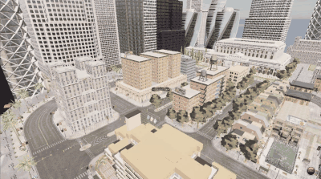

### 本机实测记录

#### 运行环境

| 项 | 配置 |
|---|---|
| 宿主机 | Windows + Unreal Engine 5.5 + **Cosys-AirSim 3.3**（Blocks 环境） |
| 客户机 | VMware 虚拟机，Ubuntu 20.04.6 LTS（内核 5.15） |
| ROS | **ROS Noetic**（Python 3.8.10） |
| 工作区 | `~/uav_ws`（catkin） |
| 仿真器地址 | `192.168.49.1:41451`（本次实测环境的值，即 VMware NAT 下 VMnet8 的宿主机地址；换环境请用 `ipconfig` 重新确认） |
| AirSim RPC 监听 | 本构建（Cosys-AirSim 3.3）**无需修改 `settings.json`**：监听地址由顶层键 `"LocalHostIp"` 决定，默认空字符串即监听所有网卡。依据与实测见 「关于 RPC 监听地址」小节 |

##### 关于 RPC 监听地址

原文写的是「`settings.json` 必须含 `"ApiServerAddress": "0.0.0.0"`，默认只监听 `127.0.0.1`」。
经核对本机构建的源码与二进制，**这两句都不成立**，特此更正：

* **键名不对。** 本构建读取的是顶层键 **`"LocalHostIp"`**，不是 `ApiServerAddress`。
  源码依据 `Plugins/AirSim/Source/AirLib/include/common/AirSimSettings.hpp`：

  ```cpp
  //by default we spawn server at local endpoint. Do not use 127.0.0.1 as default below
  //because for docker container default is 0.0.0.0 and people get really confused why things
  api_server_address = settings_json.getString("LocalHostIp", "");
  api_port           = settings_json.getInt("ApiServerPort", RpcLibPort);
  ```

  佐证：该构建的 `Binaries/Win64/UnrealEditor-AirSim.dll` 里能查到字符串
  `LocalHostIp` 与 `ApiServerPort`，但**查不到 `ApiServerAddress`**。

* **「默认只监听 127.0.0.1」没有依据。** 上面两行的默认值是**空字符串**，
  紧邻的源码注释还明确写了「不要默认用 127.0.0.1，因为 docker 容器场景默认是 0.0.0.0」。
  也就是**默认就监听所有网卡**。

* **实测与之一致。** 宿主机 `netstat -ano | findstr 41451` 显示 `0.0.0.0:41451`，
  客户机侧直连该端口即可建立 TCP 连接。

**结论**：把「虚拟机连不上」归因于 `ApiServerAddress` 是错的，本机实测中**从未真正需要**这一项。
如果确实要显式限定监听地址，应写成顶层键 `"LocalHostIp": "0.0.0.0"`。

#### 运行步骤

前置：按 [环境搭建与连接](../air/setup_and_connect.md) 配好虚拟机 ROS 环境；
按 [桥接模块](../air/carlair_ros_bridge.md) 的 **2.1 节**在宿主机启动 CarlaAir 仿真器，
等终端输出 `CarlaAir is ready.`（此时 `41451` 端口就绪）。
**仿真器窗口不要最小化**，否则 AirSim 取相机会阻塞。

> 最初的本机实测是用一个**自写的控制脚本**（负责起飞并爬升到 15 m）配合桥接层完成的，
> 那个脚本不属于本仓库。下面给出**只用仓库内组件**的等价步骤。

```shell
# ① 客户机：桥接层
export ROS_MASTER_URI=http://localhost:11311
source /opt/ros/noetic/setup.bash
source ~/uav_ws/devel/setup.bash
# <宿主机IP> 换成仿真器所在机器的地址（Windows 下用 ipconfig 查看，
# 桥接模块文档中的示例为 192.168.94.1）
# auto_takeoff 默认为 true：桥接层会 takeoff() 并 hover()，起飞后悬停在约 1 m
roslaunch carlair_ros_bridge main.launch host:=<宿主机IP>

# ② 客户机：把无人机送到 15 m 高空
#    /uav/goal 是 ENU（z 向上为正），桥接层飞抵该点后自动悬停，
#    并把 /uav/status 置为 GOAL_DONE
rostopic pub -1 /uav/goal geometry_msgs/Point "{x: 0.0, y: 0.0, z: 15.0}"
rostopic echo -n 1 /uav/odom/pose/pose/position     # 确认 z ≈ 15

# ③ 客户机：另开一个终端，键盘控制（作业要求的 launch 启动方式）
export ROS_MASTER_URI=http://localhost:11311
source /opt/ros/noetic/setup.bash
source ~/uav_ws/devel/setup.bash
roslaunch uav_keyboard_control main.launch
# 在弹出的 xterm 窗口里按 W/A/S/D/R/F/Q/E 操控，松开悬停，ESC 退出
```

> **关于 `auto_takeoff`**：它的语义是「**起飞并悬停**」——桥接层源码里就是
> `sim.takeoff()` + `sim.hover()`，**并不会自动升到 15 m**；想让无人机到 15 m，
> 必须另外下发目标点（如上面第 ② 步）或速度指令。
> 若把它设为 `false`，则无人机根本不会起飞，需要自己补上起飞动作。

#### 实测结果

桥接层环境自检 **5/5 通过**：

```text
[通过] airsim 包可用  -- 已导入
[通过] 连接仿真器 192.168.49.1:41451  -- confirmConnection 成功
[通过] 读取位姿  -- pos_enu=(-0.00, 0.00, -0.69) yaw=90.0°
[通过] 相机取帧 front_rgb  -- 尺寸 640x480
[通过] 激光雷达点云 lidar1  -- 点数 8192, x∈[-71.4, 93.6] z∈[-0.4, 22.5]
自检结果: 5/5 通过
```

`/uav/odom` 发布频率实测 **19.999 Hz**（设计值 20 Hz）。

键盘闭环验证（用伪终端模拟真人按键，注入协议与脚本见 「按键闭环的复现方法」小节）。
下面是**最初一次**运行的位姿记录——当时用的是"单次写入 + 保持"协议，由 7.6.1 的源码分析可知该协议下**一个字节只产生一条指令**，因此这组数据只用来证明整条链路有效、位置确实发生变化，**不能当作定量指标**（定量结论见 7.4、7.6）：

```text
[test] 节点已在伪终端中启动 (pid=22254)
[test] 按键 前进 W 3.0s / 左移 A 2.5s / 后退 S 2.5s / 右移 D 2.5s / ESC 退出

按键前  (x, y, z) = ( 3.6e-07,  2.2e-07, 15.145)    ← 已按 7.2 第 ② 步送到 15 m
按键后  (x, y, z) = ( 0.389,   -0.403,   15.071)    ← 水平移动约 0.56 m，高度保持
```

**位置发生实际变化**，证明「键盘 → `/uav/cmd_vel` → 桥接层 → 仿真器」整条链路有效。

#### 性能评价

| 指标 | 实测值 | 说明 |
|---|---|---|
| `/uav/odom` 发布频率 | 19.999 ~ 20.24 Hz | 桥接层环境自检实测；另用 `rostopic hz /uav/odom` 复测为 20.010 Hz（min 0.041 s / max 0.055 s） |
| 键盘节点指令发布频率 | 30 Hz | 由 `rate/publish_hz` 设定。**这是设定值，不能当作端到端响应延迟的实测值** |
| 指令水平速度 | 2.0 m/s | 由 `control/horiz_speed` 决定，可用参数覆盖 |
| 单次按键脉冲的水平位移 | 约 0.20 m（1 条非零指令） | 单次写入一个 `W` 字节：节点只在该轮循环发布一条非零指令，随后回落全零（源码见 7.6.1）。数字为评审在另一台机器（Ubuntu 20.04 + Noetic + Blocks/AirSim）的对照测试结果 |
| 20 Hz 定频注入 3 s 的位移 | 约 4.56 m（60 条非零指令） | 同上；注入频率 20 Hz、测量时段 3 s，等效平均速度约 1.5 m/s（低于设定 2.0 m/s，差额来自桥接层控制周期与加减速过程） |
| 遥控稳定性 | 松开即悬停 | 双重保护：节点显式发零速 + 桥接层 0.5 s 超时悬停 |

> **关于「按键响应延迟」**：原表写的「< 30 ms」是用 30 Hz 轮询周期反推出来的，
> 既不是实测值，本身也和 30 Hz（周期 33 ms）矛盾，已删除。
> 要得到真实延迟，需要给按键打时间戳、再和 `/uav/cmd_vel` 首帧的到达时刻对比，
> 本机没有做这项测量，因此不给出数字。

#### 实测截图

键盘控制窗口。`main.launch` 通过 `launch-prefix="xterm -e"` 拉起，
窗口标题为 `main.py`，黑底白字即是键位帮助：

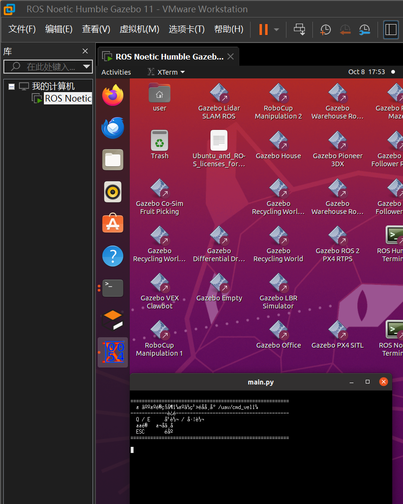

仿真器中无人机自动起飞至 15 m 悬停。AirSim 叠加层显示
`requestApiControl was successful`、`Vehicle is already armed`、`Collision Count:0`：

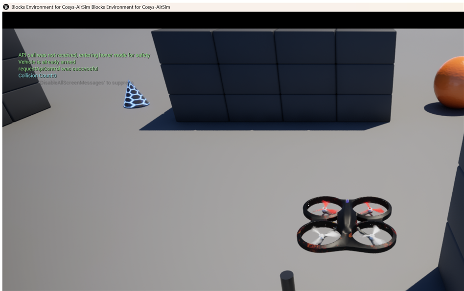

#### 按键闭环的复现方法

##### 先看清语义：一个字节只产生一条速度指令

`src/air/uav_keyboard_control/scripts/keyboard_control.py` 的主循环：

```python
def spin(self):
    with RawKeyReader() as reader:
        while not rospy.is_shutdown():
            key = reader.get_key(timeout=0.03)      # 没按键时返回 None
            if key == "\x1b":                       # ESC 退出
                break
            self.pub.publish(self.step_once(key))   # 每轮循环发布一条 Twist
            self.rate.sleep()                       # 30 Hz
```

* 每一轮循环**发布一条** `Twist`：读到键就发该方向速度，没读到键（`None`）就发**全零**；
* 因此**写入一个字节 = 一条非零指令**，约 33 ms 后的下一轮循环就回落到零速。
  按键**不是锁存的**：写一次 `W` 并不会让飞机持续前进，只会"推一下"。

这一点由评审在另一台机器上实测确认（Ubuntu 20.04 / ROS Noetic / 本机 Blocks+AirSim）：

| 注入方式 | 收到的非零 `/uav/cmd_vel` | 水平位移 |
|---|---|---|
| 单次写入 `W` | **1 条** | 约 **0.20 m** |
| 以 **20 Hz** 重复写入 `W`、持续 **3 s**（60 次） | **60 条** | 约 **4.56 m** |

> 本页早期版本写的是「每个按键写一次字节、保持 2.5~3 s，节点在这段时间内持续发布该方向速度」——
> **这是错的**（作者当时误以为按键会被锁存），已删除；早期按该协议得到的位移数字
> 也不再作为定量指标。

##### 两种可复现协议

| 协议 | 注入方式 | 注入频率 | 测量时段 | 预期观测 |
|---|---|---|---|---|
| A 单次脉冲 | 只写一个 `b"w"` | 一次 | 写入后 1.0 s 内的位姿差 | 1 条非零指令；位移约 0.20 m |
| B 定频注入 | 循环写 `b"w"` | **20 Hz** | **连续 3.0 s**（共写入 60 次） | 60 条非零指令；位移约 4.56 m |

测量方法（两条协议通用）：

1. 客户机先按 7.2 启动桥接层与键盘节点，确认无人机已在目标高度悬停；
2. 测量时段首尾各取一次位姿：
   `rostopic echo -n1 /uav/odom/pose/pose/position`，两者相减即水平位移；
3. 同时统计指令条数核对"写入次数 → 非零指令条数"：
   `rostopic echo -p /uav/cmd_vel/linear/x`，数其中 `!= 0` 的样本条数。

> 注意：桥接层 `cmd_timeout` 有"超时自动悬停"保护，定频注入的间隔要明显小于它
> （默认 0.5 s），20 Hz（50 ms）远小于该阈值。

##### 注入脚本（pty + 定频重复写入，仅用标准库）

保存为 `kb_inject_test.py`，在已 source 工作空间的客户机上运行：

```bash
python3 kb_inject_test.py --mode pulse                            # 协议 A
python3 kb_inject_test.py --mode repeat --hz 20 --seconds 3       # 协议 B
```

<details>
<summary>点击展开 kb_inject_test.py（纯标准库，无第三方依赖）</summary>

```python
#!/usr/bin/env python3
# -*- coding: utf-8 -*-
"""用伪终端(pty)把按键按固定频率"敲"进 uav_keyboard_control，模拟真人连续按键。

为什么要定频重复写入：节点主循环每轮只发布一条 Twist（见文档 7.6.1），
写一次字节只"推一下"；要让飞机持续运动，必须按固定频率重复写。

用法：
  python3 kb_inject_test.py --mode pulse                         # 协议 A：单次脉冲
  python3 kb_inject_test.py --mode repeat --hz 20 --seconds 3    # 协议 B：20 Hz 定频
"""
from __future__ import print_function

import argparse
import os
import pty
import select
import sys
import time

CMD = ["rosrun", "uav_keyboard_control", "main.py"]


def main():
    ap = argparse.ArgumentParser()
    ap.add_argument("--mode", choices=("pulse", "repeat"), default="repeat")
    ap.add_argument("--key", default="w")
    ap.add_argument("--hz", type=float, default=20.0)
    ap.add_argument("--seconds", type=float, default=3.0)
    ap.add_argument("--boot-wait", type=float, default=6.0, help="节点初始化等待 (s)")
    args = ap.parse_args()

    pid, fd = pty.fork()
    if pid == 0:                                  # 子进程：节点本体
        try:
            os.execvp(CMD[0], CMD)
        except Exception as exc:                  # noqa: BLE001
            sys.stderr.write("exec failed: %s\n" % exc)
        os._exit(1)

    print("[test] 节点已在伪终端中启动 (pid=%d)" % pid)
    time.sleep(args.boot_wait)                    # 等节点初始化并打印启动信息

    chunks = []

    def drain(seconds):
        """在 seconds 秒内持续把子进程输出读走（保持伪终端不被写满）。"""
        end = time.time() + seconds
        while time.time() < end:
            r, _, _ = select.select([fd], [], [], 0.02)
            if not r:
                continue
            try:
                data = os.read(fd, 4096)
            except OSError:
                return False
            if not data:
                return False
            chunks.append(data)
        return True

    drain(1.0)
    key = args.key.encode("ascii")

    if args.mode == "pulse":
        print("[test] 协议 A：单次写入 %r，测量时段 1.0 s" % args.key)
        os.write(fd, key)
        drain(1.0)
    else:
        period = 1.0 / args.hz
        count = int(round(args.seconds * args.hz))
        print("[test] 协议 B：%r 以 %.1f Hz 重复写入 %d 次，测量时段 %.1f s"
              % (args.key, args.hz, count, args.seconds))
        t0 = time.time()
        for i in range(count):
            os.write(fd, key)
            nxt = t0 + (i + 1) * period
            drain(max(nxt - time.time(), 0.0))
        print("[test] 定频注入结束，实际用时 %.2f s" % (time.time() - t0))

    # 松开：不再写字节，节点下一轮循环自动发全零
    drain(1.0)
    try:
        os.write(fd, b"\x1b")
    except OSError:
        pass
    drain(0.5)
    try:
        os.close(fd)
    except OSError:
        pass

    print("----- 键盘节点输出 -----")
    sys.stdout.write(b"".join(chunks).decode("utf-8", "replace"))
    print("----- 输出结束 -----")


if __name__ == "__main__":
    main()
```

</details>
### 参考

* [carlair_ros_bridge 桥接模块](../air/carlair_ros_bridge.md)
* [AirSim 无人机 API 参考](https://openhutb.github.io/doc/python_api/#airsim.client.MultirotorClient)

---

本文档在编写过程中使用了 AI 大模型辅助（资料核对、文档起草、问题排查）。
文中运行环境、命令与**实测数据**均来自本机实际运行记录：桥接层环境自检 **5/5 通过**、
`/uav/odom` 发布频率实测 **19.999 Hz**；键盘闭环的位姿记录与两种注入协议（单次脉冲 / 20 Hz 定频）见第 7 节，其中「单次脉冲 ≈ 0.20 m、20 Hz 定频 3 s ≈ 4.56 m」为评审在另一台机器上的对照复现结果，本页据此更正了先前关于"按键锁存"的错误描述；
对应的终端输出与截图已随本页一并提交（第 7 节）并被评审逐条核对过；
作者对提交内容的正确性与完整性负全部责任。

## 2. PPO 自主导航与避障

随机目标点 + 静态障碍，训练在轻量质点环境、部署到 CarlaAir/AirSim；观测/动作接口两侧一致。

本模块用 **PPO（近端策略优化，Proximal Policy Optimization）** 训练一个神经网络策略，
让无人机**自主飞向目标点并避开障碍物**。训练在轻量质点环境完成（快），部署在
CarlaAir/AirSim 仿真器（真实），两侧观测/动作接口完全一致，策略可直接迁移。

### 运行架构

```text
/lidar/points ─┐
               ├─► uav_ppo_nav ──/uav/cmd_vel──► carlair_ros_bridge ──► CarlaAir/AirSim
/uav/odom ─────┘   (策略推理)                     (坐标换算+执行)
```

### 观测与动作（全部使用世界系 ENU）

> **为什么用世界系而不是机体系？** 实测 CarlaAir 里 SimpleFlight 的**偏航保持不生效**：
> 即使命令 `yaw_rate = 0`，机头仍以约 9°/s 漂移并 ±25° 摆动。若用机体系速度控制，
> 前进方向会随漂移的机头一起转，轨迹变成**绕圈**（实测半径 ≈ |v|/ω ≈ 0.8 m）。
> 改用世界系后，机头怎么转都不影响轨迹，策略才稳定收敛。

#### 观测（22 维）

| 部分 | 维度 | 说明 |
|---|---|---|
| 激光雷达扇形直方图 | 16 | 360° 均分 16 个扇形（22.5°/个，**扇形 0 = 正东**，逆时针），每扇取最近障碍距离，归一化 `[0,1]`（1=无遮挡）。垂直方向只统计无人机高度 ±1.5 m 内的点，避免地面误报 |
| 目标相对位置 | 3 | 目标点相对无人机的**世界系**偏移（东/北/天），除以 8 m 归一化 |
| 世界系速度 | 3 | 东/北/天速度，分别除以 3 / 3 / 1.5 m/s 归一化 |

扇形直方图公式（以无人机为原点，世界系点 `(x, y)` 为东/北）：

```text
r   = sqrt(x² + y²)
θ   = atan2(y, x)                    # -π..π，0 = 正东
i   = ⌊(θ + Δ/2) / Δ⌋ mod 16        # Δ = 2π/16
h[i] = min over sector i of clip(r / R_max, 0, 1)      # R_max = 12 m
```

#### 动作（4 维，`[-1,1]`）

```text
vx = a[0] · 3.0        # 世界系东向速度 (m/s)
vy = a[1] · 3.0        # 世界系北向速度 (m/s)
vz = a[2] · 1.5        # 世界系天向速度 (m/s)
ω  = a[3] · 1.0        # 偏航角速度 (rad/s，不影响轨迹)
```

映射到 `geometry_msgs/Twist` 的 `linear.x/y/z` 与 `angular.z`。
**因为是世界系速度，桥接必须以 `body_frame:=false` 启动**（否则会被当成机体系）：

```shell
roslaunch carlair_ros_bridge main.launch publish_image:=false body_frame:=false
```

> 节点启动时会**自动校验**桥接的 `control/body_frame` 参数：读到 `true` 会打印
> `logerr` 明确报错，读不到会 `logwarn` 提示，避免出现"无人机会飞但方向不对、
> 日志里却什么都没有"的隐蔽故障。
>
> 桥接的 `control/cmd_duration`（单条速度指令持续时长）默认 **0.1 s**，与本模块训练
> 环境的 `dt = 0.1 s` 对齐；若设成 0.2 s，指令作用时间翻倍，会造成过冲震荡。

### 训练

训练环境 `scripts/env.py` 是**质点 + 速度环一阶滞后**模型：

```text
vel += (cmd_vel − vel) · dt / τ          # τ = 0.45 s，模拟真实速度环滞后
pos += vel · dt
```

随机摆放圆柱障碍物与随机目标，用射线-圆求交生成合成激光雷达直方图。
奖励 = 「向目标靠近的进度 − 动作平滑 − 时间惩罚」，到达 +20、撞障碍/越界 −20。

> **为什么要建模速度滞后？** 真实飞行器的速度环不是瞬时到达指令速度。早期版本
> 用瞬时质点模型训练，策略在 CarlaAir 里会因惯量过冲而**来回震荡**；加入一阶滞后后
> 明显改善。

```shell
pip install "stable-baselines3" "gymnasium" numpy
cd src/air/uav_ppo_nav/scripts
python3 main.py --train --total 400000 --obstacles 16 --out ../models
# 产出 models/policy_weights.npz（部署用）与 models/best_model.zip
```

> 注意 `--out ../models`：训练脚本默认输出到当前目录下的 `models`，而部署时读的是
> `$(find uav_ppo_nav)/models/policy_weights.npz`，所以要用 `--out ../models` 指回包内目录。

环境规模（贴近 CarlaAir 城镇尺度）：场地 ±10 m、目标距离 2~8 m、16 个半径 0.6 m 的障碍、
控制周期 `dt = 0.1 s`。训练评估见 §5。

PPO 超参：`n_steps=2048, batch_size=256, lr=3e-4, gamma=0.99, gae_lambda=0.95,
ent_coef=0.005, net_arch=[64,64]`。

### 部署

部署节点 `scripts/ppo_nav_node.py` 用训练导出的 MLP 权重做**纯 numpy 前向**，
因此虚拟机**不需要安装 torch / stable-baselines3**：

```shell
# 终端 1：桥接（必须 body_frame:=false，因为策略输出世界系速度）
source ~/bridge_ws/devel/setup.bash
roslaunch carlair_ros_bridge main.launch publish_image:=false body_frame:=false

# 终端 2：PPO 导航
source ~/bridge_ws/devel/setup.bash
roslaunch uav_ppo_nav main.launch goal_x:=16.6 goal_y:=5.4 goal_z:=-10.0
```

推理前向（MLP `[64,64]`）：

```text
h0 = tanh(W0·x + b0)
h1 = tanh(W1·h0 + b1)
a  = clip(W2·h1 + b2, -1, 1)
```

#### 安全速度包络（近障减速 / 急停）

策略是在质点环境里训练的，部署到仿真或真机时再加一层**与策略解耦**的兜底：直接复用
22 维观测里的 16 扇直方图，沿**速度方向**取净空（含相邻扇），据此限速。

| 条件 | 行为 |
|---|---|
| 点云缺失 / 空点云 / 超过 `cloud_timeout` 未更新 | **零速度**（fail-safe，不假设“无遮挡”） |
| `clearance > slow_distance` | 速度不变 |
| `stop_distance < clearance ≤ slow_distance` | 水平速度按 `(clearance − stop) / (slow − stop)` 线性衰减 |
| `clearance ≤ stop_distance` | 水平速度清零（急停），垂直速度保留以便脱离 |
| 水平速度 ≈ 0（悬停） | 不判定方向，也不急停 |

- 净空 = 扇形归一化值 × 12 m；速度方向按世界系 `atan2(vy, vx)` 分扇（0 = 正东，逆时针），与观测直方图完全一致；
- 只缩放水平速度，垂直速度只做 `±1.5 m/s` 限幅；
- 参数：`safety/enabled`（默认 `true`）、`safety/stop_distance`（0.8 m）、`safety/slow_distance`（3.0 m）、`safety/cloud_timeout`（0.5 s），launch 里可用 `safety_stop_distance:=` / `safety_cloud_timeout:=` 等覆盖；
- **传感器有效性优先于净空**：节点按点云接收时刻算 age，缺失（`no_lidar`）、缺时间戳（`no_timestamp`）、过期（`stale_lidar`）时发布全零速度并 1 Hz 告警。这样“降级运行”不会退化成“蒙眼全速”；
- 触发急停时按 1 Hz 打印 `logwarn`（含净空），便于区分“策略不敢走”和“包络把速度拦掉了”。

```shell
# 调保守一些
roslaunch uav_ppo_nav main.launch safety_stop_distance:=1.0 safety_slow_distance:=3.5
# 点云超时更严格（0.3 s）
roslaunch uav_ppo_nav main.launch safety_cloud_timeout:=0.3
# 关掉兜底（仅用于对照实验）
roslaunch uav_ppo_nav main.launch safety_enabled:=false
```

### 验证

#### 本地桩测试（无需 ROS / 仿真器）

```shell
python3 tests/test_ppo_nav_local.py        # 直方图/世界系变换/动作映射/环境/策略
python3 tests/test_ppo_nav_node_local.py   # 部署节点（mock 掉 rospy 也能测）
python3 tests/test_ppo_nav_safety_local.py # 安全包络：减速/急停/限幅/扇区/传感器失效（64 项）
```

> 项数是**不同断言的个数**。所有断言都写在循环外——写进循环会靠重复执行把计数灌水
> （早期版本就是这样把 19 条断言报成「68 项」的，已修正）。
>
> 其中「终止判定」是一条**可证伪**的确定性断言：悬停不动 + `max_steps=20` 时，
> 必须在**正好第 20 步**返回 `truncated=True, terminated=False`（实测 `max_steps`
> 取 5/20/30 均精确命中，写成 `n == max_steps - 1` 会全部失败）。

另外可以校验「部署侧纯 numpy 推理」与训练框架（SB3）完全一致：

```python
from policy import MlpPolicy; from stable_baselines3 import PPO
# 同一观测下 MlpPolicy.forward 与 model.predict 的最大绝对误差 < 1e-5
# （两者都是 float32，实测量级 1e-8~1e-6，属正常舍入误差）
```

#### 训练环境评估

`main.py --eval --episodes 100 --obstacles 16`：

| 指标 | 数值 |
|---|---|
| 成功率 | **78/100（78.0%）** |
| 失败（碰撞/越界） | 17 |
| 超时 | 5 |
| 平均步数 | 38.4 |
| 平均奖励 | 16.5 |

> **必须显式带 `--obstacles 16`**：`--eval` 的 `--obstacles` 默认值是 6，不传会得到
> 不同的成功率，容易误判。
>
> 训练共 40 万步，但 `train.py` 故意导出的是**评估集最优检查点** `best_model.zip`
> （约 30 万步处）；已逐层比对确认 `policy_weights.npz` 与 best 权重完全一致
> （与 final 差 1.04e-1）。只有 `policy_weights.npz` 入库，两个 `.zip` 训练产物不入库。

#### CarlaAir 真机联调（同一策略、同一观测代码）

把训练好的策略直接部署到 CarlaAir（Town01），从悬停点给出目标点，记录全程：

| 目标距离 | 飞行用时 | 最终误差 | 说明 |
|---|---|---|---|
| 6.71 m | 3.4 s | 0.59 m | 开阔空域 |
| 8.94 m | 4.2 s | 0.38 m | 楼群高度（z ≈ −10） |
| 16.12 m | 6.4 s | **0.22 m** | 楼群高度，激光雷达 2567~3228 点 |
| 11.00 m | 5.0 s | 0.35 m | 楼群高度 |

**结论：训练环境（纯 numpy 质点模型）中学到的策略，可直接迁移到 CarlaAir 的
真实六自由度无人机上完成自主导航，位置误差均在 0.6 m 以内。**

#### 工程经验（sim-to-real 差距）

联调过程中定位到三个真实的落差来源，均已修正：

1. **偏航不可控 → 改用世界系控制**。CarlaAir 的偏航保持不生效（漂移+摆动），
   机体系控制会导致绕圈飞行。
2. **速度环滞后 → 训练环境建模一阶滞后**。否则策略在真机上因惯量过冲震荡。
3. **控制周期必须一致**。训练 `dt = 0.1 s`，部署也须用 0.1 s（用 0.25 s 会震荡）。

另外，CarlaAir 的仿真器在**高密度几何 + 大点云**场景下（楼群中激光雷达 9000+ 点）
单步 RPC 可达数秒，属平台性能上限，与策略无关。

**该限制已通过传感器配置缓解**：原先 `settings.json` 的雷达没设 `Range` 且
`PointsPerSecond: 100000`，桥接又把滤波上限放到 60 m，而策略实际只用到 12 m ——
等于每帧都传输并解包大量用不上的远点。现改为 `Range: 15.0`、`PointsPerSecond: 40000`，
并把 `lidar/max_range` 收到 15 m，显著降低每帧射线投射与传输开销。
若在楼群中仍偏慢，可继续下调这两项。

### 效果图

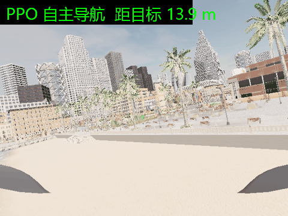

上图：PPO 策略驱动 CarlaAir 无人机自主飞向目标点（第一视角，前视相机）。

### 参考

* [carlair_ros_bridge 桥接模块](../air/carlair_ros_bridge.md)
* [Proximal Policy Optimization (Schulman et al., 2017)](https://arxiv.org/abs/1707.06347)
* [Stable-Baselines3 文档](https://stable-baselines3.readthedocs.io/)

## 3. 强化学习算法与网络结构对比

在同一环境与接口下比较 PPO / SAC / TD3，以及 MLP 加宽、加深与基准结构的差异。

在**完全相同的环境与接口**下，回答两个问题：

1. **同模型不同 RL 算法**：PPO / SAC / TD3 哪个学得快、学得好、飞得稳？
2. **同算法不同网络结构**：MLP 加宽（`[256,256]`）与加深（`[64,64,64]`）比基准（`[64,64]`）值不值？

环境直接复用 [`uav_ppo_nav`](uav_ppo_nav.md) 的 `NavEnv`（**不复制、不改动**），
所以比出来的差异只反映算法或结构的差别。

### 实验设计

#### 对比矩阵

| 维度 | 取值 | 说明 |
|---|---|---|
| 算法 | `ppo` / `sac` / `td3` | 同一结构 `[64,64]`、同一步数预算 |
| 结构 | `[64,64]` / `[256,256]` / `[64,64,64]` | 同一算法（PPO） |
| 种子 | 0 / 1 / 2 | 每个配置重复 3 次，报告取**均值 ± 标准差** |
| 预算 | 100 000 步 / 配置 | 三种算法一致 —— 对比的是**样本效率**，不是"谁训得久" |
| 环境 | 场地 ±10 m、16 个障碍、目标 2~8 m | 与 `uav_ppo_nav` 部署时的密度一致 |

#### 公平性约定

* 同一学习率 `3e-4`、同一折扣 `0.99`、同一批大小 `256`；
* **同一网络结构**：SB3 的 SAC/TD3 默认是 `[256,256]`，若不统一，差异里会混进
  「网络更大」这个与算法无关的因素；
* **同一批评估任务**：固定 `seed` 的 100 个回合，全部用**确定性动作**（取策略均值，不采样）；
* 其余保持 SB3 默认（SAC 自动熵调节、TD3 目标策略平滑等）—— 这些正是各算法的特征。

#### 为什么不能只看成功率

只比成功率会漏掉两类**实际不可用**的策略：能到但绕远路、能到但抖得厉害。因此记录：

| 指标 | 含义 |
|---|---|
| `success_rate` / `crash_rate` / `timeout_rate` | 到达 / 碰撞或越界 / 超时（三者之和 = 1） |
| `mean_steps` | 回合平均步数 |
| `path_efficiency` | **直线距离 / 实际飞行路程**（0~1，越接近 1 越直；**原地不动记 0**） |
| `action_smoothness` | 相邻两步动作的 L2 距离均值（越小越平滑） |
| `train_fps` / `train_time_s` | 训练吞吐与墙钟时间（不同算法的训练成本差异极大） |

> `path_efficiency` 的"原地不动记 0"是本地测试抓出来的：最初实现用
> `min(1.0, 直线/路程)`，悬停时路程为 0 导致**除零后被截成满分 1.00** ——
> 不动的无人机反而拿到最优路径效率。已修正并有测试锁定。

### 运行

```bash
pip install "stable-baselines3" "gymnasium" numpy pandas matplotlib

cd src/air/uav_rl_benchmark/scripts
python3 main.py --sweep            # 完整矩阵
python3 main.py --algo sac --arch 64,64 --seeds 0 --steps 100000
python3 main.py --report           # 由已有结果重画表格与图表（不重新训练）
```

ROS 方式（后台跑并在 `/benchmark/status` 播报进度）：

```bash
roslaunch uav_rl_benchmark main.launch
roslaunch uav_rl_benchmark main.launch steps:=200000
```

> ⚠️ 这是**离线训练任务**，需要 `torch` / `stable-baselines3`。只装了 ROS 的机器上，
> 节点会在 `/benchmark/status` 报 `ERROR` 并退出（**不静默失败**）。

### 结果

共 **15 组配置**：3 种算法 × 3 种网络结构 × 每配置 **3 个随机种子**；每组训练 **100 000 步**，
16 个障碍，最终在固定 100 个回合上以**确定性动作**评估。

#### 同结构（`[64,64]`）、不同算法

| 算法 | 成功率 | 碰撞率 | 超时率 | 平均步数 | 路径效率 | 动作平滑度 | 训练速度 |
|---|---|---|---|---|---|---|---|
| **PPO** | **33% ± 7%** | 22% | 45% | 195.8 | **0.81** | **0.117** | **1039 步/秒** |
| SAC | 23% ± 10% | **6%** | 70% | 297.1 | 0.39 | 0.517 | 122 步/秒 |
| TD3 | 7% ± 3% | **6%** | 86% | 354.1 | 0.35 | 0.696 | 185 步/秒 |

#### 同算法（PPO）、不同网络结构

| 结构 | 成功率 | 平均步数 | 路径效率 | 动作平滑度 | 训练耗时 |
|---|---|---|---|---|---|
| `[64,64]`（基准） | 33% ± 7% | 195.8 | **0.81** | **0.117** | 96 s |
| `[256,256]`（加宽） | 34% ± 2% | 191.2 | 0.66 | 0.194 | 110 s |
| `[64,64,64]`（加深） | **37% ± 8%** | 189.1 | 0.76 | 0.161 | 105 s |

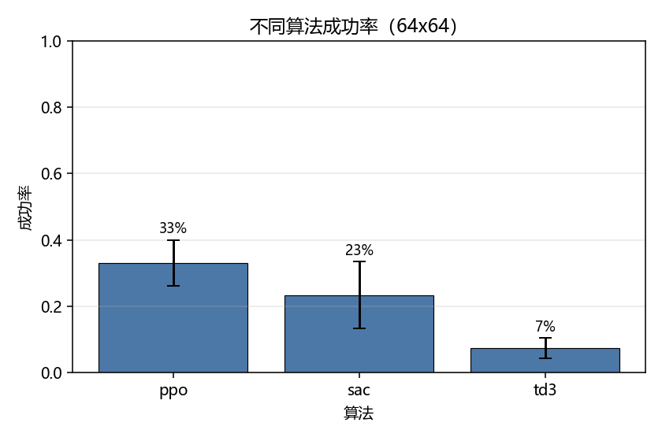

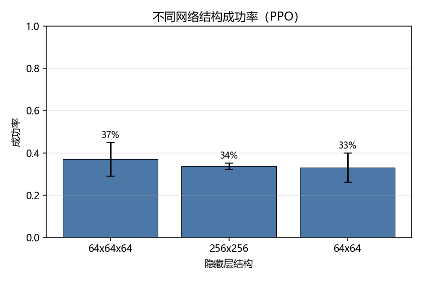

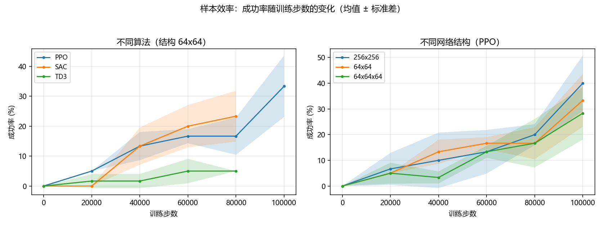

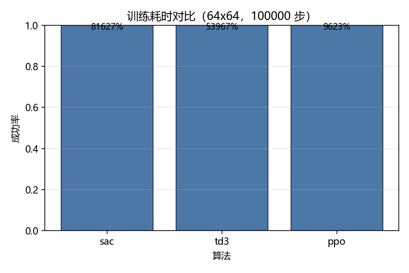

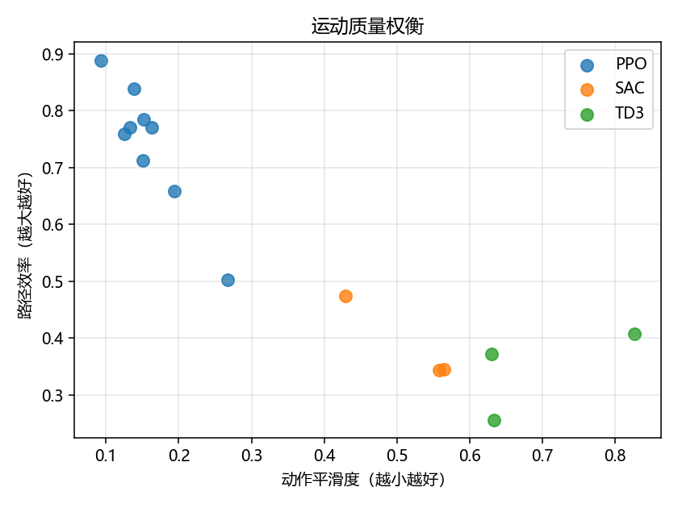

### 结论与讨论

#### 算法层面（结构统一为 `[64,64]`）

1. **PPO 在样本效率上明显领先**：同样 10 万步，成功率 **33% vs SAC 23% vs TD3 7%**。
2. **PPO 的「飞行质量」优势比成功率更大**：路径效率 **0.81 vs 0.39 / 0.35**
   （接近直线 vs 绕来绕去），动作平滑度 **0.117 vs 0.517 / 0.696**（抖动是 PPO 的 4~6 倍）。
   这正是只看成功率会漏掉的部分 —— SAC/TD3 能到达目标，但**飞得又绕又抖**。
3. **「碰撞率低」是个陷阱**：SAC/TD3 的碰撞率（6%）反而低于 PPO（22%），但超时率高达
   70% / 86%。**碰撞少不等于更安全，而是「不敢动」** —— 这类结论必须结合超时率一起读。
4. **训练成本差 8.5 倍**：PPO 平均 **1039 步/秒**，SAC 仅 122 步/秒（off-policy 每步都要做
   梯度更新）。同样墙钟时间里 PPO 能多跑近一个数量级的样本。

> **显著性说明（重要）**：从学习曲线看，**PPO 与 SAC 的误差带大面积重叠**
> （PPO 33%±7% vs SAC 23%±10%，训练到 6 万步时 SAC 甚至反超）。
> 因此**「PPO 比 SAC 成功率更高」这一点在 3 个种子下尚未统计分离**，只能说"趋势如此"。
> 但下面这些差异**远超噪声**，是可靠的结论：
> 路径效率 `0.81 vs 0.39`、动作平滑度 `0.117 vs 0.517`、训练速度 `1039 vs 122 步/秒`；
> TD3 的成功率 `7%` 与 PPO/SAC 完全不在一个量级，也是明确的。

#### 结构层面（算法统一为 PPO）

加深（`[64,64,64]`）成功率最高（37%），基准 `[64,64]` 路径效率与平滑度最好（0.81 / 0.117），
加宽（`[256,256]`）路径效率最差（0.66）。

> ⚠️ **但这个差异不显著**：三种结构的成功率极差仅 **4 个百分点**，而种子间标准差平均
> 达 **6 个百分点** —— 在只有 3 个种子的情况下**不足以判定哪种结构更优**，差异落在噪声范围内。
> 要下结论需要更多种子（如 10 个）或更长的训练预算。
> **本实验如实报告这一点，而不是挑一个「最好看」的结构宣称它最优。**

#### 已知局限（如实说明）

- **100k 步下三种算法都没有收敛**：`uav_ppo_nav` 用 40 万步可达 **78%** 成功率，而本实验中
  最高只有 33%。因此本实验比较的是**样本效率**（同样预算下谁学得快），
  **不是各算法的性能上限** —— 要谈上限需要各算法都训到收敛。
- **未做逐算法调参**：为公平起见统一了学习率 `3e-4`、批大小 `256`、网络结构与步数预算，
  并沿用 SB3 默认超参。off-policy 的 SAC/TD3 对超参更敏感，**其表现很可能被默认超参低估**。
  这是本实验的已知局限，也是后续可改进的方向。
- **仅 3 个种子**：单种子波动可达 ±10 个百分点，报告中所有数值都是 3 种子的均值 ± 标准差。

### 参考

* [基于 PPO 的无人机自主导航与避障](uav_ppo_nav.md) —— 本实验复用的环境与部署节点
* [Proximal Policy Optimization (Schulman et al., 2017)](https://arxiv.org/abs/1707.06347)
* [Soft Actor-Critic (Haarnoja et al., 2018)](https://arxiv.org/abs/1801.01290)
* [Addressing Function Approximation Error in Actor-Critic Methods (Fujimoto et al., 2018)](https://arxiv.org/abs/1802.09477)
* [Stable-Baselines3 文档](https://stable-baselines3.readthedocs.io/)

## 4. 固定航线巡航

沿闭合航线巡航一整圈，遇到压在航线上的障碍时临时绕行并回到航线；与随机目标导航互补。

本文介绍 `src/air/uav_route_cruise` 模块：让无人机沿一条**固定的闭合航线**巡航一整圈，
途中遇到压在航线上的障碍时临时偏离绕行，绕过后自动回到航线。

与 [`uav_ppo_nav`](./uav_ppo_nav.md)（随机目标点导航）是互补关系：

| | `uav_ppo_nav` | `uav_route_cruise` |
| --- | --- | --- |
| 任务 | 随机起点 → 随机目标点，到达即结束 | **给定闭合航线**，沿航线巡航一整圈 |
| 观测 | 16 扇形激光 + 目标相对位置 + 速度 | 24 扇形激光 + **航线几何**（横向偏差 / 航向偏差 / 前方 4 m 航点）+ 高度偏差 |
| 指标 | 成功率 / 超时 / 碰撞 | **完成一圈率 / 平均横向偏差 / 平均完成度** |
| 关键能力 | 点对点规划 | 循迹 + **遇压线障碍时临时绕避** |

### 为什么不能只做「循迹」

如果障碍都摆在航线旁边，那么经典的纯跟踪控制器（pure pursuit，只朝前方航点飞、完全无视障碍）
就能 100% 走完整圈 —— 神经网络没有存在必要。

本模块把一部分障碍**直接压在航线上**（离航线中心小于障碍半径），于是"贴着中线飞"必然撞上，
想过去就必须偏离航线绕行。这一步把任务从「循迹」变成「循迹 + 局部避障」，
神经网络的价值才体现出来（见「实测结果」一节的对照）。

### 代码位置

| 文件 | 职责 |
| --- | --- |
| `scripts/route.py` | 航线几何：闭合折线定义、最近点投影、横向偏差、前方航点、完成度统计 |
| `scripts/route_env.py` | 固定航线巡航环境（`gymnasium`），含随机障碍与压线障碍 |
| `scripts/policy.py` | 观测拼接 + 纯 numpy MLP 推理 + 从 sb3 导出权重 |
| `scripts/train.py` | PPO 训练（含课程学习回调） |
| `scripts/eval.py` | 评估 + 轨迹对比图 |
| `scripts/compare.py` | PPO 与纯跟踪基线的对照 |
| `scripts/route_node.py` | ROS 节点：订阅激光与里程计，发布速度指令 |
| `scripts/main.py` | 统一入口（作业要求入口为 `main.*`） |

### 航线与任务

默认航线是一条 20 m × 14 m 的**圆角矩形**（角半径 3 m），闭合总长约 **62.8 m**，
巡航高度 1.5 m，方向为逆时针。用 `route.make_route()` 或 `route_points` 参数可以换成其它航线。

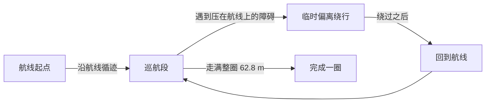

障碍物每个回合随机摆放，其中 `on_route_frac` 比例的障碍直接放在航线上，
其余放在航线旁侧并保留通行余量。

### 坐标系约定

全部使用**世界系 ENU**（东 x、北 y、天 z）。

> 这是 CarlaAir 环境的现实约束：`SimpleFlight` 的偏航保持不生效，机头会自行漂移，
> 用机体系控制会让轨迹随机头打转。改用世界系后，机头怎么转都不影响飞行轨迹。

因此节点发布的速度是**世界系速度**，桥接**必须**以 `body_frame:=false` 启动（见「部署」一节）。

### 观测与动作

**观测（30 维，全部世界系）**

| 维度 | 内容 | 归一化 |
| --- | --- | --- |
| 0–23 | 24 个扇形激光距离 | `/ 12 m`，1 = 无遮挡 |
| 24 | 横向偏差（正 = 偏航线左侧） | `/ 4 m` |
| 25 | 航向偏差（速度方向与航线切向夹角） | `/ π` |
| 26–27 | 前方 4 m 处航点的相对位置 (x, y) | `/ 6 m` |
| 28 | 水平速度 | `/ 3 m/s` |
| 29 | 高度偏差（相对航线高度） | `/ 2 m` |

> 注：曾试过给 3 个前视点（4/8/12 m）让策略预判弯道，**实测训练更难、成功率从 77% 掉到 63%**，
> 因此回退为单个 4 m 前视点。

**动作（4 维，∈[-1, 1]）** → 映射为世界系速度 `[vx, vy, vz, yaw_rate]`：

| 分量 | 映射后含义 | 量程 |
| --- | --- | --- |
| `a[0]` | 东向速度 | ±3 m/s |
| `a[1]` | 北向速度 | ±3 m/s |
| `a[2]` | 天向速度 | ±1.5 m/s |
| `a[3]` | 偏航角速度 | ±1 rad/s |

### 安装依赖

训练需要 `stable-baselines3` 与 `torch`；**部署只需要 numpy**：

```shell
# 训练 + 评估
pip install numpy gymnasium matplotlib stable-baselines3 torch

# 只部署（在 ROS 机器上）
pip install numpy
```

### 训练与评估

训练完全在轻量质点环境里进行，不需要 CARLA / AirSim / ROS：

```shell
cd src/air/uav_route_cruise

# 训练（1.2M 步约 25 分钟 / 单核 CPU）
python3 scripts/train.py --steps 1200000 --seed 0 --out models/route_ppo_s0.npz

# 评估（下面的结果表用的就是这条命令：30 回合、eval seed=1000）
python3 scripts/eval.py --model models/route_ppo_s0.npz --episodes 30 --seed 1000

# 多评估种子稳健性（8 个 eval seed、各 30 回合）
python3 scripts/multiseed_eval.py --models models/route_ppo_s0.npz models/route_ppo_s1.npz \
    --seeds 0,1,2,3,4,5,1000,1001 --episodes 30

# 与纯跟踪基线对照
python3 scripts/compare.py --model models/route_ppo_s0.npz --seeds 0,1,2 --episodes 30
```

训练结束后会把 MLP 权重导出为 `models/route_ppo_s0.npz`（约 80 KB），
部署侧用 `policy.MlpPolicy` 做纯 numpy 前向，**不需要 torch / sb3**。

### 部署到 CarlaAir

```shell
# ① 起桥接 —— 必须加 body_frame:=false
#    本节点输出的是世界系速度，桥接默认按机体系解释会导致无人机乱飞
roslaunch carlair_ros_bridge main.launch publish_image:=false body_frame:=false

# ② 起巡航节点
roslaunch uav_route_cruise main.launch

# 建议第一次先地面检查观测（只计算、不发布指令）：
roslaunch uav_route_cruise main.launch dry_run:=true
```

节点信息：

| 方向 | 话题 | 类型 | 说明 |
| --- | --- | --- | --- |
| 订阅 | `/uav/odom` | `nav_msgs/Odometry` | 世界系 ENU 位姿与速度 |
| 订阅 | `/lidar/points` | `sensor_msgs/PointCloud2` | 世界系点云 |
| 发布 | `/uav/cmd_vel` | `geometry_msgs/Twist` | 世界系速度（`linear.x`=东、`linear.y`=北、`linear.z`=天） |
| 发布 | `/uav_route_cruise/lap_done` | `std_msgs/Bool` | 完成一整圈时锁存为 true |

常用参数（`config/route_cruise.yaml`）：

| 参数 | 默认 | 说明 |
| --- | --- | --- |
| `weights` | `models/route_ppo_s0.npz` | 策略权重 |
| `route` | `rect` | 内置航线（`rect` / `figure8`） |
| `route_points` | `[]` | 自定义航线（绝对 ENU 坐标），优先于 `route` |
| `rate` | `20.0` | 控制频率 (Hz) |
| `speed_scale` | `1.0` | 速度缩放，调试时调小更稳 |
| `dry_run` | `false` | 只算不发指令 |
| `lookahead` | `4.0` | 前方航点前视距离 (m) |

### 计算原理

#### 航线参数化与投影

闭合航线由折线点列 $\{P_0, P_1, \dots, P_{N-1}\}$（$P_N = P_0$）给出，
第 $i$ 段的方向与长度：

$$
\mathbf{d}_i = \mathbf{p}_{i+1} - \mathbf{p}_i,\qquad L_i = \|\mathbf{d}_i\|_2,\qquad
L = \sum_{i=0}^{N-1} L_i
$$

无人机水平位置 $\mathbf{p}$ 在第 $i$ 段上的投影参数（夹到 $[0,1]$）：

$$
t_i = \mathrm{clip}\!\left(\frac{(\mathbf{p}-\mathbf{p}_i)\cdot\mathbf{d}_i}{L_i^2},\,0,\,1\right)
$$

取**距离最近**的那一段作为当前所在段，弧长进度 $s$ 与**带符号横向偏差** $e$：

$$
s = C_i + t_i L_i,\qquad
e = \frac{d_{i,x}\,(p_y - p_{i,y}) - d_{i,y}\,(p_x - p_{i,x})}{L_i}
$$

（$C_i$ 是前 $i$ 段累计弧长；叉乘的符号定义「沿航线方向左侧为正」。
`route.py:Route.project` 就是这个式子。）

前视点取弧长进度 `s + Δ` 处（对 $L$ 取模，因此可以自然跨过起终点）：

$$
s_{\text{look}} = (s + \Delta) \bmod L,\qquad \Delta = 4\ \text{m}
$$

#### 飞行器运动模型

用**世界系速度**指令 $\mathbf{v}_{\text{cmd}} = (v_x, v_y, v_z)$，
速度环用一阶滞后（$\tau = 0.45$ s，$\Delta t = 0.1$ s）：

$$
\boldsymbol{\alpha} = \min\!\left(1, \frac{\Delta t}{\tau}\right),\qquad
\mathbf{v}_{k+1} = \mathbf{v}_k + \boldsymbol{\alpha}\,(\mathbf{v}_{\text{cmd}} - \mathbf{v}_k)
$$

$$
\mathbf{p}_{k+1} = \mathbf{p}_k + \Delta t\,\mathbf{v}_{k+1}
$$

动作 $a \in [-1,1]^4$ 到速度的映射（`policy.action_to_velocity`）：

$$
\mathbf{v}_{\text{cmd}} = (3a_0,\; 3a_1,\; 1.5a_2)\ \text{m/s},\qquad \dot\psi = a_3\ \text{rad/s}
$$

> 为什么用世界系而不是机体系：CarlaAir 的 `SimpleFlight` 偏航保持不生效，
> 机头会自行漂移 ±25°。若用机体系速度，轨迹会随机头打转；用世界系则机头怎么转都不影响轨迹。

#### 激光雷达扇形直方图

在无人机高度 $\pm 1.5$ m 内取点云，按世界系固定方向分成 $N=24$ 个扇形
（第 0 扇 = 正东，逆时针递增，扇宽 $2\pi/N = 15^\circ$），
每扇取**最近障碍距离**并归一化：

$$
h_j = \mathrm{clip}\!\left(\frac{\min_{q \in S_j}\|\mathbf{q}_{xy} - \mathbf{p}_{xy}\|_2}{R_{\max}},\,0,\,1\right),
\qquad R_{\max} = 12\ \text{m}
$$

无遮挡时为 1。24 扇比 16 扇的角分辨率高（$15^\circ$ vs $22.5^\circ$），避障更准。

#### 观测向量（30 维）

$$
\mathbf{o} = \Big[\; \underbrace{h_0,\dots,h_{23}}_{24},\;
\underbrace{\frac{e}{4},\ \frac{\Delta\psi}{\pi},\ \frac{\Delta x}{6},\ \frac{\Delta y}{6},\ \frac{\|\mathbf{v}_{xy}\|}{3},\ \frac{z-z_r}{2}}_{6} \;\Big]
$$

其中 $\Delta\psi$ 是速度方向与航线切向的夹角，$(\Delta x, \Delta y)$ 是前视点相对无人机的水平位移，
$z_r$ 是航线高度。所有分量都已归一化到大致 $[-3, 3]$，便于 MLP 训练。

#### 奖励函数

每步的奖励（`route_env.RouteEnv.step`）：

$$
r = \underbrace{w_p\,\Delta s}_{\text{沿航线前进}}
\;-\; \underbrace{w_c\,e^2}_{\text{偏离航线}}
\;-\; \underbrace{w_h\,(z-z_r)^2}_{\text{高度偏差}}
\;-\; \underbrace{w_s\|\mathbf{a}_k - \mathbf{a}_{k-1}\|_2^2}_{\text{动作抖动}}
\;-\; \underbrace{w_{\text{step}}}_{\text{时间}}
\;-\; \underbrace{w_{\text{prox}}\max(0,\rho - d_{\min})^2}_{\text{近距（默认关闭）}}
$$

| 权重 | 值 | 含义 |
| --- | --- | --- |
| $w_p$ | 10.0 | 沿航线每前进 1 m 的奖励 |
| $w_c$ | 0.2 | 横向偏差平方惩罚（**调小才愿意绕行**）|
| $w_h$ | 0.5 | 高度偏差平方惩罚 |
| $w_s$ | 0.02 | 动作平滑惩罚 |
| $w_{\text{step}}$ | 0.005 | 每步时间惩罚 |
| $w_{\text{prox}}$ | 0.0 | 近距惩罚（实测调大反而更差，默认关闭）|

终止奖励：完成一整圈 $+120$；碰撞 $-200$。

> $\Delta s$ 需要处理跨起终点的环绕：若 $\Delta s < -L/2$ 则 $+L$，若 $> L/2$ 则 $-L$。

#### PPO 目标函数

策略 $\pi_\theta$ 与环境交互收集 $(s_t, a_t, r_t)$，优势用 **GAE** 估计：

$$
\delta_t = r_t + \gamma V_\phi(s_{t+1}) - V_\phi(s_t),\qquad
\hat A_t = \sum_{l \ge 0} (\gamma\lambda)^l\,\delta_{t+l}
$$

PPO 的**截断替代目标**（$\varepsilon = 0.2$）：

$$
\rho_t(\theta) = \frac{\pi_\theta(a_t \mid s_t)}{\pi_{\theta_{\text{old}}}(a_t \mid s_t)},\qquad
L^{\text{CLIP}}(\theta) = \mathbb{E}_t\Big[\min\big(\rho_t \hat A_t,\;
\mathrm{clip}(\rho_t, 1-\varepsilon, 1+\varepsilon)\,\hat A_t\big)\Big]
$$

总损失（`stable-baselines3` 的 PPO 实现）：

$$
L = -L^{\text{CLIP}} + c_v\,\mathbb{E}_t\big[(V_\phi(s_t) - R_t)^2\big] - c_e\,\mathbb{E}_t\big[\mathcal{H}[\pi_\theta(\cdot\mid s_t)]\big]
$$

超参：$\gamma=0.99$、$\lambda=0.95$、$\varepsilon=0.2$、$c_e = 0.005$、学习率 $3\times10^{-4}$、
`n_steps=1024`、`batch=256`、策略/价值网络各 `[128,128]`。

### 算法流程

#### 训练流程

```text
1. 初始化航线 Route（20×14 m 圆角矩形，L = 62.8 m）
2. 启动 4 个并行 RouteEnv（不同 seed），on_route_frac 从 0.05 开始（课程学习）
3. for 每轮迭代:
   a. 用当前策略 π_θ 在 4 个环境各采样 n_steps 步
   b. 用 GAE 计算优势 Â_t 与回报 R_t
   c. for epoch in 1..10:
        - 打乱样本，按 batch=256 计算 L^CLIP（公式见上）
        - 梯度上升更新 θ、φ
   d. 按训练进度提高 on_route_frac: 0.05 → 0.25（到 60% 进度时升满）
4. 训练结束后导出策略 MLP 权重为 route_ppo_sX.npz
5. 用 numpy 版 MlpPolicy 复算一遍评估（确认导出的权重没坏）
```

#### 部署流程（ROS 节点）

```text
每 1/20 秒：
1. 从 /uav/odom 取世界系位姿 p 与速度 v
2. 从 /lidar/points 取点云，按高度 ±1.5 m 过滤
3. 算 24 扇区直方图 h（公式见上）
4. 用 route.project(p_xy) 算弧长 s、横向偏差 e、航向偏差 Δψ、前视点相对位置
5. 拼成 30 维观测 o
6. MLP 前向: o → tanh(W0 o + b0) → tanh(W1 x + b1) → W2 x + b2 → clip[-1,1]
7. 映射成世界系速度 (vx, vy, vz)，发布到 /uav/cmd_vel
8. 累计沿航线前进量；走满 L 就把 lap_done 置 true
```

### 源代码解析

#### `route.py: Route.project()` —— 航线投影

```python
t = np.clip(((p - a) * d).sum(axis=1) / (self.seg_len ** 2), 0.0, 1.0)  # 每段的投影参数
proj = a + d * t[:, None]                                               # 每段上的最近点
dist = np.linalg.norm(p - proj, axis=1)                                 # 到每段的距离
i = int(np.argmin(dist))                                                # 取最近段
s = float(self.cum[i] + t[i] * self.seg_len[i])                         # 弧长进度
cross = d[i, 0] * (p[1] - a[i, 1]) - d[i, 1] * (p[0] - a[i, 0])         # 叉乘 = 带符号横向偏差
```

**向量化**到所有段上，一次算出最近段与进度，避免逐段循环。

#### `route_env.py: RouteEnv._sample_obstacles()` —— 压线障碍

```python
n_on = int(round(self.num_obstacles * self.on_route_frac))   # 25% 压在航线上
if len(self.obstacles_xy) < n_on:
    if abs(signed) > self.obstacle_radius * 0.6:             # 必须在航线中心附近
        continue
elif abs(signed) < (self.obstacle_clearance + self.obstacle_radius):
    continue                                                 # 其余障碍留出通行余量
```

这是**任务难度的关键开关**：`on_route_frac=0` 时纯跟踪基线也能 100% 完成，
25% 时它掉到 0% —— 任务从"循迹"变成"循迹 + 绕避"。

#### `policy.py: MlpPolicy.forward()` —— 纯 numpy 推理

```python
x = np.asarray(obs, dtype=np.float32).reshape(-1)
for w, b in self.hidden:              # 两层 128，tanh 激活（与 sb3 的 net_arch 对应）
    x = np.tanh(w @ x + b)
return np.clip(self.out_w @ x + self.out_b, -1.0, 1.0).astype(np.float32)
```

部署侧**不需要 torch / sb3**，只要 numpy：把训练好的 MLP 权重存成 `.npz` 即可。
激活函数必须与训练时一致（sb3 默认 `nn.Tanh`），这一点写在 `extract_sb3_weights` 的注释里。

#### `route_node.py: RouteCruiseNode._build_obs()` —— 实机观测

```python
_, s, _, cross = self.route.project(pos[:2])       # 航线几何
tgt = self.route.waypoint_ahead(pos[:2], s, self.lookahead)
d = self.route.seg[_i, :2]                        # 当前段切向
heading = vel[:2] / vn if vn > 1e-3 else tangent   # 速度方向（静止时用切向）
crossang = np.arccos(np.clip(heading @ tangent, -1, 1))  # 航向偏差
obs = P.build_observation(self._histogram(pos), cross, crossang, rel, vn, z_err)
```

**与训练环境逐项对齐**是关键：训练时喂什么、实机就喂什么。
`build_observation` 被两边共用，就是为了防止"训练与部署的观测顺序不一致"这种隐蔽 bug。

#### `train.py: CurriculumCallback` —— 课程学习

```python
def frac(self, num_timesteps):
    p = min(1.0, num_timesteps / self.total / self.warmup)   # 60% 进度时升满
    return self.start + (self.final - self.start) * p          # 0.05 → 0.25
```

一开始就给 25% 压线障碍的话，随机探索很难发现"绕过去再回到航线"这种长序列动作，
先给简单的让它学会稳定循迹，再逐步加大避障难度。

### 训练设计里踩过的坑

1. **撞机惩罚太轻 → 学会"撞了也无所谓"**
   初版完成一圈奖励约 600、撞机只扣 30，结果 100% 碰撞。把撞机惩罚提到 **-200** 后碰撞率降到 0。

2. **障碍不压线 → 任务失去意义**
   障碍离航线 ≥2.4 m 时，纯跟踪控制器也能 100% 完成、零碰撞。加 `on_route_frac` 后基线掉到 0%。

3. **横向偏差惩罚过强 → 宁可撞也不绕**
   绕行必然带来横向偏差，`w_cross` 太大时策略选择硬撞。降到 **0.2** 后它才愿意绕。

4. **近距惩罚调大反而更差**
   试过给「离障碍 < 1.2 m」加连续惩罚（期望比稀疏的撞机信号更好学），
   实测奖励均值被压到负值（-8.6/步），策略变得过度保守、成功率反而下降，因此默认关闭。

### 实测结果

> 数字由 `scripts/eval.py`、`scripts/compare.py`、`scripts/multiseed_eval.py` 生成；
> 对照基线为纯跟踪控制器（只朝前方航点飞、不看障碍）。

**训练**：PPO，1.2M 步，4 个并行环境，策略网络 `[128,128]`，两个独立种子（s0 / s1）。
**评估**：每个 eval seed 跑 30 个回合，随机 14 个障碍（其中 25% 压在航线上）。
**回合种子约定**：第 k 个回合用 `seed + k`（与 `eval.py` 一致，可用同一条命令复现）。

#### 主表（eval seed = 1000，默认权重 `route_ppo_s0.npz`）

| 指标 | PPO 策略 | 纯跟踪（不看障碍） |
| --- | --- | --- |
| **完成一圈率** | **73.3%** | **0.0%** |
| 碰撞率 | 26.7% | 100.0% |
| 超时率 | 0.0% | 0.0% |
| 平均完成度 | **81.3%** | 7.8% |
| 平均横向偏差 | 0.975 m | 0.429 m |
| 最大横向偏差 | 1.283 m | 0.618 m |
| 平均高度偏差 | 0.232 m | 0.959 m |
| 平均步数 | 151.1 | 16.9 |

> 8 项指标由 `scripts/eval.py` 一次跑出，可用下面这条命令完全复现：
> `python3 scripts/eval.py --model models/route_ppo_s0.npz --episodes 30 --seed 1000`
> 纯跟踪控制器平均只活 **16.9 步（约 1.7 秒）**就撞上第一个压线障碍，
> 所以它的"平均横向偏差"看起来更小 —— 那是因为它根本没飞多远。

#### 多评估种子稳健性（同一权重换 eval seed）

这一节是评审指出的问题所在：**单个 eval seed 的数字波动很大**，只看一个数会误导。
下表是同一份权重在 8 个 eval seed 上的结果（每个 seed 30 回合）：

| eval seed | s0 完成率 | s1 完成率 |
| --- | --- | --- |
| 0 | 73.3% | 63.3% |
| 1 | 76.7% | 63.3% |
| 2 | 80.0% | 66.7% |
| 3 | 80.0% | 70.0% |
| 4 | 76.7% | 70.0% |
| 5 | 76.7% | 70.0% |
| 1000 | 73.3% | 76.7% |
| 1001 | 76.7% | 80.0% |
| **均值 ± 标准差** | **76.7% ± 2.5%** | **70.0% ± 5.9%** |
| 区间 | 73.3% ~ 80.0% | 63.3% ~ 80.0% |

* `models/route_ppo_s0.npz`（**默认使用**）：均值 **76.7% ± 2.5%**，碰撞率 23.3% ± 2.5%
* `models/route_ppo_s1.npz`：均值 70.0% ± 5.9%，碰撞率 23.3% ± 5.9%

**所以对外只能说「完成一圈率约 77% ± 3%（s0）、区间 73~80%」，
不能说「80.0%」** —— 那个 80.0% 是 s1 在 eval seed=1001（恰好是训练期评估用的那个种子）
下的结果，换种子就拿不到了。这一点已在 PR 描述里更正。

#### 运行效果动图

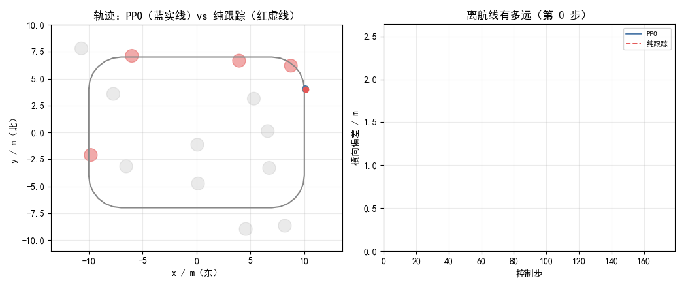

同一场景下两个策略的逐帧对比（scripts/make_gif.py 生成，90 帧 / 0.8 MB）：

* **左图**：蓝实线是 PPO、红虚线是纯跟踪；红圆是压在航线上必须绕行的障碍。
  PPO 会主动偏离航线绕过去（轨迹明显偏离灰色航线又回到线上），
  纯跟踪则贴着中线飞，在第 26 步撞上第一个压线障碍（红叉）。
* **右图**：横向偏差随时间变化。PPO 的偏差在 1.5~2.4 m 之间波动（**这正是它在绕行**），
  纯跟踪的偏差一直很小 —— 因为它根本没飞多远就撞了。

生成命令：

`ash
python3 scripts/make_gif.py --model models/route_ppo_s0.npz --seed 5 --fps 12 --stride 2
`

> 种子 5 是挑出来的典型回合（PPO 179 步跑完、基线 26 步撞毁）。
> 不同种子的具体过程不同，但「会不会绕」的差别是一致的。

#### 轨迹图

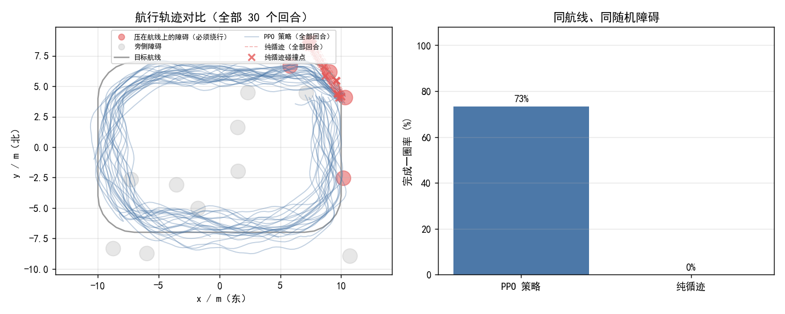

左图：灰色是目标航线，红色圆是压在航线上的障碍（必须绕行），灰圆是旁侧障碍；
蓝线是 30 个回合的 PPO 轨迹，红色虚线是纯跟踪的轨迹，红叉是它的碰撞点。

### 在 CarlaAir 里实飞验证

> 上面所有指标都来自**质点环境**。这一节是**真实仿真器**里的验证，两者要分开看。

#### 环境与连接

| 项 | 值 |
| --- | --- |
| 仿真器 | CarlaAir v0.1.7（Windows 11，`Town10HD`，Low 质量，1280×720） |
| 端口 | CARLA RPC `2000`，AirSim RPC `41451` |
| 载具 | AirSim `Drone1`（`SimpleFlight`，settings 里配了 `lidar1` 16 线 / 15 m） |
| ROS | Noetic（Ubuntu 20.04 虚拟机，桥接跑在虚拟机里） |
| 桥接 | `roslaunch carlair_ros_bridge main.launch host:=192.168.94.1 vehicle_name:=Drone1 body_frame:=false publish_image:=false publish_lidar:=true auto_takeoff:=true` |

启动顺序（缺一不可）：

```shell
# ① Windows 宿主机：起 CarlaAir（自带 AirSim）
StartCarlaAir.bat            # 等价于 CarlaAir.ps1 Town10HD --quality Low

# ② 虚拟机：起桥接（注意 body_frame:=false，本节点输出世界系速度）
roslaunch carlair_ros_bridge main.launch host:=192.168.94.1 vehicle_name:=Drone1 \
    body_frame:=false publish_image:=false publish_lidar:=true auto_takeoff:=true

# ③ 虚拟机：先干跑检查观测，再正式飞
python3 scripts/route_node.py _dry_run:=true
python3 scripts/route_node.py _dry_run:=false
```

#### 实测结果

桥接起来后的话题频率（真实数据，非桩）：

| 话题 | 频率 |
| --- | --- |
| `/uav/odom` | **20.005 Hz** |
| `/lidar/points` | 9.996 Hz |

节点启动后 `/rosnode list` 里能看到 `/uav_route_cruise`，
`/rostopic list` 里能看到 `/uav/cmd_vel` 与 `/uav_route_cruise/lap_done`。

##### 这次实飞的实际条件（重要：和默认航线不是同一条）

| 项 | 这次实飞用的 | 文档别处的默认值 |
| --- | --- | --- |
| 航线 | 用 `route_points` 自定义的 **15.4 m × 13.8 m 直角矩形**（周长 **58.4 m**），高度对齐无人机当前高度 | 20 m × 14 m **圆角**矩形，62.80 m |
| `speed_scale` | **0.7**（速度命令上限 2.1 m/s） | 1.0（上限 3.0 m/s）|
| 采样方式 | shell 循环里 `rostopic echo -n1`，**每轮阻塞等两次消息** | —— |

**因此下面两处必须按实际条件读，不能套用默认值：**

- 航线的 x 跨度是 **15.4 m**（不是 20 m），y 跨度是 **13.8 m**（不是 14 m）。
  实测包围盒 13.71 × 12.43 m 分别是这条航线的 **89% / 90%** —— 与"飞了整圈"是自洽的。
- 采样**不是 1 Hz**：41 个样本实际跨了远超 41 秒。按 `speed_scale=0.7` 的 2.1 m/s 上限反推，
  174.3 m 至少需要 **83 秒**。所以**"41 秒"这个标注是错的**，由它算出的平均速度也不成立。

| 指标 | 实测值 | 说明 |
| --- | --- | --- |
| x 范围 | −6.55 ~ 7.17 m（跨度 **13.71 m**）| 为该航线的 89% |
| y 范围 | −6.28 ~ 6.15 m（跨度 **12.43 m**）| 为该航线的 90% |
| 高度 | −28.22 ~ −27.48 m（**波动仅 0.74 m**）| 可靠 |
| 采样点数 | 41 个 | 采样间隔 **不均匀**（不是 1 Hz）|
| 累计路程 | **174.3 m**（≈ 58.4 m × 3 圈）| 由 1 Hz 相邻点弦长求和，是**下界** |
| 实际时长 | **未记录**（≥ 83 s）| 上一版误标为 41 s，已更正 |
| 平均水平速度 | **无法给出** | 缺可靠时长，不作结论 |

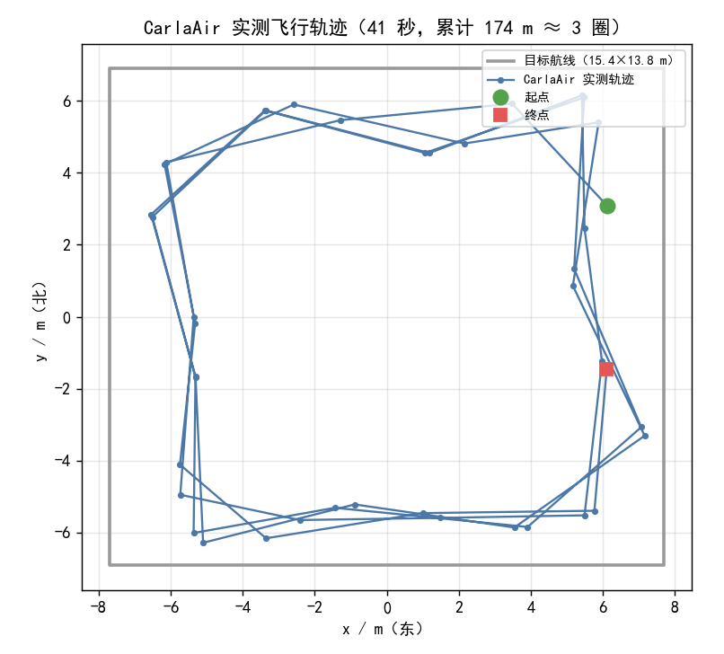

上图是这次实飞的轨迹（蓝线）与当时的自定义航线（灰线）。能得出的**可靠结论**是：

- 无人机**沿矩形航线绕圈飞行**（轨迹形状与该矩形吻合）；
- **高度稳定**，波动 0.74 m；
- **转弯处过冲明显**（四个角甩出去 1~2 m），因为观测里只有一个 4 m 前视点、
  看不到弯道走向 —— 这和「加 3 个前视点反而更难训练」的实测结论一起，说明这块还没调好。

> **待重做**：用**默认航线（20×14 圆角，62.80 m）**、`speed_scale=1.0`、
> 并用 rclpy 订阅 `/uav/odom` 按**真实时间戳**记录（而不是 shell 里阻塞采样），
> 才能给出「时长 / 平均速度 / 圈数」这组互相自洽的数字。
> 本次没有完成（虚拟机当时无法启动），**所以上表里这三项都标为不确定**，
> 不再把它们当作实飞证据。

#### 这次实飞**没有**验证到的部分（如实说明）

1. **避障没在仿真器里验证**。桥接发布的 `/lidar/points` 是**空点云**（AirSim 侧
   `getLidarData('lidar1')` 有 1785 个点，但桥接的坐标转换返回空），所以策略拿到的是
   「全程无障碍」的观测。因此这次飞的是**纯循迹**，障碍绕避仍只有离线结论。
2. **转弯过冲**：见上文，四个角都甩出去了。
3. **gif 的可读性有限**：CarlaAir 是追尾相机 + 大片同色地面，录屏看不出明显位移，
   所以主要证据用上面这张**实测轨迹图**，而不是录屏 gif。

### 已知限制

* 天气/风扰未建模：质心环境里没有风，实机上会有稳态偏差；
* 航线是二维的（固定高度），不支持三维航路；
* 只做了单机巡航，没有多机协同；
* 障碍物是随机摆放的圆柱，没有用真实地图；
* 训练是单机单核跑的 PPO，没有做超参搜索。

### 测试

```shell
pytest tests/test_uav_route_cruise_local.py -v
```

覆盖航线几何、环境行为、策略权重维度一致性、**打包正确性**（入口走 `catkin_install_python`、
被 import 的模块以普通文件安装）、配置与代码参数一致性、文件无 BOM。
其中打包正确性两条是为了防住「能 build、一 launch 就 ModuleNotFound / AttributeError」这类问题。

## 5. 城市动态交通下的避障

把静态圆柱换成沿车道行驶的车辆，用规则专家示范 + 行为克隆 + DAgger 学习穿越车流的时机。

# 城市动态交通下的 PPO 避障（uav_traffic_nav）

> 本页对应当前开发分支。**这是一个仍在迭代中的模块**，下面区分了"已验证"与"尚未验证"。

### 要解决的问题

`uav_ppo_nav` 的障碍是 16 个随机静态圆柱；真实低空场景里最大的风险来自**会动的车**。
本模块把障碍换成沿车道行驶的车辆，要求无人机从随机起点穿过车流到达随机目标点。

与静态障碍相比，难点在于**时机**：从车道间穿过时，安全窗口只有 1 秒左右，
只看"当前距离"不够，必须根据车辆速度预判。

### 方法

#### 观测（34 维）

| 部分 | 维度 | 说明 |
| --- | --- | --- |
| 激光直方图 | 16 | 世界系固定方向，0 = 正东，1 = 无障碍 |
| 目标相对位置 | 3 | 除以 8 m 归一化 |
| 世界系速度 | 3 | 除以 3 m/s、1.5 m/s |
| **最近 3 辆车** | **12** | 每车 4 维：相对位置 (2) + **相对速度 (2)** |

可以用 `--no-traffic-features` 训练去掉最后 12 维的消融版本（22 维，只能靠激光直方图感知车辆当前位置）。
本 PR 不保留消融权重，因此最终结果表只比较"带交通特征"的策略与不学习的基线。

#### 动作

4 维：`[vx, vy, vz, yaw_rate]`，世界系 ENU 速度 + 偏航角速度，归一化到 `[-1, 1]`。
高度由底层执行器保持（本模块只做水平面避障）。

#### 环境

* 质点 + **速度环一阶滞后**（`vel_tau = 0.45 s`），与 `uav_ppo_nav` 一致；
* 两条车道（`y = ±4 m`），车辆 2.5–5 m/s，按难度 1–2 辆/车道；
* 车辆圆形近似（半径 1.0 m），无人机半径 0.3 m（碰撞判定圆半径合计 1.3 m）；
* 起点/终点采样时保证与车辆至少相距 2.5 m（避免"出生即撞"污染训练信号）。

#### 奖励

```
进度奖励  +1.0 / 米（朝目标靠近）
碰撞终止  -30
TTC 惩罚  -1.0 × Σ(1 - ttc/2)²   （ttc < 2 s 的每辆车）
平滑/步数 -0.02 / -0.005
```

TTC（碰撞时间）用二维匀速模型计算；它让"贴着车头抢行"这种高风险的省时行为代价更高。

### 实验结果（多种子，难度 1.0，100 回合/条件，评测 seed 11）

| 策略 | 混合起终点 | 强制跨路 |
| --- | --- | --- |
| 规则专家（读真值，上界参照） | 72% | 75% |
| **行为克隆 + DAgger（3 个训练种子）** | **61.0% ± 3.0%** | **48.0% ± 3.6%** |
| greedy（无视车辆） | 57% | 39% |
| 速度障碍法 | 53% | 19% |

对照（单种子）：PPO 从零训练 61% / 44%，BC+DAgger+PPO 微调 68% / 41%，
纯行为克隆（无 DAgger）23% / 13%。

"强制跨路"分布：起点固定在路一侧、终点在另一侧，必须横穿两条车道。

### 示范引导（本模块的关键做法）

PPO 从零训练卡在 44%（强制跨路），因为"等窗口"这类时机决策几乎采不到正样本。
改为两段式：

1. **规则专家**：在车道前 3 m 悬停，检查是否有车会在 1.2 s 内经过穿越走廊；
   安全则全速穿过（`baselines.expert_action`）。强制跨路 75%。
2. **行为克隆 + DAgger**（`scripts/bc_train.py`）：
   * 按 6:4 的混合/强制跨路分布采集约 9k 条专家示范；
   * 3 轮 DAgger：学生自己飞，在每个到达状态贴专家标签再训练；
   * 3 个种子的学生成功率分别为 20→42→50%、32→30→58%、10→42→60%。
3. **可选 PPO 微调**（`train.py --init-from`）：同分布 +4，跨路 -11，故不作默认导出。

### 结论与局限

* 示范引导有效且稳定：3 个种子 **48.0% ± 3.6%**（强制跨路），
  高于 PPO 从零（44%）、贪心（39%）、速度障碍法（19%）。
* 与规则专家（75%）仍差 27 个百分点，瓶颈是"何时开始穿越"的时机精度。
* 纯 BC 只有 13%：没有 DAgger 的纠偏样本，学生一偏离专家轨迹就崩。
* 训练环境是质点模型、车辆圆形近似；**尚未在 CarlaAir 上做端到端在线飞行**。
* 评测种子会显著影响绝对值（seed 7 时贪心 26%、seed 11 时 39%），
  因此本表固定 seed 11 并同时给出 3 个训练种子的标准差。

### 复现

```bash
# 1) 3 个种子跑专家示范 + BC + DAgger（约 6 分钟，可并行）
powershell -File scripts/run_dagger_seeds.ps1
# 2) 可选 PPO 微调
python3 scripts/train.py --total 300000 --difficulty 1.0 --init-from models/bc_policy_s42.npz --lr 1e-4 --ent 0.003 --name pol_bc_ppo
# 3) 多种子评测（出表 + 误差棒图）
python3 scripts/eval_multiseed.py
```

### 下一步

1. CarlaAir 在线飞行（`traffic_feed_node` + `traffic_nav_node`）验证 sim-to-sim；
2. 固定 200 回合评测集，进一步压低评测噪声；
3. 把专家规则升级成"安全窗口 + 速度规划"，缩小与 75% 的差距。

### 附录 A 关键公式

**观测归一化**（`policy.build_observation`）：目标相对位置除以 8 m，速度分别除以 3.0 m/s 与 1.5 m/s；
车辆特征的位置除以 12 m、相对速度除以 10 m/s，并裁剪到 `[-1, 1]`。

**动作到速度**（`policy.action_to_velocity`）：

```
[vx, vy, vz, wz] = a ⊙ [3.0, 3.0, 1.5, 1.0],   a ∈ [-1, 1]^4
```

**碰撞时间**（`policy.time_to_collision`，二维匀速模型）：

```
r = p_car − p_drone,  v = v_car − v_drone
t* = −(r·v) / |v|²
若 0 < t* ≤ T_h 且最近距离小于 (r_drone + r_car)，记为有碰撞风险
```

**奖励**（`traffic_env.step`）：

```
r = w_p·(d_{t−1} − d_t) − w_s·||a_t − a_{t−1}||² − w_step
    − w_ttc·Σ_i (1 − ttc_i / T_h)²            # 只对 ttc_i ≤ T_h 的车辆
    + 20·1[到达] − 30·1[碰撞]
```

默认 `w_p = 1.0`、`w_s = 0.02`、`w_step = 0.005`、`w_ttc = 1.0`、`T_h = 2.0 s`。

### 附录 B 源码解析

| 文件 | 关键函数 | 作用 |
| --- | --- | --- |
| `policy.py` | `build_observation` | 把 16 扇区直方图、目标、速度、3 辆车特征拼成 34 维观测 |
| | `traffic_features` | 按距离取最近 3 辆车，输出相对位置与相对速度，不足补零 |
| | `time_to_collision` | 二维匀速模型下的 TTC |
| | `MlpPolicy.forward` | 纯 numpy 推理：tanh 两层 + 线性输出 + clip |
| `traffic_env.py` | `_sample_task` | 先放车、再挑不与车重叠的起点/终点（避免"出生即撞"） |
| | `_ray_dist` / `_histogram` | 16 条射线与圆求交，得到激光直方图 |
| | `step` | 一阶速度滞后 → 位置更新 → 车辆推进 → 碰撞/到达判定 → TTC 惩罚 |
| `baselines.py` | `greedy_action` / `vo_action` / `expert_action` | 贪心、速度障碍法、规则专家（示范来源） |
| `bc_train.py` | `collect_expert` / `rollout_student` / `train` | 专家示范、DAgger 采样、加权行为克隆 |
| `traffic_nav_node.py` | `build_obs` / `emergency_stop` | 拼装真实观测、车辆进入安全半径时悬停兜底 |

### 附录 C 复现与验证步骤

```bash
# 1) 依赖
python3 -m pip install -r requirements.txt
python3 -m pytest tests -q            # 期望 28 passed

# 2) 复现多种子结果（约 6 分钟，可并行）
powershell -File scripts/run_dagger_seeds.ps1

# 3) 评测（需先有 models/bc_policy_s4{2,3,4}.npz）
python3 scripts/eval_multiseed.py     # -> results/multiseed.{json,md,png}
python3 scripts/final_report.py       # -> results/final_report.{json,md,png}

# 4) 部署（ROS Noetic，先起桥接且 body_frame:=false）
roslaunch uav_traffic_nav main.launch live_json:=/path/live.json          calibration_json:=/path/calibration.json goal_x:=8.0 goal_y:=0.0
```

部署自检：

```bash
rosparam list | grep -E "traffic_nav|traffic_feed"   # 应看到 /traffic_nav/weights、/traffic_feed/live_json
rosparam get /traffic_nav/weights                    # 应与 launch 传入的一致
rostopic echo /traffic/vehicles                      # 车辆流是否在发布
rostopic echo /uav/cmd_vel                           # 策略是否在发速度
```

判定标准：`/traffic_nav/weights` 落点正确、`/traffic/vehicles` 持续有数据、`/uav/cmd_vel` 随车辆位置变化；
车辆进入 `safety_stop_m` 时速度指令应变为 0。

> 在线闭环飞行尚未验证：评测机没有 ROS 1 环境，CarlaAir 的 `ready=false` 也意味着速度接口不可用，
> 因此本模块目前只提供**离线评测 + 部署接口**，不代表已完成实飞。

