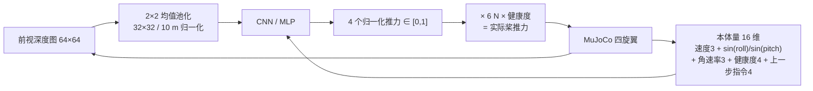
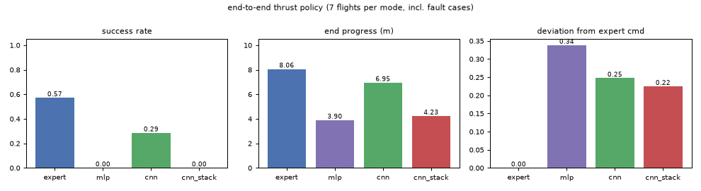
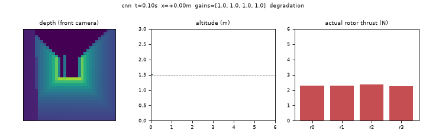

# 桨故障下的端到端推力策略（深度图 + 健康度 → 四桨推力）

本模块对应课程**任务④「每种机器人端到端模型（输入图像、输出控制指令）」**，也是「神经容错飞行」
系列里唯一一个把动作直接给到**执行器层**的模块。

## 1. 和已有端到端模块的区别

仓库里已经有一批端到端模块（`uav_depth_gate_racing_e2e`、`uav_depth_track_nn`、`uav_e2e_rl` 等），
它们的共同点是"深度图 → 速度或位姿指令"，输出给位姿控制器再去分配。本模块刻意换了三个维度：

| 对比项 | 已有端到端模块 | 本模块 |
| --- | --- | --- |
| 观测 | 深度图 + 机体速度 | 深度图 + **四桨健康度** + 三轴角速率 + 上一步指令 |
| 动作 | 速度 / 位置指令 | **四个桨的归一化推力**（端到端到执行器） |
| 数据 | 正常飞行 | **故障注入**下的飞行（推力衰减、卡死、渐进退化） |
| 指标 | 通过门 / 跟踪误差 | 故障工况下的到达率、坠机率、末端进度 |

要回答的问题很具体：**如果把"哪个桨坏了"这件事从健康度那一路喂给网络，它能不能自己学会
用剩下的桨把机体顶住？** 实测答案是"能一点，但远不够"——原因写在最后一节。

## 2. 方法



- **深度图**：底座自带前视相机 `front_cam`，取 64×64 深度，2×2 均值池化到 32×32，除以 10 m 归一化。
- **本体量**：机体系速度 3、`sin(roll)`、`sin(pitch)`、三轴角速率 `/4.0`、四桨健康度 4、上一步推力指令 4，
  共 **16 维**。观测里**没有世界系位置、没有目标点坐标**——否则等于偷看 GPS，端到端就失去意义。
- **动作**：4 个归一化推力，乘单桨满推力 $T_{\max}=6$ N、再乘健康度得到实际推力
  $$T_i^{act} = g_i \cdot u_i \cdot T_{\max}, \qquad u_i \in [0,1]$$
- **三种网络结构**（同一份数据、同一套超参，对应课程任务⑤的"同算法不同网络结构"对比）：

| 结构 | 说明 | 参数量 |
| --- | --- | --- |
| `mlp` | 深度图展平 + 本体量 → 128 → 128 → 4 | 145 924 |
| `cnn` | Conv(1→16)→Conv(16→32)→Conv(32→64) + 全局平均池化 + 全连接 | 27 812 |
| `cnn_stack` | 最近 3 帧深度图当 3 通道（能看到墙逼近的速度） | 28 100 |

- **专家参考（只用于产生数据）**：几何控制器 + 梯形速度剖面参考（位置/速度/加速度三件套前馈），
  推力分配用 PR3 的加权最小二乘（四桨可用时保留偏航，有桨彻底失效时按 Mueller & D'Andrea 的结论放弃偏航）。

## 3. 数据：DAgger 三轮

`--gen-data` 的流程：

1. 第 $k$ 轮用当前策略飞 5 个工况 × 3 段，每步以概率 $\beta_k$ 改用专家动作（否则用策略动作）；
2. $\beta$ 从 0.9 线性降到 0.5，$\beta=1$ 即纯行为克隆；
3. 专家动作加 $\sigma=0.02$ 的高斯噪声，让第一轮的轨迹不完全重合；
4. 只记录**高度 > 1.0 m** 的样本。

第 4 条是两个真 bug 换来的教训：

- `beta` 语义写反，纯 BC 那轮实际成了"全部听策略"，第一轮数据全是 22 步就坠机的废数据；
- 不加高度门限时，策略失控后的地面状态被专家打上标签，这些标签没有意义，反而把网络训坏
  （cnn 测试 MAE 从 0.026 涨到 0.083）。

最终数据：45 段飞行、**14 794 个样本**，按 **episode** 切 8:1:1（不按样本切，否则相邻帧同时进训练和测试）。

## 4. 源码解析

### 4.1 观测（`obs.py`）

```python
def crop_depth(image, size=DEPTH_SIZE):
    d = np.asarray(image, dtype=np.float64)
    if d.shape == (size, size):        # 已经是目标尺寸：直接返回，别再池化
        pooled = d
    else:
        pooled = _pool_to(d, size)     # 2×2 均值池化（整数倍）或退化到最近邻
    return np.clip(pooled / DEPTH_MAX_RANGE, 0.0, 1.0)
```

`d.shape == (size, size)` 这个快路径是修 bug 加的：原实现无条件走"整数倍池化"，
输入 32×32 时算出 `h2 = (32 // 64) * 64 = 0`，`np.mean` 空切片 → 返回全 NaN，闭环直接起飞即坠。

### 4.2 环境（`env.py`）

`ThrustEnv.step(commands)` 只有四行：

```python
commands = np.clip(np.asarray(commands, dtype=float).reshape(4), 0.0, 1.0)
actual = np.clip(commands * self.max_thrust * self.gains + self.bias, 0.0, self.max_thrust)
self.quad.apply_rotor_thrust(actual)      # 直接写四个桨的推力，绕过位姿控制器
self.quad.step(self.task.substeps)
```

策略输出就是闭环里唯一的控制器——没有底层几何控制器兜底，这也是它比"输出速度指令"的端到端难得多的原因。

### 4.3 专家参考（`expert.py`）

```python
def _trapezoid(t, distance, cruise, accel):
    t_acc = cruise / accel
    v_top = min(cruise, math.sqrt(distance * accel))
    t_real = v_top / accel
    ...
    return x, v, a      # 位置、速度、加速度三件套一起给
```

最初两版只给位置或只给速度：底座 `GeometricController` 会把速度设定当**速度误差**放大
（$k_d=-8$），瞬间要求 24 m/s² 的加速度，倾角直接顶到 45° 并让分配饱和成 `[0,1,0,1]`。
改成梯形剖面 + 三件套前馈后，健康工况的最大倾角降到 **8.7°**，9.82 s 到达终点。

### 4.4 网络与训练（`policy.py` / `train.py`）

- `build_module(arch)` 延迟 `import torch`；`load_checkpoint()` 按 payload 里的 `arch` 重建，换结构不用改代码。
- `predict()` 对输出做 `np.clip(..., 0, 1)`：网络是线性输出层，训练标签在 [0,1] 内，越界只可能来自分布外输入，
  夹住比让它输出负推力安全。
- 训练：AdamW，lr 1e-3，weight decay 1e-4，batch 128，梯度裁剪 5.0，`ReduceLROnPlateau(factor=0.5)`，早停 patience 10。
- 损失是 4 个桨的 MSE：$\mathcal{L} = \frac{1}{4}\sum_{i=1}^{4}(\hat u_i - u_i^\star)^2$。

## 5. 运行步骤

```bash
cd src/air/uav_fault_e2e_thrust_policy

python main.py --selftest           # 40 项自检（不需要 ROS，缺 torch/mujoco 会自动跳过相关分组）
python main.py --gen-data           # DAgger 3 轮，约 2 分钟
python main.py --train --arch all   # 三种结构，CPU 约 5 分钟
python main.py --eval               # 7 工况闭环对比表
python main.py --demo               # 录演示 gif
```

ROS2：

```bash
colcon build --packages-select uav_mujoco_sim uav_fault_e2e_thrust_policy
source install/setup.bash
ros2 launch uav_fault_e2e_thrust_policy policy.launch.py \
    fault:=degradation rotor:=2 onset:=2.5 severity:=0.5
```

| 话题 | 类型 | 说明 |
| --- | --- | --- |
| `/uav/odom` | `nav_msgs/Odometry` | 位姿与速度（ENU） |
| `/uav/status` | `std_msgs/String` | `RUN / CRASHED / SUCCESS / DONE` |
| `/uav/rotor_cmd` | `std_msgs/Float32MultiArray` | 策略下发的四桨归一化推力 |
| `/uav/health` | `std_msgs/Float32MultiArray` | 四桨健康度（真值，仅调试用） |
| `/uav/depth_sample` | `std_msgs/Float32MultiArray` | 深度图 16 倍抽样 |

## 6. 复现结果

7 个工况（healthy、衰减 0.5@桨2、衰减 0.3@桨1、衰减 0.6@桨0、卡死@桨0、渐进退化@桨3、完全失效@桨1）
各飞一次，seed 0：

| 模式 | 到达率 | 坠机率 | 末端进度 m | 最低高度 m | 最大倾角 ° | 指令偏离 |
| --- | --- | --- | --- | --- | --- | --- |
| expert | **0.57** | 0.43 | 8.06 | 0.98 | 30.4 | 0.000 |
| mlp | 0.00 | 1.00 | 3.90 | 0.28 | 132.8 | 0.338 |
| **cnn** | **0.29** | 0.71 | 6.95 | 0.61 | 44.0 | 0.247 |
| cnn_stack | 0.00 | 1.00 | 4.23 | 0.29 | 55.1 | 0.224 |





三点解读：

1. **`cnn` 明显最好**：27.8 K 参数、测试 MAE 0.0095、最大倾角 44°、末端进度 6.95 m；`mlp` 把深度图
   直接展平，参数是 cnn 的 5 倍，但闭环倾角 133° 直接翻掉——它学到的是"像素在哪个位置"而不是"墙有多远"。
2. **观测里补角速率是关键修正**：最初 14 维本体量只给了偏航角速率，网络没有姿态阻尼信息，
   闭环 `0/7`；补上三轴角速率后变成 `2/7`、最大倾角从 104° 降到 44°。
3. **`expert` 也只有 0.57**：完全失效与渐进退化这两个工况下，经典结构一样救不回来
   （PR3 已论证单桨全失效物理不可恢复），所以 0.57 已经是这套底座上的天花板。

还有一条**负面结论**也照实写在这里：**DAgger 相对纯 BC 没有明显收益**——两者 cnn 的到达率都是 0.29，
测试 MAE 分别 0.0096 / 0.0095。单步随机接管能修正状态分布，但解决不了回归精度这个瓶颈。

## 7. 局限与后续

1. 只覆盖 MuJoCo 单机、单一走廊场景，没有风扰与动态障碍。
2. 单桨完全失效、双桨失效不可恢复（同样如实记录在 PR3 与本篇）。
3. **端到端到执行器层对回归精度的要求比到速度层严苛得多**：MAE 0.0095 对应约 0.06 N 的单桨误差，
   而桨间差动本身只有 0.5% 量级，误差会被姿态动力学放大。这是本模块最想说明的问题，不是缺陷掩盖点。
4. 健康度由故障脚本直接给出，尚未接 `uav_rotor_fault_detector_nn` 的在线估计器；接上后观测分布会变，
   需要重训一轮。
5. 训练数据集中在 1.5 m 定高巡航，泛化到变高/变速度任务上需要重新采样。

## 8. 参考

1. Ross, Gordon, Bagnell. *A Reduction of Imitation Learning and Structured Prediction to No-Regret Online
   Learning.* AISTATS 2011.（DAgger）
2. Mueller, D'Andrea. *Stability and control of a quadrocopter despite the complete loss of one, two, or
   three propellers.* ICRA 2014.
3. 本仓库 `uav_mujoco_sim`（四旋翼仿真与 ROS2 桥接底座）、`uav_actuator_fault_sim`（故障注入）、
   `uav_neural_fault_tolerant_control`（加权分配 + 神经残差，本模块的专家来源）。
