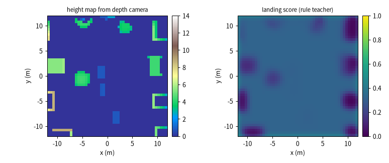
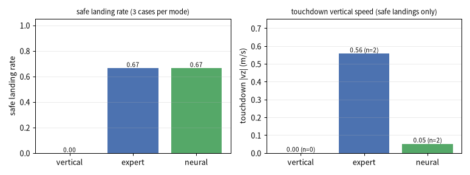
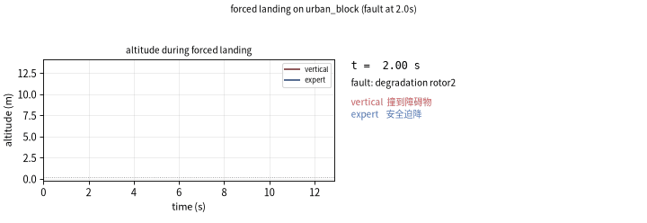

# 无人机桨故障后的自主迫降（在线建图 + 神经评分 + 闭环制导）

四旋翼掉一个桨之后能不能安全落地，取决于两件事：**往哪儿落**、**怎么飞过去**。

本模块用机体正下方的深度相机在线建一张 2.5D 高度图，用全卷积网络给每个格子打
"能不能落"的分并选出落点，再用一个回归网络输出速度指令，与底座的几何控制器、
推力分配一起构成闭环，把飞行器带到落点。

它对应课程任务的**任务③（虚拟环境建模、导航）**，并复用任务②的感知与控制：

| 模块 | 任务 | 做法 |
| --- | --- | --- |
| `uav_actuator_fault_sim` | ① | 故障注入层，给后续模块提供可复现的故障与评测台 |
| `uav_rotor_fault_detector_nn` | ② 感知 | IMU + 指令 → 1D-CNN+GRU → 四桨健康度 |
| `uav_neural_fault_tolerant_control` | ② 控制 | 神经残差 + 加权伪逆分配，带病继续飞 |
| **`uav_fault_emergency_landing`** | **③ 建图/导航** | **本模块：建图 → 评分选点 → 神经制导闭环迫降** |

## 1. 问题：为什么不能直接往下掉

`urban_block` 场景里最高的楼 10.68 m，而四旋翼在底座里**没有碰撞体**，会直接穿过楼板。
把起飞点放在最高楼上方 13.7 m、故障在 `t = 2.0 s` 注入（单桨推力衰减，剩余 50%），三种策略的结果：

| 策略 | 结果 | 触地时刻 | 触地垂直速度 | 落点误差 |
| --- | --- | --- | --- | --- |
| 垂直下降（基线） | 撞到障碍物 | 12.88 s | 0.42 m/s | — |
| 规则评分 + 专家律 | 安全迫降 | 9.42 s | 0.56 m/s | 0.00 m |
| 神经评分 + 神经制导 | 安全迫降 | 9.90 s | **0.05 m/s** | 0.04 m |

"撞到障碍物"不是物理碰撞，而是评测时沿机体正下方打一条竖直射线量出来的几何间隙：
垂直下降时最小间隙 **−9.60 m**（等于从楼里穿过去），选点迫降时 −0.04 m（贴地平飞）。

神经制导的触地垂直速度比专家律低一个量级（0.05 vs 0.56 m/s），代价是慢 0.5 s。

## 2. 方法


### 2.1 建图

深度图是相机系 −z 方向的距离，反投影公式：

$$f_y = \frac{0.5 H}{\tan(\text{fovy}/2)},\quad f_x = f_y,\quad
x = \frac{(u - c_x)\, z}{f_x},\quad y = -\frac{(v - c_y)\, z}{f_y}$$

$$\mathbf p^{world} = \mathbf R_{cam}\, [x, y, z]^\top + \mathbf c_{cam}$$

把点云按 0.5 m 分辨率落格、每格取最高点，就得到高度图。未观测格在网络输入里填
**1.0（视为障碍）**——填 0 等于告诉网络"这里是平地"，而迫降恰恰最怕这种错误的乐观。

### 2.2 规则评分（教师）

对每个格子算四个因子：

$$\text{free} = \text{observed} \wedge \neg\text{obstacle}$$

$$\text{flat} = \mathrm{clip}\!\left(1 - \frac{\sigma_h}{0.15}, 0, 1\right)$$

$$\text{margin} = \mathrm{clip}\!\left(\frac{d_{obs}}{1.5}, 0, 1\right)$$

$$\text{score} = \text{free}\cdot\text{flat}\cdot\text{margin}\cdot\text{conf}\cdot(0.35 + 0.65\,\text{near})$$

其中 $\sigma_h$ 是邻域高度标准差，$d_{obs}$ 是到最近障碍格的距离（分块欧氏距离），
$\text{conf}$ 随邻域观测数增加，$\text{near}$ 是"离当前位置近"的折扣。
规则只当教师，部署时不跑它。

### 2.3 神经评分

$$s = \sigma\!\big(\mathrm{Conv}_{1\to16}^{3\times3} \to \mathrm{ReLU} \to
\mathrm{Conv}_{16\to16}^{3\times3} \to \mathrm{ReLU} \to \mathrm{Conv}_{16\to1}^{3\times3}\big)(\text{height map})$$

全卷积、无池化无全连接（2625 参数），换网格分辨率不用改结构。

### 2.4 神经制导

13 维特征：相对落点 $(3)$、速度 $(3)$、四桨权限 $(4)$、高度 $(1)$、水平距离 $(1)$、
剩余权限 $(1)$；两层 64 宽的 tanh MLP 输出三轴速度指令（5251 参数），
监督信号来自解析专家律：

$$v_z = -\Big(v_{touch} + (v_{max} - v_{touch})\cdot\mathrm{clip}\big(\tfrac{h}{3},0,1\big)\Big)
\;-\; 0.6\cdot\max(0,\, a_{min} - a)\cdot v_{max}$$

$a$ 是归一化推力权限：权限越低，下降越快——反正也撑不久。

### 2.5 闭环

`GeometricController` 只负责姿态与总推力（位置设定点取当前位置，速度设定点交给制导律，
否则位置误差项会把下降速度抢走）；`ls_allocation` 在"有效推力"空间做加权最小二乘分配，
按可控桨数切换行权重，桨彻底失效时主动放弃偏航。

**到位门限**：水平距离 > 1.2 m 时，高度不许低于"已知最高障碍 + 0.8 m"。
没有这层保护，网络会一边平飞一边下降，从楼里穿过去。

网络只输出**速度指令**、不直接输出推力/力矩：即使训练分布外输出离谱，
最多飞得难看，不会把机体翻过来——迫降场景里这比精度重要。

## 3. 源码解析

### 3.1 深度反投影 `mapping.py`

```python
def depth_to_points(depth, cam_pos, cam_mat, fovy_deg, max_range=20.0, min_range=0.2):
    h, w = depth.shape
    fy = 0.5 * h / math.tan(math.radians(fovy_deg) / 2.0)
    fx = fy
    cx, cy = (w - 1) / 2.0, (h - 1) / 2.0
    u, v = np.meshgrid(np.arange(w), np.arange(h), indexing="xy")
    z = -depth.ravel()                       # MuJoCo 深度是相机系 -z 方向的距离
    keep = np.isfinite(z) & (np.abs(z) <= max_range) & (np.abs(z) >= min_range)
    x = (u.ravel() - cx) * z / fx
    y = -(v.ravel() - cy) * z / fy
    pts_cam = np.stack([x, y, z], axis=1)[keep]
    return pts_cam @ np.asarray(cam_mat).T + np.asarray(cam_pos)
```

`HeightMap.update()` 里有两个必须的细节：

```python
GROUND_TOLERANCE = 0.05      # 反投影的地面点会落在 -2.86e-08，不能用 z >= 0 过滤
z = np.clip(points[:, 2], 0.0, cfg.max_height)
keep = np.isfinite(z) & (z >= -GROUND_TOLERANCE) & (z <= cfg.max_height)
heights = z[keep][inside]    # inside 来自 world_to_cells 的等长掩码
np.maximum.at(self.height.reshape(-1), flat_idx, heights)   # 每格取最高
```

### 3.2 闭环控制器 `controller.py`

```python
# 每 10 步把一帧点云并进高度图
self._steps += 1
if lidar_points is not None and self.mode != "vertical":
    self.update_map(lidar_points)
# 选落点（每 MAP_EVERY 步刷新一次）
target_xy = self.choose_target(pos[:2], refresh=self._steps % MAP_EVERY == 0)
v_des = self._arrival_gate(state, target_xy, self.velocity_setpoint(state, target_xy))
# 位置设定点=当前位置 → 外环退化成纯速度跟踪
thrust, tau = self.base.compute(state, pos, v_des, np.zeros(3), yaw)
u = A.ls_allocation(self.effectiveness, [thrust, *tau], self.params, self.gains,
                    v_ref=self._v_last, row_weights=self.row_weights())
commands = A.clamp_thrusts(u, self.params)
```

三种模式只在这一层分叉：`vertical` 固定下降速度，`expert` 用规则评分 + 专家律，
`neural` 用评分网络 + 制导网络。

### 3.3 评测为什么要用真值 `evaluate.py`

```python
def surface_height(api, quad, xy, start_z=16.0):
    mujoco.mj_forward(quad.model, quad.data)
    dist = mujoco.mj_ray(quad.model, quad.data, np.array([xy[0], xy[1], start_z]),
                         np.array([0.0, 0.0, -1.0]), None, True,
                         _drone_body_id(quad), geomid)   # 排除机体自身
    return float("nan") if dist < 0 else float(start_z - dist)
```

三个判据全部用真值：最小几何间隙（每 10 步量一次，只看离地 0.6 m 以上的航段）、
终止点的表面高度、触地包线（$v_z \le 1.2$、$v_{xy} \le 1.0$、倾角 $\le 35°$）。
地图是估计值，不能拿自己的估计给自己打分。

### 3.4 用例矩阵 `evaluate.py`

```python
FLIGHT_PLANS = (("healthy", dict(kind="healthy", onset=2.0)),
                ("degradation@2", dict(kind="degradation", rotor=2, severity=0.50)),
                ("degradation@0", dict(kind="degradation", rotor=0, severity=0.78)))
FLIGHT_MODES = ("vertical", "expert", "neural")
```

三组工况刻意跨过分配层的补偿边界：悬停时每桨只要 2.33 N，而指令上限是 6.0 N，
所以坏桨剩余推力在 2.33/6.0 ≈ 39% 以上时，加权分配靠抬高指令就能完全补回来；
"剩余 50%"落在可补偿区间，"剩余 22%"已经补不回来，两个区间各取一组才能看出差别。

## 4. 运行步骤

依赖：Python ≥ 3.10、MuJoCo ≥ 3.0、torch ≥ 2.0、numpy ≥ 1.21、pillow（存 gif）、
matplotlib（画图）。不需要独显、Gazebo、Unreal。

```bash
cd src/air/uav_fault_emergency_landing
pip install -r requirements.txt

python main.py --selftest      # 32 OK / 0 FAIL
python -m pytest test -q       # 23 passed, 1 skipped
python main.py --gen-data      # 评分地图 120 张 + 制导样本 4000 条，约 30 s
python main.py --train         # 两个网络各约 0.5 s
python main.py --eval          # 三模式 x 三工况（健康 / 剩余 50% / 剩余 22%）
python main.py --demo results/landing_demo.gif
```

ROS2：

```bash
colcon build --packages-select uav_mujoco_sim uav_fault_emergency_landing
source install/setup.bash
ros2 launch uav_fault_emergency_landing landing.launch.py mode:=neural rotor:=1
```

| 话题 | 类型 | 方向 | 说明 |
| --- | --- | --- | --- |
| `/uav/odom` | `nav_msgs/Odometry` | 发 | 位姿与速度，默认 20 Hz（`publish_rate`，实测 19.98–20.01 Hz） |
| `/uav/status` | `std_msgs/String` | 发 | `HOVER` / `DESCENDING` / `LANDED` |
| `/uav/landing_target` | `geometry_msgs/Point` | 发 | 当前落点 |
| `/uav/health` | `std_msgs/Float32MultiArray` | 发 | 四桨权限真值 |
| `/uav/landing_scores` | `std_msgs/Float32MultiArray` | 发 | 评分图 max / mean |
| `/uav/goal` | `geometry_msgs/Point` | 收 | 人工指定落点（0.5 s 内优先） |
| `/uav/cmd_vel` | `geometry_msgs/Twist` | 收 | 只记录，迫降过程中不执行 |

参数分两层：`config/landing.yaml`（顶层键 `/**`）是默认值真源，launch 只覆盖常用的
5 个；权重按 cwd → 包目录 → install share 依次查找。

## 5. 复现结果



左：`tools/gen_figures.py` 在 3×3 个高位观测点（x, y ∈ {−8, −2, 4} m、高度 12 m）各扫一帧
合并出来的 2.5D 高度图（楼体与围栏清晰可见）；右：神经评分图，中间空地分数最高，
楼顶与围栏是暗的——网络是在学规则教师，不是凭空产生安全性。

> 这里的两套扫描不要混淆：画图用的是上面这套 3×3 固定网格（9 帧）；
> `evaluate.pick_obstacle_spot()` 选悬停点时默认 `span=12.0 / step=6.0` → `n=2` → 5×5 = **25 个点**，
> 是另一个函数、另一个用途。



左：安全迫降率（垂直下降 0/3；两种选点策略各 2/3，剩下那次是越过分配层补偿边界的工况）；
右：**只统计真正安全落地的那几次**的触地垂直速度（神经制导 0.05 m/s，比专家律低一个量级）。

三组工况的逐行数据（`python main.py --eval` 写入 `results/landing_comparison.json`）：

| 模式 | 工况 | 结果 | 触地时刻 | 触地垂直速度 | 最大倾角 | 最大指令比例 |
| --- | --- | --- | --- | --- | --- | --- |
| vertical | 健康 | 撞到障碍物 | 12.88 s | 0.42 m/s | 0.0° | 0.40 |
| vertical | 衰减@桨2（剩余 50%） | 撞到障碍物 | 12.88 s | 0.42 m/s | 0.0° | 0.81 |
| vertical | 衰减@桨0（剩余 22%） | 硬着陆 | 4.97 s | 9.81 m/s | 26.7° | 1.00 |
| expert | 健康 | 安全迫降 | 9.42 s | 0.56 m/s | 53.5° | 1.00 |
| expert | 衰减@桨2（剩余 50%） | 安全迫降 | 9.42 s | 0.56 m/s | 63.1° | 1.00 |
| expert | 衰减@桨0（剩余 22%） | 硬着陆 | 4.77 s | 9.79 m/s | 52.0° | 1.00 |
| neural | 健康 | 安全迫降 | 10.10 s | 0.06 m/s | 50.4° | 1.00 |
| neural | 衰减@桨2（剩余 50%） | 安全迫降 | 9.90 s | 0.05 m/s | 50.8° | 1.00 |
| neural | 衰减@桨0（剩余 22%） | 硬着陆 | 4.78 s | 9.85 m/s | 49.1° | 1.00 |

这张表里"健康"和"剩余 50%"两行数值几乎一样，不是重复实验，而是分配层把故障
完全补偿掉了：悬停时单桨出 2.33 N，坏桨增益掉到 0.5 就把它的指令从 2.33 N 加到 4.66 N
（"最大指令比例"从 0.40 涨到 0.81），有效推力与其他三桨一致，所以轨迹相同。
把桨的指令上限 6.0 N 折算回去，增益低于 `2.33 / 6.0 ≈ 0.39`（剩余推力 < 39%）时
就补不回来了——表里"剩余 22%"那组指令比例顶到 1.00，三种策略全部失败，
垂直下降 4.97 s 就以 9.81 m/s 砸地，选点策略也只能慢 0.2 s 后同样硬着陆。



动态对比：红色垂直下降直接穿过楼顶，蓝色选点迫降先平飞 2 m 到空地再压低。

训练与评测的完整数值：

| 项 | 评分网络 | 制导网络 |
| --- | --- | --- |
| 参数量 | 2625 | 5251 |
| 训练时间 | 0.52 s | 0.55 s |
| 最佳 epoch | 16 | 59 |
| 验证 MAE | 0.0622 | 0.0762（m/s） |
| 测试 MAE | 0.0603 | 0.0725（m/s） |

## 6. 局限

1. **单桨完全失效、双桨失效仍是物理不可恢复的**：本模块不宣称能救回来，两种情况在
   故障后 1 s 内姿态就发散（与 `uav_neural_fault_tolerant_control` 的结论一致）。
   对比实验因此用"健康 / 剩余推力 50% / 剩余推力 22%"三组工况，跨过分配层的补偿边界。
2. **只覆盖 MuJoCo 单机仿真**，没有真机与实飞数据。
3. **四旋翼没有碰撞体**，"撞到障碍物"是用射线量的几何间隙与落点真值高度判出来的，
   不是物理碰撞——这一条在文档里必须写清楚，否则容易过度解读。
4. 建图是**一次性扫描**的结果，飞行途中只以 10 步一帧的频率增量更新；
   真实系统应该持续建图并把新观测融进评分。
5. 制导网络是**解析专家律的蒸馏**，上限就是专家律的上限；没有用强化学习去超越它。

## 7. 参考

1. Mueller M., D'Andrea R. *Stability and Control of a Quadrocopter Despite the Complete
   Loss of One, Two, or Three Propellers.* IEEE ICRA, 2014.
2. 底座模块：`src/air/uav_mujoco_sim`（MuJoCo 四旋翼动力学、场景、传感器、ROS2 桥接）。
3. 仓库已有的 `uav_emergency_landing_selector`（规则打分 + 固定候选点），
   本模块与它的区别是**在线建图 + 神经评分 + 闭环制导**。
