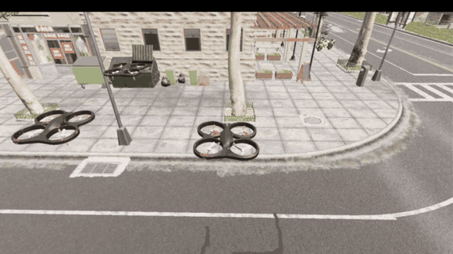

# 无人机编队飞行（Leader-Follower）

**编队飞行**的 ROS 侧实现：长机按航点序列巡航，僚机以「长机当前位置 + 队形偏移」
为期望位置，三架共用一条 AirSim RPC 连接（用 `vehicle_name` 区分），位置误差经
PID 转成三维速度指令下发，完成**一字横队 / 三角 / 纵队**等队形的保持与动态切换。

源码位于
[`src/air/uav_formation_flight`](https://github.com/OpenHUTB/ros2/tree/master/src/air/uav_formation_flight)，
完整运行步骤与参数说明见
[`README.md`](https://github.com/OpenHUTB/ros2/blob/master/src/air/uav_formation_flight/README.md)。



*演示（`column_straight` 纵队任务）：长机沿街巡航、僚机保持队形。*

---

## 1. 它解决什么问题 <span id="1-它解决什么问题"></span>

多机编队要「保持相对位置」，比单机跟踪航点难在四件事上，本模块逐条处理：

1. **起飞柱只有一根**。OpenHUTB 这个构建里 `settings.json` 的 `X/Y/Z` 不生效，
   三架载具会在**同一个坐标**生成。因此起飞必须严格**依次**进行：上一架先爬升，
   再横向让出柱子，下一架才允许起飞。
2. **执行机构有约 0.65 秒延迟**。从下发速度指令到飞机真正达到该速度，实测延迟
   `0.65 s`（`scripts/lag_probe.py`：给常值速度脉冲，用互相关求滞后）。这个延迟
   决定了控制带宽上限，也决定了**不能把航点当阶跃指令**丢给 PID。
3. **街道不是空场地**。演示街道两侧 4~6 米高处有灯柱（`BP_StreetLight_*`）与
   行道树，横向可用余量只有 5 米左右 —— 这直接影响演示队形的选择（见[第 5 节](#5-队形与任务)）。
4. **高度会被横向机动带偏**。持续横向加速时飞机容易高出目标约 1 米，进而蹭到
   路灯或树冠。抑制横向机动（限速参考 + 前馈）后，高度误差随之回到亚米级。

---

## 2. 架构位置 <span id="2-架构位置"></span>

本模块直接使用 **AirSim RPC**（`airsim.MultirotorClient`），不依赖 ROS 桥：

| 层次 | 组件 | 说明 |
|---|---|---|
| 仿真器 | OpenHUTB / AirSim | 多旋翼模式，RPC 端口 41451，载具名见 `settings.json` |
| 控制 | `formation_controller.py` | 长机航点跟踪 + 僚机队形保持，20 Hz 控制与采样 |
| 参数 | `config/params.yaml` | 连接、飞行、PID、队形、任务五段 |
| 启动 | `launch/main.launch` | 加载参数、命令行覆盖任务与增益、启动节点 |

与 `carlair_ros_bridge` 的区别：桥接模块把 AirSim 包装成 ROS 话题，适合与
感知/规划模块对接；本模块关心的是**多机协同控制**，直接走 RPC 更省一层延迟。

---

## 3. 运行 <span id="3-运行"></span>

**宿主（Windows）**：启动 OpenHUTB 模拟器（AirSim 多旋翼模式），
`settings.json` 的 `Vehicles` 段声明长机与僚机（默认 `SimpleFlight`、
`SimpleFlight2`、`SimpleFlight3`）。模拟器是 Windows 程序，不在虚拟机里启动。

**虚拟机**：本实验用的是 **ROS 1 Noetic + catkin**（Ubuntu 20.04），工作空间用
`catkin_make` 编译，每开一个新终端都要先 `source devel/setup.bash` 才能 `roslaunch`；
ROS 安装、依赖与工作空间的建立见[环境配置与前置准备](./octree_uav_3d_pathfinding/env_setup.md)，
Python 客户端安装与端口连通性检查见[建立虚拟机和空域载具之间的连接](./setup_and_connect.md)。

```bash
chmod +x ~/catkin_ws/src/uav_formation_flight/scripts/*.py
cd ~/catkin_ws && source devel/setup.bash
roslaunch uav_formation_flight main.launch mission:=column_straight
```

可覆盖的命令行参数：`mission`（任务名）、`kp` / `ki` / `kd`（PID 增益）、
`log_dir`（日志目录，默认 `$HOME/uav_formation_flight_logs`）。

节点启动后会自动完成：重置关卡 → 三架落地并记录起飞点 → **依次起飞、逐架展开**
→ 长机按航点飞行、僚机保持队形 → 到点降落 → 写出 CSV 与指标。

---

## 4. 参数 <span id="4-参数"></span>

`config/params.yaml` 的 `airsim` 段（连接）：

| 参数 | 默认 | 说明 |
|---|---|---|
| `ip` | `192.168.237.1` | 宿主机 VMnet8 地址，每台机器不同，按自己的网络改 |
| `timeout` | `30.0` | 单次 AirSim RPC 的超时时间（秒）。模拟器还在加载场景、被按 `P` 暂停或宿主机繁忙时，一次调用可能要几秒才返回，10 秒容易误报 `Request timed out`，故放宽到 30 秒 |
| `leader` | `SimpleFlight` | 长机载具名，须与 `settings.json` 的 `Vehicles` 一致 |
| `followers` | `[SimpleFlight2, SimpleFlight3]` | 僚机载具名列表，顺序与 `shapes` 的偏移一致 |

`flight` 段（长度单位米、速度单位米/秒）：

| 参数 | 默认 | 说明 |
|---|---|---|
| `control_rate` | 20.0 | 控制与采样频率。PID 的 `dt` 用**实测周期**，不写死标称值 |
| `takeoff_altitude` | 3.0 | 队形飞行高度（也是僚机展开时的平移高度） |
| `takeoff_interval` | 1.0 | 三架依次起飞的时间间隔（秒），避免在地面相互干涉 |
| `alt_separation` | 3.0 | 长机展开时的抬升量，用来让出起飞柱；机身约 1.5 米，2 米会挤到桨叶 |
| `leader_clear_offset` | `[2.5, 0.0]` | 长机沿马路方向让开柱子的距离（沿 x 走不经过行道树） |
| `deploy_mode` | `position` | 展开阶段用 AirSim 自带位置控制（稳定优先）；`pid` 可选，用于对比 |
| `deploy_offset` | `[0.0, 0.0]` | 展开阶段的额外水平偏移（ENU 米），一般留 0 |
| `altitude_mode` | `velocity` | 高度通道下发方式：`velocity` 把三维速度都交给 PID；`setpoint` 改用 AirSim 自己的高度环（两条路都实飞过，见[第 8 节](#8-踩过的坑)第 6 条） |
| `reset_on_start` | `true` | 每次运行前重置关卡，保证三架从同一起点起飞 |
| `cmd_duration` | 0.10 | 速度指令有效期，保持与控制周期同量级 |
| `leader_velocity_ff` | 0.5 | 僚机前馈增益：叠加长机速度（先过 0.3 秒低通），抵消追赶移动目标的固有滞后 |
| `leader_velocity_ff_tau` | 0.3 | 前馈速度的低通时间常数（秒），抑制长机速度抖动 |
| `leader_ref_speed` | 0.7 | 长机**引导点**沿航点折线的推进速度（替代阶跃航点参考） |
| `max_speed` / `max_vertical_speed` | 2.0 / 1.0 | 水平 / 垂直速度上限 |
| `waypoint_tolerance` / `formation_tolerance` | 0.25 / 0.30 | 长机到位判据 / 队形保持判据 |
| `waypoint_timeout` / `deploy_timeout` | 25.0 / 30.0 | 单航点超时 / 单架展开超时 |
| `settle_time` | 1.0 | 进入容差后继续保持的时间，用于统计稳态误差 |
| `collision_check_every` | 5 | 每几拍查询一次碰撞（`simGetCollisionInfo`，0 = 关闭） |
| `max_duration` | 150.0 | 单次任务总时长上限，到点自动收尾 |

`pid` 段为位置误差到速度指令的增益，默认 `kp=0.4 ki=0.02 kd=0.05`、积分限幅
`integral_limit=1.0`。（单机整定到 `kp=1.0` 是稳的，三机同飞必须降——见[第 8 节](#8-踩过的坑)
第 8 条。另外 `launch/main.launch` 里的同名默认值会**覆盖**这里，改增益要两处一起改。）

---

## 5. 队形与任务 <span id="5-队形与任务"></span>

`shapes` 段定义僚机相对长机的 ENU 偏移（顺序与 `airsim/followers` 一致）：

| 队形 | 偏移 | 说明 |
|---|---|---|
| `line` | `(0,-3)`、`(0,+3)` | 一字横队，左右各 3 米 |
| `column_x` | `(-3,0)`、`(-6,0)` | **沿航向纵队**，长机正后 3 米 / 6 米 |
| `column` | `(0,-3)`、`(0,-6)` | 横向纵队 |
| `triangle` | `(0,-3)`、`(-2.6,+1.5)` | 等边三角形，长机为前顶点 |

`missions` 段定义长机航点与队形切换时刻表：

| 任务 | 队形 | 说明 |
|---|---|---|
| `line_straight` | `line` | 一字横队直线巡航 |
| `column_straight` | `column_x` | **纵队直线巡航 —— 本街道推荐用于演示与录屏** |
| `triangle_circle` | `triangle` | 三角编队绕半径 6 米的圆 |
| `switch_shape` | 横队→三角→纵队 | 队形动态切换，统计过渡时间 |

> **演示队形为什么用纵队**：这条街两侧 4~6 米高处是灯柱与行道树，横向可用余量
> 约 5 米。一字横队左右各 3 米时，僚机离灯柱只剩约 1 米，长机的任何摆动都会让它
> 蹭上去。纵队让三架全程压在马路中线上，侧向余量超过 3 米，从几何上避开这个问题。
> 需要一字横队的画面时，应换到更宽的空地，或降低高度并收窄间距。

---

## 6. 输出与指标 <span id="6-输出与指标"></span>

运行结束后在日志目录生成两个文件：

* `formation_<任务>_kp.._ki.._kd...csv`：每拍一行，列为
  `t, shape, vehicle, x_ref, y_ref, z_ref, x, y, z, ex, ey, ez, dist, u_x, u_y, u_z,
  pid_x, pid_y, pid_z, ff_x, ff_y, ff_z`。
  其中 `u_*` 是**这一拍实际下发的速度指令**（已限幅）——用它可以直接量出
  「指令 → 实际速度」的延迟，不必再靠复现；后六列是**限幅之前**的 PID 输出与前馈项，
  用于分离「到底哪一项在推指令」（排查「误差很小、指令却满幅」这类现象时就靠它）。
* `..._metrics.csv`：汇总指标。

| 指标 | 含义 |
|---|---|
| `leader_track_rms` | 长机相对引导点的跟踪误差 RMS |
| `formation_rms[僚机]` / `formation_max` | 僚机队形误差的 RMS / 峰值 |
| `formation_setup_time` | 展开耗时（三架就位） |
| `collision_count[载具]` | 碰撞次数（按对象名去重，已过滤地面接触噪声） |
| `loop_rate` | 实测控制循环频率 |
| `switch_time[队形]` | 队形切换的过渡时间 |

配套脚本：

* `scripts/plot_formation.py`：由 CSV 画轨迹图与误差曲线；
* `scripts/fleet_check.py`：只做连飞检查（三架起飞/悬停/降落）；
* `scripts/lag_probe.py`：量「速度指令 → 实际速度」的延迟；
* `scripts/tune_hover.py`：被控对象辨识 + 位置环增益试跑（单机，不录屏）；
* `scripts/deploy_probe.py`：单独复现展开阶段并打印碰撞对象；
* `scripts/vehicle_diag.py`：逐架对比状态估计与真值、量执行机构响应。

---

## 7. 实测结果 <span id="7-实测结果"></span>

**被控对象（单机，`tune_hover.py`）**

| 项目 | 水平（东向） | 垂直 |
|---|---|---|
| 稳态速度比（指令 0.5 m/s） | 0.97 | 1.00 / 1.01 |
| 上升时间（63%） | 0.95 s | 0.05 s |
| 位置环（kp=1.0/ki=0.05/kd=0.2）稳态 RMS | 0.026 m | 高度 RMS 0.014 m |

**指令延迟（`lag_probe.py`）**：0.65 s，且与指令有效期（0.5 s / 0.05 s）无关，
说明延迟来自 AirSim 内部的速度跟踪，而不是指令队列。

**编队任务（`column_straight`，三机，kp=0.40 / ki=0.02 / kd=0.05）**

| 指标 | 实测 |
|---|---|
| `leader_track_rms` | 0.268 m |
| `formation_rms` / `formation_max`（SimpleFlight2） | 0.465 m / 0.745 m |
| `formation_rms` / `formation_max`（SimpleFlight3） | 0.467 m / 0.739 m |
| `formation_setup_time`（依次起飞 + 展开） | 47.6 s |
| `collision_count`（三架） | 0 / 0 / 0 |
| `loop_rate` | 20.0 Hz |
| 航点 | 5 / 5 全部到达，任务段 36.0 s |

任务段实测高度：长机 2.87~3.22 米，僚机 2.57~3.41 米（设定 3.0 米）。僚机的带宽比长机大，
因为它的期望高度就是长机的实际高度，而长机本身还有约 ±0.1 米的起伏。高度误差中位数
0.09 米（长机）/ 0.15 米（僚机），队形误差峰值仍在 0.75 米以内。同一配置另跑一次，
三个指标分别是 0.268 / 0.466 / 0.469 米，与上表一致。演示动图见[文首](#leader-follower)。

---

## 8. 踩过的坑 <span id="8-踩过的坑"></span>

这些问题都实测复现过，写在这里是为了让后来者少走弯路。

1. **三架同点生成 → 起飞必须严格依次**。上一架没让开之前起飞下一架，物理引擎会把
   两架互相弹开，表现为「一架不动、另外两架摇摆」。
2. **5~6 米高度朝人行道横移会撞树冠**。同样的平移动作在 3~4 米高度连做两次都一次
   成功，在 5~6 米高度两次都失败（残差 1.1~1.9 米、绕圈 30 秒不收敛）。展开改为
   **低空横移**后问题消失。
3. **航点不能当阶跃参考**。`kp=1.0` 配 0.65 秒延迟，阶跃指令必然过冲成极限环：
   长机来回摆、高度被横向加速度顶高约 1 米、僚机跟着摆并撞上路灯和彼此。改为
   **限速引导点**（`leader_ref_speed`）并对长机也加前馈后，长机跟踪误差回到亚米级。
4. **演示队形要服从场地**。见[第 5 节](#5-队形与任务)的说明：横向 ±3 米在这条街上会贴到灯柱。
5. **AirSim 的碰撞标志会保持**。停在地面时它会持续报「和路面 mesh 接触、穿透 0」，
   飞机起飞后该标志仍然存在。日志里按对象名过滤 `Road_*` / `Ground*` 这类地面接触，
   其余（树冠、路灯、载具名）一律记录，不要按穿透深度过滤 —— 擦碰的穿透常常也是 0。
6. **不要用 `moveByVelocityZAsync`**。那里的 `z` 是高度设定点，每拍用滞后的测量值
   重算设定点会形成坏反馈；本模块统一用 `moveByVelocityAsync` 下发三维速度。
   实测更直接：切到这个接口后，0.5 m/s 的横向指令会跑出 0.85~1.43 m/s
   （171%~286%），横向速度根本不被尊重。
7. **`launch` 里的增益会覆盖 `params.yaml`**。`main.launch` 的 `kp/ki/kd` 参数默认值
   永远生效，改 YAML 不算数 —— 改增益必须两处一起改，或命令行传 `kp:=`。
8. **三机同飞时增益要降**。同一组 kp=1.0 在单机测试里稳态 RMS 只有 0.026 米，
   但三架同时在线时指令长期打满：`column_straight` 那次水平指令 `|u| > 1.9 m/s`
   的采样占 95%~99%、垂直 `|u_z| > 0.95 m/s` 的占 85%~88%（`line_straight` 那次是
   98%~100% / 87%~100%）。飞机互相顶撞、高度被顶到 6.8 米（正是树冠那一层），
   最后撞路灯，队形误差 2.65 / 2.78 米。降到 kp=0.40 / kd=0.05 后队形误差回到
   0.47 米以内、碰撞归零。教训：**单机调好的增益不能直接搬到多机**。

---

## 9. 常见问题 <span id="9-常见问题"></span>

* **`Request timed out`**：TCP 层能连上但 AirSim RPC 超时。先确认宿主机
  `settings.json` 的 `ApiServerAddress` / 端口，再看 `airsim/timeout` 是否太小
  （默认 30 秒）；可用 `scripts/fleet_check.py` 单独验证链路。
* **展开报「未完全收敛」**：说明某架在 `deploy_timeout` 内没能进入空位。日志里会
  逐秒打印该架的位置、目标、残差与速度，并打印每次碰撞的对象名 —— 先看这两样。
* **模拟器崩溃 / 卡顿**：城市地图加三架载具的内存占用较高，跑之前关掉浏览器等
  大内存程序；录制时把模拟器窗口缩小到 1280×720，既省内存也让动图更清楚。
* **换地图后队伍贴地或撞东西**：先量高度余量（灯柱、树冠、屋檐），再调
  `takeoff_altitude` 与队形偏移；必要时改用沿航向纵队。

---

## 10. 目录结构 <span id="10-目录结构"></span>

```
src/air/uav_formation_flight/
├── config/params.yaml          # 连接 / 飞行 / PID / 队形 / 任务
├── launch/main.launch          # 启动入口（可覆盖任务与增益）
├── scripts/
│   ├── formation_controller.py # 主节点：长机航点跟踪 + 僚机队形保持
│   ├── plot_formation.py       # 由 CSV 画轨迹与误差曲线
│   ├── fleet_check.py          # 连飞检查
│   ├── lag_probe.py            # 指令延迟测量
│   ├── tune_hover.py           # 被控对象辨识 + 增益试跑
│   ├── deploy_probe.py         # 展开阶段复现
│   └── vehicle_diag.py         # 真值/估计对比与执行机构响应
├── CMakeLists.txt
├── package.xml
├── README.md
└── .gitattributes              # 本模块统一 LF，避免在 Windows 上提交成 CRLF
```

---

本文档与配套代码在编写过程中使用了 AI 大模型辅助（需求分析、方案讨论、代码与文档起草、
问题排查），文档中的全部数据均在 OpenHUTB 模拟器上实测采集，作者对提交内容的正确性与
完整性负全部责任。
