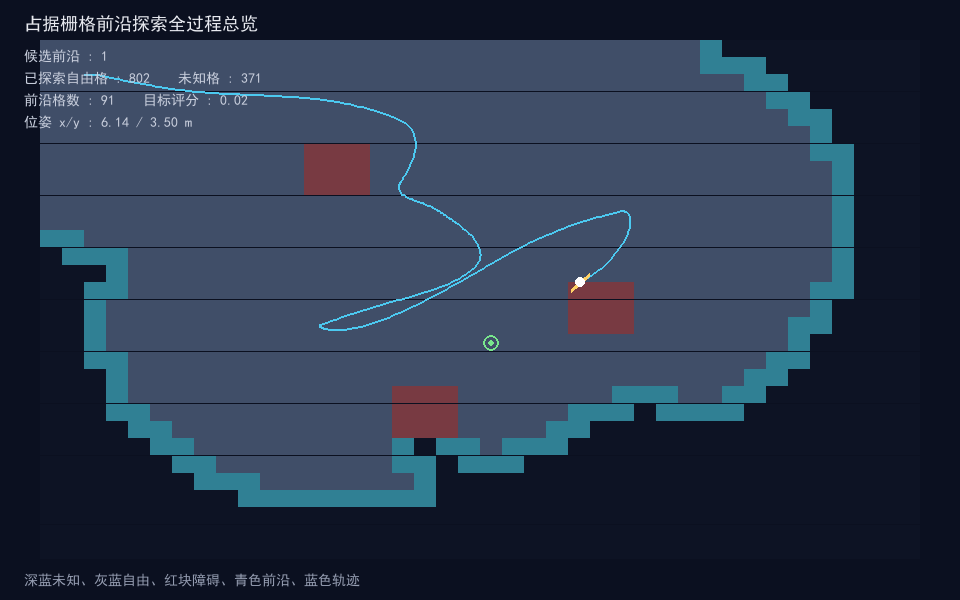
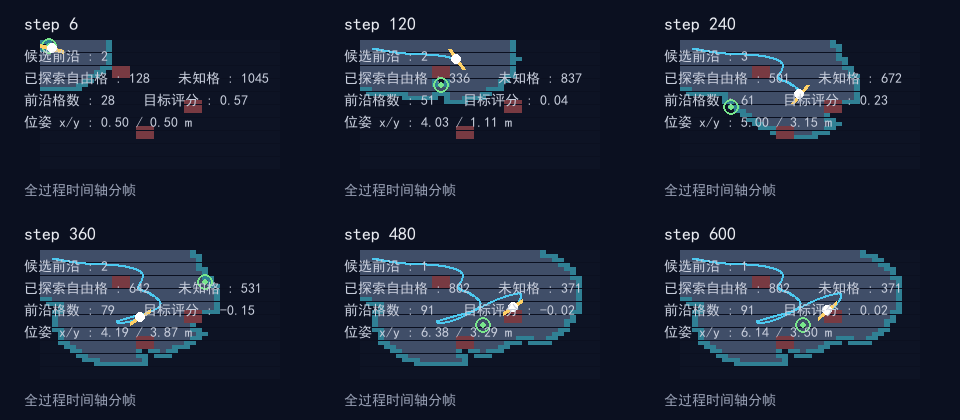
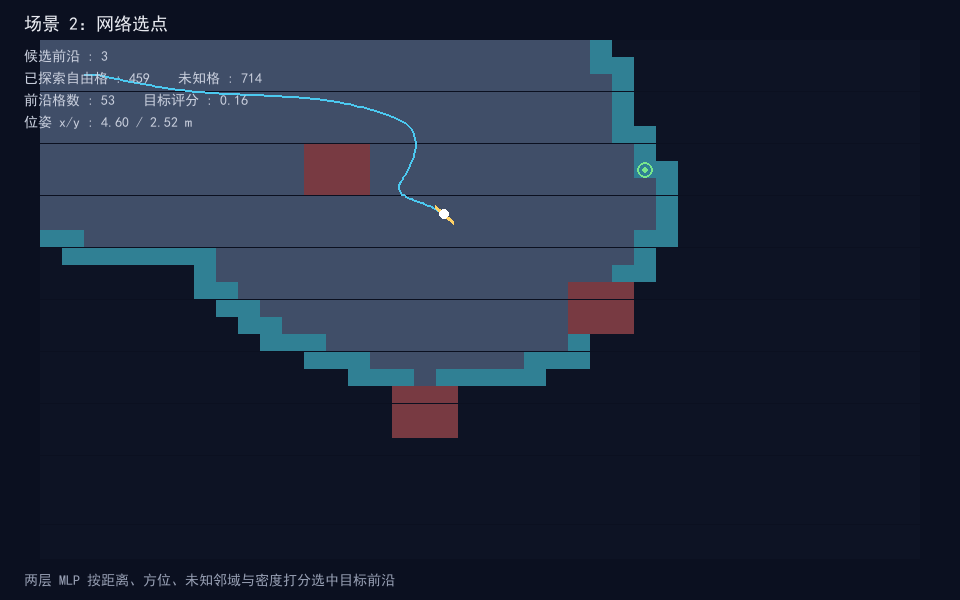
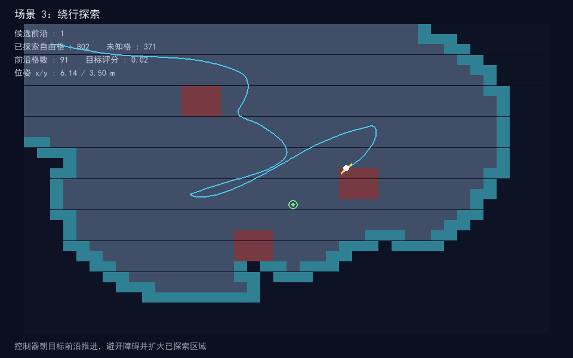

# 占据栅格前沿探索神经网络（uav_frontier_exploration_occupancy_nn）

## 概览

| 项目 | 内容 |
| --- | --- |
| 作业类别 | 任务 3：虚拟环境建图与自主探索（占据栅格 + 神经网络前沿选点） |
| 仿真器 | 内置 numpy 平面运动模型 + pygame 2.6.1 离屏渲染 |
| 运行环境 | Ubuntu 20.04 / ROS Noetic、Ubuntu 22.04 / ROS 2 Humble；离线仿真可在 Windows Python 3.13 直接运行 |
| 编程语言 | Python 3 |
| 第三方依赖 | numpy、pygame（离线）；rclpy、nav_msgs、std_msgs（ROS 节点） |
| 话题/节点 | 发布 `/odom`（Odometry）、`/frontier`（Float32MultiArray） |
| 运行方式 | `ros2 launch uav_frontier_exploration_occupancy_nn uav_frontier_exploration_occupancy_nn.launch.py`；离线 `python main.py --shots` |

## 修改目的与内容

**修改目的**：对应课程任务 3「虚拟环境建图导航与自主探索」，在空域载具示例中补充一个占据栅格前沿探索模块。机载测距射线逐帧维护未知/自由/占据三态栅格，系统从自由与未知的边界提取前沿候选，神经网络按可探索价值打分并选择目标前沿，控制器闭环朝目标推进、绕开障碍，逐步扩大已探索区域。

**实现内容**：

- `occupancy_map.py`：40×30 栅格、分辨率 0.25 m（覆盖 10.0×7.5 m），三态取值未知 -1、自由 0、占据 1；沿射线步进标记自由格，命中障碍在端点标记占据格，并给出自由格邻接未知格的前沿判定。
- `frontier.py`：对前沿格做八邻域连通聚类，取簇质心作为候选前沿点；提取距离、相对方位、邻域未知格数、局部自由密度 4 维特征并归一化。
- `frontier_policy.py`：两层 MLP，输入 4 维候选特征，隐藏层 6 单元，输出一路可探索价值评分；权重按「近、正对、未知邻域多、局部可通行」的启发式结构预置，不依赖深度学习框架。
- `controller.py`：航向 PD 跟踪目标点，速度带阻尼；前方受阻时按左前/右前间隙朝自由侧转向；位姿安全护盾在新位姿落入占据格时回退，禁止驶入障碍。
- `explorer.py`：闭环串联建图、前沿提取、网络选点与导航控制，统计已探索自由格、未知格、前沿格数与受阻步数。
- `explorer_node.py`：ROS 2 节点，定时推进闭环，发布里程计与前沿决策；rclpy 延迟导入，离线测试不依赖 ROS。
- `main.py`：离线仿真入口，支持 `--demo` 与 `--shots`，离屏渲染全过程关键帧。
- 提供 launch 文件、`package.xml`、`setup.py` 与单元测试。

**已知限制**：

- 场景为三块规则矩形障碍的二维平面，未包含三维高程、动态障碍与狭窄通道；前沿聚类为连通域质心，未做全局路径规划，受阻时仅靠局部间隙转向。
- 神经网络权重按启发式结构预置，未做在线训练；本地开发环境为 Windows，未在 Ubuntu + ROS 实机上完成端到端联调，ROS 节点仅做接口封装，需在 ROS 环境中构建验证。

## 测试环境与结果

- **实际系统**：Windows 11，本地 Python 离线仿真与单元测试环境。
- **Python 与关键依赖版本**：Python 3.13.16；numpy 2.5.4；pygame 2.6.1（SDL 2.28.4）；pytest 9.2.0；Pillow 13.0.0。
- **模拟器**：内置纯 numpy 平面运动模型 + pygame 离屏渲染（`SDL_VIDEODRIVER=dummy`）；未使用 MuJoCo / Gazebo。
- **构建与运行命令**（包目录 `src/air/uav_frontier_exploration_occupancy_nn/`）：
  - 单元测试：`python -m pytest test -q`
  - 离线仿真：`python main.py --demo`；出图：`python main.py --shots`
  - ROS 构建（ROS 环境内，工作区根目录）：`colcon build --packages-select uav_frontier_exploration_occupancy_nn --symlink-install`
  - ROS 启动：`ros2 launch uav_frontier_exploration_occupancy_nn uav_frontier_exploration_occupancy_nn.launch.py`
- **验证操作与结果**：9 项单元测试全部通过，其中地图 3 项、前沿 2 项、策略 2 项、控制器 2 项。闭环 600 步内已探索自由格 802，剩余未知格 371，轨迹未驶入障碍格（侵入次数 0），受阻转向 4 步，位姿最大到达 x 6.70 m、y 4.18 m。
- **尚未验证**：未在 Ubuntu / ROS 实机构建与 launch 联调；真实激光/测距传感器建图与多机协同探索未在图形界面下实测。

## 运行效果

全过程场景：起步建图（射线标出近旁自由格，提取首批前沿候选）→ 网络选点（MLP 按距离、方位、未知邻域与密度打分选中目标前沿）→ 绕行探索（控制器朝目标前沿推进，避开障碍并扩大已探索区域）。

| 指标 | 数值 |
| --- | --- |
| 已探索自由格 | 802 |
| 剩余未知格 | 371 |
| 前沿格数 | 91 |
| 障碍格侵入次数 | 0 |
| 受阻转向步数 | 4 |
| 位姿最大 x / y | 6.70 / 4.18 m |

### 全程轨迹总览



### 全过程时间轴分帧



### 阶段关键帧

| 场景 | 截图 |
| --- | --- |
| 场景 1：起步建图 |  |
| 场景 2：网络选点 |  |
| 场景 3：绕行探索 |  |

## 系统原理与公式

### 占据栅格与射线探测

栅格单元状态：

```
s(c, r) ∈ {未知 -1, 自由 0, 占据 1}
```

射线按步长 `res/2` 步进，沿途未命中障碍的单元标记自由；命中障碍时在端点标记占据：

```
x_t = ox + cos(θ)·t,  y_t = oy + sin(θ)·t,  t ∈ [step, max_range]
```

### 前沿判定与候选特征

自由格八邻域内存在未知格即为前沿格；连通聚类后取簇质心 `(wx, wy)`。每个候选提取 4 维特征：

```
f_dist = clip(dist / 3.0, 0, 1)
f_bear = clip(atan2(wy-y, wx-x) - yaw) / π
f_unk  = 未知邻域数 / 8
f_dens = 局部 3×3 自由格占比
```

### 前沿打分网络

两层前向计算：

```
hidden = tanh(W1·f + b1)
score = W2·hidden + b2
```

评分权重倾向：距离 `-0.5`、方位 `-0.3`、未知邻域 `+1.4`、局部自由密度 `+0.3`，选中候选为评分最大的下标。

### 运动控制

```
yaw_des = atan2(ty - y, tx - x)
ω = clamp(kp_yaw·wrap(yaw_des - y), ±yaw_max)
v_fwd = v_max·max(0, cos(err))   # 前方受阻时前飞置 0，朝自由侧转向
v += (v_des - v)·min(1, damping·dt)
```

新位姿若落入占据格则回退到上一位姿并清零速度。

## 算法流程

```
初始化机体位置、偏航与占据栅格
  │
  ├─ 射线探测：18 条射线标记自由/占据格，更新三态栅格
  │
  ├─ 前沿提取：自由-未知边界判定 -> 连通聚类 -> 候选特征
  │
  ├─ 打分网络：候选特征 -> 可探索价值评分 -> 选中目标前沿
  │
  ├─ 控制器：航向跟踪目标，受阻朝自由侧转向，安全护盾防侵入
  │
  └─ 积分位置与栅格状态，进入下一仿真步
```

## 源代码解析

| 文件 | 职责 |
| --- | --- |
| `uav_frontier_exploration_occupancy_nn/occupancy_map.py` | 三态占据栅格、世界/栅格坐标换算、射线探测与前沿格判定 |
| `uav_frontier_exploration_occupancy_nn/frontier.py` | 前沿连通聚类、候选质心定位与 4 维特征提取 |
| `uav_frontier_exploration_occupancy_nn/frontier_policy.py` | `FrontierScoreNetwork`：两层 MLP 打分、argmax 选目标与权重结构 |
| `uav_frontier_exploration_occupancy_nn/controller.py` | `ExplorerController`：航向 PD、速度阻尼、受阻转向与位姿护盾 |
| `uav_frontier_exploration_occupancy_nn/explorer.py` | `FrontierExplorer`：建图-选点-导航闭环与统计指标 |
| `uav_frontier_exploration_occupancy_nn/explorer_node.py` | ROS 2 节点：定时推进闭环，发布 `/odom`、`/frontier`；rclpy 延迟导入 |
| `main.py` | 离线一键实验入口：`--shots` 离屏运行并保存截图；`--demo` 打开观察窗口 |
| `test/test_map.py` | 自由格标记、障碍命中与前沿边界判定校验 |
| `test/test_frontier.py` | 邻域聚类去重、候选特征维度与归一化区间校验 |
| `test/test_policy.py` | 近且未知邻域多的候选评分更高、argmax 选目标校验 |
| `test/test_controller.py` | 朝目标前进、受阻时保持位姿不前进校验 |

关键实现说明：

- 网络不依赖深度学习框架，权重按探索启发式结构预置为确定值，前向推理仅用 numpy 矩阵乘与 tanh。
- 安全护盾在控制器更新后做占据格回退，保证轨迹不驶入障碍；受阻转向依据左前、右前间隙选择方向。
- 离屏渲染使用 `SDL_VIDEODRIVER=dummy`，无需图形界面即可生成关键帧。

## 仿真运行步骤

### Ubuntu 20.04 / ROS 2 Humble

```bash
# 进入工作区源码目录
colcon build --packages-select uav_frontier_exploration_occupancy_nn --symlink-install
source install/setup.bash
ros2 launch uav_frontier_exploration_occupancy_nn uav_frontier_exploration_occupancy_nn.launch.py
```

### 离线仿真（Windows / Linux，无需 ROS）

```bash
cd src/air/uav_frontier_exploration_occupancy_nn
python main.py --shots    # 生成全过程截图到 docs/img/
python main.py --demo     # 观察前沿探索过程
```

### 单元测试

```bash
python -m pytest test/ -q
```

## 文件结构

```
src/air/uav_frontier_exploration_occupancy_nn/
├── launch/uav_frontier_exploration_occupancy_nn.launch.py
├── uav_frontier_exploration_occupancy_nn/
│   ├── __init__.py
│   ├── occupancy_map.py
│   ├── frontier.py
│   ├── frontier_policy.py
│   ├── controller.py
│   ├── explorer.py
│   └── explorer_node.py
├── test/
│   ├── test_map.py
│   ├── test_frontier.py
│   ├── test_policy.py
│   └── test_controller.py
├── resource/uav_frontier_exploration_occupancy_nn
├── conftest.py
├── main.py
├── package.xml
├── setup.py
├── setup.cfg
└── README.md
docs/air/uav_frontier_exploration_occupancy_nn.md
docs/img/uav_frontier_exploration_occupancy_nn_*.png
```

## 话题、节点与参数

### 话题

| 话题 | 类型 | 方向 | 说明 |
| --- | --- | --- | --- |
| `/odom` | `nav_msgs/Odometry` | 发布 | 机体位置与线速度 |
| `/frontier` | `std_msgs/Float32MultiArray` | 发布 | 目标前沿 x、y、评分、候选数、自由格数、未知格数 |

### 参数

| 参数 | 默认值 | 说明 |
| --- | --- | --- |
| `sim_rate` | 20.0 | 仿真控制频率 Hz |

## 与现有模块的区别

- 与 `uav_grid_navigation`（已知栅格上的路径导航）不同：本模块从未知环境的射线观测中在线建图，依据自由/未知边界的前沿候选自主决定下一个探索目标，不依赖预先给定的全局地图与终点。
- 与 DQN / PPO 等强化学习导航模块不同：本模块不训练回报驱动的策略，而是用两层 MLP 对前沿候选的可探索价值打分，规则透明、可离线复现。
- 与激光避障模块不同：本模块面向主动探索与覆盖建图，输出的是探索目标点而非单纯避障指令。

## 提交前检查

- [x] 已检查 Files changed 和冲突，无无关生成文件、重复内容或误删公共文件。
- [x] 源码与教程按模块分别放在 src、docs，文件使用英文下划线命名。
- [x] 模块提供 `main.py` 和 launch，依赖及安装路径正确，README 步骤已实际运行（离线仿真与单元测试已跑通）。
- [x] 新模块已添加首页和导航链接；已运行 `mkdocs serve --livereload` 检查相关页面。（本地未安装 mkdocs，未执行本地文档预览；导航与首页索引条目已写入 `mkdocs.yml` 与 `docs/index.md`。）
- [x] 功能描述与验证证据一致；PNG 小于 3 MB，GIF 小于 5 MB。

## 大模型使用声明

过程中借助大模型工具辅助代码编写、整理包目录结构与本描述排版，核心逻辑与操作、场景参数设定与实际运行调试为本人完成，作者对提交内容负责。
