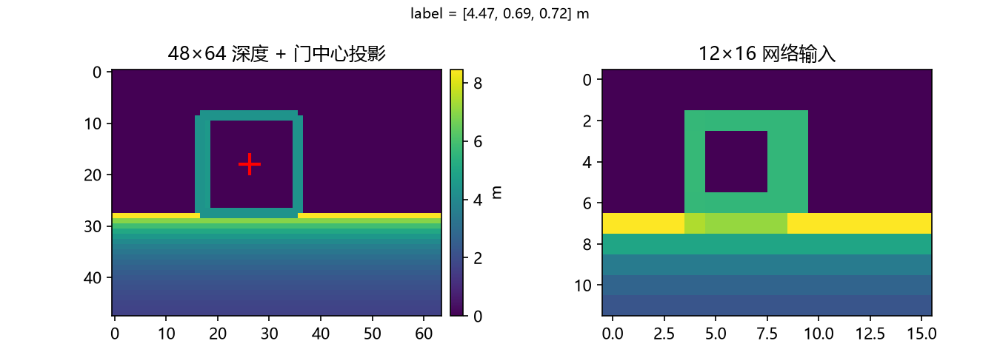
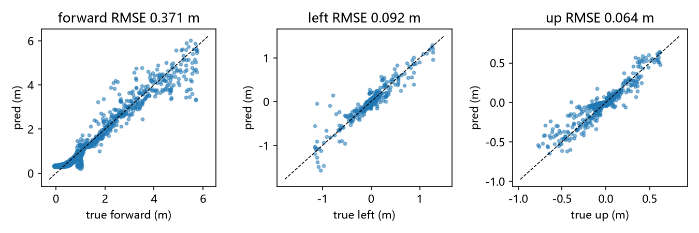
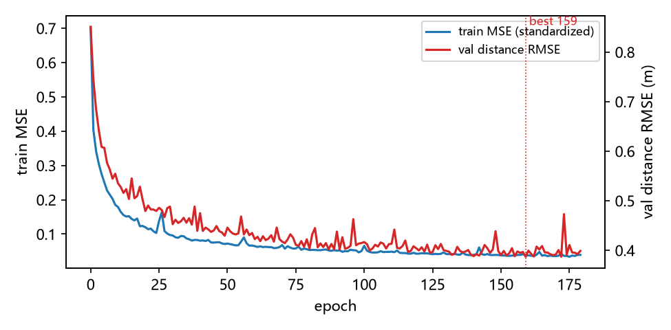
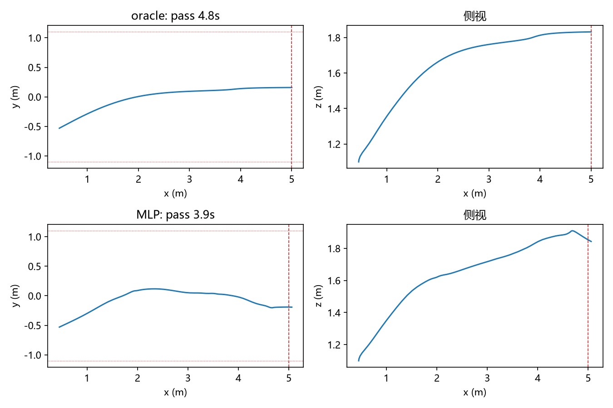
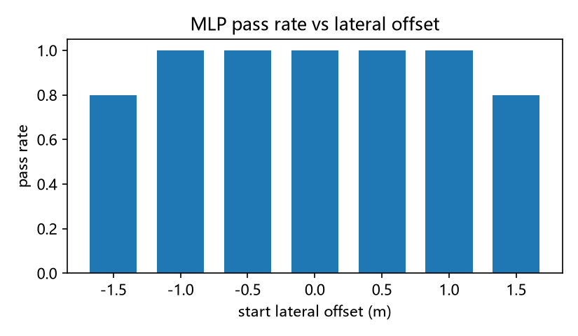

# 单门深度视觉伺服：门中心回归 + 比例控制

对应作业任务（2）传感器感知与（4）端到端决策。

`src/air/uav_gate_center_servo/`

输入 48×64 深度图，块平均到 12×16；一个 192→32→3 的小 MLP 回归门框中心
`[forward, left, up]`，比例控制器输出航向系速度穿过单个门。推理只用深度图；
训练标签由仿真真值生成。与 `uav_depth_gate_racing_e2e` 的端到端策略不同，
本模块把感知和控制分开：网络只负责“门在哪”，控制律只负责“怎么飞”。

## 1. 与已有模块的区别

| 模块 | 做法 | 本模块不同 |
|---|---|---|
| `uav_depth_gate_racing_e2e` | 深度图直接映射到速度；BC/DAgger/PPO；CNN/GRU/注意力 | 只回归门中心，再用 P 控制；单门；无策略网络/RL |
| `openhutb_yolo_mlp_control` | RGB + YOLO 检测框 + 视觉居中 | 深度图、门框几何中心、无 YOLO |
| 本模块 | 两阶段、可解释 | #410 的可解释基线/消融 |

## 2. 输入与标签

深度相机 `front_cam` 在机体系 `(0.075, 0, 0.012)`，光轴 +x，图像右 = 机体 -y，
图像上 = 机体 +z，`fovy=70°`。

```text
p_cam = p + R·c_b
label = gate_center - p_cam = [forward, left, up]
target = label + R·c_b
```

`label` 和深度在同一状态采集；推理时只用深度。固定航向 `ref_yaw=0`，所以
航向系与世界 ENU 同向。图像投影：

```text
fx = fy = (H/2) / tan(35°)
u = cx - fx·left/forward
v = cy - fy·up/forward
```

深度预处理：48×64 米制深度按 4×4 块平均到 12×16；只平均有限且 >0 的像素，
整块无效时为 0。不用插值，避免把无效像素抹成有效深度。



## 3. 网络与训练

- 结构：192→32→3，tanh 隐层，线性输出；6,275 参数，权重约 50 KB。
- 输入：12×16 深度按全局均值/标准差归一化；输出三轴标签按训练集均值/标准差归一化。
- 训练：MSE、Adam（lr 1e-3、weight decay 1e-4）、batch 64、最多 200 轮，
  patience 20，按验证距离 RMSE 恢复最优权重。
- 数据：55 个 oracle episode，4,977 帧；按 episode 80/20 切分（44/11），
  标准化统计只用训练集；训练时按 50% 概率做水平镜像（深度左右翻转、left 取反）。
- 结果：验证 distance RMSE **0.387 m**，forward/left/up **0.371/0.092/0.064 m**；
  最优 159 轮，179 轮早停。





## 4. 比例伺服

```text
v_x = clip(k_x·(forward - look_ahead), v_min, v_max)
v_y = clip(k_y·left, -v_max, v_max)
v_z = clip(k_z·up, -v_z_max, v_z_max)
```

默认 `k_x=1.5, look_ahead=1.0, v_min=0.5, v_max=1.8, k_y=1.2, k_z=1.2,
v_z_max=0.9`。深度有效比例低于 0.5 时按比例减速；预测越界或非有限时输出零速。
oracle 和 MLP 共用这一个函数，只换标签来源。

环境：底座 `gate_track` 单门（`n_gates=1`），无人机在门前 2–6 m、横向 ±1.5 m、
高度 ±0.8 m 随机重置；固定航向，20 Hz 帧内 5 个 0.01 s 控制步调用
`GeometricController.act`。穿过门平面且落在 1.1 m 开口内算通过，否则记 miss；
12 s 未穿过记 timeout。



### 4.1 闭环结果

50 个随机起点（seeds 5000–5049），oracle 和 MLP 用同一控制律：

| 项 | oracle | MLP |
|---|---|---|
| 通过 | 50/50 | 48/50 |
| 平均用时 | 4.37 s | 3.63 s |
| 最大用时 | 5.50 s | 6.25 s |
| miss / timeout | 0 / 0 | 2 / 0 |
| 推理延迟 | — | 0.048 ms 均值，0.094 ms P95 |

横向起点扫描（7 个偏移 × 10 seeds）：±1.5 m 处 0.8，其余 1.0。



## 5. ROS2 节点

| 方向 | 话题 | 类型 |
|---|---|---|
| 订阅 | `/camera/depth` | `sensor_msgs/Image`（32FC1，米） |
| 订阅 | `/uav/odom` | `nav_msgs/Odometry` |
| 发布 | `/uav/cmd_vel` | `geometry_msgs/Twist`（机体系，m/s） |
| 发布 | `/gate_servo/status` | `std_msgs/String` |
| 发布 | `/gate_servo/depth_view` | `sensor_msgs/Image`（mono8，12×16） |

节点 20 Hz；深度超时 0.5 s。发布前：

```text
v_body = Rᵀ·a
```

底座 `VelocityCommander` 按实时姿态把机体系指令旋到世界系；再左乘 `R` 后，
世界速度正好等于航向系指令 `a`。不直接发布航向速度，也不做偏航跟随。

```bash
ros2 launch uav_gate_center_servo gate_servo.launch.py with_sim:=true
ros2 topic hz /uav/cmd_vel
ros2 topic echo /gate_servo/status --once
```

已知限制：底座 launch 的 `gate_track` 是 8 门，在线演示会把最近门当目标；
离线单门指标不包含门序切换。单门在线演示需要外部单门深度源。

## 6. 复现

```bash
python main.py --selftest
python main.py --collect --episodes 55 --seed 0 --scene-seed 16
python main.py --train --epochs 200 --seed 0
python main.py --evaluate --episodes 50 --lateral-n 10
python main.py --figures
```

`--figures` 需要 matplotlib；无头服务器设置 `MPLBACKEND=Agg`。

## 7. 已知限制

- 单门、固定航向；不处理门序、偏航跟踪和障碍物。
- 只在仿真深度上验证；真实相机的时延、缺帧、噪声未覆盖。
- 深度全零时自检/测试跳过，数据集采集直接报错，避免训练空图。
- MLP 输入 12×16 是速度/精度折中；更远或更小的门需要更高分辨率。
