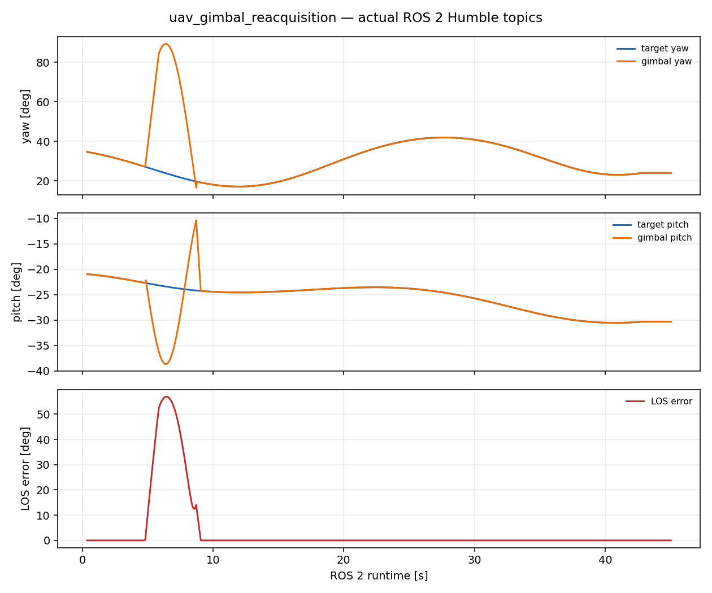
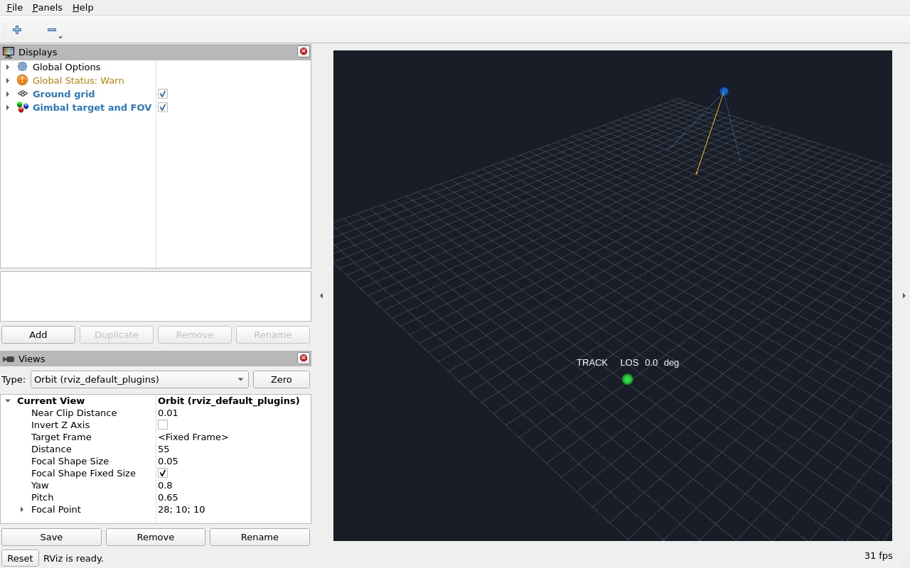
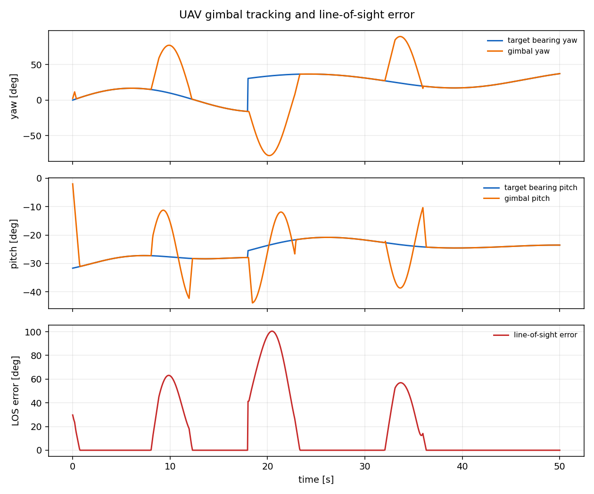
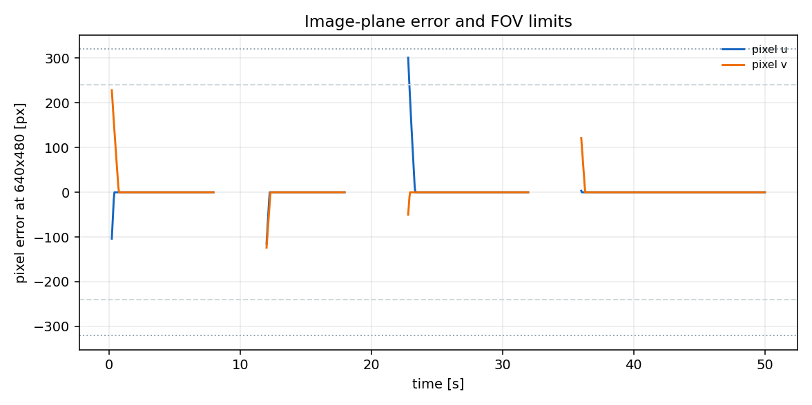
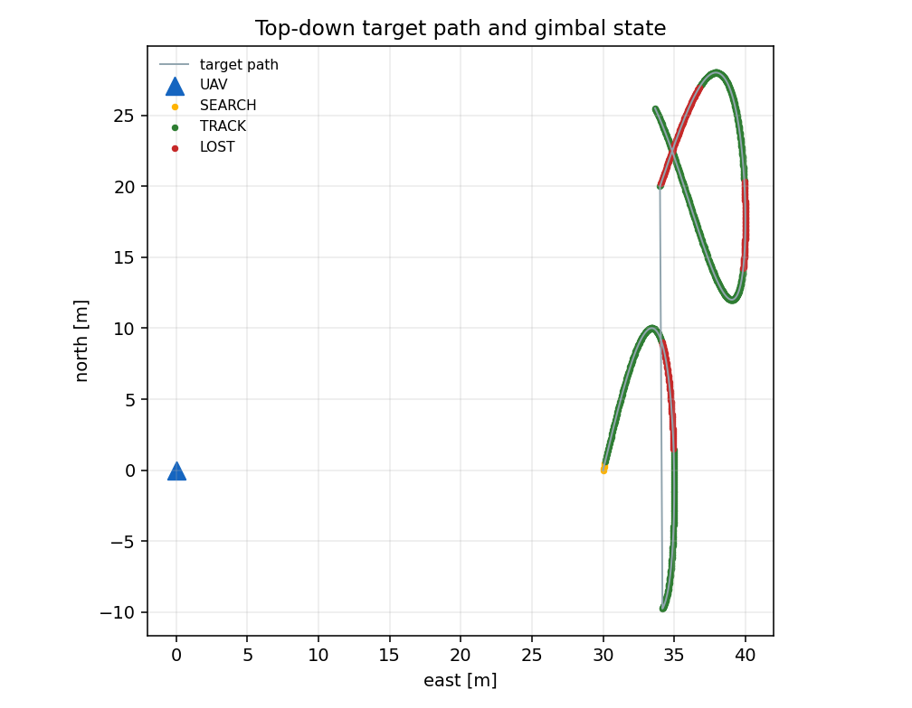
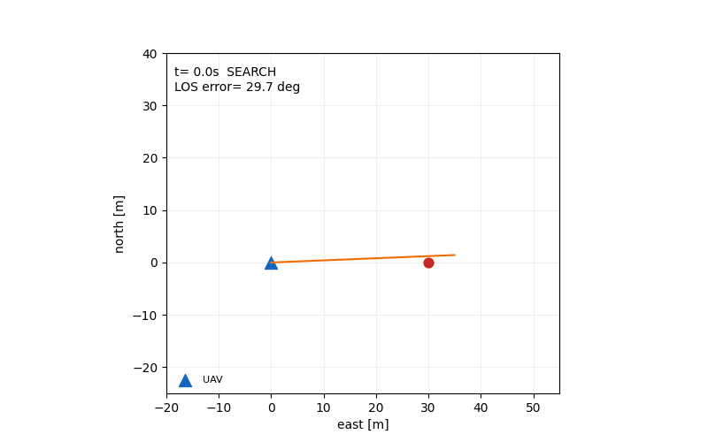

# 低空无人机机载云台目标丢失重捕获与视轴误差评估

本项目面向低空小型无人机的机载云台，演示一条完整链路：目标在图像中运动、被遮挡或突然跳变，云台跟踪器判断目标是否丢失，进入搜索扫描，重新捕获目标，并统计重捕获时间和视轴误差。

与仓库已有模块的区别：

- `airsim_drone_gimbal_teleop` 是键盘手动控制和相机预览，不判断目标丢失。
- `openhutb_yolo_mlp_control` 是地面车辆视觉居中，不是无人机机载云台重捕获。
- 本模块专注于云台目标丢失判定、搜索重捕获和 LOS/像素质误差评估，不发送真实飞控指令。

## 1. 系统结构

```text
目标轨迹 + 遮挡/跳变
        ↓
云台 FOV 投影：方位角、俯仰角、像素误差
        ↓
状态机：SEARCH → TRACK → LOST → 搜索 → TRACK
        ↓
重捕获时间、跟踪率、LOS RMS、像素质误差
```

核心参数：

- 图像分辨率：640 × 480
- 水平/垂直 FOV：60° / 45°
- 云台最大角速度：偏航 55°/s，俯仰 40°/s
- 目标丢失判定：连续 3 帧未检测到
- 场景：50 秒，包含两次遮挡和一次目标突然迁移

## 2. 几何与状态机

目标相对云台的方位角和俯仰角：

\[
\psi_t=\operatorname{atan2}(y_t-y_c,\ x_t-x_c),
\qquad
\theta_t=\operatorname{atan2}(z_t-z_c,\ \sqrt{(x_t-x_c)^2+(y_t-y_c)^2})
\]

视轴单位向量：

\[
\mathbf{b}=(\cos\theta\cos\psi,\ \cos\theta\sin\psi,\ \sin\theta)
\]

目标视线与云台视轴的夹角即 LOS 误差：

\[
\epsilon_{\mathrm{LOS}}=\arccos(\mathbf{b}\cdot\mathbf{l})
\]

其中 \(\mathbf{l}\) 是云台指向目标的单位视线向量。

状态机：

| 状态 | 行为 |
|---|---|
| SEARCH | 在丢失方向附近进行偏航/俯仰扫描 |
| TRACK | 目标在视场内，云台按角速度限制跟踪 |
| LOST | 连续多帧无有效检测，记录丢失事件 |
| 重捕获 | 扫描过程中重新检测到目标，恢复 TRACK |

状态未使用真实检测网络，而是用 FOV、遮挡标志和投影误差模拟“检测到/未检测到”。这使算法和接口可复现，但不能把结果解释为真实视觉检测器精度。

## 3. ROS 2 接口

| 话题 | 类型 | 方向 | 说明 |
|---|---|---|---|
| `/uav_gimbal/target` | `geometry_msgs/PointStamped` | 输入 | 目标世界坐标，frame `map` |
| `/uav_gimbal/target_visible` | `std_msgs/Bool` | 输入 | 目标是否被遮挡 |
| `/uav_gimbal/observation` | `std_msgs/String` | 输出 | 云台角、目标角、LOS、像素误差、状态 |
| `/uav_gimbal/status` | `std_msgs/String` | 输出 | 丢失/重捕获次数、跟踪率、RMS |
| `/uav_gimbal/markers` | `visualization_msgs/MarkerArray` | 输出 | 目标、无人机、视轴、FOV、状态文字 |

节点只发布仿真状态和可视化标记，不发送控制真实飞行器或真实云台的指令。

## 4. 构建与运行

推荐环境：Ubuntu 22.04、ROS 2 Humble、Python 3.10。

```bash
source /opt/ros/humble/setup.bash
colcon build --symlink-install --packages-select uav_gimbal_reacquisition
source install/setup.bash
ros2 launch uav_gimbal_reacquisition main.launch.py
```

查看：

```bash
ros2 topic list | grep uav_gimbal
ros2 topic echo /uav_gimbal/observation
ros2 topic echo /uav_gimbal/status
```

RViz2 添加 `MarkerArray`，订阅 `/uav_gimbal/markers`，Fixed Frame 设为 `map`。标记包含：

- 蓝色无人机位置；
- 红色/绿色目标球（丢失/检测到）；
- 黄色云台视轴箭头；
- 浅蓝色 FOV 边界；
- 当前状态和 LOS 误差文字。

离线复现不需要 ROS 2：

```bash
cd src/air/uav_gimbal_reacquisition
python3 main.py --duration 50 --dt 0.05 --output-dir artifacts/demo
```

## 5. 本次实测结果

### 5.1 ROS 2 Humble 实测

在 Ubuntu 22.04.5 / ROS 2 Humble 的 VMware 虚拟机中完成了实际构建和运行：

```text
Starting >>> uav_gimbal_reacquisition
Finished <<< uav_gimbal_reacquisition [0.77s]
Summary: 1 package finished [1.09s]
```

6 项 `unittest` 在 VM 内通过。`ros2 launch uav_gimbal_reacquisition main.launch.py` 启动两个节点后，记录到以下状态变化：

```text
SEARCH → TRACK → LOST → TRACK
```

连续录制 45 秒，共 896 个真实 `/uav_gimbal/observation` 样本：

| 指标 | 结果 |
|---|---:|
| 总状态帧 | 1424 |
| 跟踪帧 | 1162 |
| 跟踪率 | 81.6% |
| 丢失事件 | 3 |
| 重捕获事件 | 3 |
| 重捕获时间 | 3.90 / 4.75 / 3.90 s |
| LOS RMS | 1.96° |
| 像素质误差 RMS | 20.97 px |
| 最大有效 LOS 误差 | 23.82° |





第二张图是在 VM 的 Xvfb 显示中实际启动 RViz2 后抓取的窗口。RViz2 订阅 `/uav_gimbal/markers`，画面中可见无人机位置、目标球、FOV 边界、视轴和 `TRACK LOS` 状态文字。

### 5.2 离线复现结果

环境：Windows 11、Python 3.13.7，Matplotlib 仅用于绘图；核心算法只使用 Python 标准库。6 项单元测试通过。

50 秒运行、步长 0.05 秒的结果：

| 指标 | 结果 |
|---|---:|
| 总帧数 | 1001 |
| 实际跟踪帧 | 739 |
| 检测帧 | 741 |
| 跟踪率 | 73.8% |
| 丢失事件 | 3 |
| 重捕获事件 | 3 |
| 重捕获时间 | 3.90 / 4.75 / 3.90 s |
| LOS RMS | 2.46° |
| 像素质误差 RMS | 26.33 px |
| 最大有效 LOS 误差 | 23.84° |









这些图来自同一份 50 秒 CSV，不是手工绘制的示意图。图中 LOS 峰值对应遮挡或目标跳变后的搜索阶段，恢复 TRACK 后误差回到视轴附近。

## 6. 已知限制

1. 检测器使用理想 FOV/遮挡模型，没有接入 YOLO、KCF 或真实相机图像。
2. 没有相机畸变、曝光、运动模糊、云台机械回差和振动。
3. 目标在世界系中运动，云台位置固定，尚未接入 AirSim/OpenHUTB 的无人机姿态和真实相机图像。
4. LOS 误差和像素质误差是仿真评估量，不能代替真实光电吊舱的标定结果。
5. 搜索策略是固定扫描，不是基于目标运动预测的最优搜索。

后续可扩展：接入 AirSim 相机与无人机姿态、增加目标运动预测、比较不同搜索策略、引入真实检测器与标定误差。

## 7. 大模型使用声明

使用 OpenAI Codex 辅助完成代码、测试、文档和运行图；作者已逐项复核代码、参数与结果，并对提交内容、数据真实性和后续维护负责。
