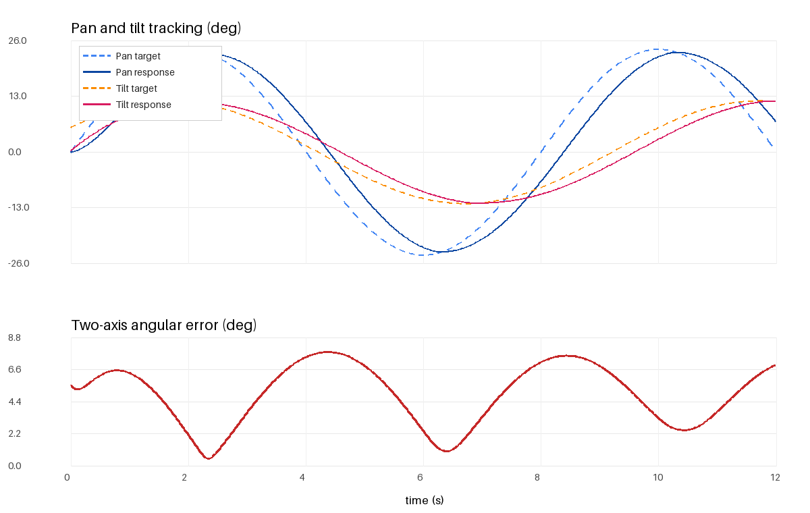

# 无人机云台两轴稳定控制

本实验演示机载云台跟踪目标视线时的两轴 PID 稳定控制。目标在画面中平滑摆动，
控制器输出 pan/tilt 角速度，经过速率限制和死区后驱动云台，最后统计跟随误差。

源码位置：`src/air/uav_gimbal_stabilization/`

## 实验目标

- 理解云台 pan/tilt 两轴独立控制；
- 为每个轴加入 PID、积分限幅和死区；
- 限制角速度，避免目标突变造成过大的执行器指令；
- 用合成目标轨迹复现闭环收敛并记录 CSV；
- 明确区分仿真验证与真实云台硬件实验。

## 控制流程

```text
合成目标轨迹
    ↓
pan/tilt 角度误差
    ↓
两轴 PID + 死区
    ↓
角速度限幅
    ↓
云台角速度模型
    ↓
状态、误差与指标
```

控制律：

```text
rate_axis = Kp·e + Ki·∫e dt + Kd·de/dt
rate_axis_clipped = clip(rate_axis, -max_rate, max_rate)
```

`|e|` 小于 `deadband` 时输出零角速度，抑制小幅噪声导致的抖动。

## 运行

```bash
cd ~/catkin_ws
catkin_make
source devel/setup.bash
roslaunch uav_gimbal_stabilization main.launch
```

纯 Python 仿真：

```bash
cd src/air/uav_gimbal_stabilization
python3 scripts/main.py --duration 12 --rate 50 \
  --csv /tmp/gimbal.csv --plot /tmp/gimbal.png
```

## ROS 话题

| 话题 | 类型 | 说明 |
|---|---|---|
| `/uav/gimbal/target` | `geometry_msgs/Vector3` | 目标 pan/tilt 角度 |
| `/uav/gimbal/cmd` | `geometry_msgs/Vector3` | pan/tilt 角速度指令 |
| `/uav/gimbal/state` | `geometry_msgs/Vector3` | 当前角度与二维误差 |
| `/uav/gimbal/status` | `std_msgs/String` | 运行状态和累计指标 |

`Vector3` 字段含义：

- `/uav/gimbal/target`：`x=pan` 目标角，`y=tilt` 目标角，`z=0`；
- `/uav/gimbal/cmd`：`x=pan` 角速度，`y=tilt` 角速度，`z=0`；
- `/uav/gimbal/state`：`x=当前 pan`，`y=当前 tilt`，`z=二维综合角误差`。

`duration` 和 `rate` 必须是有限正数；没有有效样本时，CSV 和绘图函数会安全返回。
ROS 节点的最终 `status` 同时给出 `samples`、`rmse_deg`、`max_error_deg` 和
`saturation_ratio`。

## 结果指标

- 二维角误差 RMSE；
- 最大角误差；
- 指令饱和比例；
- 运行步数和 CSV 记录。



本次 50 Hz、12 s 离线闭环仿真的结果：

| 项目 | 结果 |
|---|---:|
| 样本数 | 600 |
| 二维角误差 RMSE | 5.269° |
| 最大角误差 | 7.764° |
| 速率饱和比例 | 0 |

响应图上方面板同时给出 pan、tilt 的目标与响应，下方给出二维角误差。当前平滑目标
轨迹没有触发 60°/s 的速率上限，饱和处理通过单元测试中的大幅阶跃输入单独验证。

## 测试

catkin 自动测试：

```bash
cd ~/catkin_ws
catkin_make run_tests_uav_gimbal_stabilization
catkin_test_results
```

单独运行 unittest：

```bash
cd src/air/uav_gimbal_stabilization
python3 -m unittest discover -s test -v
```

11 项测试覆盖 PID 速率限幅、死区、双轴误差、目标轨迹确定性、闭环前后段
误差下降、CSV 首条时间、非法时长/频率、空结果和离线参数校验。

## AI 使用声明

使用 Codex（OpenAI）辅助代码、测试和文档整理；算法参数、运行结果与提交内容由作者复核并负责。

本包采用 MIT License，完整许可证文本位于 `src/air/uav_gimbal_stabilization/LICENSE`。
