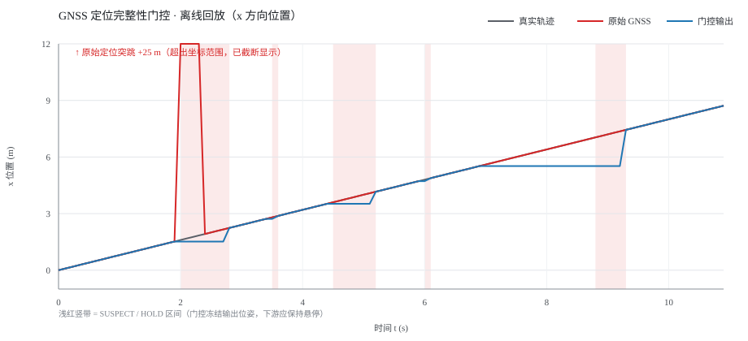
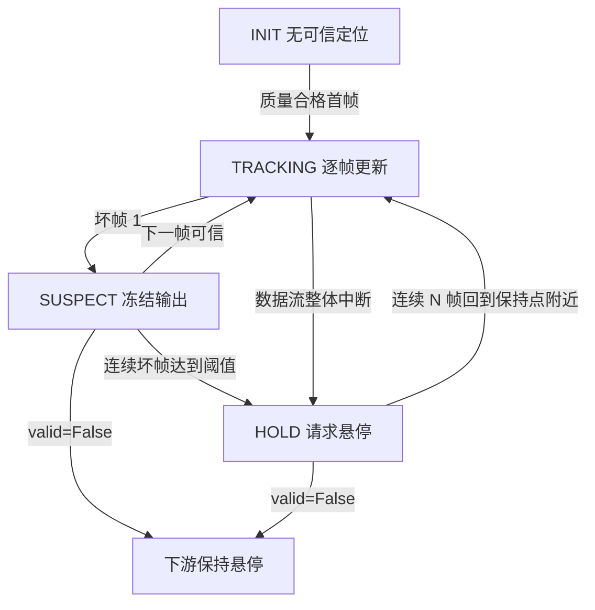

# 无人机 GNSS 定位完整性监测与位置跳变失效保护



> 上图是由 `python main.py --plot` **实际运行生成的矢量曲线**（非仿真截图、非拍照）：
> 灰色为合成真实轨迹，红色为注入异常后的原始 GNSS，蓝色为门控输出，
> 浅红竖带为 SUSPECT / HOLD 区间。原始定位的 +25 m 突跳超出坐标范围，已在图上标注并按上限截断显示。

## 1. 为什么要做这个模块

定点悬停、航点跟踪这类功能都默认「这一帧定位是可信的」。但 GNSS 在遮挡后重新捕获、
多路径、定位降级或数据流中断时，相邻两帧之间可能出现几米到几十米的位置突跳。
飞控一旦采信，就会把这当成真实的位置误差，朝错误方向做大幅修正，
表现为突然加速飞走。仓库里已有的
[目标高度指令约束](./uav_altitude_command_guard.md) 处理的是**目标指令**，
[遥测异常诊断](./telemetry_diagnostics.md) 输出的是**诊断评分**，
[任务安全状态机](./uav_mission_safety_manager/overview.md) 处理的是**任务层**；
定位输入侧的运动学合理性门控仍是空缺。

本模块补上这一层：每帧定位先过一遍「质量检查 + 运动学 plausibility 检查」，
不可信就冻结最后可信位姿、向下游发出保持悬停信号，
直到定位连续多帧重新落到保持点附近才恢复。
纯计算层 `integrity_math.py` 只用 Python 标准库，因此判据可以脱离 ROS 和仿真器单测。

## 2. 判据

记上一帧可信定位为 $p_{k-1}=(x,y,z)$，当前帧为 $p_k$，时间差 $\Delta t=t_k-t_{k-1}$。

**质量检查**（任一不满足即拒绝）：数值有限、时间不倒退、$\Delta t \le T_{stale}$、
定位类型不低于 3D、卫星数不少于下限、水平精度不超过上限。

**运动学检查**：允许的水平与垂直位移为

$$
d_h^{max}=v_h^{max}\cdot\min(\Delta t,\ \Delta t_{cap})+m,\qquad
d_v^{max}=v_v^{max}\cdot\min(\Delta t,\ \Delta t_{cap})+m
$$

其中 $m$ 是附加裕度，$\Delta t_{cap}$ 是位移外推的时间上限。拒绝条件：

$$
\sqrt{(x_k-x_{k-1})^2+(y_k-y_{k-1})^2}>d_h^{max}
\quad\text{或}\quad
|z_k-z_{k-1}|>d_v^{max}
$$

对 $\Delta t$ 做截断是必要的：若直接用真实间隔外推，一次 10 s 失锁后的
任意大跳变都会被算成「速度允许范围内」，门控就形同虚设。默认
$v_h^{max}=12\ \mathrm{m/s}$、$v_v^{max}=6\ \mathrm{m/s}$、$m=1.5\ \mathrm{m}$、
$\Delta t_{cap}=0.5\ \mathrm{s}$、$T_{stale}=1.5\ \mathrm{s}$。

质量问题与突跳分别给出原因码（`fix_type`、`low_sats`、`accuracy`、
`non_finite`、`position_jump`、`altitude_jump`、`time_reversal`、`stale`、
`stream_gap`），便于在 `/drone/gnss_status` 里定位问题。

## 3. 状态机



关键点：

- **SUSPECT 消抖**：单帧坏点只冻结一帧，不直接判定失效，避免偶发噪点误触发。
- **HOLD 冻结**：输出始终是最后一个可信位姿 $p_{k-1}$，不是原始坏帧，也不是 0；
  `valid=False` 且 `action=hover`，下游据此停止定位闭环。
- **恢复需要连续 N 帧**：HOLD 期间用 `check_fix(None, ...)` 只做质量检查，
  再要求每帧与保持点的三维距离不超过 $r_{reacq}=3.0\ \mathrm{m}$，
  连续 `recovery_streak=5` 帧才把该帧设为新的可信位姿。
  这样既避免旧位姿与新帧之间的 $\Delta t$ 触发 `stale`，也避免一帧侥幸合格就恢复。
- **看门狗**：节点内 10 Hz 定时器在完全没有新消息时也会主动进入 HOLD，
  不依赖回调是否能收到「下一帧」。

## 4. 参数

| 参数 | 默认值 | 单位 / 说明 |
| --- | --- | --- |
| `max_speed` | 12.0 | m/s，水平最大合理速度 |
| `max_vertical_speed` | 6.0 | m/s，垂直最大合理速度 |
| `position_margin` | 1.5 | m，位移裕度 |
| `accuracy_limit` | 3.0 | m，水平精度上限 |
| `min_fix_type` | 2 | 0 无定位 / 1 2D / 2 3D / 3 RTK 固定解 |
| `min_sats` | 8 | 最少卫星数（未提供 `/drone/gnss_satellites` 时按此值处理） |
| `stale_timeout` | 1.5 | s，帧间隔与看门狗超时 |
| `max_extrapolate_dt` | 0.5 | s，位移外推时间上限 |
| `suspect_limit` | 2 | 连续坏帧进入 HOLD 的阈值 |
| `recovery_streak` | 5 | 恢复所需连续可信帧数 |
| `reacquisition_radius` | 3.0 | m，HOLD 期间重新捕获允许离保持点的距离 |
| `origin_lat/lon/alt` | 0 / 0 / 0 | 度 / 度 / 米，局部坐标原点 |
| `default_accuracy` | 0.5 | m，协方差未知时采用的精度估计 |
| `frame_id` | `map` | 输出位姿的坐标系 |

## 5. 话题接口

| 方向 | 话题 | 类型 |
| --- | --- | --- |
| 订阅 | `/drone/gnss` | `sensor_msgs/NavSatFix` |
| 订阅（可选） | `/drone/gnss_satellites` | `std_msgs/Int32` |
| 发布 | `/drone/pose_validated` | `geometry_msgs/PoseStamped` |
| 发布 | `/drone/gnss_valid` | `std_msgs/Bool` |
| 发布 | `/drone/gnss_status` | `std_msgs/String`（JSON） |

`NavSatFix` 的 `status.status` 映射为定位类型：`NO_FIX→0`、`FIX/SBAS_FIX→2`、
`GBAS_FIX→3`；水平精度取 `position_covariance[0]` 的平方根，
协方差类型未知时回退到 `default_accuracy`。经纬度用等距近似换算到局部米制坐标，
只适用于小范围实验区域。

## 6. 运行

离线回放与单元测试不需要 ROS，在模块目录下执行：

```bash
cd src/air/uav_gnss_integrity_monitor
python main.py
python main.py --plot ./outputs
python -m unittest -v test_gnss_integrity_monitor.py
```

ROS 2 侧（Ubuntu 22.04 / Humble）：

```bash
source /opt/ros/humble/setup.bash
colcon build --packages-select uav_gnss_integrity_monitor --symlink-install
source install/setup.bash
ros2 launch uav_gnss_integrity_monitor uav_gnss_integrity_monitor.launch.py
```

完整的构建、手动发话题、观察输出与停止步骤见
[模块 README](https://github.com/OpenHUTB/ros2/tree/master/src/air/uav_gnss_integrity_monitor)。

## 7. 离线验证与结果

合成轨迹为 $x=0.8t$ 的匀速直线（$\Delta t=0.1\ \mathrm{s}$，共 92 帧），
依次注入：+25 m 位置突跳（4 帧）、2D 定位且卫星不足（1 帧）、
精度恶化到 8 m（3 帧）、非有限数值（1 帧）、定位数据流中断 1.9 s。

实际执行 `python main.py` 的输出（节选）：

```text
样本数 92，其中被接受 70，HOLD 帧 18
原始定位最大绝对误差 25.0 m；门控输出最大绝对误差 1.84 m
从 HOLD 恢复到 TRACKING 的次数: 3
拒绝原因统计: {"accuracy": 3, "awaiting_reacquisition": 12,
  "far_from_hold_pose": 2, "fix_type": 1, "non_finite": 1,
  "position_jump": 2, "stream_gap": 1}

状态变化事件 (t / 状态 / 原因):
  t= 0.00  TRACKING  quality_ok
  t= 2.00  SUSPECT   position_jump
  t= 2.10  HOLD      position_jump
  t= 2.80  TRACKING  reacquired
  t= 3.50  SUSPECT   fix_type
  t= 3.60  TRACKING  ok
  t= 4.50  SUSPECT   accuracy
  t= 4.60  HOLD      accuracy
  t= 5.20  TRACKING  reacquired
  t= 6.00  SUSPECT   non_finite
  t= 6.10  TRACKING  ok
  t= 8.80  HOLD      stream_gap
  t= 9.30  TRACKING  reacquired
```

指标定义：「最大绝对误差」= $\max_k |x_k^{output/raw}-x_k^{truth}|$，
单位米，仅在 x 方向、仅在这条合成轨迹上测量；
它不是定位精度指标，只用来说明门控没有把 25 m 的坏帧透传给下游。
逐帧数据见 [offline_replay.csv](../evidence/uav_gnss_integrity_monitor/offline_replay.csv)。

实际执行 `python -m unittest -v test_gnss_integrity_monitor.py` 的结果：

```text
Ran 22 tests in 0.062s
OK
```

22 项覆盖：配置校验、位移上限截断、五类质量检查、位置/高度突跳、
时间倒退、超时、零时间差、SUSPECT 消抖、HOLD 冻结位姿、
恢复需要满连续帧数、远处重新捕获被拒、数据流中断、看门狗超时、
重置、回放误差上界、三次恢复、SVG/CSV 生成。

## 8. 已知限制与未验证内容

- 已验证的是**判据、状态机与离线回放**；**未验证** ROS 2 话题闭环、
  AirSim / MuJoCo 仿真飞行、真实 GNSS 硬件故障与实机悬停效果。
  开发环境为 Windows 11 + Python 3.13.14，无 ROS 2、无仿真器，
  不能把离线曲线解释成飞行效果。
- 注入的是软件层的定位异常，不是真实多路径或欺骗干扰。
- 经纬高换算为小范围等距近似，大范围场景需换正式投影。
- HOLD 期间若载具被吹离保持点超过 `reacquisition_radius`，
  模块会保持 HOLD 等待人工介入，这是有意的保守设计。
- 默认阈值面向本次 0.8 m/s 的合成低速轨迹，实机使用前需重新标定。

## 9. 大模型使用声明

本模块的判据实现、ROS 2 封装、文档、单元测试与 PR 描述使用
WorkBuddy（均衡模型）辅助生成；提交者已逐行审阅、实际运行全部命令并核对输出，
对提交内容负责。
