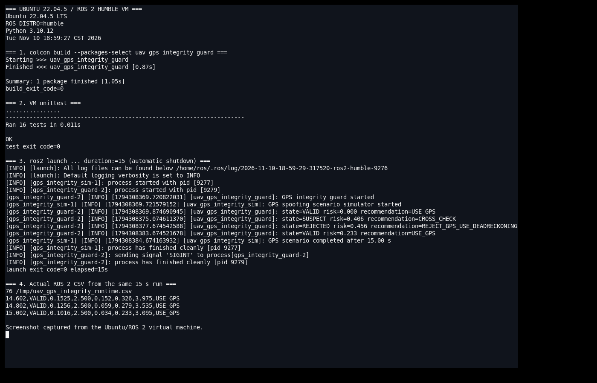
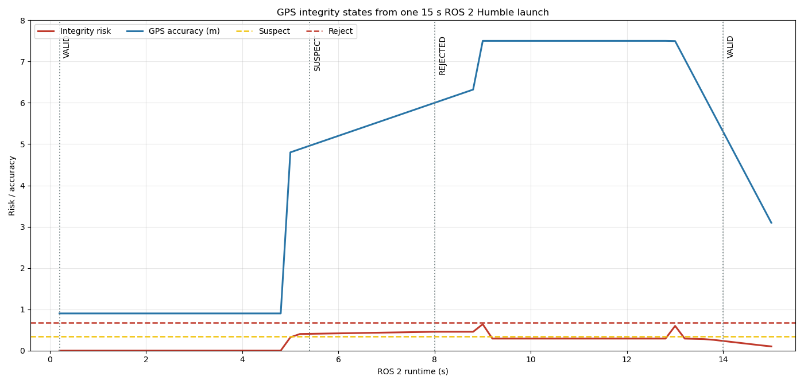

# 无人机 GPS 欺骗与定位完整性监测

本项目面向低空无人机 GNSS 定位受跳变、欺骗和协方差异常影响的情况。模块同时检查位置差分速度、GPS 上报速度、IMU 速度一致性和水平精度，输出 `VALID / SUSPECT / REJECTED` 以及导航源建议。

与仓库已有模块的区别：

- `AirLib 传感器消息回归` 检查传感器消息字段和契约；
- 普通导航/轨迹模块直接使用定位结果；
- 本模块只评估 GPS 是否可信，并提供切换到 IMU 航位推算的明确建议。

## 1. 判定方法

位置差分速度：

\[
v_p=\frac{\sqrt{(x_k-x_{k-1})^2+(y_k-y_{k-1})^2}}
{\Delta t}
\]

风险由四部分组成：

\[
R=0.34R_{speed}+0.28R_{IMU}+0.23R_{accuracy}+0.15R_{jump}
\]

- 速度残差：位置差分速度与 GPS 上报速度之差；
- IMU 残差：GPS 上报速度与 IMU 速度之差；
- 精度风险：水平精度的归一化值；
- 跳变风险：位置速度明显超过 IMU 速度时触发。

状态阈值为 `SUSPECT=0.35`、`REJECTED=0.68`。超过 6 m 水平精度或检测到异常跳变时立即拒绝。

## 2. ROS 2 接口

| 话题 | 类型 | 方向 | 说明 |
|---|---|---|---|
| `/uav_gps/integrity_sample` | `std_msgs/String` | 输入 | GPS 位置、速度、精度和 IMU 速度 |
| `/uav_gps/integrity_assessment` | `std_msgs/String` | 输出 | 风险、状态和各项残差 |
| `/uav_gps/integrity_advice` | `std_msgs/String` | 输出 | `USE_GPS / CROSS_CHECK / REJECT_GPS_USE_DEADRECKONING` |

模块不直接切换导航源，也不向飞控发送模式切换命令。

## 3. 构建与运行

```bash
source /opt/ros/humble/setup.bash
colcon build --symlink-install --packages-select uav_gps_integrity_guard
source install/setup.bash
ros2 launch uav_gps_integrity_guard main.launch.py duration:=15
```

CSV 默认写入 `/tmp/uav_gps_integrity_runtime.csv`。

当 `duration` 大于 0 时，模拟器结束后 launch 会通过进程退出事件自动关闭两个节点。默认 `duration:=0.0` 表示持续运行，此时使用 `Ctrl+C` 手动停止。

## 4. Humble 虚拟机实测

在 Ubuntu 22.04.5 / ROS 2 Humble / Python 3.10.12 中实际构建，VM 内 16 项 `unittest` 全部通过。`ros2 launch ... duration:=15` 启动两个节点并自动退出，本次截图对应的 CSV 共 76 行（1 行表头和 75 条有效状态）。

实际状态迁移：

```text
VALID → SUSPECT → REJECTED → VALID
```

进入 `SUSPECT` 后风险约为 0.41–0.46；进入 `SUSPECT` 前仍有低于 0.35 的过渡样本。水平精度从约 4.8 m 增至 7.5 m，恢复后风险回到 0.23 以下。

VM 内实际终端截图同时记录了 Ubuntu 22.04.5、ROS 2 Humble、`colcon build`、16 项单元测试、两个节点启动、状态迁移、自动退出和实际 CSV 尾部：



根据同一轮 15 秒 ROS 2 CSV 生成的完整性曲线：



## 5. 限制

1. GPS、IMU 和欺骗轨迹均为确定性仿真，不是射频或飞行实测。
2. 当前使用二维位置和速度一致性，尚未融合多星座、卫星几何、原始伪距和载噪比。
3. IMU 速度被假设为短期可信；IMU 同时故障时无法保证检测结论。
4. 没有实现 RAIM、接收机自主完好性监测或真实卡尔曼新息协方差。
5. 输出是告警与建议，不能替代飞控导航源选择和失效降级逻辑。

## 6. 大模型使用声明

使用 OpenAI Codex 辅助完成代码、测试、文档和运行图生成；作者已逐项复核代码、参数和结果，并对提交内容、数据真实性和后续维护负责。
