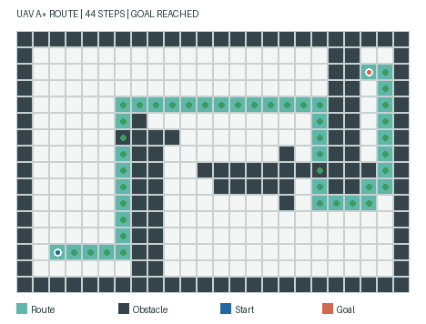
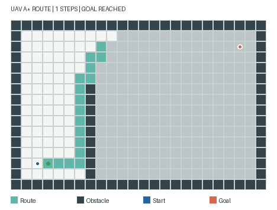

# MuJoCo 无人机栅格激光建图与路径重规划

该示例在 MuJoCo 平面场景中控制无人机模型沿 A* 航点移动。控制循环读取 MuJoCo 位姿，以 180 束虚拟激光测距更新占据栅格，并在每到达一个格点后重新规划路线。

## 运行

```bash
cd src/air/uav_grid_navigation
python -m pip install -r requirements.txt
python -m pip install -r requirements-dev.txt
python main.py
python -m pytest -q test_navigation.py
```

默认场景为 24×16 栅格，包含三组矩形障碍物。运行结果写入模块目录下的 `output/`：`navigation_map.png` 展示最终地图与行进路线，`navigation_run.gif` 展示扫描建图过程，`trajectory.json` 保存仿真位姿，`navigation_metrics.json` 记录到达状态、地图覆盖率、扫描次数和重规划次数。

地图覆盖率统计 308 个内部格点；外圈 76 个边界格初始化为已知障碍，并在指标中单独记录。默认运行完成 44 个格点，目标位于 `(21, 13)`。

## 运行结果





English: The MuJoCo planar UAV follows A* waypoints using pose feedback. At each waypoint, 180 virtual lidar rays update the occupancy grid and the planner computes the next route. Coverage is measured over 308 interior cells; the 76 boundary cells are initialized as occupied and reported separately.
