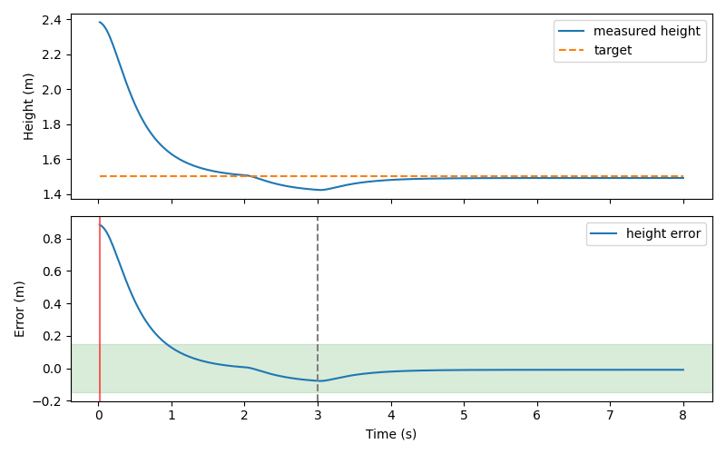
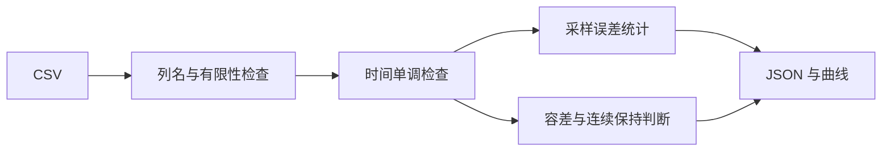

# 无人机定高日志误差与抗扰恢复时间评估

本模块从 CSV 独立计算定高误差和扰动结束后的恢复时间。输入只需时间、实测高度和目标高度三列，既可用于神经网络控制，也可用于传统反馈对照。默认附带一次 MuJoCo 阵风场景 PPO 飞行日志，运行不需要重新训练或安装仿真器。



## 环境与运行

Python 3.10/3.11、NumPy、Matplotlib、Pillow；ROS 部分采用 Ubuntu 22.04 / Humble。

```bash
cd src/air/uav_hover_log_eval
python3 -m pip install -r requirements.txt
python3 main.py
python3 main.py --input /path/to/flight.csv --output outputs/flight
```

输出为 `summary.json`、误差曲线 PNG 和 GIF。输入异常会明确报错，不把缺失或非法记录静默当作零误差。

## 输入与指标

CSV 必须包含 `time_s,height_m,target_m`，允许额外列；时间单位秒，高度单位米。至少两条记录，三列必须为有限数，时间严格递增。

$$e_i=z_i-z_{target,i},\quad \mathrm{RMSE}=\sqrt{\frac{1}{N}\sum_i e_i^2},\quad \mathrm{MAE}=\frac{1}{N}\sum_i|e_i|.$$

误差按采样点等权统计，不进行时间加权。非均匀采样日志比较时应先统一采样条件。

恢复时间默认从 3 s 扰动结束起算：绝对误差进入 0.15 m 容差带后，连续维持至少 0.5 s，才确认恢复，并返回首次进入时刻减去 3 s。若相邻间隔超过中位采样间隔的 2.5 倍，则连续计时重置；没有足够数据确认恢复时返回 JSON `null`。

`tail_within_tolerance` 检查末 1 s 的有效覆盖和误差；短日志不会仅凭最后一条样本认定成功。`complete_8s_episode` 只表示日志从约 0 s 覆盖到 8 s，不等同于完成真实飞行任务；恢复条件和完整回合条件分别输出。



## 附带日志结果

样本来自 `uav_vertical_ppo` 的 gust 场景、评估种子 101：2–3 s 受到 1.5 N 向下外力，目标高度 1.5 m；仅此一个回合。

| 指标 | 数值 |
|---|---:|
| 采样数 | 400 |
| 首末采样间隔 | 7.98 s |
| RMSE | 0.186642 m |
| MAE | 0.078907 m |
| 最大绝对误差 | 0.884181 m |
| 恢复时间 | 0.02 s |
| 末 1 s 均在容差内 | 是 |

0.02 s 是按给定 0.15 m 容差、采样时刻和 0.5 s 持续条件得到的首次合格起点，不代表控制器在 0.02 s 内消除了全部扰动误差。指标包含初始高度收敛过程；不能直接与去掉起始过渡段的稳态误差比较。

## ROS 2 发布

```bash
source /opt/ros/humble/setup.bash
cd ~/ros2
colcon build --packages-select uav_hover_log_eval
source install/setup.bash
ros2 launch uav_hover_log_eval main.launch.py
ros2 topic echo /uav/hover_metrics --once
```

节点从 `log_path` 参数指定文件计算一次，以 1 Hz 发布 JSON `std_msgs/String` 到 `/uav/hover_metrics`。这是离线日志摘要的 ROS 发布，不是在线逐帧估计；发布期间修改 CSV 不会自动重载，需重启节点。

## 源码与验证

`metrics.py` 负责读取和统计，`cli.py` 提供统一入口与曲线，`ros_node.py` 发布摘要。三项测试以手算误差、连续恢复条件、短日志、非法数值和逆序时间验证边界。Ubuntu 22.04 / Humble 中构建、安装后 launch 与实际话题接收通过；未验证 Ubuntu 20.04 或真机。

## 使用声明

使用 ChatGPT / Codex 辅助实现与文档整理；提交者负责审阅、理解并对提交内容负责。
