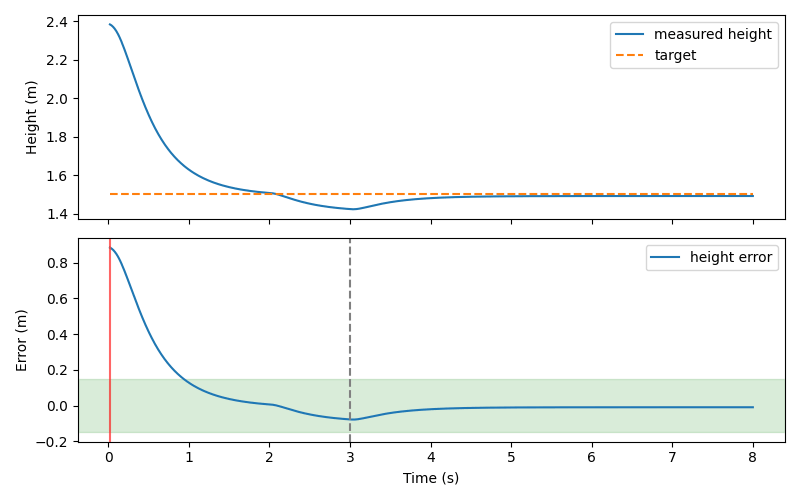
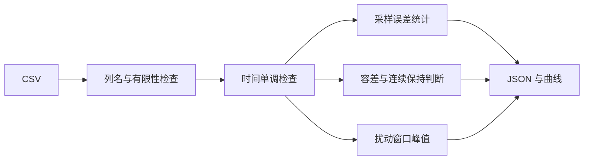

# 无人机定高日志误差与抗扰恢复时间评估

本模块从 CSV 独立计算定高误差和扰动结束后的恢复时间。输入只需时间、实测高度和目标高度三列，既可用于神经网络控制，也可用于传统反馈对照。默认附带一次 MuJoCo 阵风场景 PPO 飞行日志，运行不需要重新训练或安装仿真器。



## 环境与运行

Python 3.10/3.11、NumPy、Matplotlib、Pillow；ROS 部分采用 Ubuntu 22.04 / Humble。

```bash
cd src/air/uav_hover_log_eval
python3 -m pip install -r requirements.txt
python3 main.py
python3 main.py --input /path/to/flight.csv --output outputs/flight
# 换扰动参数（默认 3.0 s / 1.0 s / 0.15 m / 0.5 s）
python3 main.py --disturbance-end 3.0 --disturbance-window 1.0 \
  --tolerance 0.05 --hold 0.5
```

输出为 `summary.json`、误差曲线 PNG 和 GIF。输入异常会明确报错，不把缺失或非法记录静默当作零误差。

## 输入与指标

CSV 必须包含 `time_s,height_m,target_m`，允许额外列；时间单位秒，高度单位米。至少两条记录，三列必须为有限数，时间严格递增。附带日志的来源与生成方式见 [`data/README.md`](https://github.com/OpenHUTB/ros2/blob/master/src/air/uav_hover_log_eval/data/README.md)。

$$e_i=z_i-z_{target,i},\quad \mathrm{RMSE}=\sqrt{\frac{1}{N}\sum_i e_i^2},\quad \mathrm{MAE}=\frac{1}{N}\sum_i|e_i|.$$

误差按采样点等权统计，不进行时间加权。非均匀采样日志比较时应先统一采样条件。

五个口径参数都以命令行开关和 ROS 参数暴露，默认值如下：

| 参数 | 默认值 | 含义 |
|---|---|---|
| `--disturbance-end` / `disturbance_end` | 3.0 s | 扰动结束时刻，恢复时间从此起算 |
| `--disturbance-window` / `disturbance_window` | 1.0 s | 扰动窗口长度，用于统计窗口峰值偏差 |
| `--tolerance` / `tolerance` | 0.15 m | 恢复判定的容差带半宽 |
| `--hold` / `hold_s` | 0.5 s | 确认恢复所需的连续保持时间（秒） |
| `--max-gap` / `max_gap_s` | 0.05 s | 最大相邻采样间隙，默认适用于 50 Hz 日志 |

恢复时间从 `disturbance_end` 起算：绝对误差进入容差带后，连续维持至少 `hold_s` 才确认恢复，返回首次合格区段起点与扰动结束时刻的差值。相邻间隔超过 `max_gap_s` 时重新计时；没有足够样本确认时返回 JSON `null`。更低频率的日志需显式调整最大间隙。

`disturbance_peak_m` 是扰动窗口内的峰值偏差；`error_left_tolerance` 标记扰动结束后的已观测误差是否超出容差带。若误差始终在带内，恢复值只反映首个有充分后续样本支持的区段起点，可能为零或一个采样周期，不代表全部误差已消除；样本覆盖不足时仍为 `null`。

`tail_ratio` 为末 1 s 已观测样本中落入容差带的比例。`tail_covered` 要求该窗口至少覆盖 0.95 s，且所有相邻间隙不超过 `max_gap_s`；`tail_within_tolerance` 还要求这些样本全部在带内。比例为 100% 本身不能证明尾段稳定。`complete_8s_episode` 要求首样本位于 [0, 0.05] s、末样本不早于 7.95 s，且全段没有超限间隙，仅表示采样覆盖符合此规则。



## 附带日志结果

样本来自 `uav_vertical_ppo` 的 gust 场景、评估种子 101：2–3 s 受到 1.5 N 向下外力，目标高度 1.5 m；仅此一个回合。

| 指标 | 数值 |
|---|---:|
| 采样数 | 400 |
| 记录时长 | 7.98 s |
| RMSE | 0.186642 m |
| MAE | 0.078907 m |
| 最大绝对误差 | 0.884181 m |
| 扰动窗口峰值偏差（2–3 s） | 0.076958 m |
| 扰动后是否离开 0.15 m 容差带 | 否 |
| 恢复时间 | 0.02 s（等于一个采样周期，见下） |
| 末 1 s 容差内样本占比 | 100% |
| 完整 8 s 回合 | 是 |

**这份日志上的 0.02 s 不代表控制器在 0.02 s 内抑制了扰动**：1.5 N 阵风只造成 0.077 m 的峰值偏差，扰动结束后的样本没有超出 0.15 m 容差带，所以"首次进入容差带"发生在扰动结束后的第一个采样点，数值只等于采样周期。容差改宽到 0.40 m 时仍是 0.02 s，收紧到 0.05 m 则变成 0.40 s——它主要由容差和采样周期决定，与控制器性能关系不大。评价抗扰能力应看 `disturbance_peak_m`；要得到有信息量的恢复时间，需要加大扰动或收紧容差。

指标包含初始高度收敛过程；不能直接与去掉起始过渡段的稳态误差比较。

## ROS 2 发布

```bash
source /opt/ros/humble/setup.bash
cd ~/ros2
colcon build --packages-select uav_hover_log_eval
source install/setup.bash
ros2 launch uav_hover_log_eval main.launch.py
ros2 topic echo /uav/hover_metrics --once
# 换口径参数
ros2 launch uav_hover_log_eval main.launch.py tolerance:=0.05 max_gap_s:=0.05
```

节点从 `log_path` 参数指定文件计算一次，以 1 Hz 发布 JSON `std_msgs/String` 到 `/uav/hover_metrics`；口径参数为 `disturbance_end`、`disturbance_window`、`tolerance`、`hold_s`、`max_gap_s`，均支持 launch 的 `参数名:=值` 写法。这是离线日志摘要的 ROS 发布，不是在线逐帧估计；发布期间修改 CSV 不会自动重载，需重启节点。

## 源码与验证

`metrics.py` 负责读取和统计，`cli.py` 提供统一入口与曲线，`ros_node.py` 发布摘要。测试覆盖手算误差、连续恢复、容差变化、稀疏日志、尾段缺口、可调采样间隙、非法数值与逆序时间。Ubuntu 22.04 / Humble 中构建、安装后 launch 与实际话题接收通过；未验证真机。

## 使用声明

使用 ChatGPT / Codex 辅助实现与文档整理；提交者负责审阅、理解并对提交内容负责。
