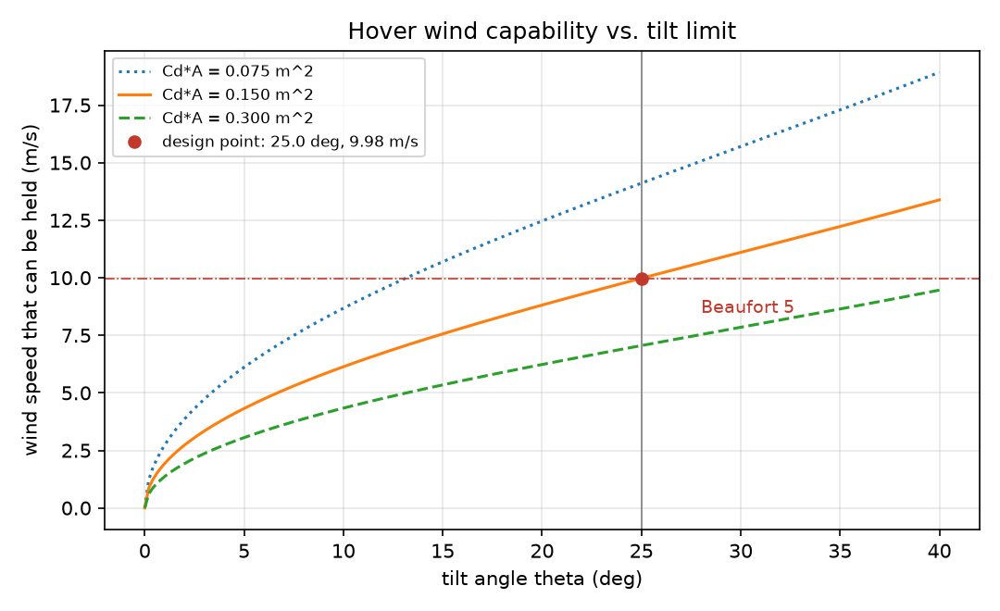
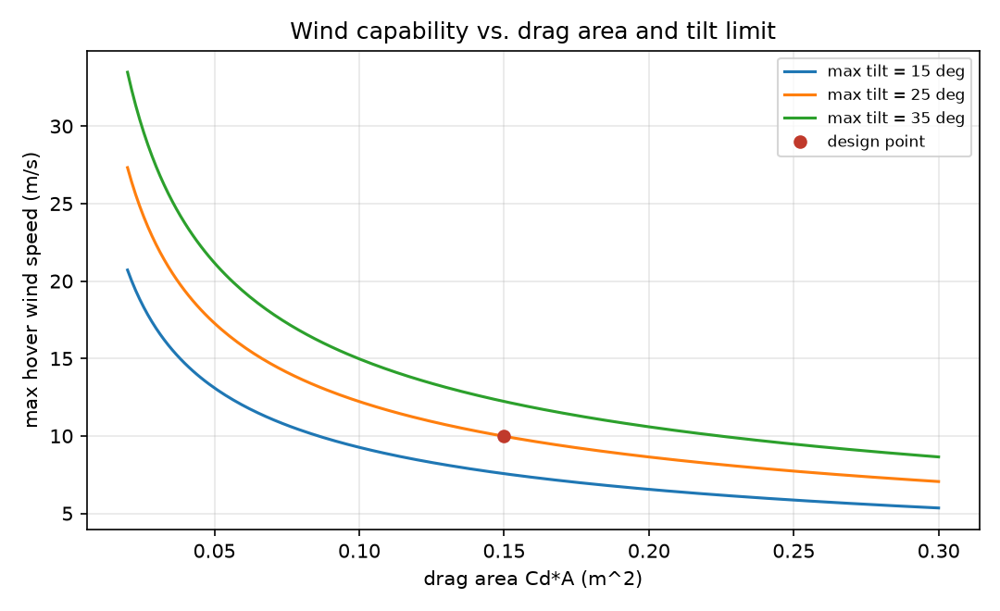

# 悬停抗风能力核算：倾角、推重比余量与蒲福风级

多旋翼在风里能不能悬停，取决于**姿态能倾多少**和**推力还剩多少**，不是只看电机最大拉力。
本模块把这两个约束写成闭式解：给定质量、阻力面积 $C_dA$ 和倾角上限，算出能悬停的最大风速、
对应的蒲福风级、需要预留的推重比，以及阵风来时的额外倾角。

默认机型（2 kg、$C_dA=0.15\ \mathrm{m^2}$、倾角上限 25°、海平面标准大气）的结论：

| 指标 | 数值 |
| --- | --- |
| 悬停重力 | 19.61 N |
| 最大抗风（倾角 25°） | **9.98 m/s**（蒲福 5 级，8.0–10.7 m/s） |
| 该倾角所需推重比 | $T/W = 1.1034$，比竖直悬停多 10.3% 推力 |
| 阵风校验（+3 m/s） | 需要额外倾斜 13.27°，到 38.27° |

**这里是「给定倾角上限下的风包线」**：它回答「姿态能到 25° 时，风多大还能悬停」，
不回答「这台机器一定能到 25°」。后者取决于实际可用推重比，见第 3 节。



## 1. 运行环境

只要 Python 3.8 及以上、NumPy 与 Matplotlib（见 `requirements.txt`），不需要 ROS、飞控或仿真器：

```bash
cd src/air/uav_hover_wind_limit
python3 -m pip install -r requirements.txt
python3 main.py --output outputs
python3 main.py --tw 1.05            # 实际可用推重比只有 1.05 时
```

实测环境：Windows 11 `10.0.26200`、Python `3.12.14`、NumPy `2.3.5`、Matplotlib `3.11.2`。
实际输出（`main.py` 默认参数）：

```text
==> uav_hover_wind_limit
    参数: m=2.00 kg, Cd*A=0.150 m^2, 最大倾角=25.0 deg, 海拔=0 m, rho=1.2250 kg/m^3
    悬停重力: 19.61 N
    最大抗风: 9.98 m/s (蒲福 5 级)
    有效倾角: 25.00 deg (受姿态上限限制), 所需推重比 T/W = 1.1034 (比竖直悬停多 10.3% 推力)
    提示: 未给 --tw, 默认假设实际可用推重比 >= 1.1034(姿态上限要求的余量); 若做不到, 用 --tw 传入实际值
    阵风校验: 在 9.98 m/s 上再加 3.0 m/s, 需要额外倾斜 13.27 deg (共 38.27 deg)
    注意: 海拔只改空气密度(阻力); 旋翼最大推力也随密度下降, 需单独用 --tw 给出

    [倾角-风速] 倾角(deg)   可悬停风速(m/s)   蒲福风级
                  0.00           0.000            0
                  4.17           3.944            3
                  8.33           5.592            4
                 12.50           6.880            4
                 16.67           7.994            4
                 20.83           9.013            5
                 25.00           9.977            5
```

换机型/换高度只需改参数：

```bash
python3 main.py --mass 3.0 --drag-area 0.20 --max-tilt 30 --altitude 1500
```

`--altitude` 用 ISA 对流层近似把海拔换算成空气密度（只支持 -500 ~ 11000 m，超出直接报错）。

## 2. 模型

准静态假设：悬停时气流速度等于风速，机体为刚性体，气动合力只有阻力
$D = \tfrac12 \rho (C_dA) V^2$ 且与来流同向；推力沿机体 $z$ 轴。垂直与水平方向平衡：

$$T\cos\theta = mg,\qquad T\sin\theta = D(V) = \tfrac12\rho (C_dA) V^2 .$$

两式相除消掉推力：

$$\tan\theta = \frac{\rho (C_dA) V^2}{2mg}.$$

于是给定倾角 $\theta$ 时的风速上限与所需推重比为

$$V(\theta) = \sqrt{\frac{2mg\tan\theta}{\rho (C_dA)}},\qquad \frac{T}{W}=\frac{1}{\cos\theta} .$$

反解也成立：给定风速 $V$，所需倾角 $\theta(V)=\arctan\!\big(\rho (C_dA)V^2/(2mg)\big)$，
阵风增量 $\Delta V$ 只要再算一次 $\theta(V+\Delta V)-\theta(V)$。

## 3. 姿态上限由谁决定：倾角限制 vs 推力余量

倾角上限 $\theta_{max}$ 通常是姿态控制器/安全策略给的，但**真能不能到**由推重比决定：
悬停在倾角 $\theta$ 需要的推重比是 $1/\cos\theta$，所以实际可用推重比 $(T/W)_{avail}$ 能支持的最大倾角是

$$\theta_{achievable} = \arccos\frac{1}{(T/W)_{avail}} .$$

本模块取 $\theta_{eff}=\min(\theta_{max},\theta_{achievable})$ 算风包线，并在报告里写明是谁限制的：

```bash
python3 main.py --tw 1.05
```

```text
    最大抗风: 8.27 m/s (蒲福 5 级)
    有效倾角: 17.75 deg (受推力余量限制), 所需推重比 T/W = 1.0500 (比竖直悬停多 5.0% 推力)
    实际可用推重比 1.050 -> 可达倾角 17.75 deg; 姿态上限 25.0 deg
```

也就是说，标称 25° 的机型如果实际只有 $T/W=1.05$，抗风从 9.98 m/s 掉到 8.27 m/s（还是 5 级，
但余量小很多）。不传 `--tw` 时工具按「$\theta_{max}$ 可达」计算，输出里会用 `tilt_budget.limited_by`
标记为 `tilt_limit`，并在 `notes` 里说明这个前提。

`report.json` 里对应字段：

```json
"tilt_budget": {
  "effective_tilt_deg": 17.7535,
  "achievable_tilt_deg": 17.7535,
  "limited_by": "thrust_margin",
  "required_thrust_to_weight": 1.05,
  "tilt_limit_thrust_to_weight": 1.1034
}
```

## 4. 敏感性



从公式可以直接读出三条缩放关系，测试里都钉住了：

- 抗风上限 $\propto \sqrt{m/(\rho C_dA)}$：质量翻 4 倍，抗风翻倍；阻力面积翻 4 倍，抗风减半；
- 抗风上限 $\propto \sqrt{\tan\theta_{eff}}$：倾角从 25° 放到 30° / 35°，抗风从 9.98 涨到 11.10 / 12.23 m/s；
- 海拔升高 $\rho$ 变小，抗风按 $1/\sqrt{\rho}$ 变大（1500 m 约 1.08 倍，2000 m 约 1.10 倍，3000 m 约 1.16 倍）。

**海拔这一条要读准**：模型里海拔只改空气密度，于是阻力变小、同倾角能扛的风变大；
但真实旋翼的最大推力也随密度下降，实际可用推重比会一起变小。所以「3 km 抗风提高 16%」
的准确含义是「**在仍能维持同一倾角的前提下**，风包线提高了 16%」。要判断整机实际能力，
请用 `--tw` 传入该高度下的实际可用推重比，工具会按第 3 节取有效倾角。

推重比只和倾角有关：$T/W = 1/\cos\theta_{eff}$，25° 是 1.103、30° 是 1.155、35° 是 1.221。
要留姿态余量给阵风，就得按「最大倾角 + 阵风余量」来选 $T/W$。

## 5. 蒲福风级对照

风速换算按 WMO 分级（0 级 <0.3 m/s，1 级 0.3–1.5，……12 级 ≥32.7 m/s），结果里同时给出
`max_wind_beaufort`，方便和作业规范里的「几级风能飞」对照。默认机型的 9.98 m/s 落在 5 级，
6 级（10.8–13.8 m/s）就超出 25° 姿态能力了——要么提高倾角上限，要么减小 $C_dA$。

## 6. ROS 2 接口

模块按仓库约定提供 `package.xml` / `setup.py` / `launch`，`colcon build` 后可以直接起节点：

```bash
source /opt/ros/humble/setup.bash
cd ~/ros2
colcon build --packages-select uav_hover_wind_limit
source install/setup.bash
ros2 launch uav_hover_wind_limit main.launch.py
# 带参数
ros2 launch uav_hover_wind_limit main.launch.py max_tilt_deg:=30.0 available_thrust_to_weight:=1.20
ros2 topic echo /uav/wind_limit      # std_msgs/String, 内容是 report.json 同样的 JSON
```

节点只做「按参数算一次 + 周期发布」，计算全部在 `core` 里（有纯计算单测）。参数：

| 参数 | 默认 | 说明 |
| --- | --- | --- |
| `mass` | 2.0 | 整机质量 kg |
| `drag_area` | 0.15 | 阻力面积 $C_dA$，m² |
| `max_tilt_deg` | 25.0 | 倾角上限 deg |
| `altitude_m` | 0.0 | 海拔 m |
| `available_thrust_to_weight` | 0.0 | 实际可用推重比，0 表示不提供 |
| `period_s` | 5.0 | 发布周期 s |

发布走 transient local（depth 1），晚加入的 `ros2 topic echo` 也能立刻拿到最后一条。
离线命令行入口仍然可用：`ros2 run uav_hover_wind_limit wind_limit --output outputs`。

## 7. 适用范围与限制

- 准静态、单自由度姿态：不建模姿态环动态、电机响应和阵风频谱，结论用于**选型与作业窗口**评估；
- 只算气动阻力，不含机体升力、旋翼入流遮挡、螺旋桨效率随来流的变化；
- $C_dA$ 与实际可用推重比都需要实测或查厂家数据，取错会直接让结果偏 $\sqrt{1/C_dA}$ 或偏倾角；
- 未考虑地面效应与近壁流动；风切变、下击暴流等极端风况不适用；
- 节点本身没有在本机运行过（本机无 ROS 环境），Ubuntu 22.04 + Humble 的 `colcon build` /
  launch / 话题收发见 `validation/ros_checklist.md`，需要另一位使用者复现。

## 8. 测试与验证

```bash
cd src/air/uav_hover_wind_limit
python3 -m pip install -r requirements-dev.txt
python3 -m pytest test -v
```

19 项检查全部通过，期望值都能手算核对：

- $\tan\theta = D/(mg)$ 恒等式、倾角与风速互为反函数、$V(\theta)$ 闭式解；
- $T/W = 1/\cos\theta$ 与「多付多少推力」；
- 两条缩放律（质量 ×4 / 阻力面积 ×4）与海拔对密度、抗风的影响；
- **推重比耦合**：$T/W=1.05$ 时 $\theta_{achievable}\approx17.75°$、有效倾角被截断、抗风降到 8.27 m/s、
  `limited_by='thrust_margin'`；$T/W=1.30$ 时仍由倾角限制；$T/W\le1$ 直接报错；
- `report.json` 的 `tilt_budget` 字段自洽、`notes` 里写明海拔前提；
- 蒲福风级 18 个边界点（0.3、1.6、3.4 … 32.7 m/s）；
- 阵风附加倾角、参数校验（质量/阻力面积/倾角/密度/重力/风速/高度范围）；
- GBK 控制台下打印不抛 `UnicodeEncodeError`（Windows 默认中文代码页）；
- `main.py` 冒烟：真的写出 2 张 PNG 与 `report.json`；
- **ROS 节点接线**：用最小假 `rclpy`/`std_msgs` 替身导入 `ros_node`，验证参数 → 计算 → 发布 JSON
  这条链路（topic 名、transient local 之前的发布、定时器周期），不需要真机装 ROS。

CI：`.github/workflows/uav_hover_wind_limit_tests.yml` 在 Ubuntu + Python 3.8 上按
`requirements-dev.txt` 装依赖、跑 pytest、跑 `main.py` 冒烟与 `PYTHONIOENCODING=gbk` 复跑，
另有一个 Windows 任务用 GBK stdio 再跑一遍。

## 使用声明

使用 DeepSeek Harness（deepseek-flash）辅助实现、测试与文档；作者对提交内容负责。
