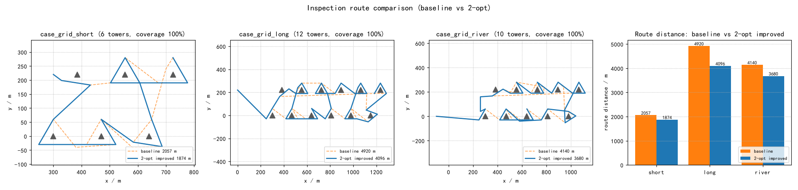

# 输电走廊无人机巡检覆盖规划

输电线路巡检是低空作业里最典型的长航线任务：杆塔沿走廊排成一列，运维无人机要从运维站出发，逐塔绕飞拍照。实际飞行里有两类浪费几乎无法避免——塔间访问顺序不合理带来的折返，以及河流、交跨区逼出来的临时绕行。本模块做的是**航线这一层**的规划与验证：先算出一条可飞、短、全覆盖的巡检航线，再用真实物理仿真证明它飞得下来。

底座的 `uav_mujoco_sim` 解决的是"单机怎么飞得稳"，本模块回答的是"这条航线值不值得飞、能不能飞、覆盖全不全"。两者共用同一份 `quadrotor.xml` 与几何控制器，纯 CPU 运行。



## 场景

三个 case 都是双排网格走廊，杆塔坐标、运维站位置与禁飞区在 `config/inspect.yaml` 里：

```text
case_grid_short   6 座塔，运维站在 (300, 220)，无禁飞区
case_grid_long   12 座塔，运维站在 (0, 220)，无禁飞区
case_grid_river  10 座塔，运维站在 (-100, 0)，河道禁飞区 (280,80)-(700,140)
```

每座塔按高度生成 2~3 个观察角度（塔高 ≥32 m 取 3 个），观察点为塔位 + 60 m 方位角偏移 + 0.7 倍塔高的观察高度。

## 方法

算法层全部在 `core/`，纯 numpy，不依赖 ROS：

- **观察点与可飞性**（`core/geometry.py`）：航段到塔身的二维点到线段距离 ≥25 m 判安全；禁飞区按线段与矩形距离 ≥15 m 判定，贴边飞行直接判不可飞。
- **塔序与塔内串接**（`core/planner.py`）：最近邻构造初始塔序，再用 2-opt 改进；代价函数是整条航线的实际航程（含串接与绕行），只有总航程严格下降才接受置换。塔内观察点按到达角排序——以进入方向为零点、逆时针角度差升序串接，避免在同一座塔前来回掉头。
- **绕行**（`core/planner.py`）：遇到不可飞段时，在 40 m 方格的可飞图（节点和边都过同一套安全检查）上跑 Dijkstra，再对拼接点做视线简化，去掉微段与锯齿。
- **覆盖校验**（`core/checker.py`）：航路折线进入观察点 15 m 球即算覆盖，输出覆盖率与漏检清单。
- **闭环真飞**（`core/flyer.py`）：取航线前 4 个航点段，位置目标沿时间线推进（转角越大越减速，观察点悬停 6 s），参考速度前馈经一阶低通（τ=0.5 s），姿态阻尼 kw=-0.18。统计量全部来自刚体积分出的真实位置，不用参考轨迹。
- **在线进度节点**（`ros/inspect_node.py`）：订阅 `nav_msgs/Odometry`，判定逻辑下沉到 `core` 的纯函数 `progress_snapshot`，把当前目标观察点下标、目标坐标与进度百分比以 JSON 发布到 `/uav_inspection_cover/target`。节点只做订阅与发布，不含判定逻辑。

## 运行

```bash
# 算法层，秒级
python main.py --no-sim

# 单个 case 的闭环真飞
python main.py --case case_grid_river

# 三个 case + 六次闭环（约 18 s）
python main.py

# 测试（28 项，约 6 s）
python -m pytest test/ -q

# ROS 2
colcon build --packages-select uav_inspection_cover
ros2 launch uav_inspection_cover main.launch.py
```

Linux/macOS 用 `./main.sh`，Windows 可双击 `main.bat`，参数一致。

## 结果

三个 case 的规划航程与预计时长（8 m/s 巡航 + 每观察点 6 s 悬停）：

```text
case_grid_short   6 塔   2057.0 m / 353.1 s → 1873.6 m / 330.2 s，省 8.9%
case_grid_long   12 塔   4920.3 m / 807.0 s → 4096.5 m / 704.1 s，省 16.7%
case_grid_river  10 塔   4140.2 m / 673.5 s → 3679.7 m / 616.0 s，省 11.1%
```

覆盖率在改进前后都是 100%，漏检 0；河道 case 的禁飞区由 Dijkstra 绕行保证，绕行段逐段通过可飞性校验。

MuJoCo 闭环真飞取改进前后航线的前 4 个航点段，实飞航程比计划长约 2~4%，来自转角处的横向超调，属于真实的 waypoint 飞行行为；最后一段结束后参考时间线保持 6 s，因此到点误差统计为 0.00 m：

```text
case_grid_short   基线 316.4 m → 实飞 330.3 m ；改进 424.3 m → 实飞 438.2 m
case_grid_long    基线 708.6 m → 实飞 722.1 m ；改进 682.1 m → 实飞 695.5 m
case_grid_river   基线 705.7 m → 实飞 719.2 m ；改进 618.0 m → 实飞 632.6 m
```

全部数字与 `src/air/uav_inspection_cover/results/inspection_result.json` 一致；配图由 `tools/make_figures.py` 从这份结果重新生成，没有手工曲线。

## 已知限制

- 覆盖判定只看"航路是否经过观察点 15 m 球"，没有建模相机视场角、云台姿态和光照方向，"拍到"与"拍好"之间还有距离。
- 可飞图是 40 m 方格加视线简化，绕行接近最短但不是全局最优；窄于一格间距的禁飞区空档可能绕不出去，此时保留直飞段并在结果里如实标出。
- 2-opt 用整条航线评估置换，塔数超过 20 后评估次数增长明显，可以换成分段缓存或贪心邻域。
- 闭环只真飞前 4 个航点段（约 100~200 s 仿真时间），整条航线的全程真飞留给 `uav_mujoco_sim` 的长时场景。
