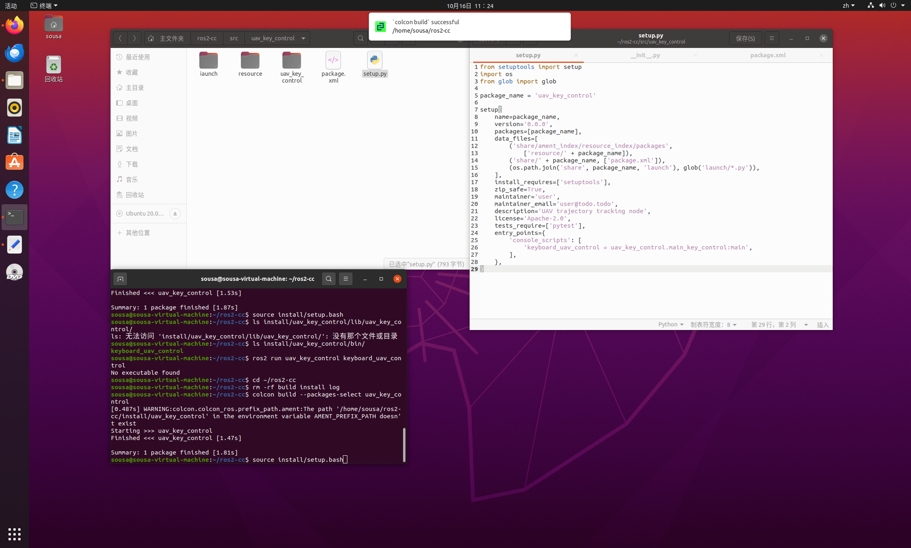

  
# uav_key_control 使用说明
无人机键盘速度控制ROS2功能包

## 功能介绍
该功能包实现无人机键盘遥控节点。激活终端后，通过W/A/S/D按键控制无人机的运动速度，空格键实现急停，节点向`/cmd_vel`话题发布Twist速度指令。

## 运行环境
- 操作系统：Ubuntu 20.04
- ROS版本：ROS2 Foxy
- Python版本：3.8.10
  

## 启动步骤

1. 编译功能包
```bash
colcon build --packages-select uav_key_control
source install/setup.bash
```
2. 启动键盘控制节点
```bash 
ros2 run uav_key_control main_key_control
```
3. 新开终端，监听话题查看输出的速度指令
```bash
ros2 topic echo /cmd_vel
```
4.按键映射
 
- W：向前，X方向线速度正向
- S：向后，X方向线速度反向
- A：原地左转，Z方向角速度正向
- D：原地右转，Z方向角速度反向
- 空格：急停，所有速度置0
 
5.运行效果
 
节点成功启动后，选中节点所在终端，按下W/A/S/D按键，监听终端可以实时打印Twist速度消息，验证速度指令正常发布。


