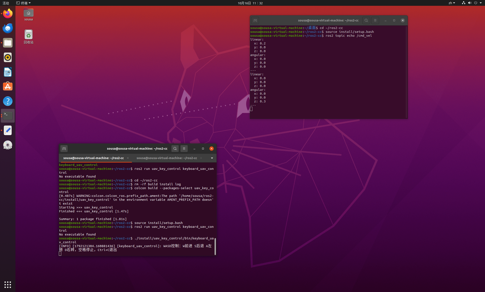

# uav_key_control 使用说明
无人机键盘速度控制ROS2功能包

## 功能介绍
该功能包实现无人机键盘速度遥控节点。激活终端后，通过W/A/S/D按键直接控制无人机运动速度，空格键实现急停；节点向  /cmd_vel  话题发布Twist速度指令，属于速度环控制。

## 运行环境
- 操作系统：Ubuntu 20.04
- ROS版本：ROS2 Foxy
- Python版本：3.8.10
## 核心代码文件

本模块包含以下核心文件，均已提交至仓库：

```text
src/
└── uav_key_control/
    ├── main_uav_track.py       # 无人机键盘速度控制节点
    ├── setup.py                # ROS 2 功能包配置文件
    ├── package.xml             # ROS2功能包描述文件
    └── resource/
        └── uav_key_control    # resource资源标识文件
    └── launch/
        └── uav_track.launch.py # 节点一键启动文件
```
## 核心代码内容

本模块的核心代码已上传至仓库 `src/air/uav_key_control/` 目录下。

完整代码请点击下方链接查看：

* [查看 main_key_control.py 代码](../../src/air/uav_key_control/main_key_control.py)
* [查看 package.xml 代码](../../src/air/uav_key_control/package.xml)
* [查看 setup.py 代码](../../src/air/uav_key_control/setup.py)
* [查看 key_control.launch.py 代码](../../src/air/uav_key_control/launch/key_control.launch.py)  
## 启动步骤

1.进入ROS2工作空间
```bash
cd ~/ros2-cc
```
2.编译功能包
```bash
colcon build --packages-select uav_key_control
source install/setup.bash
```
3. 启动键盘控制节点
```bash 
ros2 run uav_key_control main_key_control
```
4. 新开一个终端窗口，同样进入工作空间并加载环境，监听速度话题  /cmd_vel ，查看节点发布的Twist速度指令 
```bash
cd ~/ros2-cc
source install/setup.bash
ros2 topic echo /cmd_vel
```
5.按键映射
- W：向前，输出X方向正向线速度
- S：向后，输出X方向反向线速度
- A：原地左转，输出Z方向正向角速度
- D：原地右转，输出Z方向反向角速度
- 空格：急停，所有速度置0
  
6.运行效果
  
节点成功启动后，选中节点所在终端，按下W/A/S/D按键，监听终端可以实时打印Twist速度消息，验证速度指令正常发布。


