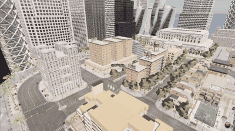
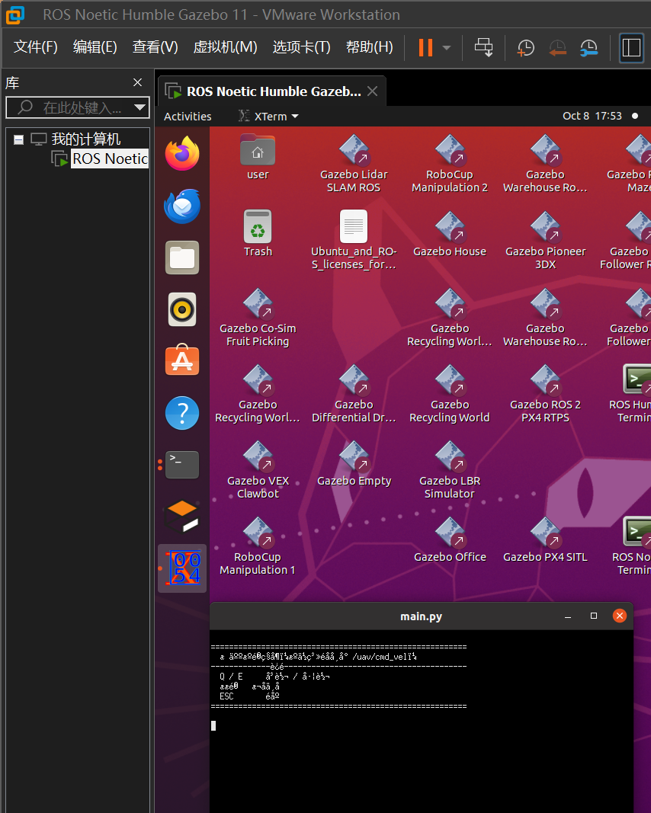
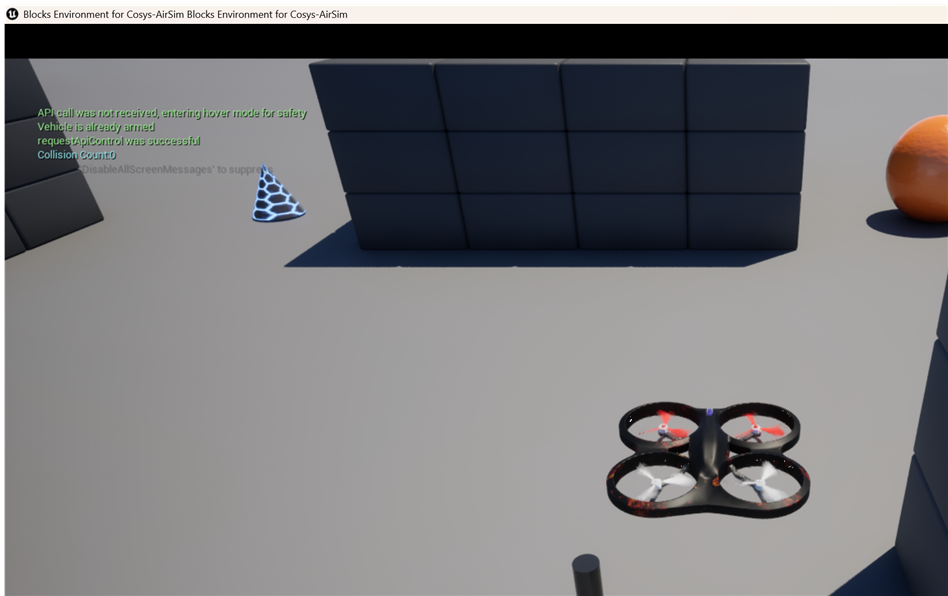
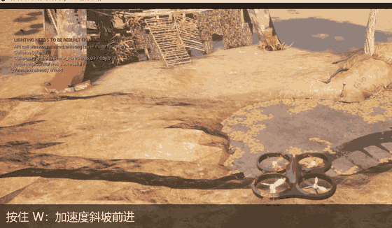

# 无人机键盘控制（uav_keyboard_control）

任务①「无人机仿真 + 键盘控制」的 ROS 侧实现：把终端按键转换为**机体系速度指令**，
发布到 `/uav/cmd_vel`，由 `carlair_ros_bridge` 连仿真器执行。仿真/坐标换算/安全限幅
集中在桥接层，键盘、规划器、神经网络控制器共用同一条指令通道。

在"一个键一个轴"的基础上，本模块还支持**多键组合**（`W`+`A` 斜飞、`W`+`Q` 边走边转）、
**加速度限幅的平滑调速**（速度按斜坡逼近目标，松开后同样斜坡回零），以及把键盘从
"直接控制"升级为"技能控制"的**技能宏**（`1`/`2`/`3` 触发起飞、旋转、前进，基于
`/uav/odom` 闭环），并顺带修掉了"按方向键会误退出"的问题。语义见第 2 节，
实现见第 4 节，技能宏单独在第 8 节。

## 1. 运行架构

```text
终端按键 ──► uav_keyboard_control ──/uav/cmd_vel──► carlair_ros_bridge ──► CarlaAir/AirSim
            (raw 模式读键)        (geometry_msgs/Twist)   (坐标换算+执行)     (无人机)
```

## 2. 按键映射

机体系（x 前 / y 左 / z 上）：

| 按键 | 动作 | Twist 分量 |
|---|---|---|
| `W` / `S` | 前进 / 后退 | `linear.x = ±horiz_speed` |
| `A` / `D` | 左移 / 右移 | `linear.y = ±horiz_speed` |
| `R` / `F` | 上升 / 下降 | `linear.z = ±vert_speed` |
| `Q` / `E` | 右转 / 左转 | `angular.z = ±yaw_rate` |
| 组合键（如 `W`+`A`、`W`+`Q`） | 斜向 / 边走边转 | 各轴分量叠加 |
| `1` / `2` / `3` | 技能宏：升到 1.5 m / 原地转 360° / 前进 3 m | 基于 `/uav/odom` 闭环，结束回悬停 |
| 松开 | 悬停 | 按 `accel_*` 斜坡回零 |
| `ESC` / `Ctrl-C` | 退出 | 先补发一条零速 |

`Q`/`E` 的方向遵循 AirSim 机体系 `yaw_rate` 约定（`Q=+yaw_rate` 机头右转）。

三点补充：

* **组合键**：`W`+`A` 下发 `linear.x = +horiz_speed, linear.y = +horiz_speed`；
  `W`+`S` 这类互斥组合自然抵消为 0。终端没有"按键抬起"事件，是否按住靠
  "最近 `key_hold_timeout`（默认 0.15 s）内是否还收到过该键"判断，见 4.4。
* **平滑**：目标速度仍是上表的 `±horiz_speed` 等，但实际下发值按 `accel_*` 斜坡逼近，
  不会从 0 直接跳变到 2 m/s；松开后同样斜坡回零（4.5）。
* **方向键不误触**：`ESC [ A` 等转义序列会被整段吃掉，按方向键既不退出，
  残字节也不会被当成运动键（4.6）。
* **技能宏**：`1`/`2`/`3` 触发一次闭环动作，细节与参数见第 8 节；宏运行中按任意方向键
  立即取消并接管（手动优先）。

## 3. 编译与运行

```shell
# 终端 1：桥接（连仿真 + 执行 + 自动起飞悬停）
source ~/bridge_ws/devel/setup.bash
roslaunch carlair_ros_bridge main.launch

# 终端 2：键盘控制
source ~/bridge_ws/devel/setup.bash
roslaunch uav_keyboard_control main.launch
```

把焦点放在键盘控制终端，按 `W/A/S/D/R/F/Q/E` 操控（可同时按住多个键斜飞），松开后平滑减速到悬停，`ESC` 退出。

## 4. 实现要点

### 4.1 终端 raw 模式

Linux 终端默认行缓冲（要按回车），用 `termios`+`tty` 进入 raw 模式即可单键即时响应：

```python
with RawKeyReader() as reader:        # __enter__ 切 raw，__exit__ 恢复
    key = reader.get_key(timeout=0.03)  # select 非阻塞读一个字符
```

`with` 语句保证 `Ctrl-C` 或异常退出时也能恢复终端设置，不会把用户的终端卡在 raw 模式。

### 4.2 按键 → 速度：纯函数

`key_to_cmd(key, horiz, vert, yaw)` 把按键映射为 `(vx, vy, vz, wz)`，
`step_once` 再打包成 `geometry_msgs/Twist`。两者都不依赖 ROS/终端，
可在无 ROS 的机器上单元测试（`tests/test_keyboard_local.py`，79 项，覆盖单键、组合键、按键保持、加速度斜坡与转义序列）。

### 4.3 每轮循环发布一条指令

节点以 30 Hz 运行，**每轮循环都发一条** `Twist`（包括全零）：这既满足桥接层
「`cmd_timeout` 内必须有新指令」的要求，也给平滑器一个固定节拍。按键**不锁存**——
要持续运动必须真的按住（终端自动重复会持续送字节）；自动化时即"定频重复注入"，见 7.6。

### 4.4 按键保持：终端没有"抬起"事件

raw 模式下终端只在**按下**（以及操作系统的自动重复）时送字节，松手不会再送任何东西，
因此"是否还按住"只能靠时间戳推断：

```python
class KeyTracker:
    def press(self, key, now):        # 收到一个字节 -> 记录最近时间
        if _axis(key) is not None:
            self._seen[key.lower()] = now

    def active(self, now):            # 超过 hold_timeout 没再收到 -> 判松开
        expired = [k for k, t in self._seen.items() if now - t > self.hold_timeout]
        ...
```

* 按住某键时，终端自动重复会以 25~40 ms 的间隔持续送同一个字节，时间戳被不断续期；
* 默认 `key_hold_timeout = 0.15 s`，相当于连丢 4 帧才判松开，既不会因偶发丢帧抖动，
  松手后也不会拖太久；
* 未知键（方向键序列的残字节、功能键等）不进入保持集合，不会污染运动指令。

### 4.5 组合键与加速度平滑

组合键只是把"一个键"换成"一组键"，各轴分量相加，仍是纯函数：

```python
merge_target(["w", "a"])        # -> (vx=+h, vy=+h, 0, 0)   斜向
merge_target(["w", "s"])        # -> (0, 0, 0, 0)           互斥抵消
```

下发前再经加速度限幅，把目标速度斜坡逼近：

```python
self.cmd = tuple(ramp_towards(cur, tgt, accel * dt) for cur, tgt, accel in ...)
```

节点级指令序列（30 Hz，`accel_horiz=4.0`，**不含仿真器动力学**）：按住 `W` 时
`vx` 从 0 逐帧 0.13 → 0.27 → 0.40 → … → 2.00 爬升，约 **0.5 s** 到满速；松开后
约 **0.5 s** 斜坡回零。把三轴 `accel_*` 都设为 `<= 0` 即可退回"瞬时阶跃"的旧手感。

单帧积分时长还有 `MAX_LOOP_DT = 0.1 s` 的上限：终端若被阻塞（拖动窗口、系统卡顿），
不会因为一帧 `dt` 很大就把速度积分到很高。

### 4.6 ESC 与方向键

方向键在终端里发送的是 `ESC [ A`、`ESC [ 1 ; 5 A` 这类 CSI 序列，第一个字节就是 `0x1b`。
如果只按字节判断，按一下方向键就会退出节点（旧实现的问题），而且序列残字节 `[`、`A`
还会被当成运动键。现在收到 `0x1b` 后先把整段序列吃掉，只有"孤立的 ESC"才退出：

```python
if key == "\x1b":
    if consume_escape(reader):     # ESC [ ... 终止字节
        continue
    break
```

退出（含异常退出）时还会补发一条全零 `Twist`，不必等桥接层 0.5 s 超时保护才停。

## 5. 与视口内置 WASD 的关系

CarlaAir 视口**内置**键盘操控（任务①的「仿真」部分），本模块提供 **ROS 侧**键盘控制
（任务①的「键盘控制」部分）。两者可对比验证：视口 WASD 直接驱动仿真器，
本模块走 `键盘 → /uav/cmd_vel → 桥接 → 仿真器` 的完整 ROS 链路，正是后续
规划器、神经网络控制器的通用入口。

## 6. 效果图

键盘控制演示（录屏转 GIF，`W 前进 / A 左移 / D 右移 / R 上升 / Q 右转` 机动，第三人称视角）：



## 7. 本机实测记录

### 7.1 运行环境

| 项 | 配置 |
|---|---|
| 宿主机 | Windows + Unreal Engine 5.5 + **Cosys-AirSim 3.3**（Blocks 环境） |
| 客户机 | VMware 虚拟机，Ubuntu 20.04.6 LTS（内核 5.15） |
| ROS | **ROS Noetic**（Python 3.8.10） |
| 工作区 | `~/uav_ws`（catkin） |
| 仿真器地址 | `192.168.49.1:41451`（本次实测环境的值，即 VMware NAT 下 VMnet8 的宿主机地址；换环境请用 `ipconfig` 重新确认） |
| AirSim RPC 监听 | 本构建（Cosys-AirSim 3.3）**无需修改 `settings.json`**：监听地址由顶层键 `"LocalHostIp"` 决定，默认空字符串即监听所有网卡。依据与实测见 [7.1.1](#711-关于-rpc-监听地址) |

#### 7.1.1 关于 RPC 监听地址

原文写的是「`settings.json` 必须含 `"ApiServerAddress": "0.0.0.0"`，默认只监听 `127.0.0.1`」。
经核对本机构建的源码与二进制，**这两句都不成立**，特此更正：

* **键名不对。** 本构建读取的是顶层键 **`"LocalHostIp"`**，不是 `ApiServerAddress`。
  源码依据 `Plugins/AirSim/Source/AirLib/include/common/AirSimSettings.hpp`：

  ```cpp
  //by default we spawn server at local endpoint. Do not use 127.0.0.1 as default below
  //because for docker container default is 0.0.0.0 and people get really confused why things
  api_server_address = settings_json.getString("LocalHostIp", "");
  api_port           = settings_json.getInt("ApiServerPort", RpcLibPort);
  ```

  佐证：该构建的 `Binaries/Win64/UnrealEditor-AirSim.dll` 里能查到字符串
  `LocalHostIp` 与 `ApiServerPort`，但**查不到 `ApiServerAddress`**。

* **「默认只监听 127.0.0.1」没有依据。** 上面两行的默认值是**空字符串**，
  紧邻的源码注释还明确写了「不要默认用 127.0.0.1，因为 docker 容器场景默认是 0.0.0.0」。
  也就是**默认就监听所有网卡**。

* **实测与之一致。** 宿主机 `netstat -ano | findstr 41451` 显示 `0.0.0.0:41451`，
  客户机侧直连该端口即可建立 TCP 连接。

**结论**：把「虚拟机连不上」归因于 `ApiServerAddress` 是错的，本机实测中**从未真正需要**这一项。
如果确实要显式限定监听地址，应写成顶层键 `"LocalHostIp": "0.0.0.0"`。

### 7.2 运行步骤

前置：按 [环境搭建与连接](../air/setup_and_connect.md) 配好虚拟机 ROS 环境；
按 [桥接模块](../air/carlair_ros_bridge.md) 的 **2.1 节**在宿主机启动 CarlaAir 仿真器，
等终端输出 `CarlaAir is ready.`（此时 `41451` 端口就绪）。
**仿真器窗口不要最小化**，否则 AirSim 取相机会阻塞。

> 最初的本机实测是用一个**自写的控制脚本**（负责起飞并爬升到 15 m）配合桥接层完成的，
> 那个脚本不属于本仓库。下面给出**只用仓库内组件**的等价步骤。

```shell
# ① 客户机：桥接层
export ROS_MASTER_URI=http://localhost:11311
source /opt/ros/noetic/setup.bash
source ~/uav_ws/devel/setup.bash
# <宿主机IP> 换成仿真器所在机器的地址（Windows 下用 ipconfig 查看，
# 桥接模块文档中的示例为 192.168.94.1）
# auto_takeoff 默认为 true：桥接层会 takeoff() 并 hover()，起飞后悬停在约 1 m
roslaunch carlair_ros_bridge main.launch host:=<宿主机IP>

# ② 客户机：把无人机送到 15 m 高空
#    /uav/goal 是 ENU（z 向上为正），桥接层飞抵该点后自动悬停，
#    并把 /uav/status 置为 GOAL_DONE
rostopic pub -1 /uav/goal geometry_msgs/Point "{x: 0.0, y: 0.0, z: 15.0}"
rostopic echo -n 1 /uav/odom/pose/pose/position     # 确认 z ≈ 15

# ③ 客户机：另开一个终端，键盘控制（作业要求的 launch 启动方式）
export ROS_MASTER_URI=http://localhost:11311
source /opt/ros/noetic/setup.bash
source ~/uav_ws/devel/setup.bash
roslaunch uav_keyboard_control main.launch
# 在弹出的 xterm 窗口里按 W/A/S/D/R/F/Q/E 操控，松开悬停，ESC 退出
```

> **关于 `auto_takeoff`**：它的语义是「**起飞并悬停**」——桥接层源码里就是
> `sim.takeoff()` + `sim.hover()`，**并不会自动升到 15 m**；想让无人机到 15 m，
> 必须另外下发目标点（如上面第 ② 步）或速度指令。
> 若把它设为 `false`，则无人机根本不会起飞，需要自己补上起飞动作。

### 7.3 实测结果

桥接层环境自检 **5/5 通过**：

```text
[通过] airsim 包可用  -- 已导入
[通过] 连接仿真器 192.168.49.1:41451  -- confirmConnection 成功
[通过] 读取位姿  -- pos_enu=(-0.00, 0.00, -0.69) yaw=90.0°
[通过] 相机取帧 front_rgb  -- 尺寸 640x480
[通过] 激光雷达点云 lidar1  -- 点数 8192, x∈[-71.4, 93.6] z∈[-0.4, 22.5]
自检结果: 5/5 通过
```

`/uav/odom` 发布频率实测 **19.999 Hz**（设计值 20 Hz）。

键盘闭环验证（用伪终端模拟真人按键，注入协议与脚本见 [7.6](#76-按键闭环的复现方法)）。
下面是**最初一次**运行的位姿记录——当时用的是"单次写入 + 保持"协议，由 7.6.1 的源码分析可知该协议下**一个字节只产生一条指令**，因此这组数据只用来证明整条链路有效、位置确实发生变化，**不能当作定量指标**（定量结论见 7.4、7.6）：

```text
[test] 节点已在伪终端中启动 (pid=22254)
[test] 按键 前进 W 3.0s / 左移 A 2.5s / 后退 S 2.5s / 右移 D 2.5s / ESC 退出

按键前  (x, y, z) = ( 3.6e-07,  2.2e-07, 15.145)    ← 已按 7.2 第 ② 步送到 15 m
按键后  (x, y, z) = ( 0.389,   -0.403,   15.071)    ← 水平移动约 0.56 m，高度保持
```

**位置发生实际变化**，证明「键盘 → `/uav/cmd_vel` → 桥接层 → 仿真器」整条链路有效。

### 7.4 性能评价

| 指标 | 实测值 | 说明 |
|---|---|---|
| `/uav/odom` 发布频率 | 19.999 ~ 20.24 Hz | 桥接层环境自检实测；另用 `rostopic hz /uav/odom` 复测为 20.010 Hz（min 0.041 s / max 0.055 s） |
| 键盘节点指令发布频率 | 30 Hz | 由 `rate/publish_hz` 设定。**这是设定值，不能当作端到端响应延迟的实测值** |
| 指令水平速度（稳态） | 2.0 m/s | 由 `control/horiz_speed` 决定，可用参数覆盖；**v2 起需要约 0.5 s 的加速段才到满速** |
| 单次按键脉冲的水平位移 | 约 0.20 m（v1，无平滑；1 条非零指令） | 该数字来自**旧版**语义：一个字节只产生一条 2 m/s 指令。v2 的脉冲会维持 0.15 s 再斜坡回零，**位移已变，需重测**（节点级指令积分约 0.07 m，见 7.6.1） |
| 20 Hz 定频注入 3 s 的位移 | 约 4.56 m（v1，无平滑；60 条非零指令） | 同上；v2 的指令波形变为"0.5 s 爬升 + 匀速 + 0.5 s 减速"，**不能与 v1 直接比较，需重测** |
| 组合键 | v2 新增 | `W`+`A` 两轴同时给速度；`W`+`S` 抵消为 0。节点级单测覆盖（`tests/test_keyboard_local.py` B 节） |
| 技能宏：`3` 键前进 | 3.00 ± 0.10 m（节点级积分） | 用最小积分器当飞机跑 `test_macros_loop.py`；峰值速度 ≤1.5 m/s，结束指令回零。**实飞位移待重测** |
| 技能宏：`1` 键高度 | 1.50 ± 0.07 m（节点级积分） | 同上；进入 ±5 cm 死区并稳定 6 帧才判定完成 |
| 技能宏：`2` 键旋转 | 360° ± 4°（节点级积分） | 同上；按累计偏航判断，不会多转一圈 |
| 遥控稳定性 | 松开后平滑回零 | 松开 0.15 s 判松开、按 `accel_*` 斜坡回零（水平 4 m/s² 时约 0.5 s）；桥接层 0.5 s 超时悬停仍在；退出时补发零速 |

> **v2 的行为变更**：本节与 7.6 里带"约 0.20 m / 约 4.56 m"的位移数字测量于**无平滑的 v1**
> （2025 年版节点）。v2 改了指令波形，旧数字不能再当作 v2 的指标；表中已标注。
> 7.6.1 给出 v2 的**节点级**指令序列（可离线复算），物理位移需要在仿真器上重测后再填入。

> **关于「按键响应延迟」**：原表写的「< 30 ms」是用 30 Hz 轮询周期反推出来的，
> 既不是实测值，本身也和 30 Hz（周期 33 ms）矛盾，已删除。
> 要得到真实延迟，需要给按键打时间戳、再和 `/uav/cmd_vel` 首帧的到达时刻对比，
> 本机没有做这项测量，因此不给出数字。

### 7.5 实测截图

键盘控制窗口。`main.launch` 通过 `launch-prefix="xterm -e"` 拉起，
窗口标题为 `main.py`，黑底白字即是键位帮助：



仿真器中无人机自动起飞至 15 m 悬停。AirSim 叠加层显示
`requestApiControl was successful`、`Vehicle is already armed`、`Collision Count:0`：



### 7.6 按键闭环的复现方法

#### 7.6.1 先看清语义：一个字节能"续命"多久

节点主循环（v2）：

```python
def spin(self):
    with RawKeyReader() as reader:
        while not rospy.is_shutdown():
            key = reader.get_key(timeout=0.03)      # 没按键时返回 None
            if key == "\x1b":                       # ESC（先排除方向键序列）
                if consume_escape(reader):
                    continue
                break
            self.pub.publish(self.step_once(key, now=now))   # 每轮一条 Twist
            self.rate.sleep()                                # 30 Hz
```

每一轮循环**发布一条** `Twist`，这一点两版相同；不同的是"按键还活着多久"和"速度怎么变"：

| 语义 | v1（无平滑，旧实测数据来源） | v2（当前） |
|---|---|---|
| 一个字节的有效期 | 只影响当下这一轮（≈33 ms） | `key_hold_timeout` = 0.15 s |
| 松开后的速度 | 下一轮立刻全零（阶跃） | 0.15 s 判松开，再按 `accel_*` 斜坡回零（水平约 0.5 s） |
| 多键 | 一次只有一个轴（后按的覆盖先按的） | 各轴分量叠加（`W`+`A` 斜飞、`W`+`S` 抵消） |
| 方向键 | `0x1b` 开头 -> 直接退出 | 整段 CSI/SS3 序列被吃掉，不退出、不产生运动 |
| 退出 | 停止发布，等桥接层 0.5 s 超时 | 先补发一条零速再停 |

v1 的实测（评审在另一台机器 Ubuntu 20.04 / ROS Noetic / Blocks+AirSim 上做的对照复现）：

| 注入方式 | 收到的非零 `/uav/cmd_vel` | 水平位移 |
|---|---|---|
| 单次写入 `W` | **1 条** | 约 **0.20 m** |
| 以 **20 Hz** 重复写入 `W`、持续 **3 s**（60 次） | **60 条** | 约 **4.56 m** |

v2 的**节点级**指令序列（30 Hz、`accel_horiz=4.0`、`horiz_speed=2.0`，不含仿真器动力学，
由 `keyboard_control.py` 的纯函数逻辑逐帧推出来，可离线复算）：

| 注入方式 | v2 节点级指令 | 节点级指令积分（位移估算） |
|---|---|---|
| 单次写入 `W` | **7 条**非零：`0.13 → 0.27 → 0.40 → 0.53 → 0.40 → 0.27 → 0.13` m/s，之后全零 | 约 **0.07 m**（峰值只有 0.53 m/s：0.15 s 保持期内来不及加速到 2.0，且首帧 dt=0 不积分） |
| 20 Hz 重复写入 `W`、持续 3 s | 前 0.5 s 逐帧爬升到 2.00 m/s，其后匀速 2.00，停写后再经 0.15 s + 0.5 s 斜坡回零 | 约 **5.5 m**（注入段）+ 约 **0.5 m**（减速段），整段积分约 **6.2 m** |

> 这两组 v2 数字是**指令层**的，不是仿真器里的实测位移：桥接层按 `cmd_duration`
> （默认 0.1 s）分片执行，还有控制周期与机体动力学，实际位移会与积分值有差异。
> 真值请按 7.6.2 的协议在仿真器上重测后回填本节。
>
> 本页更早的版本写的是「每个按键写一次字节、保持 2.5~3 s，节点在这段时间内持续发布该方向速度」——
> **那是错的**（作者当时误以为按键会被锁存），已删除；按该协议得到的数字不作数。

#### 7.6.2 两种可复现协议

| 协议 | 注入方式 | 注入频率 | 测量时段 | 预期观测（v2） |
|---|---|---|---|---|
| A 单次脉冲 | 只写一个 `b"w"` | 一次 | 写入后 1.0 s 内的位姿差 | 7 条非零指令（峰值约 0.53 m/s）；指令积分约 0.07 m，**待重测** |
| B 定频注入 | 循环写 `b"w"` | **20 Hz** | **连续 3.0 s**（共写入 60 次） | 指令在 0.5 s 内爬升到 2.0 m/s 并保持；整段积分约 6.2 m，**待重测** |

测量方法（两条协议通用）：

1. 客户机先按 7.2 启动桥接层与键盘节点，确认无人机已在目标高度悬停；
2. 测量时段首尾各取一次位姿：
   `rostopic echo -n1 /uav/odom/pose/pose/position`，两者相减即水平位移；
3. 同时统计指令条数核对"写入次数 → 非零指令条数"：
   `rostopic echo -p /uav/cmd_vel/linear/x`，数其中 `!= 0` 的样本条数。

> 注意：桥接层 `cmd_timeout` 有"超时自动悬停"保护，定频注入的间隔要明显小于它
> （默认 0.5 s），20 Hz（50 ms）远小于该阈值。

#### 7.6.3 注入脚本（pty + 定频重复写入，仅用标准库）

保存为 `kb_inject_test.py`，在已 source 工作空间的客户机上运行：

```bash
python3 kb_inject_test.py --mode pulse                            # 协议 A
python3 kb_inject_test.py --mode repeat --hz 20 --seconds 3       # 协议 B
```

<details>
<summary>点击展开 kb_inject_test.py（纯标准库，无第三方依赖）</summary>

```python
#!/usr/bin/env python3
# -*- coding: utf-8 -*-
"""用伪终端(pty)把按键按固定频率"敲"进 uav_keyboard_control，模拟真人连续按键。

为什么要定频重复写入：节点主循环每轮只发布一条 Twist（见文档 7.6.1），
一个字节只能把该键"续命" key_hold_timeout（默认 0.15 s）；要让飞机持续运动，
必须按固定频率重复写（模拟真人按住时终端的自动重复）。

用法：
  python3 kb_inject_test.py --mode pulse                         # 协议 A：单次脉冲
  python3 kb_inject_test.py --mode repeat --hz 20 --seconds 3    # 协议 B：20 Hz 定频
"""
from __future__ import print_function

import argparse
import os
import pty
import select
import sys
import time

CMD = ["rosrun", "uav_keyboard_control", "main.py"]


def main():
    ap = argparse.ArgumentParser()
    ap.add_argument("--mode", choices=("pulse", "repeat"), default="repeat")
    ap.add_argument("--key", default="w")
    ap.add_argument("--hz", type=float, default=20.0)
    ap.add_argument("--seconds", type=float, default=3.0)
    ap.add_argument("--boot-wait", type=float, default=6.0, help="节点初始化等待 (s)")
    args = ap.parse_args()

    pid, fd = pty.fork()
    if pid == 0:                                  # 子进程：节点本体
        try:
            os.execvp(CMD[0], CMD)
        except Exception as exc:                  # noqa: BLE001
            sys.stderr.write("exec failed: %s\n" % exc)
        os._exit(1)

    print("[test] 节点已在伪终端中启动 (pid=%d)" % pid)
    time.sleep(args.boot_wait)                    # 等节点初始化并打印启动信息

    chunks = []

    def drain(seconds):
        """在 seconds 秒内持续把子进程输出读走（保持伪终端不被写满）。"""
        end = time.time() + seconds
        while time.time() < end:
            r, _, _ = select.select([fd], [], [], 0.02)
            if not r:
                continue
            try:
                data = os.read(fd, 4096)
            except OSError:
                return False
            if not data:
                return False
            chunks.append(data)
        return True

    drain(1.0)
    key = args.key.encode("ascii")

    if args.mode == "pulse":
        print("[test] 协议 A：单次写入 %r，测量时段 1.0 s" % args.key)
        os.write(fd, key)
        drain(1.0)
    else:
        period = 1.0 / args.hz
        count = int(round(args.seconds * args.hz))
        print("[test] 协议 B：%r 以 %.1f Hz 重复写入 %d 次，测量时段 %.1f s"
              % (args.key, args.hz, count, args.seconds))
        t0 = time.time()
        for i in range(count):
            os.write(fd, key)
            nxt = t0 + (i + 1) * period
            drain(max(nxt - time.time(), 0.0))
        print("[test] 定频注入结束，实际用时 %.2f s" % (time.time() - t0))

    # 松开：不再写字节，节点在 key_hold_timeout 后判松开并按加速度斜坡回零
    drain(1.0)
    try:
        os.write(fd, b"\x1b")
    except OSError:
        pass
    drain(0.5)
    try:
        os.close(fd)
    except OSError:
        pass

    print("----- 键盘节点输出 -----")
    sys.stdout.write(b"".join(chunks).decode("utf-8", "replace"))
    print("----- 输出结束 -----")


if __name__ == "__main__":
    main()
```

</details>
## 8. 技能宏（1/2/3）

键盘不再只是“按住才动”：按 `1`/`2`/`3` 触发三个基于 `/uav/odom` 的**短闭环**动作，
结束后自动回到悬停。宏运行中按任意方向键立即取消并接管（手动优先）；`ESC` 退出会
取消宏并补发零速。

| 键 | 动作 | 闭环量 | 结束条件 |
|---|---|---|---|
| `1` | 升到 `macro/takeoff_altitude`（默认 1.5 m） | `odom.z` | 进入 ±5 cm 死区并稳定 6 帧（≈0.2 s） |
| `2` | 原地转 `macro/spin_degrees`（默认 360°） | 累计偏航（wrap 到 ±π） | 剩余 ≤ 2° |
| `3` | 沿机头方向前进 `macro/forward_distance`（默认 3 m） | 起点连线的投影距离 | 剩余 ≤ 2 cm |

### 8.1 为什么用闭环而不是“定时开环”

“前进 3 m”如果开环写成“以 1.5 m/s 走 2 s”，加减速、桥接层 `cmd_duration`（0.1 s）
分片执行、机体动力学都会带来误差，飞几次就能差出几十厘米。这里三个宏都订阅
`/uav/odom`（ENU 位置 + 四元数解出的偏航），每帧按**实际位姿**算误差，误差到阈值就结束，
所以“3 m”是量出来的 3 m，而不是数出来的 2 s。

没有位姿时宏**拒绝启动**（只发零速）：`control/odom_timeout`（默认 0.6 s）内没收到新
`/uav/odom` 就认为位姿不可用，避免“盲飞”。

### 8.2 三个控制律

```python
# 1 键：高度 P 律 + 死区 + 稳定帧
vz = clamp(kp * (target_z - odom.z), max_vert_speed)

# 2 键：累计偏航（wrap 到 ±π），临近目标降速
accumulated += wrap_pi(odom.yaw - last_yaw)
wz = sign * min(rate, max(min_rate, 1.5 * remaining))

# 3 键：按刹车曲线收油，到点自然停下
remaining = distance - (p - p0) · dir(yaw0)
vx = min(forward_speed, sqrt(2 * brake_accel * remaining))
```

三者输出的仍是**机体系速度**，和手动键走同一条 `/uav/cmd_vel`、同一个
`VelocitySmoother`（加速度限幅）——所以宏的起停同样平滑，桥接层不需要任何改动。

### 8.3 状态机与接管

`skill_macros.MacroRunner` 一次只允许一个宏：

* `trigger(key, pose)`：`1`/`2`/`3` 各建一个宏对象；未知键或无位姿返回 `False`；
* `update(pose, dt)`：推进一帧，返回速度指令；宏完成时自动清空；
* `cancel()`：手动键、`stop()`、退出路径调用；
* 位姿在 `update` 时丢失 -> 自动取消（不会带着旧位姿继续飞）。

主循环里的优先级是：**手动键 > 宏 > 悬停**。按方向键时先 `cancel()`，再按手动键计算目标速度，
平滑器会从当前速度平滑切过去，不会顿一下。

### 8.4 参数

| 参数 | 默认 | 说明 |
|---|---|---|
| `macro/takeoff_altitude` | 1.5 | 1 键目标高度 m |
| `macro/spin_degrees` | 360.0 | 2 键旋转角度 deg |
| `macro/forward_distance` | 3.0 | 3 键前进距离 m |
| `macro/forward_speed` | 1.5 | 3 键最大速度 m/s |
| `macro/brake_accel` | 2.0 | 3 键刹车减速度 m/s² |
| `macro/alt_kp` | 2.0 | 高度 P 律增益 |
| `macro/altitude_tolerance` | 0.05 | 高度死区 m |
| `macro/settle_ticks` | 6 | 进入死区后连续多少帧算到位 |
| `control/odom_timeout` | 0.6 | 位姿超时 s，超时后拒绝启动宏 |
| `topic/odom` | `/uav/odom` | 桥接层位姿话题 |

### 8.5 节点级验证（离线，不含仿真器动力学）

`test_macros_loop.py` 用一个最小积分器当“飞机”，把 `step_once` 发出的指令积分回位姿：

| 用例 | 结果 |
|---|---|
| `3` 键前进 3 m | 3.00 ± 0.10 m，峰值 ≤1.5 m/s，收尾指令回零 |
| `1` 键升到 1.5 m | 1.50 ± 0.07 m，结束时 `linear.z` 归零 |
| `2` 键转 360° | 累计 360° ±4°，不会多转一圈 |
| 手动键接管 | 宏被取消，速度斜坡切到手动 `horiz_speed` |
| 无位姿 / 位姿超时 | 宏拒绝启动，只发零速 |
| `stop()` | 取消宏并补发零速 |

这些是**指令层**的验证：证明“给定位姿，宏能发出正确的速度序列”。真正的位移误差
还要在 CarlaAir 里按第 7 节的方法实测（本页不把离线积分值当实飞数据）。

### 8.6 已知限制

* `1` 键只负责“升到目标高度”，前提是仿真器已解锁/起飞（桥接层 `auto_takeoff` 默认 `true`）；
* `2` 键按偏航累计判断，若飞行中被外力拧动，累计值会受影响（按方向键可随时接管）；
* `3` 键沿“按下 `3` 时的机头方向”直线走，**不做避障**——避障由 `uav_lidar_safety_corridor`
  一类模块负责，两者可以叠加（宏只发速度，不占通道）。

### 8.7 行为演示（本机回放，非 ROS 链路）



演示内容（8 fps，26 s，压到 8.7 MB）：按住 `W` 加速 → 松开平滑减速 → `W`+`A` 斜飞 →
按 `3` 前进 3 m 自动刹停 → 按 `1` 升到 1.5 m 悬停 → 按 `2` 原地转 360°。

> **这段是怎么录的**：用的是仓库里**同一份** `keyboard_control.KeyboardController.step_once()`
> （组合键、按键保持、加速度平滑、技能宏全部走原代码），但本机没有 ROS，所以用一个假的
> `rospy` 承接它输出的 `Twist`，再经 AirSim 的 Python 接口直接下发（等价于桥接层做的那一段）。
> 因此它展示的是"按键 → 速度指令 → 飞行动作"，**不是** `roslaunch` 的 ROS 实飞录屏；
> 场景是本机打包版 AirSim（AbandonedPark），不是 CarlaAir。
> ROS 链路的实飞录屏与位移测量仍待在 Ubuntu + CarlaAir 环境补录（见 7.2 / 7.6）。

## 9. 参考

* [carlair_ros_bridge 桥接模块](../air/carlair_ros_bridge.md)
* [AirSim 无人机 API 参考](https://openhutb.github.io/doc/python_api/#airsim.client.MultirotorClient)

---

本文档在编写过程中使用了 AI 大模型辅助（资料核对、文档起草、问题排查）。
文中运行环境、命令与**实测数据**均来自本机实际运行记录：桥接层环境自检 **5/5 通过**、
`/uav/odom` 发布频率实测 **19.999 Hz**；键盘闭环的位姿记录与两种注入协议（单次脉冲 / 20 Hz 定频）见第 7 节。
其中「单次脉冲 ≈ 0.20 m、20 Hz 定频 3 s ≈ 4.56 m」是**无平滑的 v1** 由评审在另一台机器上的对照复现结果；
v2 增加了按键保持、组合键与加速度平滑，指令波形改变，7.4/7.6.1 中对应的 v2 数字是**节点级指令积分估算**
（可离线复算），物理位移仍待在仿真器上重测后回填，文中已逐处标注，没有把估算值冒充实测值。
v3 增加了技能宏（`1`/`2`/`3`），其 7.4 中的 3.00 m / 1.50 m / 360° 同样来自离线的
`test_macros_loop.py`（最小积分器当飞机），**不是** AirSim 实飞位移，实飞仍需按第 7 节方法复测。
对应的终端输出与截图已随本页一并提交（第 7 节）并被评审逐条核对过；
作者对提交内容的正确性与完整性负全部责任。
