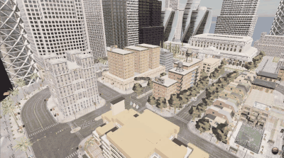

# 无人机键盘控制（uav_keyboard_control）

任务①「无人机仿真 + 键盘控制」的 ROS 侧实现：把终端按键转换为**机体系速度指令**，
发布到 `/uav/cmd_vel`，由 `carlair_ros_bridge` 连仿真器执行。仿真 / 坐标换算 / 安全限幅
集中在桥接层，键盘控制器与桥接层通过同一条指令通道解耦。

## 1. 运行架构

```text
终端按键 ──► uav_keyboard_control ──/uav/cmd_vel──► carlair_ros_bridge ──► CarlaAir/AirSim
            (raw 模式读键)        (geometry_msgs/Twist)   (坐标换算+执行)     (无人机)
```

## 2. 按键映射

机体系（x 前 / y 左 / z 上）：

| 按键 | 动作 | Twist 分量 | 默认幅值 |
|---|---|---|---|
| `W` / `S` | 前进 / 后退 | `linear.x = ±forward_speed` | ±2.0 m/s |
| `A` / `D` | 左移 / 右移 | `linear.y = ±side_speed` | ±0.5 m/s |
| `R` / `F` | 上升 / 下降 | `linear.z = ±vert_speed` | ±1.0 m/s |
| `Q` / `E` | 右转 / 左转 | `angular.z = ±yaw_rate` | ±0.4 rad/s |
| `空格` | 立即悬停 | 全零 | — |
| `ESC` | 退出节点 | — | — |

`Q`/`E` 的方向遵循 AirSim 机体系 `yaw_rate` 约定（`Q=+yaw_rate`，机头右转）。
各轴默认幅值见第 5 节参数表，可在 `config/keyboard.yaml` 中调整。

## 3. 编译与运行

```bash
# 终端 1：桥接（连仿真 + 执行 + 自动起飞悬停）
source ~/catkin_ws/devel/setup.bash
roslaunch carlair_ros_bridge main.launch

# 终端 2：键盘控制
source ~/catkin_ws/devel/setup.bash
roslaunch uav_keyboard_control main.launch
```

把焦点放在键盘控制终端，按 `W/A/S/D/R/F/Q/E` 操控，`ESC` 退出。节点以 30 Hz 持续发布指令。

## 4. 实现要点

### 4.1 终端 raw 模式

Linux 终端默认行缓冲（要按回车），用 `termios` + `tty` 进入 raw 模式即可单键即时响应：

```python
with RawKeyReader() as reader:          # __enter__ 切 raw，__exit__ 恢复
    key = reader.get_key(timeout=0.03)  # select 非阻塞读一个字符
```

`with` 语句保证 `Ctrl-C` 或异常退出时也能恢复终端设置，不会把终端卡在 raw 模式。
节点优先打开控制终端 `/dev/tty` 读键，失败时回退 `sys.stdin`，兼容 `roslaunch` 与 `rosrun` 两种启动方式。

### 4.2 按键 → 速度：纯函数

`key_to_cmd(key, forward_speed, side_speed, vert_speed, yaw_rate)` 把按键映射为
`(vx, vy, vz, wz)`；`step_once` 再打包成 `geometry_msgs/Twist`。两者都不依赖 ROS / 终端，
可在无 ROS 的机器上做单元测试。未知键返回 `None`，由节点按悬停处理。

### 4.3 状态锁存 + 超时自动悬停

Linux 原始终端没有按键松开事件，节点采用「状态锁存 + 超时悬停」：

- 按住按键时终端自动重复上报字符，节点持续保持该指令；
- 松开按键（或焦点丢失导致收不到字符）后，超过 `hold_timeout`（默认 0.3 s）没有新按键，
  自动清零悬停，避免节点一直保持上一条指令把无人机带飞；
- 按空格或未知键立即清零悬停。

桥接层的 `cmd_vel_sub` 另有「超过 `cmd_timeout` 无指令自动悬停」的保护，两层共同防止失控。

## 5. 参数（`config/keyboard.yaml`）

| 参数 | 默认值 | 说明 |
|---|---:|---|
| `control/forward_speed` | 2.0 m/s | `W/S` 前后速度 |
| `control/side_speed` | 0.5 m/s | `A/D` 左右速度 |
| `control/vert_speed` | 1.0 m/s | `R/F` 升降速度 |
| `control/yaw_rate` | 0.4 rad/s | `Q/E` 偏航角速度 |
| `control/hold_timeout` | 0.3 s | 松开按键后保持指令的最长时长，超时悬停 |
| `rate/publish_hz` | 30.0 Hz | 指令发布频率 |
| `topic/cmd_vel` | `/uav/cmd_vel` | 速度指令话题，与桥接包一致 |

需要调整速度幅值时直接修改 `config/keyboard.yaml`，再重新 `roslaunch` 生效。

## 6. 与视口内置 WASD 的关系

CarlaAir 视口**内置**键盘操控（任务①的「仿真」部分），本模块提供 **ROS 侧**键盘控制
（任务①的「键盘控制」部分）。两者可对比验证：视口 WASD 直接驱动仿真器，
本模块走 `键盘 → /uav/cmd_vel → 桥接 → 仿真器` 的完整 ROS 链路。

## 7. 本地测试（无需 ROS / 仿真器 / 终端）

```bash
python3 tests/test_keyboard_local.py
```

测试不依赖 ROS / 仿真器，覆盖：按键映射与符号、速度参数读取、`Twist` 字段映射、
`key_to_cmd` 空键 / 未知键处理，以及 `package.xml` / `CMakeLists` / `main.launch` /
`keyboard.yaml` 工程文件校验。

## 8. 效果图

键盘控制演示（录屏转 GIF，`W 前进 / A 左移 / D 右移 / R 上升 / Q 右转` 机动，第三人称视角）：



## 9. 参考

* [carlair_ros_bridge 桥接模块](./carlair_ros_bridge.md)
* [AirSim 无人机 API 参考](https://openhutb.github.io/doc/python_api/#airsim.client.MultirotorClient)
