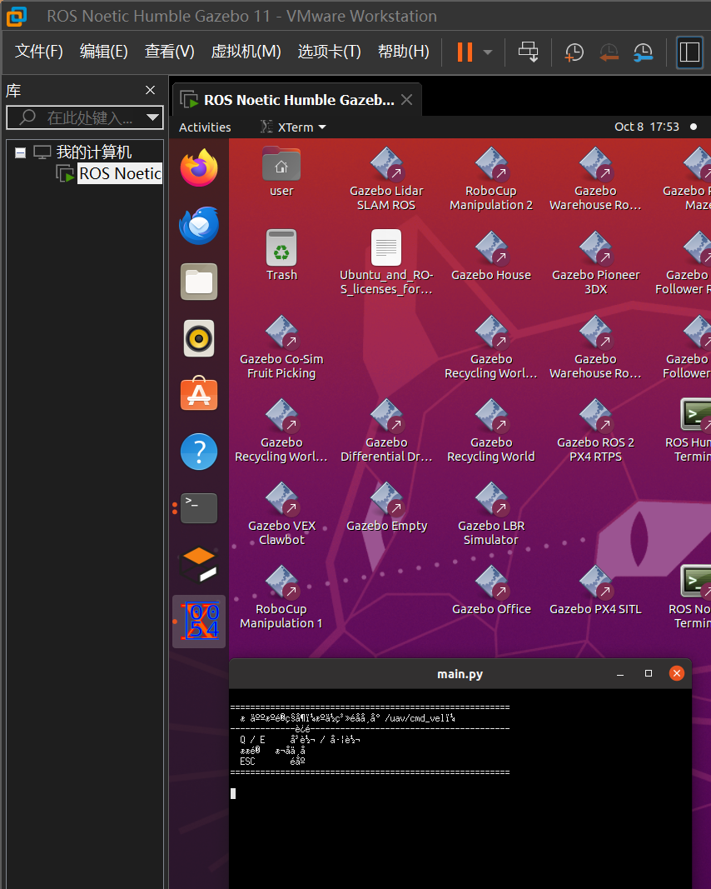
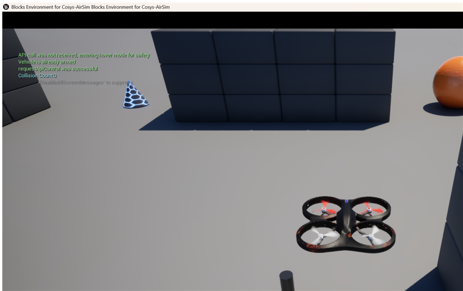

# 无人机键盘控制（uav_keyboard_control）

任务①「无人机仿真 + 键盘控制」的 ROS 侧实现：把终端按键转换为**机体系速度指令**，
发布到 `/uav/cmd_vel`，由 `carlair_ros_bridge` 连仿真器执行。仿真 / 坐标换算 / 安全限幅
集中在桥接层，键盘、规划器、神经网络控制器共用同一条指令通道。该键盘模块同时也是
任务②数据集采集时的人工遥控入口，采集标签速度尺度与部署安全限幅保持一致。

## 1. 运行架构

```text
终端按键 ──► uav_keyboard_control ──/uav/cmd_vel──► carlair_ros_bridge ──► CarlaAir/AirSim
            (raw 模式读键)        (geometry_msgs/Twist)   (坐标换算+执行)     (无人机)
```

## 2. 按键映射

机体系（x 前 / y 左 / z 上）：

| 按键 | 动作 | Twist 分量 | 默认幅值 |
|---|---|---|---|
| `W` / `S` | 前进 / 后退 | `linear.x = ±forward_speed` | ±2.0 m/s |
| `A` / `D` | 左移 / 右移 | `linear.y = ±side_speed` | ±0.5 m/s |
| `R` / `F` | 上升 / 下降 | `linear.z = ±vert_speed` | ±1.0 m/s |
| `Q` / `E` | 右转 / 左转 | `angular.z = ±yaw_rate` | ±0.4 rad/s |
| `空格` | 立即悬停 | 全零 | — |
| `ESC` | 退出节点 | — | — |

`Q`/`E` 的方向遵循 AirSim 机体系 `yaw_rate` 约定（`Q=+yaw_rate`，机头右转）。
`W/S`、`A/D`、`R/F`、`Q/E` 的幅值已对齐部署侧安全限幅（`max_vx=2.0`、`max_vy=0.5`、`max_yaw=0.4`），
保证人工采集的动作标签尺度与神经网络模型输出一致，避免训练标签在部署端被钳位。

## 3. 编译与运行

```bash
# 终端 1：桥接（连仿真 + 执行 + 自动起飞悬停）
source ~/catkin_ws/devel/setup.bash
roslaunch carlair_ros_bridge main.launch

# 终端 2：键盘控制
source ~/catkin_ws/devel/setup.bash
roslaunch uav_keyboard_control main.launch
```

把焦点放在键盘控制终端，按 `W/A/S/D/R/F/Q/E` 操控，`ESC` 退出。节点以 30 Hz 持续发布指令。

## 4. 实现要点

### 4.1 终端 raw 模式

Linux 终端默认行缓冲（要按回车），用 `termios` + `tty` 进入 raw 模式即可单键即时响应：

```python
with RawKeyReader() as reader:          # __enter__ 切 raw，__exit__ 恢复
    key = reader.get_key(timeout=0.03)  # select 非阻塞读一个字符
```

`with` 语句保证 `Ctrl-C` 或异常退出时也能恢复终端设置，不会把终端卡在 raw 模式。
节点优先打开控制终端 `/dev/tty` 读键，失败时回退 `sys.stdin`，兼容 `roslaunch` 与 `rosrun` 两种启动方式。

### 4.2 按键 → 速度：纯函数

`key_to_cmd(key, forward_speed, side_speed, vert_speed, yaw_rate)` 把按键映射为
`(vx, vy, vz, wz)`；`step_once` 再打包成 `geometry_msgs/Twist`。两者都不依赖 ROS / 终端，
可在无 ROS 的机器上做单元测试。未知键返回 `None`，由节点按悬停处理。

### 4.3 状态锁存 + 超时自动悬停

Linux 原始终端没有按键松开事件，节点采用「状态锁存 + 超时悬停」：
节点主循环 30 Hz，**每轮循环发布一条** `Twist`：读到按键就发该方向速度，没读到（松开/未知键）就发全零；按键**不锁存**，要连续运动必须持续按键（自动化时即"定频重复注入"，见 7.6）。桥接层的
`cmd_vel_sub` 有「超过 `cmd_timeout` 无指令自动悬停」的安全保护，这里再叠加一层
显式零速度，双保险防止无人机失控。

- 按住按键时终端自动重复上报字符，节点持续保持该指令；
- 松开按键（或焦点丢失导致收不到字符）后，超过 `hold_timeout`（默认 0.3 s）没有新按键，
  自动清零悬停，避免节点一直保持上一条指令把无人机带飞；
- 按空格或未知键立即清零悬停。

桥接层的 `cmd_vel_sub` 另有「超过 `cmd_timeout` 无指令自动悬停」的保护，两层共同防止失控。

## 5. 参数（`config/keyboard.yaml`）

| 参数 | 默认值 | 说明 |
|---|---:|---|
| `control/forward_speed` | 2.0 m/s | `W/S` 前后速度，对齐 `max_vx` |
| `control/side_speed` | 0.5 m/s | `A/D` 左右速度，对齐 `max_vy` |
| `control/vert_speed` | 1.0 m/s | `R/F` 升降速度 |
| `control/yaw_rate` | 0.4 rad/s | `Q/E` 偏航角速度，对齐 `max_yaw` |
| `control/hold_timeout` | 0.3 s | 松开按键后保持指令的最长时长，超时悬停 |
| `rate/publish_hz` | 30.0 Hz | 指令发布频率 |
| `topic/cmd_vel` | `/uav/cmd_vel` | 速度指令话题，与桥接包一致 |

需要调整速度幅值时直接修改 `config/keyboard.yaml`，再重新 `roslaunch` 生效。

## 6. 与视口内置 WASD 的关系

CarlaAir 视口**内置**键盘操控（任务①的「仿真」部分），本模块提供 **ROS 侧**键盘控制
（任务①的「键盘控制」部分）。两者可对比验证：视口 WASD 直接驱动仿真器，
本模块走 `键盘 → /uav/cmd_vel → 桥接 → 仿真器` 的完整 ROS 链路，正是后续
规划器、神经网络控制器的通用入口。

## 7. 本地测试（无需 ROS / 仿真器 / 终端）

```bash
python3 tests/test_keyboard_local.py
```

桩依赖运行，覆盖：按键映射与符号、速度参数读取、`Twist` 字段映射、
`key_to_cmd` 空键 / 未知键处理，以及 `package.xml` / `CMakeLists` / `main.launch` /
`keyboard.yaml` 工程文件校验。

## 8. 效果图

键盘控制演示（录屏转 GIF，`W 前进 / A 左移 / D 右移 / R 上升 / Q 右转` 机动，第三人称视角）：


## 9. 参考
## 7. 本机实测记录

### 7.1 运行环境

| 项 | 配置 |
|---|---|
| 宿主机 | Windows + Unreal Engine 5.5 + **Cosys-AirSim 3.3**（Blocks 环境） |
| 客户机 | VMware 虚拟机，Ubuntu 20.04.6 LTS（内核 5.15） |
| ROS | **ROS Noetic**（Python 3.8.10） |
| 工作区 | `~/uav_ws`（catkin） |
| 仿真器地址 | `192.168.49.1:41451`（本次实测环境的值，即 VMware NAT 下 VMnet8 的宿主机地址；换环境请用 `ipconfig` 重新确认） |
| AirSim RPC 监听 | 本构建（Cosys-AirSim 3.3）**无需修改 `settings.json`**：监听地址由顶层键 `"LocalHostIp"` 决定，默认空字符串即监听所有网卡。依据与实测见 [7.1.1](#711-关于-rpc-监听地址) |

#### 7.1.1 关于 RPC 监听地址

原文写的是「`settings.json` 必须含 `"ApiServerAddress": "0.0.0.0"`，默认只监听 `127.0.0.1`」。
经核对本机构建的源码与二进制，**这两句都不成立**，特此更正：

* **键名不对。** 本构建读取的是顶层键 **`"LocalHostIp"`**，不是 `ApiServerAddress`。
  源码依据 `Plugins/AirSim/Source/AirLib/include/common/AirSimSettings.hpp`：

  ```cpp
  //by default we spawn server at local endpoint. Do not use 127.0.0.1 as default below
  //because for docker container default is 0.0.0.0 and people get really confused why things
  api_server_address = settings_json.getString("LocalHostIp", "");
  api_port           = settings_json.getInt("ApiServerPort", RpcLibPort);
  ```

  佐证：该构建的 `Binaries/Win64/UnrealEditor-AirSim.dll` 里能查到字符串
  `LocalHostIp` 与 `ApiServerPort`，但**查不到 `ApiServerAddress`**。

* **「默认只监听 127.0.0.1」没有依据。** 上面两行的默认值是**空字符串**，
  紧邻的源码注释还明确写了「不要默认用 127.0.0.1，因为 docker 容器场景默认是 0.0.0.0」。
  也就是**默认就监听所有网卡**。

* **实测与之一致。** 宿主机 `netstat -ano | findstr 41451` 显示 `0.0.0.0:41451`，
  客户机侧直连该端口即可建立 TCP 连接。

**结论**：把「虚拟机连不上」归因于 `ApiServerAddress` 是错的，本机实测中**从未真正需要**这一项。
如果确实要显式限定监听地址，应写成顶层键 `"LocalHostIp": "0.0.0.0"`。

### 7.2 运行步骤

前置：按 [环境搭建与连接](../air/setup_and_connect.md) 配好虚拟机 ROS 环境；
按 [桥接模块](../air/carlair_ros_bridge.md) 的 **2.1 节**在宿主机启动 CarlaAir 仿真器，
等终端输出 `CarlaAir is ready.`（此时 `41451` 端口就绪）。
**仿真器窗口不要最小化**，否则 AirSim 取相机会阻塞。

> 最初的本机实测是用一个**自写的控制脚本**（负责起飞并爬升到 15 m）配合桥接层完成的，
> 那个脚本不属于本仓库。下面给出**只用仓库内组件**的等价步骤。

```shell
# ① 客户机：桥接层
export ROS_MASTER_URI=http://localhost:11311
source /opt/ros/noetic/setup.bash
source ~/uav_ws/devel/setup.bash
# <宿主机IP> 换成仿真器所在机器的地址（Windows 下用 ipconfig 查看，
# 桥接模块文档中的示例为 192.168.94.1）
# auto_takeoff 默认为 true：桥接层会 takeoff() 并 hover()，起飞后悬停在约 1 m
roslaunch carlair_ros_bridge main.launch host:=<宿主机IP>

# ② 客户机：把无人机送到 15 m 高空
#    /uav/goal 是 ENU（z 向上为正），桥接层飞抵该点后自动悬停，
#    并把 /uav/status 置为 GOAL_DONE
rostopic pub -1 /uav/goal geometry_msgs/Point "{x: 0.0, y: 0.0, z: 15.0}"
rostopic echo -n 1 /uav/odom/pose/pose/position     # 确认 z ≈ 15

# ③ 客户机：另开一个终端，键盘控制（作业要求的 launch 启动方式）
export ROS_MASTER_URI=http://localhost:11311
source /opt/ros/noetic/setup.bash
source ~/uav_ws/devel/setup.bash
roslaunch uav_keyboard_control main.launch
# 在弹出的 xterm 窗口里按 W/A/S/D/R/F/Q/E 操控，松开悬停，ESC 退出
```

> **关于 `auto_takeoff`**：它的语义是「**起飞并悬停**」——桥接层源码里就是
> `sim.takeoff()` + `sim.hover()`，**并不会自动升到 15 m**；想让无人机到 15 m，
> 必须另外下发目标点（如上面第 ② 步）或速度指令。
> 若把它设为 `false`，则无人机根本不会起飞，需要自己补上起飞动作。

### 7.3 实测结果

桥接层环境自检 **5/5 通过**：

```text
[通过] airsim 包可用  -- 已导入
[通过] 连接仿真器 192.168.49.1:41451  -- confirmConnection 成功
[通过] 读取位姿  -- pos_enu=(-0.00, 0.00, -0.69) yaw=90.0°
[通过] 相机取帧 front_rgb  -- 尺寸 640x480
[通过] 激光雷达点云 lidar1  -- 点数 8192, x∈[-71.4, 93.6] z∈[-0.4, 22.5]
自检结果: 5/5 通过
```

`/uav/odom` 发布频率实测 **19.999 Hz**（设计值 20 Hz）。

键盘闭环验证（用伪终端模拟真人按键，注入协议与脚本见 [7.6](#76-按键闭环的复现方法)）。
下面是**最初一次**运行的位姿记录——当时用的是"单次写入 + 保持"协议，由 7.6.1 的源码分析可知该协议下**一个字节只产生一条指令**，因此这组数据只用来证明整条链路有效、位置确实发生变化，**不能当作定量指标**（定量结论见 7.4、7.6）：

```text
[test] 节点已在伪终端中启动 (pid=22254)
[test] 按键 前进 W 3.0s / 左移 A 2.5s / 后退 S 2.5s / 右移 D 2.5s / ESC 退出

按键前  (x, y, z) = ( 3.6e-07,  2.2e-07, 15.145)    ← 已按 7.2 第 ② 步送到 15 m
按键后  (x, y, z) = ( 0.389,   -0.403,   15.071)    ← 水平移动约 0.56 m，高度保持
```

**位置发生实际变化**，证明「键盘 → `/uav/cmd_vel` → 桥接层 → 仿真器」整条链路有效。

### 7.4 性能评价

| 指标 | 实测值 | 说明 |
|---|---|---|
| `/uav/odom` 发布频率 | 19.999 ~ 20.24 Hz | 桥接层环境自检实测；另用 `rostopic hz /uav/odom` 复测为 20.010 Hz（min 0.041 s / max 0.055 s） |
| 键盘节点指令发布频率 | 30 Hz | 由 `rate/publish_hz` 设定。**这是设定值，不能当作端到端响应延迟的实测值** |
| 指令水平速度 | 2.0 m/s | 由 `control/horiz_speed` 决定，可用参数覆盖 |
| 单次按键脉冲的水平位移 | 约 0.20 m（1 条非零指令） | 单次写入一个 `W` 字节：节点只在该轮循环发布一条非零指令，随后回落全零（源码见 7.6.1）。数字为评审在另一台机器（Ubuntu 20.04 + Noetic + Blocks/AirSim）的对照测试结果 |
| 20 Hz 定频注入 3 s 的位移 | 约 4.56 m（60 条非零指令） | 同上；注入频率 20 Hz、测量时段 3 s，等效平均速度约 1.5 m/s（低于设定 2.0 m/s，差额来自桥接层控制周期与加减速过程） |
| 遥控稳定性 | 松开即悬停 | 双重保护：节点显式发零速 + 桥接层 0.5 s 超时悬停 |

> **关于「按键响应延迟」**：原表写的「< 30 ms」是用 30 Hz 轮询周期反推出来的，
> 既不是实测值，本身也和 30 Hz（周期 33 ms）矛盾，已删除。
> 要得到真实延迟，需要给按键打时间戳、再和 `/uav/cmd_vel` 首帧的到达时刻对比，
> 本机没有做这项测量，因此不给出数字。

### 7.5 实测截图

键盘控制窗口。`main.launch` 通过 `launch-prefix="xterm -e"` 拉起，
窗口标题为 `main.py`，黑底白字即是键位帮助：



仿真器中无人机自动起飞至 15 m 悬停。AirSim 叠加层显示
`requestApiControl was successful`、`Vehicle is already armed`、`Collision Count:0`：



### 7.6 按键闭环的复现方法

#### 7.6.1 先看清语义：一个字节只产生一条速度指令

`src/air/uav_keyboard_control/scripts/keyboard_control.py` 的主循环：

```python
def spin(self):
    with RawKeyReader() as reader:
        while not rospy.is_shutdown():
            key = reader.get_key(timeout=0.03)      # 没按键时返回 None
            if key == "\x1b":                       # ESC 退出
                break
            self.pub.publish(self.step_once(key))   # 每轮循环发布一条 Twist
            self.rate.sleep()                       # 30 Hz
```

* 每一轮循环**发布一条** `Twist`：读到键就发该方向速度，没读到键（`None`）就发**全零**；
* 因此**写入一个字节 = 一条非零指令**，约 33 ms 后的下一轮循环就回落到零速。
  按键**不是锁存的**：写一次 `W` 并不会让飞机持续前进，只会"推一下"。

这一点由评审在另一台机器上实测确认（Ubuntu 20.04 / ROS Noetic / 本机 Blocks+AirSim）：

| 注入方式 | 收到的非零 `/uav/cmd_vel` | 水平位移 |
|---|---|---|
| 单次写入 `W` | **1 条** | 约 **0.20 m** |
| 以 **20 Hz** 重复写入 `W`、持续 **3 s**（60 次） | **60 条** | 约 **4.56 m** |

> 本页早期版本写的是「每个按键写一次字节、保持 2.5~3 s，节点在这段时间内持续发布该方向速度」——
> **这是错的**（作者当时误以为按键会被锁存），已删除；早期按该协议得到的位移数字
> 也不再作为定量指标。

#### 7.6.2 两种可复现协议

| 协议 | 注入方式 | 注入频率 | 测量时段 | 预期观测 |
|---|---|---|---|---|
| A 单次脉冲 | 只写一个 `b"w"` | 一次 | 写入后 1.0 s 内的位姿差 | 1 条非零指令；位移约 0.20 m |
| B 定频注入 | 循环写 `b"w"` | **20 Hz** | **连续 3.0 s**（共写入 60 次） | 60 条非零指令；位移约 4.56 m |

测量方法（两条协议通用）：

1. 客户机先按 7.2 启动桥接层与键盘节点，确认无人机已在目标高度悬停；
2. 测量时段首尾各取一次位姿：
   `rostopic echo -n1 /uav/odom/pose/pose/position`，两者相减即水平位移；
3. 同时统计指令条数核对"写入次数 → 非零指令条数"：
   `rostopic echo -p /uav/cmd_vel/linear/x`，数其中 `!= 0` 的样本条数。

> 注意：桥接层 `cmd_timeout` 有"超时自动悬停"保护，定频注入的间隔要明显小于它
> （默认 0.5 s），20 Hz（50 ms）远小于该阈值。

#### 7.6.3 注入脚本（pty + 定频重复写入，仅用标准库）

保存为 `kb_inject_test.py`，在已 source 工作空间的客户机上运行：

```bash
python3 kb_inject_test.py --mode pulse                            # 协议 A
python3 kb_inject_test.py --mode repeat --hz 20 --seconds 3       # 协议 B
```

<details>
<summary>点击展开 kb_inject_test.py（纯标准库，无第三方依赖）</summary>

```python
#!/usr/bin/env python3
# -*- coding: utf-8 -*-
"""用伪终端(pty)把按键按固定频率"敲"进 uav_keyboard_control，模拟真人连续按键。

为什么要定频重复写入：节点主循环每轮只发布一条 Twist（见文档 7.6.1），
写一次字节只"推一下"；要让飞机持续运动，必须按固定频率重复写。

用法：
  python3 kb_inject_test.py --mode pulse                         # 协议 A：单次脉冲
  python3 kb_inject_test.py --mode repeat --hz 20 --seconds 3    # 协议 B：20 Hz 定频
"""
from __future__ import print_function

import argparse
import os
import pty
import select
import sys
import time

CMD = ["rosrun", "uav_keyboard_control", "main.py"]


def main():
    ap = argparse.ArgumentParser()
    ap.add_argument("--mode", choices=("pulse", "repeat"), default="repeat")
    ap.add_argument("--key", default="w")
    ap.add_argument("--hz", type=float, default=20.0)
    ap.add_argument("--seconds", type=float, default=3.0)
    ap.add_argument("--boot-wait", type=float, default=6.0, help="节点初始化等待 (s)")
    args = ap.parse_args()

    pid, fd = pty.fork()
    if pid == 0:                                  # 子进程：节点本体
        try:
            os.execvp(CMD[0], CMD)
        except Exception as exc:                  # noqa: BLE001
            sys.stderr.write("exec failed: %s\n" % exc)
        os._exit(1)

    print("[test] 节点已在伪终端中启动 (pid=%d)" % pid)
    time.sleep(args.boot_wait)                    # 等节点初始化并打印启动信息

    chunks = []

    def drain(seconds):
        """在 seconds 秒内持续把子进程输出读走（保持伪终端不被写满）。"""
        end = time.time() + seconds
        while time.time() < end:
            r, _, _ = select.select([fd], [], [], 0.02)
            if not r:
                continue
            try:
                data = os.read(fd, 4096)
            except OSError:
                return False
            if not data:
                return False
            chunks.append(data)
        return True

    drain(1.0)
    key = args.key.encode("ascii")

    if args.mode == "pulse":
        print("[test] 协议 A：单次写入 %r，测量时段 1.0 s" % args.key)
        os.write(fd, key)
        drain(1.0)
    else:
        period = 1.0 / args.hz
        count = int(round(args.seconds * args.hz))
        print("[test] 协议 B：%r 以 %.1f Hz 重复写入 %d 次，测量时段 %.1f s"
              % (args.key, args.hz, count, args.seconds))
        t0 = time.time()
        for i in range(count):
            os.write(fd, key)
            nxt = t0 + (i + 1) * period
            drain(max(nxt - time.time(), 0.0))
        print("[test] 定频注入结束，实际用时 %.2f s" % (time.time() - t0))

    # 松开：不再写字节，节点下一轮循环自动发全零
    drain(1.0)
    try:
        os.write(fd, b"\x1b")
    except OSError:
        pass
    drain(0.5)
    try:
        os.close(fd)
    except OSError:
        pass

    print("----- 键盘节点输出 -----")
    sys.stdout.write(b"".join(chunks).decode("utf-8", "replace"))
    print("----- 输出结束 -----")


if __name__ == "__main__":
    main()
```

</details>
## 8. 参考

* [carlair_ros_bridge 桥接模块](./carlair_ros_bridge.md)
* [AirSim 无人机 API 参考](https://openhutb.github.io/doc/python_api/#airsim.client.MultirotorClient)

---

本文档在编写过程中使用了 AI 大模型辅助（资料核对、文档起草、问题排查）。
文中运行环境、命令与**实测数据**均来自本机实际运行记录：桥接层环境自检 **5/5 通过**、
`/uav/odom` 发布频率实测 **19.999 Hz**；键盘闭环的位姿记录与两种注入协议（单次脉冲 / 20 Hz 定频）见第 7 节，其中「单次脉冲 ≈ 0.20 m、20 Hz 定频 3 s ≈ 4.56 m」为评审在另一台机器上的对照复现结果，本页据此更正了先前关于"按键锁存"的错误描述；
对应的终端输出与截图已随本页一并提交（第 7 节）并被评审逐条核对过；
作者对提交内容的正确性与完整性负全部责任。
