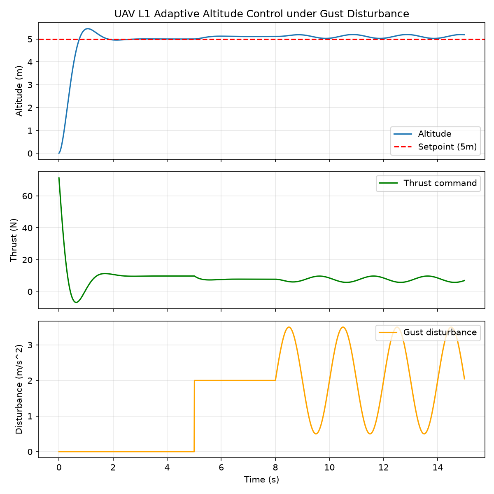

# 无人机 L1 自适应高度控制仿真

> 对应源码模块：`src/air/uav_l1_altitude_stabilization/`

## 1. 简介

L1 自适应高度控制用于在阵风扰动下保持无人机定高悬停，是高度通道控制、定高飞行
与飞行自动化的基础环节。本模块在纯 NumPy 离线仿真中搭建一维点质量无人机高度通道
与 L1 自适应控制器，在 5 m 阶跃目标与阵风扰动下观测高度响应，统计超调、稳态误差、
调节时间与扰动偏差。

演示包含高度响应、推力指令与阵风扰动三条曲线的三子图，以及阶跃爬升叠加阵风扰动
的全过程动图。

## 2. 环境

| 项目 | 配置 |
|---|---|
| 系统 | Ubuntu 20.04 / 22.04（本地 Windows 亦可离线运行） |
| Python | 3.8+（实测 Python 3.13） |
| 数值计算 | NumPy 2.5.4 |
| 绘图 | Matplotlib（Agg 后端，无图形会话亦可出图） |
| 仿真 | 纯 NumPy 点质量离线仿真，无需 ROS / Gazebo / AirSim |

## 3. 安装与运行

```bash
cd src/air/uav_l1_altitude_stabilization
bash main.sh
# 或直接运行核心脚本
python3 scripts/l1_altitude_node.py
```

> 纯离线数值仿真，不需要图形会话；响应曲线由 Matplotlib Agg 后端直接保存为 PNG。

## 4. 任务流程

| 步骤 | 说明 |
|---|---|
| 1. 阶跃目标 | 高度目标设为 5 m，无人机从 0 m 开始爬升 |
| 2. 闭环控制 | PD 反馈 + L1 自适应估计项补偿集总扰动，输出垂向推力指令 |
| 3. 阵风扰动 | t=5s 叠加 2.0 m/s² 阶跃阵风；t=8s 起叠加振幅 1.5 m/s²、0.5 Hz 正弦阵风 |
| 4. 指标统计 | 统计末高度、最大超调、稳态误差、2% 调节时间与阵风后最大偏差 |
| 5. 曲线输出 | 绘制高度 / 推力 / 阵风三子图，并生成演示动图 |



*图 1：高度响应、推力指令与阵风扰动三子图*


*图 2：阶跃爬升与阵风扰动全过程演示 GIF*

## 5. 实现说明

1. **被控对象**：`UAVAltitudePlant` 一维点质量模型，加速度 = 推力 / 质量 − 重力 +
   扰动，积分得到速度与高度，高度非负。
2. **L1 控制器**：`L1AltitudeController` 由 PD 反馈（`kp=12.0`、`kd=6.0`）与自适应律
   （`gamma=20.0`）组成；自适应估计项经低通滤波后叠加到悬停推力上，补偿未知风扰。
3. **扰动模型**：`gust(t)` 在 t>5s 叠加阶跃阵风，t>8s 叠加 0.5 Hz 正弦阵风。
4. **指标评测**：`run_sim()` 跑 15 s、步长 0.01 s；`main()` 计算末高度、超调、
   稳态误差、2% 调节时间与阵风后最大偏差，并保存响应曲线。

## 6. 实测数据

| 指标 | 数值 |
|---|---|
| 仿真时长 / 步长 | 15 s / 0.01 s |
| 目标高度 | 5.0 m |
| 末高度 | **5.191 m** |
| 最大超调 | 0.454 m（约 9.1%） |
| 稳态误差 | 0.191 m |
| 调节时间（±2% 误差带） | 0.73 s |
| 阵风后最大偏差 | 0.197 m |
| 运行环境 | Python 3.13 + NumPy 2.5.4（纯离线） |

## 7. 已知限制

- 仿真采用简化一维点质量模型，未包含姿态内环与横向位置通道；
- 阵风模型为阶跃 + 正弦叠加，真实风场更复杂（湍流、突变与空间分布）；
- 观测为理想状态反馈，未引入传感器噪声、测量延迟与状态滤波；
- 未封装 ROS 2 节点，话题仅为脚本内约定，未对接真实发布 / 订阅。

## 8. 参考

- L1 自适应控制：基于状态反馈与自适应律的集总扰动估计与补偿架构；
- 同类流程：ROS 2 高度控制器 + Gazebo / AirSim 风场仿真（本模块为独立纯 NumPy 离线实现）。

## 大模型使用声明

本页文档、代码与实验由 AI 助手辅助完成；所有命令、曲线图、GIF 与数据均在本地
Python 3.13 + NumPy 2.5.4 环境中实际运行生成，作者已核对并对内容负责。
