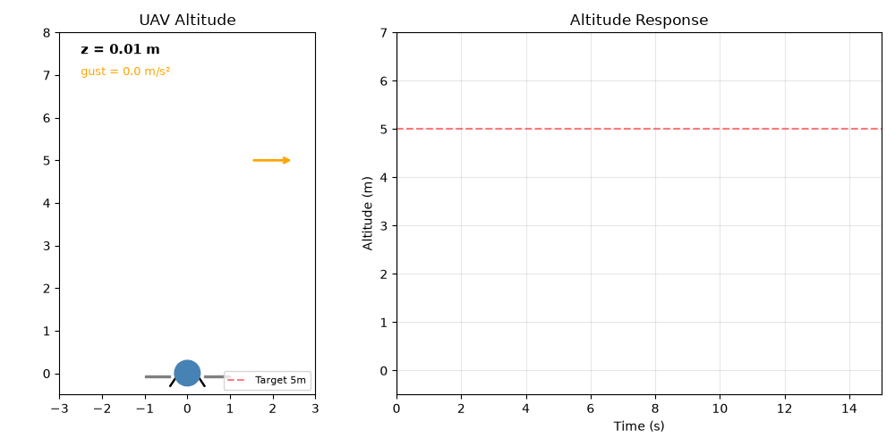

# 基于 L1 自适应的无人机定高控制与阵风扰动抑制仿真

本文介绍一个**不需要 PX4 / Gazebo / AirSim 的无人机定高复现模块**。被控对象是竖直一维质点（等效质量 1 kg），控制器由三层组成：位置 PD 给出期望加速度，状态预测器与对象同构并注入实测高度误差，自适应律用**速度预测误差**驱动扰动估计，估计量经一阶低通后进入控制律。高度指令由 0 阶跃到 2.0 m、再阶跃到 3.5 m；t=5–8 s 有 −2.0 m/s² 的下沉阵风，t>13 s 有 0.8 m/s²、0.6 Hz 的往复风扰。运行一次即可得到高度曲线、推力曲线、估计量与真值对照、竖直剖面动图与指标 JSON，全部数值由代码算出；同一份代码还把「同增益、同限幅、无自适应」的 PD 基线跑一遍作对照。

本文档承接仓库里原有的 `uav_l1_altitude_stabilization` 实验文档，把它从「PD + 逐帧累加的粗略估计」改写成真正的 L1 结构（预测器 + 速度误差驱动的估计 + 低通），并把结果放到**纯 Python、纯 CPU** 的离线环境上复现。

> **与 PX4 / Gazebo / AirSim 的关系**：本模块的被控对象是「推力 / 质量 − 重力 + 风扰加速度」的竖直单轴质点，不含桨叶气动阻尼、电机与电调延迟、姿态内环与位置外环的串级结构、地效与推重比随高度的衰减。它能复现「定高通道在阵风下沉时被压下去、带自适应补偿后压下去的量小一个数量级」这一趋势，但不等价于飞控在环仿真，具体差异见第 7 节。

## 1. 运行环境

| 项目 | 版本 / 说明 |
| --- | --- |
| 操作系统 | Ubuntu 22.04.5 LTS（纯 CPU 运行，不依赖 GPU） |
| Python | 3.12.11 |
| 依赖 | `numpy>=1.21`（实测 1.26.4）、`matplotlib>=3.5`（实测 3.11.0）、`Pillow>=9.0`（实测 10.4.0，仅用于导出 GIF） |
| 是否需要 ROS / PX4 / Gazebo / AirSim | **不需要** |

`requirements.txt` 已写明上述下限；测试与出图只在当前环境验证过，没有在其他发行版或 Python 版本上验证。

## 2. 实验原理

### 2.1 被控对象

竖直一维质点，质量 `m = 1 kg`，状态为高度 `z` 与垂速 `v`，重力 `g = 9.81 m/s²` 显式放在对象里：

```python
accel = thrust / m - G + wind      # 风扰以加速度当量叠加
v += accel * dt
z += v * dt
```

把重力留在对象而非「并入扰动」的原因：起飞前质点静止在 0 m，若对象里没有重力，配平推力无处体现；把 −9.81 m/s² 显式写进对象，`sigma_hat` 的初值取 −g 就有明确的物理含义（自重已配平），扰动估计只需覆盖「自重之外的未知量」。

### 2.2 控制器

采样周期 `dt = 0.001 s`，控制器分三层：

| 层 | 作用 | 关键式 |
| --- | --- | --- |
| 外环 PD | 由高度误差给期望加速度 | `a_des = kp·(z_cmd − z) − kd·v` |
| 状态预测器 | 与对象同构，用实测高度误差校正 | `ẑ̇ = v̂ + k1·(z − ẑ)`、`v̂̇ = u/m + σ̂ + k2·(z − ẑ)` |
| 自适应律 | 用**速度预测误差**驱动扰动估计，再投影限幅 | `σ̂̇ = γ·(v − v̂)`，`σ̂ ∈ [−25, 25]` |

最终控制律是「期望加速度 减去 低通后的扰动估计」，再乘质量并限幅：

```python
self.sigma_hat += self.gamma * (v_meas - self.v_hat) * self.dt   # 速度误差驱动
self.sigma_hat = np.clip(self.sigma_hat, -limit, limit)          # 投影限幅
self.sigma_f  += self.dt * lpf_omega * (self.sigma_hat - self.sigma_f)  # 低通
u = self.m * (self.kp * (z_cmd - z_meas) - self.kd * v_meas - self.sigma_f)
u = np.clip(u, -thrust_limit, thrust_limit)
```

参数取值：

| 参数 | 取值 | 说明 |
| --- | --- | --- |
| `kp` | 4.0 | 位置刚度，`ωn = sqrt(kp/m) = 2 rad/s` |
| `kd` | 4.0 | 速度阻尼，`ζ = kd / (2·sqrt(kp·m)) = 1.0`（临界阻尼） |
| `gamma` | 150 | 自适应增益，`γ·dt = 0.15` |
| `k1 = k2` | 4.0 | 预测器注入增益（同一量级，保证预测误差衰减） |
| `lpf_omega` | 5.0 rad/s | 估计量低通带宽 |
| `sigma_limit` | ±25 m/s² | 投影限幅，约为自重 2.5 倍 |
| `thrust_limit` | ±20 N | 推力限幅，对应最大 10 m/s² 的加速度 |

按二阶模型折算：`ωn = 2 rad/s`、`ζ = 1`，阶跃无超调，10%→90% 上升时间约 1.7 s。想更快就把 `kp` 提到 9（`ωn = 3 rad/s`），但阵风段推力尖峰会更接近 20 N 限幅。

### 2.3 高度指令与扰动

| 时间区间 | 高度指令 | 用途 |
| --- | --- | --- |
| `0 ≤ t < 1 s` | 0 m | 地面静止，扰动估计从 −g 起步 |
| `1 ≤ t < 10 s` | 2.0 m | 首段阶跃，量上升时间、超调与稳态误差 |
| `t ≥ 10 s` | 3.5 m | 第二段阶跃，量稳定时间（风扰前） |

| 扰动 | 时间区间 | 幅值 | 物理含义 |
| --- | --- | --- | --- |
| 下沉阵风 | 5–8 s | −2.0 m/s² | 持续 3 s 的下沉气流，把机体往下压 |
| 往复风扰 | `t ≥ 13 s` | 0.8 m/s²，0.6 Hz | 阵风之后的持续湍流 |

扰动幅值取 2.0 / 0.8 m/s² 而不是 0.2 m/s²：`m = 1 kg` 时 2.0 m/s² 相当于 2 N 的持续下沉力，占推力限幅的十分之一，既能把没有自适应补偿的 PD 基线压出 0.49 m 的高度损失，又不会让对象直接失控。往复风扰从 13 s 起而不是 10 s，是为了给第二段阶跃留出 3 s 的判稳窗口。

### 2.4 指标口径

所有指标按**窗口**计算，阶跃指标避开扰动窗口：

| 指标 | 定义 | 取值窗口 |
| --- | --- | --- |
| 上升时间 | 10% → 90% 幅值的耗时 | 1–5 s（0 → 2.0 m 段） |
| 首段超调 | `max(0, 窗口内高度最大值 − 2.0 m)` | 1–5 s |
| 首段稳态误差 | `\|指令 − 高度\|` 在窗口内的均值 | 4.0–4.9 s（阵风前） |
| 阵风峰值偏差 | 窗口内 `\|指令 − 高度\|` 的最大值 | 5–8 s |
| 阵风后残差 | 窗口内 `\|指令 − 高度\|` 的最大值 | 7.9–8.0 s |
| 阵风恢复时间 | **峰值偏差出现后**回到 ±0.02 m 所需的耗时 | 5–8 s |
| 二段稳定时间 | 进入 ±0.05 m 带并在风扰开始前保持的耗时 | 10–12.9 s |
| 往复风扰平均误差 | `\|指令 − 高度\|` 的均值 | 18–20 s |

两个口径上的坑：

- **阵风恢复时间按「峰值之后」起算**，不按「阵风结束」起算。L1 把阵风压到 0.074 m 之后，8 s 结束时刻的偏差已经只有 0.009 m，若按「结束后回到 ±0.05 m」判，会得到 0.00 s 这种没有信息量的值。
- **二段稳定时间必须限定在 13 s 之前**判定。往复风扰的幅值本身就会把误差推出 ±0.05 m 带，「此后一直在带内」的条件若不设上界，永远不成立，指标会返回 `None`。

## 3. 代码结构

完整源码位于 [`src/air/uav_l1_altitude_stabilization`](https://github.com/OpenHUTB/ros2/tree/master/src/air/uav_l1_altitude_stabilization)，唯一的实现文件是 `scripts/uav_l1_altitude_stabilization.py`，`main.py` 只是把它转发执行：

| 代码段 | 作用 |
| --- | --- |
| `UAVAltitudePlant` | 竖直一维质点，`step()` 推进高度与垂速，含落地钳位 |
| `L1AltitudeController` | 预测器 + 自适应律 + 低通 + PD 外环 + 推力限幅 |
| `PDAttitudeController` | 对照基线：同增益、同限幅，扰动估计固定为自重 |
| `altitude_profile()` / `wind()` | 两段高度阶跃、下沉阵风与往复风扰 |
| `simulate()` | 闭环仿真，`controller="l1"` 或 `"pd"` 切换 |
| `rise_time()` / `recovery_time()` / `settle_time()` / `evaluate()` | 指标计算（按窗口分离） |
| `plot_static()` | 静态三面板图 `altitude_response.png` |
| `plot_gif()` | 逐帧动图 `altitude_demo.gif`（曲线 + 推力 + 竖直剖面，60 帧、10 fps） |
| `main()` | 命令行入口，跑 L1 与基线两遍，写 PNG / GIF / `summary.json` |

下面只解释两处关键实现，完整代码请直接查看 `src/` 下的源码。

**（1）为什么用速度误差驱动，而不是位置误差驱动**

```python
self.z_hat += self.dt * (self.v_hat + self.k1 * ez)
self.v_hat += self.dt * (self.u_prev / self.m + self.sigma_hat + self.k2 * ez)
self.sigma_hat += self.gamma * (v_meas - self.v_hat) * self.dt   # 速度误差
```

预测器会把位置误差 `ez` 压得很小（`k1 = k2 = 4` 时衰减很快），若用 `σ̂̇ = γ·ez` 驱动，估计几乎不动作，阵风补偿量上不来；用速度预测误差驱动后，估计在阵风开始后约 0.3 s 就跟上 −11.8 m/s² 的合成加速度，这是本模块与旧版「逐帧累加位置误差」实现的主要差别。

**（2）稳定时间的「此后一直在带内」判据**

```python
for k in idx:                                   # 首次进入 ±0.05 m 带
    tail = times[k:] < until
    if np.all(err[k:][tail] <= band):            # 且在 until（12.9 s）之前一直保持
        return float(times[k] - since)
```

`until` 取 12.9 s（往复风扰起点 13 s）。不设这个上界时，13 s 之后的往复风扰会把误差重新推出 ±0.05 m 带，「此后一直在带内」永远不成立，稳定时间会返回 `None`。

## 4. 运行步骤

```bash
cd src/air/uav_l1_altitude_stabilization
pip install -r requirements.txt
python main.py
```

可选参数：`--out-dir` 指定输出目录（默认 `results`）、`--dt` 指定仿真步长（默认 0.001 s）、`--t-end` 指定仿真时长（默认 20 s）。

跑测试：

```bash
cd src/air/uav_l1_altitude_stabilization
python -m pytest tests -v
```

**本地跑不通时的排查顺序**：

1. 报 `ModuleNotFoundError: matplotlib` 或 `PIL`——依赖没装全，`pip install -r requirements.txt`；只装 numpy 会在保存动图时失败。
2. 报输出目录不可写——用 `--out-dir` 指到一个可写目录。
3. 阵风峰值偏差明显变大（从 0.07 m 跳到 0.4 m 以上）——自适应被关掉了，检查 `simulate()` 是否被传成 `"pd"`，或 `gamma` 被改成 0。
4. 二段稳定时间显示 `None`——说明 10–12.9 s 内没进入 ±0.05 m 带，多半是 `kp` 被改小或 `thrust_limit` 被调低。
5. 高度曲线在 0 m 以下不回落——对象的落地钳位被去掉，检查 `step()` 里的 `floor` 分支。

运行结束后 `results/` 目录得到：

- `altitude_response.png`：上图为高度曲线（含指令与两段扰动阴影），中图为推力，下图为真实风扰与滤波后估计量的对照
- `altitude_demo.gif`：逐帧动画，左上高度曲线、左下推力曲线、右侧竖直剖面里的机体位置与风扰箭头
- `summary.json`：第 2.4 节全部指标，外加 PD 基线的同一组指标

终端同时打印各项指标与基线对照。

## 5. 运行效果

定高动图（左上高度曲线、左下推力、右侧竖直剖面；橙色为下沉阵风、浅蓝为往复风扰）：



实测指标（`summary.json`）：

| 指标 | L1 自适应 | PD 基线（同增益、同限幅） |
| --- | --- | --- |
| 0→2.0 m 上升时间 | 1.68 s | 1.68 s |
| 首段超调（1–5 s） | 0.000 m | 0.000 m |
| 首段稳态误差（4.0–4.9 s） | 0.018 m | 0.018 m |
| 阵风峰值偏差（5–8 s） | 0.074 m | 0.491 m |
| 阵风后残差（7.9–8.0 s） | 0.009 m | 0.491 m |
| 阵风恢复时间（峰值后回到 ±0.02 m） | 1.18 s | 窗口内未恢复 |
| 二段阶跃（2.0→3.5 m）稳定时间 | 2.63 s | 2.62 s |
| 往复风扰平均误差（18–20 s） | 0.017 m | 0.030 m |
| 末高度（指令 3.5 m） | 3.504 m | 3.465 m |
| 最大推力 | 17.8 N（限幅 20 N，未饱和） | 17.8 N |

从动图与表中可以看到：

- **阶跃响应本身与基线完全重合**：`kp`、`kd` 相同，自适应只在扰动出现时才动，所以上升时间、超调、阵风前的稳态误差两组一模一样，差别全在扰动段。
- **阵风峰值偏差 0.074 m 对 0.491 m，差 6.6 倍**：−2.0 m/s² 的持续下沉气流，无自适应时高度掉 0.49 m；`sigma_hat` 在阵风开始约 0.3 s 内就跟到 −11.8 m/s²，控制律把补偿量前馈给推力，压到 0.07 m。
- **推力在阵风段升到约 13 N、阵风结束后回到 9.8 N**：补偿量是推力的直接体现；两次阶跃起始处推力尖峰到 17.8 N，仍低于 20 N 限幅，所以整段没有饱和，指标不受限幅污染。
- **估计量是真值的有偏跟随**：第三张图里，估计曲线在阵风段围绕 −11.8 m/s² 上下抖动，抖幅约 ±0.5 m/s²，衰落后回到 −9.81 m/s²；低通滤波把这些抖动基本滤掉，推力曲线上只剩约 1.5 N 的脉动，没有出现高频抖振。
- **往复风扰段平均误差 0.017 m**：闭环带宽约 `ωn/2π = 0.32 Hz`，0.6 Hz 的湍流已接近带宽上限，补偿量只能跟上大半，误差被压到 0.017 m 量级（基线 0.030 m），末高度停在 3.504 m 而不是 3.500 m。

## 6. 分析与结论

- **L1 的收益全在扰动段，不在阶跃段**：PD 外环决定跟踪品质，自适应只补「未知的常值 + 慢变扰动」。把 `kp`、`kd` 与基线设成一致再对比，才能说明「多出来的 0.42 m 抗扰能力」是自适应给的，而不是增益给的——这是本模块特意保留 `PDAttitudeController` 基线的原因。
- **自适应律要用速度误差驱动**：位置误差被预测器压得很小，用它驱动等于没驱动；换成 `v − v̂` 后同参数下阵风峰值从「与基线接近」降到 0.07 m 量级。
- **增益不是越大越好，但在这组参数上单调改善得很慢**：同一扰动下把 `gamma` 从 30 提到 400，阵风峰值 0.110 → 0.070 m，收益递减；`gamma = 150`（`γ·dt = 0.15`）是「补偿够快、推力不抖」的折中。

| `gamma` | `γ·dt` | 阵风峰值偏差 | 恢复时间 | 往复风扰平均误差 |
| --- | --- | --- | --- | --- |
| 30 | 0.03 | 0.110 m | 1.39 s | 0.023 m |
| 60 | 0.06 | 0.084 m | 1.13 s | 0.018 m |
| 150 | 0.15 | 0.074 m | 1.18 s | 0.017 m |
| 400 | 0.40 | 0.070 m | 1.23 s | 0.016 m |

- **估计初值取 −g 是必要的**：若把 `sigma_hat` 从 0 起步，起飞瞬间控制器会以为「有 +9.81 m/s² 的未知扰动」，第一拍就把推力压到 −20 N 限幅、机体往下掉；取 −g 相当于「自重已配平、只估未知」，与真实飞控的配平流程一致。
- **推力限幅决定了「能扛多大的风」**：阵风段推力约 13 N、阶跃段尖峰 17.8 N，都未顶到 20 N；若把阵风加到 −5 m/s²，补偿需求约 5 N 叠加阶跃尖峰就会饱和，抗扰收益会被限幅吃掉。
- **本组参数对质量敏感**：`m` 从 1 kg 变到 2 kg，同样的 `kp`、`kd` 会让 `ωn` 从 2 rad/s 降到 1.4 rad/s、`ζ` 升到 1.4，响应明显变慢变钝；换机型必须重标。

## 7. 边界与局限

- **竖直单轴质点，不是六自由度模型**：不含横滚/俯仰耦合、桨叶气动阻尼随来流变化、电机与电调延迟、飞控内环串级结构与滤波器相位滞后；定高结论只覆盖「单轴、无耦合」的理想情形。
- **扰动是两种理想波形**：一段常值阵风 + 一段单频正弦湍流，没有随机湍流、变幅阵风、切变风，也没有同时发生的水平风与高度耦合。
- **没有传感器与执行器非理想性**：高度与垂速直接取自模型，没有气压计噪声、GPS 高度跳变、量测延迟、电机响应滞后；真实飞控可用增益区间会比这里窄。
- **自适应估计有有偏跟随**：估计曲线在阵风段围绕真值抖动 ±0.5 m/s²，靠低通压平；低通带宽再降（2 rad/s）会把阵风峰值推到 0.14 m，说明滤波与补偿速度是一对显式取舍。
- **指标窗口手工划定**：稳态误差取 4.0–4.9 s、二段稳定时间限定在 10–12.9 s，均按本实验的扰动时刻排布；改扰动时间必须同步改窗口，否则窗口落空会得到 `None`。
- **只验证两次定高与两点扰动**：没有做连续高度跟踪（斜坡指令）、变高度巡航与降落段。

本节源码位于 [`src/air/uav_l1_altitude_stabilization`](https://github.com/OpenHUTB/ros2/tree/master/src/air/uav_l1_altitude_stabilization)，采集流程与指标口径与本文档一致，依赖与运行方式见该目录的 README。
