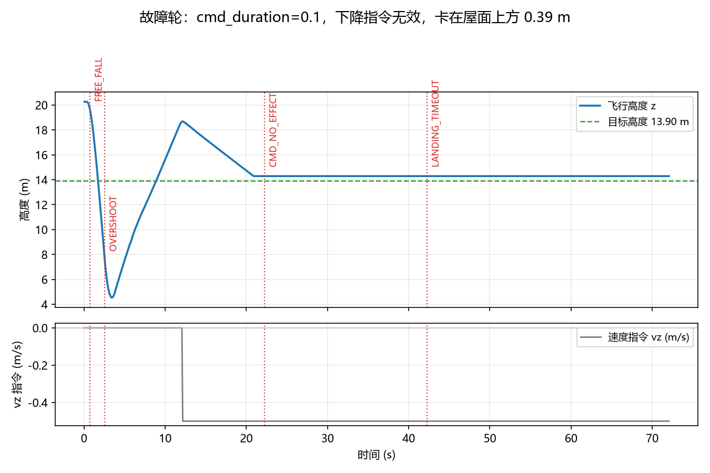
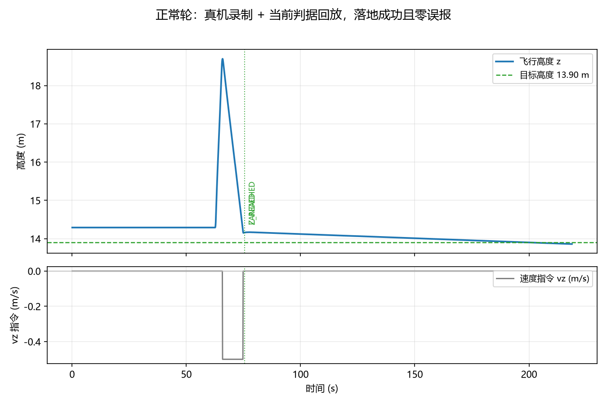

# 无人机降落过程监控（指令-运动一致性）

**一句话**：飞机"以为自己降落了"但实际悬在半空，是降落环节最危险的静默故障。这个模块只做一件事 ——
盯着 `/uav/cmd_vel` 下发的垂直速度和 `/uav/odom` 的实际高度变化，一旦"喊了不动""掉得没人管"
"超时没落地"就立刻告警并落 CSV，事后能一键出图。



## 1. 为什么需要这个监控

在真实 UE + AirSim + `carlair_ros_bridge` 上联调时遇到一个静默故障：桥接层 `cmd_duration=0.1`
配置下，上游连续下发 −0.5 m/s 下降指令，飞机却在屋面上方 0.39 m 处停住不动；而下游降落模块
只按"离屋面还差多少"判断，等它挪进容差就宣布 `LANDED` —— 日志全绿，实际没落地。

不管这个现象最后归因于桥接层的哪一处（见第 4 节的实测与待定位说明），**控制链路各层之间都缺少
一次"指令与结果是否一致"的校验**。本模块补上这一层：不改进任何控制算法、不发送任何控制指令，
只做"看门狗 + 记录仪"。

## 2. 判据

| 告警码 | 级别 | 触发条件 |
| --- | --- | --- |
| `CMD_NO_EFFECT` | error | 窗口内**指令积分** ∫\|−vz\|dt ≥ `cmd_effect_min_expect_m`，但实际下降量 < `cmd_effect_ratio` × 期望值 |
| `DESCEND_STALL` | warn | 已经开始下降后下降指令消失（\|vz\| < `cmd_min_vz`），窗口内高度也只变化 < `descend_stall_eps_m`，且仍未到目标高度 |
| `FREE_FALL` | error | 高度下掉速率 > `free_fall_rate`，而速度指令远小于它（掉高 / 失控） |
| `Z_REACHED` | info | 高度进入目标 ± `landing_tol_m` 并稳定 `landed_stable_s`（"到位置了"，与上游是否松手无关） |
| `LANDED` | info | `Z_REACHED` 且上游已释放下降指令（一次完整的落地） |
| `CMD_NOT_RELEASED` | warn | 已到位置，但上游仍在发下降指令超过 `landed_cmd_grace_s` |
| `OVERSHOOT` | error | 已低于目标高度超过 `overshoot_m`（可重复触发，不是一次性） |
| `LANDING_TIMEOUT` | error | 从开始下降算起超过 `timeout_s` 仍未到位置 |
| `INPUT_STALE` | error | 里程计超过 `stale_input_s` 没有新数据 |
| `TARGET_UNKNOWN` | warn | 启动后 `target_unknown_s` 内仍拿不到落地目标高度 |

几条关键语义（都是评审提出后修正/明确的）：

* **期望位移用指令积分**：`∫|−vz|dt`（只累计向下的部分），不是"最后一帧速度 × 窗口长度"。
  指令变化（暂停后恢复、变速、重新接管）会把观察窗起点推到变化那一刻，避免拿历史空档算期望。
* **起动宽限期只保护"一致性"判据**：`descend_grace_s`（默认 1.5 s）内不判 `CMD_NO_EFFECT`，
  但 `FREE_FALL` 用的是完整高度历史，照常工作。
* **告警是上升沿触发**：条件持续期间只报一次，条件消失后才可能再报（另有 `alert_cooldown_s`）。
  实测 90 s 的持续故障只产生 1 条 `CMD_NO_EFFECT`，不会刷屏。
* **可复位**：落地/超时之后，只要飞机重新爬升超过 1 m，或目标高度发生变化，`reset()` 会自动
  清掉一次性事件与告警历史和阶段，因此**一个常驻节点可以连续监控多次降落**。
* **坐标只有一种**：核心判据内部一律 ENU（上为正）。`frame/z_up:=false`（NED）时，节点会把
  **高度、速度指令、目标高度三处一起**换算（`monitor_core.to_enu`），不存在"z 换了、vz 没换"。
* **不依赖 `DESCEND` 字样**：`carlair_ros_bridge` 的 `/uav/status` 只会发
  `READY / GOAL x y z / GOAL_DONE / GOAL_FAILED / VELOCITY / HOVER`，没有 `DESCEND`。
  所以 `DESCEND_STALL` 用的是"指令消失 + 高度不再下降 + 还没到目标"这种可观测组合；
  只有当某个桥接层真的会发 `DESCEND` 时，才用 `thresholds/status_descend_keywords` 打开状态串判据。
* **落地与"上游收手"分离**：`Z_REACHED` 只看物理高度，`LANDED` 才额外要求指令释放；
  上游落地后不清零指令时会给 `CMD_NOT_RELEASED` 警告，而不会把整次降落误判成超时失败。
* **时钟兜底**：`use_sim_time=true` 但 `/clock` 没来时 `rospy.get_time()` 恒为 0，会让所有
  时间判据失效。节点启动时会检测时间是否在推进，不推进就自动改用单调时钟并打 ERROR 日志。

## 3. 运行

```bash
# 终端 1：桥接层
roslaunch carlair_ros_bridge main.launch host:=192.168.49.1
# 终端 2：被监控的降落模块
roslaunch rooftop_landing_nn main.launch
# 终端 3：本模块
roslaunch uav_landing_monitor main.launch csv:=/tmp/landing.csv
rosrun   uav_landing_monitor main.py        # 等价的前台运行
```

话题：

| 方向 | 话题 | 类型 |
| --- | --- | --- |
| 订阅 | `/uav/odom`、`/uav/cmd_vel`、`/uav/status` | `nav_msgs/Odometry`、`geometry_msgs/Twist`、`std_msgs/String` |
| 订阅（可选） | `/rooftop_nn/landing_point`、`/uav/goal` | `geometry_msgs/Point`（确定落地目标高度） |
| 发布 | `/uav/landing_monitor/alert` | `std_msgs/String`，一条告警一行 JSON |
| 发布 | `/uav/landing_monitor/state` | `std_msgs/String`，周期状态 JSON（含仍在持续中的告警） |

常用参数（完整列表见 `config/uav_landing_monitor.yaml`）：

```bash
roslaunch uav_landing_monitor main.launch csv:=/tmp/l.csv
roslaunch uav_landing_monitor main.launch z_up:=false          # 桥接层高度是 NED 下为正
roslaunch uav_landing_monitor main.launch target_mode:=fixed use_target_z:=true target_z:=13.9
roslaunch uav_landing_monitor main.launch timeout_s:=30 stale_input_s:=0.5
```

出图（同类告警会标注次数，例如 `CMD_NO_EFFECT ×7`）：

```bash
python3 tools/plot_report.py /tmp/landing.csv --out landing.png --title "正常降落"
```

测试（纯 python，不需要 ROS / 仿真器；`catkin_make run_tests` 也会通过 `catkin_add_nosetests` 跑）：

```bash
python3 tests/test_uav_landing_monitor_local.py     # 预期 结果：67/67 通过
```

## 4. 实测记录（并如实说明它不总是复现）

环境：Windows 宿主机 UE 5.5 + Cosys-AirSim（Blocks 场景）+ 本仓库 `carlair_ros_bridge`
+ `rooftop_landing_nn` 降落模块 + 本监控模块，全程真实运行（非离线回放）。

**正常轮**（`cmd_duration=0.5`，真机录制，下图用**当前判据回放**该录制）：

```bash
python3 tools/replay_csv.py landing_normal.csv        # -> 结论 ok，仅有 Z_REACHED + LANDED
python3 tools/plot_report.py landing_normal.csv --alerts replay --out normal_run.png
```



**故障轮**（`cmd_duration=0.1`，当时飞机在屋面上方 0.39 m 处停住不动、上游仍在发 −0.5 m/s）：


这张图是**评审前版本**的真实记录（当时还是"逐帧报"，所以画出了 7 条同类告警）。当前版本改成
**上升沿触发**：同一段持续故障只会报 1 条 `CMD_NO_EFFECT`，随后由 `LANDING_TIMEOUT` 收尾，
告警不再刷屏（这一点有回归用例覆盖，见 `tests/` 里的"持续故障只报一次"）。

### 关于"飞机为什么不动"：只登记现象，不做因果结论

评审指出我原来的因果描述与桥接层代码对不上，这一点是对的，这里改成可核对的事实：

| 事实 | 说明 |
| --- | --- |
| `cmd_duration=0.1` 时 4 s 只降 0.11 m；`0.3` → 0.28 m；`0.5` → 2.27 m | 同一架飞机、同一条 −0.5 m/s 指令，差异稳定可复现（用 AirSim 客户端脚本直接量出来的） |
| `cmd_vel_sub.py` 控制环 20 Hz，指令新鲜时每周期重发同一条指令 | 所以"下一条命令顶掉上一条"的说法不成立：被覆盖的是**同一条**指令 |
| 同一配置后来复跑两次，下降恢复正常（0.49 m/s） | 说明这个现象**不是必现**，与飞行状态/时序有关 |
| 故障轮画面里 UE 曾显示 `API call was not received, entering hover mode for safety` | 这是 AirSim 因 RPC 调用超时进入 hover 保护：此时速度指令会被忽略 —— 与"指令在发、飞机不动"高度吻合，但目前只是线索，未做定论 |

结论：本模块的定位是**发现**（并且这次确实发现了：指令与高度连续 8 s 不一致），
**归因与修复属于桥接层**。本 PR 不修改桥接层默认值，也没有把它写成"已修复"。

## 5. 和别的模块的关系（不重复造轮子）

* `telemetry_diagnostics`：用 GRU 判**遥测数据本身**的统计异常（注入漂移/冻结/丢包），ROS2、偏数据层。
  本模块不建模数据分布，只做**控制指令与运动结果**的规则一致性校验，ROS1 桥接话题，零训练、即插即用。
* `rooftop_landing` / `rooftop_landing_nn`：负责"落到哪里"，可能因为链路问题**误以为**落地了；
  本模块不参与决策，只负责在它们出错时把问题喊出来。
* 本模块**不发任何控制指令**，因此可以挂在任何桥接层/任何降落模块旁边做旁路监控。

## 6. 已知限制

* 规则阈值是工程经验值（`config` 里都可调，且启动时会打印整份生效阈值、拼错的键会 WARN）；
  极端机型的加速度差异需要重新标定；起动宽限期设小了会误报、设大了会漏报"很快就卡住"的故障。
* 只监听单个载具；多机需要各自带命名空间启动一份。
* 高度用单一来源 `/uav/odom`，里程计本身漂移时无法自证（需要外部真值，比如动捕/RTK）。
* `target/goal_offset_m`（默认 5 m）是把 `/uav/goal` 的安全高度折算成屋面高度的**约定值**，
  没有校验；能收到 `/rooftop_nn/landing_point` 时不会用到它，收不到时启动日志会提示，
  超时未拿到目标高度则报 `TARGET_UNKNOWN`。
* "落地"只判定到高度层面（`Z_REACHED` + 指令释放），不判断是否真的踩在屋面上——
  落点几何是否正确属于 `rooftop_landing*` 模块的职责。

## 附：大模型使用声明

本模块的代码、测试与文档在编写过程中使用了大模型辅助（判据设计讨论、代码与文档起草、
绘图脚本整理、以及按评审意见重构判据与补充回归用例）。所有结论均来自仓库内可复现的真实运行：
`tests/test_uav_landing_monitor_local.py`（67 项断言，含评审提出的暂停/恢复、变速、
低高度启动、第二次降落、到位置不松手、NED 换算、并发等场景）、以及第 4 节两轮 UE + AirSim
真机运行（CSV 由节点参数 `monitor/csv` 生成，图由 `tools/plot_report.py` 从该 CSV 绘制）。
作者对提交内容的正确性与完整性负全部责任。
