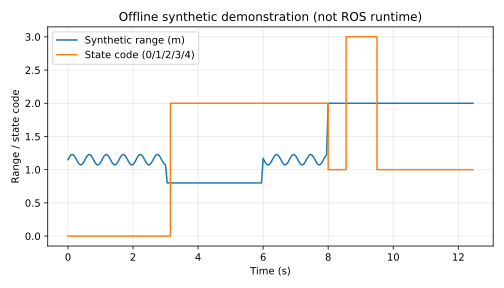

# 无人机近地测距迟滞报警

处理低空近地测距的阈值抖动、连续确认和断流，只输出报警，不宣称自动降落。

**开发状态：离线演示和核心测试已运行；ROS Noetic 构建、launch、在线话题和飞行/模拟器闭环尚未验证。** 本文不作为已通过课程验收的声明。

## 环境与依赖

本次实测为云端 Ubuntu 24.04、Python 3.12.14，NumPy 2.3.5、matplotlib 3.10.8，未安装 ROS。离线演示使用 matplotlib，神经网络模块另需 NumPy。
目标 ROS 环境为 Ubuntu 20.04 / Python 3.8 / ROS Noetic；该目标环境已由用户此前检查，本模块本次尚未进入其中运行。

## 离线复现

在仓库根目录执行，输出目录应不存在：

```bash
python3 -m unittest discover -s src/air/uav_landing_range_alarm/tests -v
python3 src/air/uav_landing_range_alarm/main.py --output /tmp/uav_landing_range_alarm_demo
```

第二条生成 samples.csv、metrics.json 和 offline_demo.svg；MLP 还会重新训练并输出 model.json。不同 NumPy/BLAS 版本可能产生末位数值差异。

## ROS 构建和运行（待实际验证）

从仓库根目录开始，在独立 catkin 工作空间中只放这个包，不把整个混合 ROS1/ROS2 仓库交给 catkin：

```bash
source /opt/ros/noetic/setup.bash
mkdir -p ~/air_course_ws/src
cp -r src/air/uav_landing_range_alarm ~/air_course_ws/src/
cd ~/air_course_ws
catkin_make
source devel/setup.bash
roslaunch uav_landing_range_alarm main.launch
```

如缺依赖，按 package.xml 使用 ROS 对应发行版安装；不要在系统 ROS 中随意混装 Python 版本。
Ctrl+C 结束本模块。话题演示不要连接实机飞控，先完成受控仿真联调。

## 状态机与故障场景

默认报警阈值 1.0 米，解除阈值 1.3 米，需要连续 3 个低于/等于报警阈值的有效样本才进入 ALARM。
中间区间保留当前 CLEAR/ALARM 状态但打断未完成确认，防止 1.0 米附近抖动导致频繁切换；高于/等于 1.3 米立即恢复 CLEAR。
有效样本间隔超过 0.5 秒则 STALE；重新收到测距后重新累积确认。首次启动没有可信样本同样输出 STALE。

节点检查 `Range` 的 min_range、max_range 和测距值。负值、NaN、正负无穷或量程外数据标为 INVALID。
ROS Range 的正负无穷有传感器特定意义，本教学模块选择保守拒绝，不擅自解释为“已经接地”。

| 接口 | 类型 | 说明 |
|---|---|---|
| `range_input` | sensor_msgs/Range | 向下测距；单位米 |
| `~state` | std_msgs/String | UNKNOWN/CLEAR/ALARM/STALE/INVALID |
| `~demo` 参数 | bool | 默认 true，自动发布可重复合成测距 |

演示在 3–6 秒注入近地段，在 8–9.5 秒停止发布，之后恢复正常距离。

## ROS 联调操作（待实际验证）

```bash
rostopic echo /uav_landing_range_alarm/state
```

默认演示应先 CLEAR，再 ALARM，在断流段变 STALE，随后恢复 CLEAR。
`~demo=false` 可接外部传感器；禁止与默认合成发布器同时输入同一话题，以免混淆数据来源。
若需要外部输入，可直接运行：

```bash
rosrun uav_landing_range_alarm main.py --ros _demo:=false
```

## 限制

它是近地报警，不是自动降落控制器；没有地形识别、着陆状态机、姿态修正、推力或速度输出。
测距沿传感器射线，倾斜时不等于垂直高度。本例不使用神经网络，不声称解决复杂地面反射问题。
时限基于单调接收时间，不验证源端时钟或网络延迟；源码中的阈值需要根据采样率和任务重新设定。


## 本次实际结果

离线单元测试：**8/8 通过**。原始输出位于本模块 tests_result.txt。

```json
{
  "alarm_samples": 97,
  "stale_samples": 19,
  "final_state": "CLEAR",
  "validation_scope": "offline mathematical demo; ROS runtime not tested"
}
```

下面为程序实际生成的**离线合成数据/数学演示图**，不是 ROS 窗口截图或飞行记录：



指标文件：源码模块内 offline_metrics.json。逐点样本可用离线复现命令重新生成。
没有本次 ROS 在线截图、catkin 构建结果、真实数据验证、文档浏览器预览和另一人另一台机器复测，需后续补齐。

## 大模型使用声明

使用 OpenAI Codex 辅助方案设计、代码、核心测试、合成演示、文档和提交准备。仅报告实际执行结果；作者需理解、复核和补充目标环境验证，并对内容负责。
