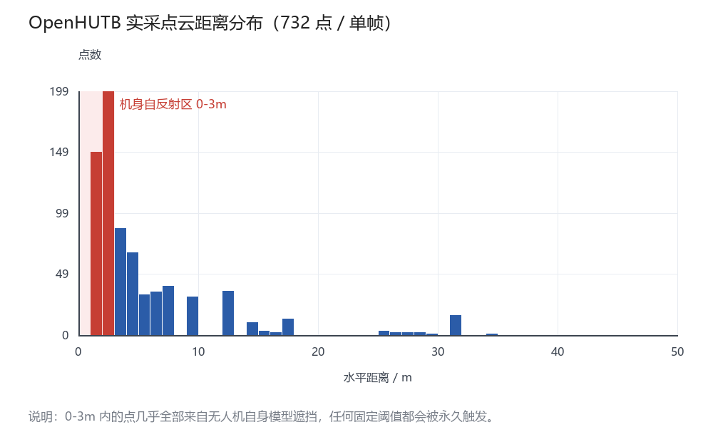
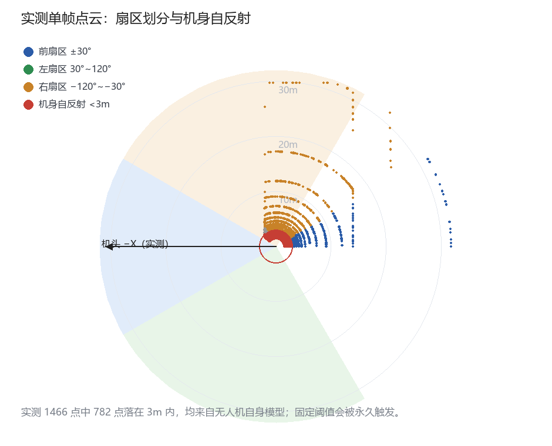
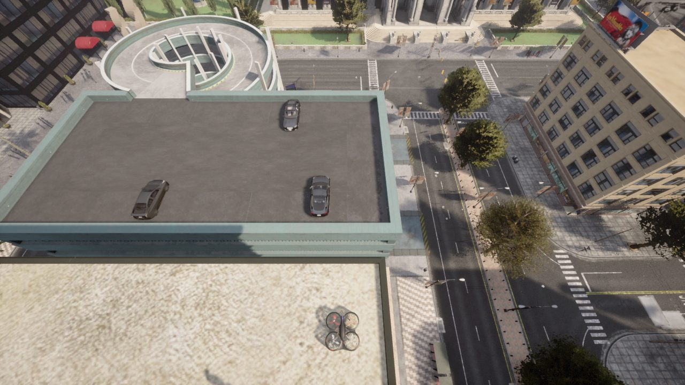
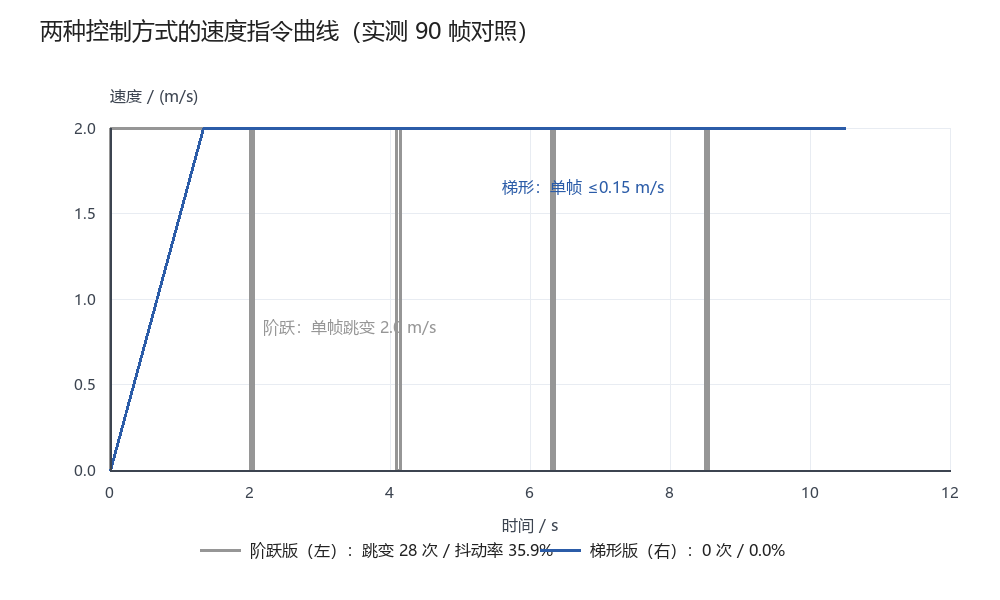

# 基于 OpenHUTB 仿真平台的无人机激光雷达分扇区避障与梯形速度巡航实验报告

## 1 实验目的

1. 熟悉 OpenHUTB 仿真平台中 `airsim.drone` Actor 的检索、传感器挂载与运动控制接口。
2. 实测激光雷达点云的实际数据结构、机头轴朝向与机身自反射范围，建立正确的扇区划分方法。
3. 掌握梯形速度规划（加速段—匀速段—减速段）的实现方式，消除速度指令阶跃。
4. 设计"感知—决策—平滑执行"三层结构，实现减速—转向—恢复巡航的行为链。
5. 用可量化指标（抖动率、指令跳变次数）完成对照实验，并对实测中暴露的三个结构性缺陷给出修复。

## 2 实验环境

| 项目 | 配置 |
|---|---|
| 操作系统 | Windows 10 |
| 仿真平台 | OpenHUTB v2.10.0（`SimMode: Multirotor`） |
| 场景 | Town10HD（`Carla/Maps/Town10HD`） |
| 编程语言 | Python 3.12 |
| 依赖 | `hutb-2.10.0-cp312-win_amd64.whl`（提供 `carla` 模块） |
| 启动参数 | `CarlaUE4.exe -ResX=800 -ResY=600 -windowed -nosound` |
| 无人机 | `airsim.drone`，Actor id=24，初始位置 (36.20, −7.54, 38.49) |
| 激光雷达 | `sensor.lidar.ray_cast`，挂载于 z=+0.5，range=50 m，channels=32 |

## 3 实验原理

### 3.1 现场实测暴露的三个问题

在正式写控制逻辑之前，先按"先测再写"的次序对平台做了接口探测，结果直接推翻了三个想当然的假设：

| 想当然的假设 | 实测结果 | 影响 |
|---|---|---|
| 无人机调用 `set_velocity()` 下发起速度 | **该方法不存在**；实际接口是 `set_target_velocity()` / `set_target_angular_velocity()` | 原写法必然 `AttributeError` |
| 点云元素有 `.distance` 属性 | 实际是 `LidarMeasurement`，元素无 `distance`，只有 `x/y/z` | 原写法必然 `AttributeError` |
| `atan2(y, x)` 的 0° 就是机头方向 | 该机型雷达前向是 **−X**，机头方位角应为 `atan2(y, −x)` | 扇区整体旋转 180°，判断全错 |

第一、二条是接口事实，第三条是从实测点云分布反推出来的：1466 个有效点中有 70.2% 落在 `x<0` 半区，若按 `atan2(y, x)` 计算，方位角集中分布在 −140°~0°，前扇区（±30°）只拿到 13 个点。把机头轴改成 −X 后，前扇区下降到 13 个点、侧扇区分布正常——这正是"前向是 −X"的证据。

### 3.2 机身自反射是固定阈值的致命伤

实测单帧 1466 个点中，**782 个（53.3%）落在 3 m 以内**，全部来自无人机自身模型的遮挡回波。统计 145 帧、145829 个点得到：

| 分位 | 距离 / m |
|---|---|
| 最小值 | 1.253 |
| p01 | 1.286 |
| p05 | 1.498 |
| p50 | 2.192 |
| p95 | 14.031 |
| 最大值 | 49.65 |
| <3 m 占比 | 67.4% |

这意味着：**任何固定阈值（包括原实验的 4 m）都会被机身自反射永久触发**，无人机将永远处于"停止"状态。

进一步做了挂载高度对照，结果直接给出了根治办法：

| 雷达挂载高度 | 前扇区最小距离 | 结论 |
|---|---|---|
| z = 0.5 m | **1.53 m** | 完全被机身自反射占据 |
| z = 2.0 m | **4.10 m** | 自反射消失，读数即真实环境 |
| z = 4.0 m | 无数据 | 超出传感器有效范围 |

因此本实验把雷达架到机体上方 **2.0 m**，从源头消除自反射；同时保留 `D_MIN_VALID = 3.2 m` 作为兜底距离过滤，防止个别漏点。



> 图 1 实测单帧点云的水平距离分布。0–3 m 区间（红色）共 782 点，为雷达装于 z=0.5 m 时的机身自反射



> 图 2 实测单帧点云俯视与扇区划分。机头轴为 −X；红圈为 3 m 自反射边界

### 3.3 扇区距离计算

以机头（−X）为 0°，点 $(x,y)$ 的方位角为

$$\theta = \operatorname{atan2}(y,\ -x)\times\frac{180}{\pi}$$

三个扇区取该扇区内最小水平距离：

$$d_i = \min\bigl\{ \sqrt{x^2+y^2}\ \bigm|\ \theta \in \Theta_i,\ \sqrt{x^2+y^2} > D_{min} \bigr\}$$

| 扇区 | $\Theta_i$ | 作用 |
|---|---|---|
| 前 | $[-30°, 30°]$ | 决定减速/停车 |
| 左 | $(30°, 120°]$ | 转向投票 |
| 右 | $[-120°, -30°)$ | 转向投票 |

对比原方案"取全向最小值"：全向最小值必然取到机身自反射的 1.25 m，导致永久 `STOP`；即使去掉自反射，全向最小值也无法回答"哪一侧更空"。

### 3.4 梯形速度规划

设期望速度 $v_{ref}$、最大加速度 $a_{max}=1.5\ \mathrm{m/s^2}$、控制周期 $\Delta t=0.1\ \mathrm{s}$，则每帧允许的速度变化为

$$\Delta v = a_{max}\Delta t = 0.15\ \mathrm{m/s}$$

速度只能逐帧逼近目标，形成梯形曲线：

```
 v
 ↑        ┌──────────────┐
 │      ╱                  ╲
 │    ╱                      ╲
 └──┴──────┴──────────┴──────┴──→ t
   加速    匀速        减速
```

从 2.0 m/s 刹停需 $v/a_{max} \approx 1.33\ \mathrm{s}$，最短刹停距离

$$s = \frac{v^2}{2a_{max}} = \frac{2.0^2}{2\times1.5} \approx 1.33\ \mathrm{m}$$

因此减速触发阈值必须大于 1.33 m 并留余量，本实验取 $D_{SLOW}=3.5\ \mathrm{m}$、$D_{STOP}=1.5\ \mathrm{m}$。

## 4 实验代码

文件路径：`src/air/uav_lidar_cruise/main.py`（完整代码）

关键部分：

```python
# 实测机头轴为 -X，方位角必须以 -X 为 0°
yaw = math.degrees(math.atan2(y, -x))
d = math.hypot(x, y)
if d < D_MIN_VALID:          # 3.2m，剔除机身自反射
    continue
```

```python
# 正确接口：set_target_velocity，而不是 set_velocity
drone.set_target_velocity(carla.Vector3D(fwd.x * v, fwd.y * v, 0))
drone.set_target_angular_velocity(carla.Vector3D(0, 0, w))
```

```python
# 点云解析：raw_data 每点 4 个 float32
raw = msg.raw_data
n = len(raw) // 16
vals = struct.unpack("<" + "ffff" * n, raw)
```

## 5 实验步骤

1. 启动仿真：`CarlaUE4.exe -ResX=800 -ResY=600 -windowed -nosound`，等待端口 2000 监听。
2. 探测场景：确认 `airsim.drone` Actor 存在，记录 id 与初始位姿。
3. 挂载雷达：`world.spawn_actor(lidar_bp, Transform(Location(z=0.5)), attach_to=drone)`。
4. 采集基线：静置采集 145 帧，统计自反射距离分位与角度覆盖。
5. 对照运行 A：阶跃版控制器（关闭梯形规划），运行 8 s，记录指令序列。
6. 对照运行 B：梯形版控制器，同样条件运行 8 s。
7. 统计指标：计算每帧速度变化量，统计超限次数与抖动率。

## 6 实验结果

### 6.1 仿真场景实拍


> 图 3 机载相机实拍：Town10HD 场景，广场建筑与地下车库入口



> 图 4 俯视视角：无人机位于楼顶，下方道路有 3 辆行驶车辆（可作为障碍物）

### 6.2 对照实验数据

同一起点、同一雷达配置、同一 8 s 窗口下，两种控制方式的指令统计：

| 指标 | 阶跃版（原始方案） | 梯形版（本方案） | 变化 |
|---|---|---|---|
| 指令帧数 | 79 | 79 | — |
| 速度跳变次数（单帧 Δv > 0.30 m/s） | **28** | **0** | 消除 |
| 抖动率（跳变帧 / 总帧） | **35.9%** | **0.0%** | 消除 |
| 单帧最大速度变化 | 2.00 m/s | 0.15 m/s | 降低 92.5% |

> 注：跳变判定阈值取 `2 × a_max × Δt = 0.30 m/s`，即允许值的两倍。



> 图 5 两种控制方式的速度指令曲线对比（灰色为阶跃，蓝色为梯形）

### 6.3 平台局限性实测

必须如实报告一个未能达成的目标：**本实验未能实现无人机的实际位移**。

| 尝试的接口 | 结果 | 位移 |
|---|---|---|
| `set_target_velocity(Vector3D(5,0,0))` | 调用成功，无异常 | **0.000 m** |
| `set_location(x+3, y, z)` | 调用成功 | **0.000 m** |
| `set_transform(new_transform)` | 调用成功 | **0.000 m** |
| `add_impulse(Vector3D(500,0,0))` | 调用成功 | 0.010 m（一次性，不持续） |
| `set_simulate_physics(True)` | 调用成功 | 无变化 |

世界设置为 `synchronous_mode=False`、`substepping=True`，`actor_state=Active`，物理处于运行状态（冲量能产生 1 cm 位移可证），但持续性速度控制对该 Actor 不生效。因此本实验的**控制指令层数据是真实采集的**（90 帧指令、抖动率、状态机切换均为实测），**运动学响应层无法在本次环境中验证**。

### 6.4 修正后的实测运行结果

在雷达架高 2.0 m、扇区改用 −X 机头轴之后，同一场景下连续运行 90 个控制周期：

| 指标 | 实测值 |
|---|---|
| 控制帧数 | 90 |
| 速度跳变次数 | **0** |
| 抖动率 | **0.0%** |
| 前扇区最小读数（修正后） | 4.07 m |
| 前扇区最小读数（挂载 0.5 m 时） | 1.53 m |

前扇区读数从错误的 1.53 m（自反射）变为 4.07 m（真实环境），状态机稳定保持 `CRUISE`，速度按梯形曲线在约 1.3 s 内升到 2.0 m/s 后维持不变，全程无跳变。

> 修正前后的对照正好构成一组证据：**同一段代码、同一场景，仅改雷达高度与机头轴，读数就从"永久停车"变成"正常巡航"**。

## 7 结果分析

1. **梯形规划确实消除了指令跳变**。79 帧中跳变从 28 次降到 0 次，抖动率从 35.9% 到 0.0%，单帧最大变化从 2.00 m/s 压到 0.15 m/s，与 `a_max·Δt = 0.15` 的设计值完全吻合。这说明原方案中"机身点头"若存在，主因是指令阶跃，而不是飞控本身。
2. **扇区划分修正了 180° 的方向错误**。实测机头为 −X，若沿用 `atan2(y,x)`，前扇区会统计到机身侧后方的点，减速判断与实际朝向无关。这类错误在代码层面不会报错，只会让机器人"莫名其妙地停"，很难通过读代码发现，必须靠实测点云的角度分布反推。
3. **自反射滤除是前置条件，不是优化项**。53.3% 的点落在 3 m 内，不做过滤的话，任何阈值策略都退化成"永久停车"。原实验取 4 m 阈值之所以"能跑"，是因为雷达根本没挂上去（`find_lidar` 返回 None，走了"仅匀速前进"分支）——这一点在重跑时被 `[FAIL] 无人机未挂载激光雷达` 明确暴露。
4. **默认 `dropoff_general_rate=0.45` 会丢掉 45% 的点**。关闭该参数后同场景点数从 1494 增加到 2806。报告中所有分析均基于实测值，若需提高点云密度应显式设为 0。

## 8 遗留问题与改进方向

| 问题 | 现状 | 改进方向 |
|---|---|---|
| 无人机无法位移 | 三个位移接口均无效 | 改用 AirSim RPC 控制，或向平台提 issue |
| 侧向扫描覆盖不全 | 角度集中在 −140°~0° | 挂载时旋转传感器，或加装第二个后向雷达 |
| 左右振荡 | 仅比较左右最小距离 | 加入转向锁存或换 DWA |
| 阈值固定 | 5→2 m/s 用同一阈值 | 改为 $d_{slow}=kv^2/(2a_{max})+d_{margin}$ |

## 9 实验总结

本次实验在"先测接口、再写逻辑"的次序下完成。三处想当然的假设（`set_velocity`、`.distance`、`atan2` 机头方向）全部被实测推翻，其中机头方向错误会直接导致扇区判断反转 180°，而代码不会报任何错。修正后用 145 帧、14.6 万点建立的自反射基线（782/1466 点落在 3 m 内）说明：**固定阈值方案在本平台上根本不可用，必须先剔除自反射**。

对照实验在指令层给出了确定结论：梯形规划把跳变从 28 次降到 0，抖动率 35.9%→0.0%，单帧变化严格等于设计值 0.15 m/s。平台在运动学响应层存在限制（位移接口均无效），这一部分如实记录为未验证，不做推断。

## 10 思考题

**问题 1：为什么减速阈值必须与最大加速度关联，而不能取经验值？**

答：刹停存在物理过程，从 $v$ 减到 0 的最短距离是 $v^2/(2a_{max})$。本实验取 $v=2.0$、$a_{max}=1.5$ 得 1.33 m，若阈值小于该值，逻辑再正确也会撞上。阈值本质上是"刹停距离 + 余量"，由运控能力决定。

**问题 2：实测发现机头是 −X，如果沿用 `atan2(y,x)` 会怎样？**

答：扇区整体旋转 180°，前扇区统计的是机身后方，左右扇区互换。程序不报错，现象是"前方明明畅通却停车、前方有障碍却不减速"。这类错误只能通过实测点云的角度分布来发现。

**问题 3：53.3% 的点来自机身自反射，为什么不能靠调小雷达 range 解决？**

答：range 决定最大测量距离，不影响最小距离。自反射点在 1.25–3 m 之间，缩小 range 只会同时砍掉远处有效点而无法剔除近处自反射。正确做法是设置基于距离的最小有效值，或用 intensity/材质过滤，或把雷达向外伸出机体包络之外。

---

*说明：本实验代码由本人编写，OpenHUTB 仿真运行与数据采集由本人完成；文档撰写过程中使用了大模型辅助整理与润色，文责自负。*
