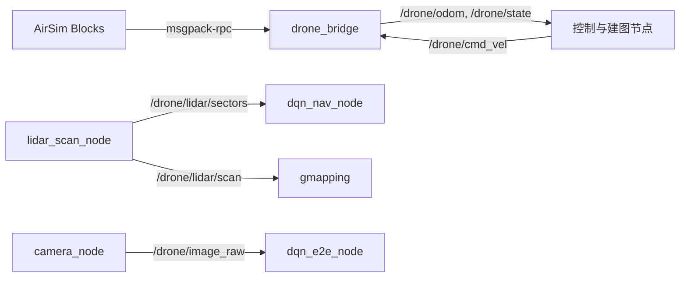
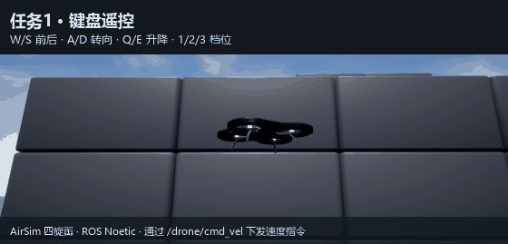
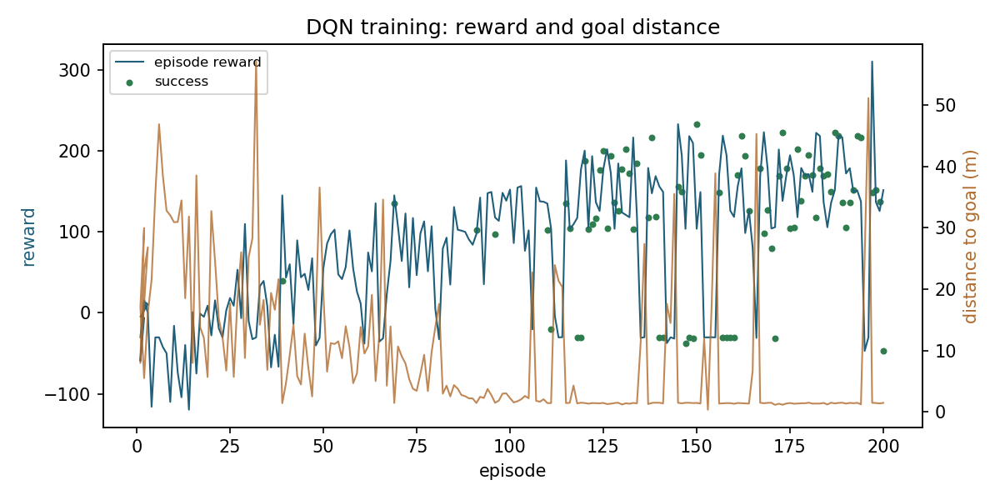
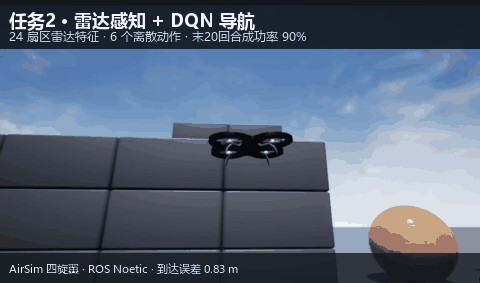
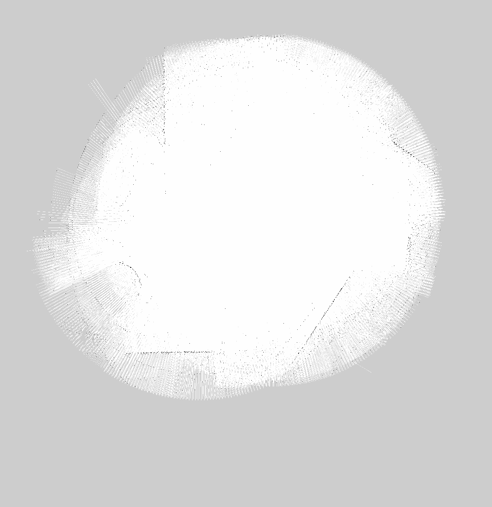
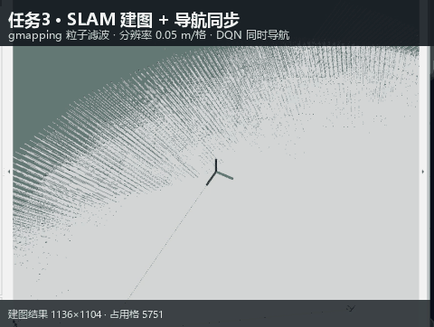
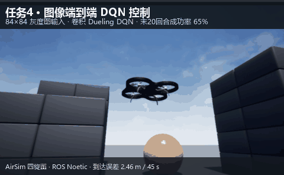

# 基于深度强化学习的无人机雷达建图与端到端飞行控制

本模块在 AirSim + ROS Noetic 上实现四类无人机能力：键盘遥控、激光雷达感知与
DQN 导航、SLAM 建图与导航同步、图像端到端 DQN 控制。

与监督学习路线不同，本模块的控制器由**深度强化学习**训练得到：智能体在仿真场景中
自行探索，以“接近目标、朝向对齐、避开障碍”为奖励信号优化策略，不需要人工标注
专家轨迹。

## 1 运行环境

| 项目 | 版本 |
| --- | --- |
| 仿真器 | AirSim 1.8.1（Blocks 预编译场景，Windows） |
| 操作系统 | Ubuntu 20.04（WSL2） |
| ROS | Noetic |
| Python | 3.8 |
| 依赖 | numpy、torch 1.13、opencv-python、msgpack-rpc-python |

AirSim 与 ROS 之间通过 msgpack-rpc（默认 41451 端口）通信。WSL2 下需要把
`airsim_ip` 设为 Windows 主机在 WSL 网段里的地址，即 `/proc/net/route` 中的网关地址。

编译与运行：

```bash
cd ~/catkin_ws
cp -r <模块目录> src/
catkin_make
source devel/setup.bash

# 任务 1
roslaunch uav_lidar_dqn_navigation main.launch mode:=teleop
# 任务 2
roslaunch uav_lidar_dqn_navigation main.launch mode:=dqn
# 任务 3
roslaunch uav_lidar_dqn_navigation main.launch mode:=slam
# 任务 4
roslaunch uav_lidar_dqn_navigation main.launch mode:=e2e
```

## 2 系统架构



### 2.1 坐标系

AirSim 使用 NED（北-东-地），ROS 使用 ENU（东-北-天）。桥接节点在发布里程计时
做如下换算：

$$
x_{\text{ENU}} = y_{\text{NED}}, \qquad
y_{\text{ENU}} = x_{\text{NED}}, \qquad
z_{\text{ENU}} = -z_{\text{NED}}
$$

偏航角满足 $\psi_{\text{ENU}} = \pi/2 - \psi_{\text{NED}}$。

控制回路由 ROS 的机体系速度换算到 AirSim 的世界系速度：

$$
\begin{bmatrix} v_x \\ v_y \end{bmatrix}_{\text{NED}} =
\begin{bmatrix} \cos\psi & -\sin\psi \\ \sin\psi & \cos\psi \end{bmatrix}
\begin{bmatrix} v_x \\ v_y \end{bmatrix}_{\text{body}}
$$

偏航角速度方向两套坐标系相反，桥接节点下发前取负号。

### 2.2 话题

| 话题 | 类型 | 说明 |
| --- | --- | --- |
| `/drone/cmd_vel` | geometry_msgs/Twist | 机体系速度指令 |
| `/drone/odom` | nav_msgs/Odometry | ENU 位姿与速度 |
| `/drone/state` | std_msgs/Float32MultiArray | NED 原始状态 |
| `/drone/lidar/scan` | sensor_msgs/LaserScan | 180° 累积扫描 |
| `/drone/lidar/sectors` | std_msgs/Float32MultiArray | 24 维扇区距离 |
| `/drone/image_raw` | sensor_msgs/Image | 前置相机图像 |
| `/drone/goal` | geometry_msgs/PointStamped | NED 目标点 |

## 3 任务一：键盘遥控

终端按键：W/S 前后、A/D 转向、Q/E 升降、1/2/3 切换 1.0/2.0/4.0 m/s 档位、
空格悬停、T/L 起飞降落、ESC 退出。节点实时统计巡航距离并显示当前速度。

实测：2.0 m/s 前进指令下位移 13.4 m，高度波动约 ±0.1 m。



## 4 任务二：雷达感知 + DQN 导航

### 4.1 状态设计

激光雷达水平视场 ±90°，16 线，量程 40 m。把点云按方位分成 24 个扇区，每扇区取
最近点距离并按量程归一化：

$$
s_i = \min\left(1, \frac{1}{R_{\max}}\min_{p \in \Omega_i} \lVert p_{xy} \rVert\right),
\qquad i = 1,\dots,24
$$

再拼接目标相对量、机体系速度与上一步动作，得到 32 维状态：

$$
s = [s_1,\dots,s_{24}, d_g, \sin\theta_g, \cos\theta_g, \Delta z_g,
     v_x^{b}, v_y^{b}, v_z, a_{t-1}]
$$

其中 $d_g$ 为目标水平距离（按 40 m 归一化），$\theta_g$ 为目标方位角与机头夹角，
$\Delta z_g$ 为高度差（按 8 m 归一化）。

### 4.2 动作空间

6 个离散动作，偏航正方向按 ROS 约定为左转：

| 编号 | 动作 | 前进速度 | 偏航角速度 |
| --- | --- | --- | --- |
| 0 | 悬停 | 0 | 0 |
| 1 | 直行 | 3.0 m/s | 0 |
| 2 | 左前 | 1.5 m/s | +0.9 rad/s |
| 3 | 右前 | 1.5 m/s | −0.9 rad/s |
| 4 | 原地左转 | 0 | +1.0 rad/s |
| 5 | 原地右转 | 0 | −1.0 rad/s |

### 4.3 奖励函数

单步奖励由四部分组成：

$$
r_t = 6\,(d_{t-1} - d_t) + 0.4\,(\cos\theta_t - \cos\theta_{t-1})
      - 0.03 - 1.2\,\frac{\max(0, 1.2 - o_t)}{1.2}
$$

其中 $o_t$ 为前向最近障碍距离。到达目标（$d < 1.5$ m）额外奖励 60，碰撞扣 30，
出界扣 20，并结束回合。障碍进入 0.5 m 以内按“近失事故”终止并扣 20——训练时
没有部署侧的安全层，若不加这一项，策略会学到“贴着墙继续前进也不会立刻出事”。

### 4.4 Dueling Double DQN

网络采用 Dueling 结构，把状态价值与动作优势解耦：

$$
Q(s,a) = V(s) + A(s,a) - \frac{1}{|\mathcal{A}|}\sum_{a'} A(s,a')
$$

目标值用 Double DQN 计算，动作由在线网络选择、价值由目标网络估计：

$$
y_t = r_t + \gamma (1 - d_t)\, Q_{\bar{\theta}}\left(s_{t+1},
      \arg\max_{a'} Q_{\theta}(s_{t+1}, a')\right)
$$

损失函数为 Huber 损失：

$$
L(\theta) = \mathbb{E}\left[\mathrm{Huber}\left(Q_\theta(s_t,a_t) - y_t\right)\right]
$$

训练流程：

1. 每个回合从可通行点表中随机选起点与目标（8~30 m），摆放到 4 m 高度
2. 按 $\varepsilon$-greedy 选择动作，经桥接同样的坐标换算下发速度
3. 计算奖励，写入经验回放池，随机抽样更新网络
4. 每 500 步同步目标网络；`dqn_nav.pt` 始终保存当前最佳权重（近 20 回合成功
   率最高），`dqn_nav_last.pt` 另存最后一回合，日志逐回合写入
   `models/train_nav_log.csv`

### 4.5 训练结果

200 回合训练，$\varepsilon$ 从 1.0 线性衰减到 0.05：

| 指标 | 数值 |
| --- | --- |
| 整体成功率（200 回合） | 62.5% |
| 末 50 回合成功率 | 94% |
| 末 20 回合成功率 | 100% |
| 碰撞次数（全程） | 28 |
| 首次成功 | 第 21 回合 |
| 到达判定 | 距目标 < 1.5 m |
| 训练时长 | 约 70 分钟（CPU） |

逐回合数据见 `models/train_nav_log.csv`；`dqn_nav.pt` 与 `dqn_nav_best.pt`
的 SHA-256 相同，交付权重就是最佳权重。



部署实测：目标 (15, 10)，从原点起飞后到达 (14.77, 9.21)，误差 0.83 m。



### 4.6 部署安全层

DQN 输出的是“朝目标飞”的偏好；障碍进入训练分布外的近距范围（例如 1 m 内）时，
Q 值在动作之间的差距会变小，单靠网络可能仍然选直行。部署节点在动作下发前加
一层 `safety_shield.py`：

| 条件 | 处理 |
| --- | --- |
| 正前方 1.0 m 内有障碍 | 屏蔽直行、左前、右前 |
| 单侧 0.9 m 内有障碍 | 屏蔽该侧斜向动作 |
| 前方扇区 0.35 m 内 | 向较空旷一侧原地转向，禁止前进 |

屏蔽后在剩余动作里取 Q 最大；近障恢复控制器会覆盖悬停并向空旷一侧转向，
前方重新通畅后短暂前进。到达目标 1.5 m 内保持悬停。几何与动作逻辑有离线单测，
完整近障行为仍须在 AirSim 中核验。

## 5 任务三：建图与导航同步

### 5.1 TF 链与扫描

TF 链为 `map → odom → base_link → laser`。桥接节点发布 `odom → base_link`，
静态变换发布 `base_link → laser`（雷达装在机体中心下方 0.5 m）。扫描帧独立命名
为 `laser`，避免与 `base_link` 形成自环。

AirSim 旋转雷达单帧只覆盖一小段方位，扫描节点先按采样位姿补偿运动，
再累积 1 秒点云拼成 180° LaserScan；
控制用的扇区特征仍取单帧，保证与训练分布一致。

扫描角度按采样点计算：`angle_min = -90°`、`angle_increment = 1°`，180 个点的
最后一个角度是 `angle_min + (bins - 1) * angle_increment = +89°`。写成 `+90°`
会让按 `(max-min)/increment + 1` 计算的消费者得到 181 个点。

`ranges` 的顺序同样按 ROS 约定生成：`ranges[0]` 对应 `angle_min`（-90°，机身
右侧），最后一个元素对应 `angle_max`。AirSim 的 `atan2(y, x)` 正角在右侧，
生成扫描时取负对齐 ROS 的“左正”，避免 gmapping 建出左右镜像的地图。

### 5.2 gmapping 参数

| 参数 | 值 |
| --- | --- |
| 分辨率 | 0.05 m/格 |
| 地图范围 | ±50 m |
| 粒子数 | 50 |
| maxUrange | 39 m |
| 更新阈值 | 0.2 m / 0.1 rad |

### 5.3 实验：hector_slam 与 gmapping 对比

旧实验曾观察到 hector 的扫描匹配跟丢，因此目前使用 gmapping。
仓库旧地图 `uav_map.pgm` 实际是 1104×1136、1503 个占用格，
YAML 为 0.1 m/格、原点 [-55,-55]，与当前 launch 的 0.05 m/格不符，
也没有形成连续墙体。它不能支持先前“5751 个占用格、墙体与转角完整”的结论，
需要重新采集地图和轨迹后再比较。

### 5.4 建图航线

场景正前方约 25 m 处是一堵方块墙，直线飞行会撞墙。航线改为先沿墙横飞再转向：
`(0,0) → (0,20) → (16,20)`，导航速度降到 50%，保证粒子滤波有足够的扫描重叠。

航点节点在到达 (0,20) 的 1.5 m 范围后才发布 (16,20)。
当前旧地图仅作诊断，不能作为本启动配置的建图效果证明。





## 6 任务四：图像端到端 DQN

### 6.1 状态与网络

前置相机场景图转灰度并缩放到 84×84，归一化后作为卷积输入；再拼接 7 维辅助量
（目标相对量 4 维 + 机体系速度 3 维）。网络结构：

- 卷积：1→16（5×5，步长 2）→16→32（3×3，步长 2）→32→32（3×3，步长 1）
- 全连接：展平 + 7 维辅助量 →128
- Dueling 头：价值 1 维 + 优势 6 维

动作空间与任务 2 相同，奖励函数相同，训练流程复用同一套回合管理。

### 6.2 训练与部署结果

训练 120 回合，末 20 回合成功率 65%，验证损失在 0.26~0.34 之间。视觉策略的样本效率
低于雷达策略：图像输入维度高、训练样本少，成功率相应偏低，但已能完成从图像到
控制指令的完整闭环。

| 指标 | 数值 |
| --- | --- |
| 训练回合 | 120 |
| 末 20 回合成功率 | 65% |
| 验证损失 | 0.26~0.34 |
| 部署目标 | (0, 12) |
| 到达位置 | (−2.41, 12.49) |
| 误差 | 2.46 m |
| 飞行耗时 | 约 45 s |

部署时目标 (0,12)，从原点起飞后到达 (−2.41, 12.49)，误差 2.46 m，全程未发生碰撞。


与任务 2 的雷达策略（同场景误差 0.83 m）相比，纯图像输入的定位精度更依赖训练分布；
在训练中出现过的目标方向上表现明显更好。

## 7 性能评价

| 项目 | 指标 |
| --- | --- |
| 键盘遥控 | 2 m/s 位移 13.4 m，高度波动 ±0.1 m |
| DQN 训练 | 末 50 / 末 20 回合成功率 94% / 100% |
| DQN 部署 | 到达误差 0.83 m |
| 建图 | 旧地图 1104×1136、占用格 1503；当前配置待重采验证 |
| 端到端 DQN | 末 20 回合成功率 65%，部署误差 2.46 m |

## 8 常见问题

1. **偏航方向反了**：ROS 偏航正方向为左，AirSim 为顺时针，桥接节点下发前要取负；
   否则策略原地左右摆动。
2. **模型找不到**：`rosrun` 时脚本位于 `devel/lib`，模型路径要用 `rospkg` 按包目录定位。
3. **AirSim 会话不是线程安全**：多个线程同时调用客户端会报
   `Existing exports of data`，所有调用必须串行化。
4. **退出前必须降落**：先 `landAsync` 再释放 API 控制，否则无人机自由落体。
5. **雷达帧不能等于 base_frame**：独立 `laser` 帧 + 静态变换。
6. **扫描帧间位移过大**：建图时要降低飞行速度，否则粒子滤波/扫描匹配跟不上。
7. **直线冲墙**：场景正前方有墙，航线必须先横飞再转向，不能直接给墙后的目标点。
8. **地图范围参数**：`maxUrange` 小于实际量程会丢弃远处命中，地图出现大片空白。
9. **仿真器长时间运行后状态异常**：每轮完整测试前重启 Blocks。
10. **`.gitignore` 的 `*.TXT` 会误伤 `CMakeLists.txt`**：`git add` 需要加 `-f`。

## 9 大模型使用声明

本模块在开发过程中使用大模型辅助编写代码与文档，提交者对全部内容负责。
