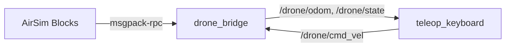

# 基于深度强化学习的无人机雷达建图与端到端飞行控制

本模块在 AirSim + ROS Noetic 上实现四类无人机能力：键盘遥控、激光雷达感知与
DQN 导航、SLAM 建图与导航同步、图像端到端 DQN 控制。

与监督学习路线不同，本模块的控制器由**深度强化学习**训练得到：智能体在仿真场景中
自行探索，以“接近目标、朝向对齐、避开障碍”为奖励信号优化策略，不需要人工标注
专家轨迹。

本页先说明模块总体设计与已落地的键盘遥控（PR #892）；雷达感知、DQN 训练与部署、
建图、端到端控制按依赖顺序在后续 PR 中补充。

## 1 运行环境

| 项目 | 版本 |
| --- | --- |
| 仿真器 | AirSim 1.8.1（Blocks 预编译场景，Windows） |
| 操作系统 | Ubuntu 20.04（WSL2） |
| ROS | Noetic |
| Python | 3.8 |
| 依赖 | numpy、msgpack-rpc-python |

AirSim 与 ROS 之间通过 msgpack-rpc（默认 41451 端口）通信。WSL2 下需要把
`airsim_ip` 设为 Windows 主机在 WSL 网段里的地址，即 `/proc/net/route` 中的网关地址。

编译与运行：

```bash
cd ~/catkin_ws
cp -r <模块目录> src/
catkin_make
source devel/setup.bash

# 任务 1：键盘遥控
roslaunch uav_lidar_dqn_navigation main.launch mode:=teleop
```

## 2 系统架构



桥接节点是模块唯一的 AirSim 客户端：它把 ROS 的机体系速度指令翻译成 AirSim 的
`moveByVelocityZAsync` 调用，并把位姿、速度与原始状态发布回 ROS。控制节点只依赖
ROS 话题，因此可以脱离 AirSim 单独调试。

### 2.1 坐标系

AirSim 使用 NED（北-东-地），ROS 使用 ENU（东-北-天）。桥接节点在发布里程计时
做如下换算：

$$
x_{\text{ENU}} = y_{\text{NED}}, \qquad
y_{\text{ENU}} = x_{\text{NED}}, \qquad
z_{\text{ENU}} = -z_{\text{NED}}
$$

速度指令从机体系旋到世界系，偏航角速度还需反号：ROS 逆时针为正，AirSim 顺时针为正。

## 3 键盘遥控

`teleop_keyboard.py` 在终端读取单键输入，维护速度档位与里程统计，并把
`geometry_msgs/Twist` 发到 `/drone/cmd_vel`。

| 按键 | 功能 |
| --- | --- |
| W / S | 前进 / 后退 |
| A / D | 左偏航 / 右偏航 |
| Q / E | 上升 / 下降 |
| 1 / 2 / 3 | 低速 / 中速 / 高速档 |
| T / L | 起飞 / 降落 |

起飞与降落调用桥接节点提供的 `/drone/takeoff`、`/drone/land` 服务；高度由
`moveByVelocityZAsync` 保持，避免松键后掉高。

## 4 话题与服务

| 名称 | 类型 | 说明 |
| --- | --- | --- |
| `/drone/cmd_vel` | geometry_msgs/Twist | 机体系速度指令 |
| `/drone/odom` | nav_msgs/Odometry | ENU 位姿与速度 |
| `/drone/state` | std_msgs/Float32MultiArray | NED 原始状态 |
| `/drone/takeoff` | std_srvs/Trigger | 起飞 |
| `/drone/land` | std_srvs/Trigger | 降落 |

## 5 后续 PR

| PR | 内容 |
| --- | --- |
| #893 | 雷达扇区特征与扫描话题发布 |
| #918 | DQN 策略训练流程与模型权重 |
| #922 | DQN 导航节点与 gmapping 建图链路 |
| #932 | 图像端到端 DQN 与演示动图 |

## 大模型使用声明

本模块在开发过程中使用大模型辅助编写代码与文档，提交者对全部内容负责。
