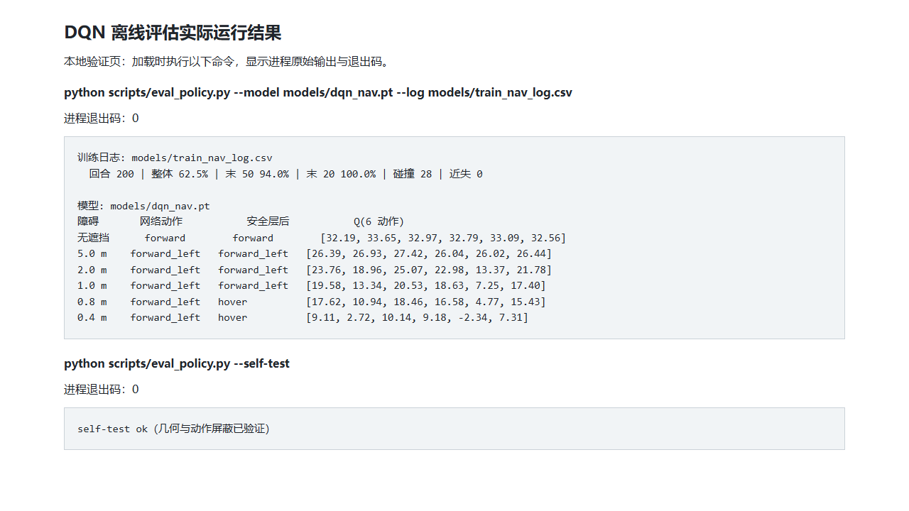

# DQN 策略离线评估

`scripts/eval_policy.py` 用来在没有 ROS、没有 AirSim 的机器上检查已训练的策略：
它读取 `models/train_nav_log.csv` 汇总训练结果，再构造“正前方若干米有墙”的
状态，打印网络输出的 Q 值与动作，并使用随本模块提供的 `safety_shield.py`
打印动作屏蔽后的结果。该脚本与部署分支 #922 的动作屏蔽函数一致；本离线工具
不模拟部署节点中额外的 0.35 m 强制悬停或飞行动力学。

推理使用 `torch.load(..., weights_only=True)`；随包检查点包含优化器状态，
本次已在 PyTorch 2.15.0+cpu 上验证。PyTorch 1.13 的安全加载器无法读取这份
完整检查点；工具不会自动启用不安全的反序列化。

## 用法

```bash
cd src/air/uav_lidar_dqn_navigation

# 训练统计 + 贴墙探测
python3 scripts/eval_policy.py

# 指定权重与日志
python3 scripts/eval_policy.py --model models/dqn_nav.pt \
                              --log models/train_nav_log.csv

# 只跑几何与安全层断言（不需要权重）
python3 scripts/eval_policy.py --self-test
```

## 输出示例

下面的截图来自本地验证页面：页面实际执行评估与自检命令，展示进程输出和退出码。



本页面也已通过 `mkdocs serve --livereload` 本地预览，见[网页预览截图](../../img/air/uav_lidar_dqn_navigation/policy_mkdocs_preview.png)。

```
训练日志: models/train_nav_log.csv
  回合 200 | 整体 62.5% | 末 50 94.0% | 末 20 100.0% | 碰撞 28 | 近失 0

模型: models/dqn_nav.pt
障碍     网络动作        安全层后        Q(6 动作)
无遮挡   forward        forward        [32.19, 33.65, 32.97, 32.79, 33.09, 32.56]
5.0 m    forward_left   forward_left   [26.39, 26.93, 27.42, 26.04, 26.02, 26.44]
2.0 m    forward_left   forward_left   [23.76, 18.96, 25.07, 22.98, 13.37, 21.78]
1.0 m    forward_left   forward_left   [19.58, 13.34, 20.53, 18.63, 7.25, 17.40]
0.8 m    forward_left   hover          [17.62, 10.94, 18.46, 16.58, 4.77, 15.43]
0.4 m    forward_left   hover          [9.11, 2.72, 10.14, 9.18, -2.34, 7.31]
```

## 怎么读

- 无遮挡时选择 `forward`；障碍进入 5 m 内后改为 `forward_left`，
  且 `forward` 的 Q 从 33.65 降到 2.72，说明网络确实在使用雷达特征
- 网络在 0.4 m 时倾向斜向而不是原地转开，这是训练分布外的窗口；
  `safety_shield.py` 在前方距离严格小于 1.0 m 时屏蔽前向动作，本次输出为
  `hover`；1.0 m 恰好等于阈值，因此不屏蔽。
- 控制用的 24 扇区索引与扫描的 ROS 角度约定是两套顺序：前者按 AirSim 机体系
  （索引 0 在左侧），后者按 ROS（`ranges[0]` 在右侧 -90°）

## self-test

`--self-test` 不加载权重，只断言两件事：0.4 m 墙会让正前扇区接近 0，
以及动作屏蔽会拦下直行。安全层不可导入时脚本报错退出，不会将跳过断言报告为成功。
此自检是合成静态输入下的逻辑检查，不代表完整飞行闭环已通过。
