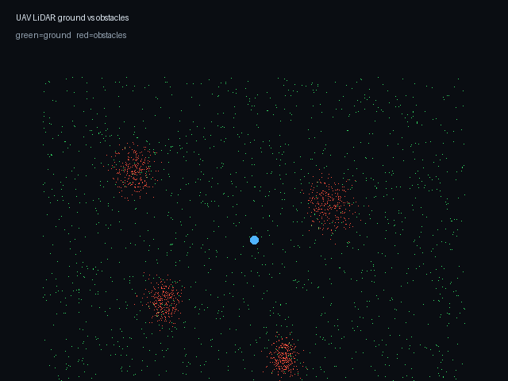

# 无人机 LiDAR 地面/障碍分割

订阅 `/lidar/points`（世界系 ENU），用 RANSAC 拟合地面平面，分别发布地面点和障碍点。可用于降落区评估、局部避障和点云调试。



> 动图为合成 LiDAR 点云；绿色地面、红色障碍、蓝点为无人机。

## 接口

| 方向 | 话题 | 类型 |
|---|---|---|
| 订阅 | `/lidar/points` | `sensor_msgs/PointCloud2` |
| 发布 | `/lidar/ground` | `sensor_msgs/PointCloud2` |
| 发布 | `/lidar/obstacles` | `sensor_msgs/PointCloud2` |

## 运行

```bash
roslaunch uav_lidar_ground_filter main.launch \
  distance_threshold:=0.2 max_iterations:=120
```

两路点云都用原云的 `frame_id`，RViz 中分别着色即可。

## 参数

| 参数 | 默认 | 说明 |
|---|---|---|
| `distance_threshold` | 0.2 | 平面内点阈值 m |
| `max_iterations` | 120 | RANSAC 迭代次数 |
| `min_range` | 0.5 | 最小水平距离 m |
| `max_range` | 60.0 | 最大水平距离 m |

## 测试

```bash
python3 test/test_ground_filter_local.py
# 7/7 通过
```

覆盖 RANSAC 平面拟合、地面/障碍掩码、比例统计和少于 3 点的异常。
