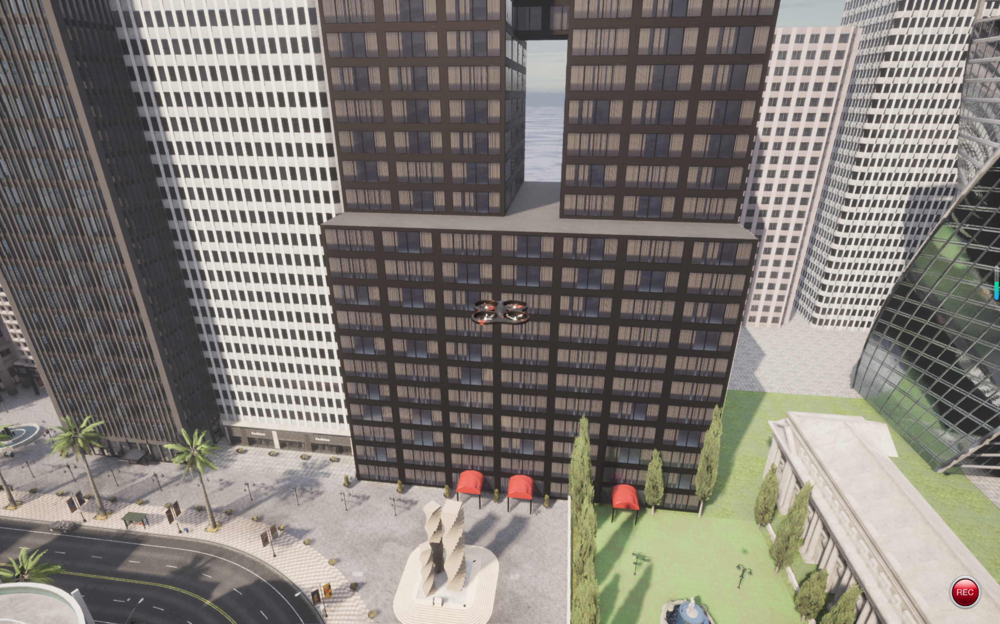
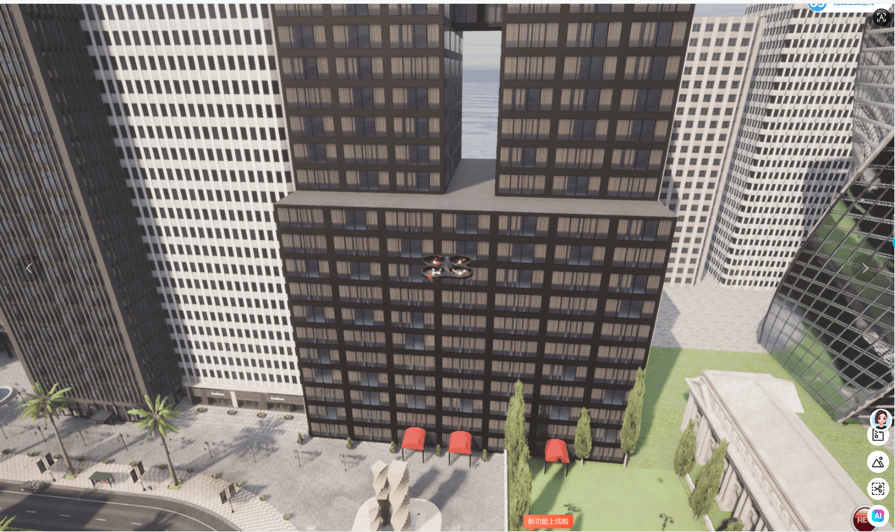

# 基于OpenHUTB仿真平台无人机激光雷达避障实验报告

## 1 实验目的
1. 熟悉OpenHUTB人车一体化仿真平台的基础操作，掌握仿真环境与Python客户端的通信方法。
2. 理解无人机激光雷达传感器工作原理，掌握激光雷达点云数据读取与障碍物距离计算方法。
3. 设计并编写Python控制程序，实现无人机自主检测前方障碍物，完成基础避障功能。
4. 掌握仿真实验结果观测、记录与分析方法，完成仿真实验的完整流程。

## 2 实验环境
- 操作系统：Windows10
- 仿真平台：OpenHUTB v2.10.0
- 编程语言：Python3.9
- 依赖库：carla Python API、pygame
- 硬件：PC计算机

## 3 实验原理
OpenHUTB是面向人车混合场景的国内仿真平台，API接口风格参考CARLA。平台内可预置无人机模型，无人机搭载激光雷达传感器。
激光雷达向外发射激光束，返回点云数据，每个点包含空间坐标信息。程序读取点云，计算最近障碍物距离：
- 当障碍物距离小于设定阈值（4m），下发速度指令，无人机停止前进；
- 当障碍物距离大于阈值，无人机保持向前匀速飞行。

通过Python客户端连接仿真服务器，读取传感器数据，下发运动控制指令，形成感知-决策-控制闭环，实现自主避障。

## 4 实验代码
文件路径：`src/air/uav_lidar_obstacle/drone_control.py`（本模块的 ROS 2 包装节点在同目录的 `uav_lidar_obstacle/node.py`，见第 10 节）
```python
# -*- coding: utf-8 -*-
"""无人机激光雷达避障脚本（OpenHUTB / CARLA 仿真）。

运行::

    python drone_control.py

按 Ctrl+C 退出；退出时停止雷达监听并把无人机速度置零，避免重复启动残留活动回调。
"""

import sys
import time

import carla


def main():
    # 连接 OpenHUTB 仿真服务
    try:
        client = carla.Client("127.0.0.1", 2000)
        client.set_timeout(20.0)
        world = client.get_world()
    except Exception as exc:
        print("❌ 无法连接仿真服务: %s" % exc)
        return 1

    print("✅ 成功接入 OpenHUTB 仿真世界")

    # 遍历场景 Actor，查找无人机
    drone = None
    for actor in world.get_actors():
        if actor.type_id.find("drone") != -1:
            drone = actor
            print("找到无人机，ID:%s, 类型:%s" % (drone.id, actor.type_id))
            break
    if drone is None:
        print("❌ 场景内没有找到无人机 Actor")
        return 1

    # 查找挂载在无人机上的激光雷达
    lidar = None
    for sensor in world.get_actors():
        if ("lidar" in sensor.type_id and sensor.parent is not None
                and sensor.parent.id == drone.id):
            lidar = sensor
            print("✅ 找到机载激光雷达")
            break

    min_dist = 100.0

    # 激光雷达回调函数，读取点云
    def lidar_callback(pc_data):
        nonlocal min_dist
        min_dist = 100.0
        for p in pc_data:
            d = p.distance
            if d < min_dist:
                min_dist = d

    if lidar:
        lidar.listen(lidar_callback)
    else:
        print("⚠️ 未检测到机载激光雷达，仅执行匀速前进")

    try:
        while True:
            # 避障决策逻辑
            if min_dist < 4.0:
                print("前方障碍物 %.2fm，停止飞行" % min_dist)
                drone.set_velocity(carla.Vector3D(0, 0, 0))
            else:
                print("前方安全 %.2fm，向前飞行" % min_dist)
                drone.set_velocity(carla.Vector3D(2, 0, 0))
            time.sleep(0.1)
    except KeyboardInterrupt:
        print("\n程序终止 Ctrl+C")
    finally:
        # 显式停止传感器监听并停车，避免重复启动残留活动回调
        if lidar:
            lidar.stop()
        try:
            drone.set_velocity(carla.Vector3D(0, 0, 0))
        except Exception:
            pass
    return 0


if __name__ == "__main__":
    sys.exit(main())
```

## 5 实验步骤
1. 启动 OpenHUTB 仿真平台
进入 OpenHUTB 根目录，使用低分辨率指令启动仿真，降低显存占用：
cmd
CarlaUE4.exe -ResX=800 -ResY=600
等待场景加载完成，场景内预置无人机模型，确认仿真画面正常。
2. 打开终端，准备 Python 环境
新开 CMD 终端，把 OpenHUTB 自带的 carla 包加入 PYTHONPATH（egg 文件名按本机实际安装为准）：
cmd
set PYTHONPATH=C:\hutb_windows_v2.10.0\PythonAPI\carla\dist\<carla 的 egg 文件名>

3. 运行 Python 控制脚本
在新终端里切换到本模块目录，直接运行脚本（脚本已随模块提交，不再是 examples 目录下的临时文件）：
cmd
cd <仓库路径>\src\air\uav_lidar_obstacle
python drone_control.py

4. 观察实验现象
• 控制台打印连接状态、无人机与激光雷达检索信息；
• 无人机在场景中向前飞行；
• 当无人机前方出现建筑物等障碍物，雷达检测到近距离目标，无人机停止前进；
• 障碍物移除后，前方距离大于阈值，无人机恢复向前飞行。
5. 结束实验
在终端按下Ctrl+C终止程序，脚本自动停止雷达传感器，无人机速度置零。关闭 OpenHUTB 仿真窗口。

## 6 实验结果

图 1 OpenHUTB 仿真平台城市场景加载，无人机初始画面

图 2 Python 脚本控制无人机，基于激光雷达实现障碍物检测与避障
1. 仿真正常启动后，场景自带无人机模型，可接收 Python 下发的速度指令。
2. 程序成功读取机载激光雷达点云数据，实时计算前方最近障碍物距离。
3. 实现预期避障效果：障碍物距离小于 4m 无人机停止；无障碍物时持续向前飞行。

## 7 结果分析
1. OpenHUTB 仿真与 Python 客户端可以正常建立通信，实现传感器数据读取与运动指令下发。
2. 激光雷达点云数据可以有效感知前方障碍物，简单阈值判断可以完成基础避障功能。
3. 实验存在局限性：本方案只检测正前方距离，无法实现侧向绕行；阈值固定，环境适应性较差。
4. 硬件限制：本机显卡显存容量有限，高分辨率场景下容易出现显存不足导致仿真闪退，因此本次实验采用 800×600 低分辨率运行仿真。

## 8 实验总结
本次实验基于 OpenHUTB 仿真平台完成无人机激光雷达避障开发。实验学习了 OpenHUTB 仿真环境的使用方法，掌握仿真与 Python 客户端通信机制，理解激光雷达感知原理，编写感知 - 决策 - 控制的 Python 程序。
通过实验验证，基于激光雷达 + 阈值判断的方案可以实现无人机基础避障。该方案结构简单，容易实现，但智能程度有限。后续可以优化算法，增加绕行逻辑，提升无人机在复杂场景下的自主避障能力。

## 9 思考题
1. 本实验只判断正前方障碍物，如果障碍物出现在无人机左侧 / 右侧，当前代码能否避障？为什么？
答：不能。当前代码只取所有点云最小距离，没有区分障碍物的方位。障碍物在侧面时，虽然检测到距离，但不会做转向绕行，只会原地停止，无法绕开障碍物。
2. 激光雷达点云数据量大，在回调函数中大量循环计算会带来什么问题？
答：回调函数是传感器数据的实时回调，计算耗时过长会造成数据堆积，出现数据延迟、丢包，严重时会造成仿真通信卡顿、断开连接。
3. 除了固定阈值避障，还有哪些常见的机器人避障算法？
答：人工势场法、动态窗口法（DWA）、A * 路径规划、快速扩展随机树（RRT）等。

## 10 用 ROS 2 启动（可选）

上面的流程用的是纯 CARLA 脚本。同一套控制律也做成了 ROS 2 节点，
代码在 `src/air/uav_lidar_obstacle/uav_lidar_obstacle/node.py`，
适合与 `carla_ros_bridge` 这类 ROS 2 组件联调：

```bash
colcon build --packages-select uav_lidar_obstacle
source install/setup.bash
ros2 launch uav_lidar_obstacle uav_lidar_obstacle.launch.py
```

节点默认订阅 `/carla/lidar/point_cloud`（`sensor_msgs/PointCloud2`）、发布
`/uav/cmd_vel`（`geometry_msgs/Twist`，`linear.x` 为机体系前向速度）；
停车阈值 4.0 m、前飞速度 2.0 m/s 都可以用 `stop_distance:=` /
`forward_speed:=` 覆盖；点云超过 1 s 未更新时按故障安全策略停车。
参数表、话题表与两条路径的区别见模块
[README](https://github.com/OpenHUTB/ros2/tree/master/src/air/uav_lidar_obstacle/README.md)。
