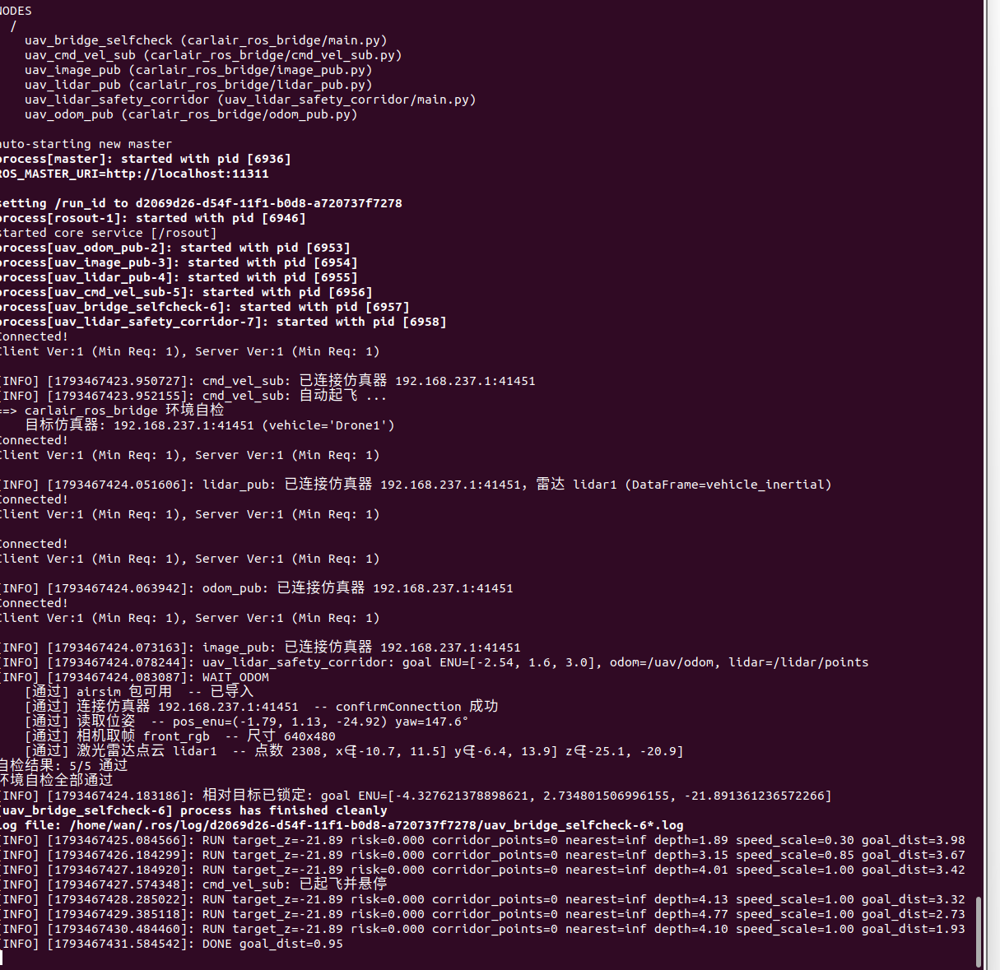

# 无人机激光雷达三维安全走廊与自适应高度避障

本实验在 OpenHUTB/CarlaAir 的 Town10HD 场景中，使用无人机机载激光雷达点云
选择安全飞行高度，并用前视深度图补充近距离玻璃/墙面保护，通过 ROS Noetic
桥接完成速度闭环。

源码位置：`src/air/uav_lidar_safety_corridor/`

## 1. 实验目标

- 订阅 OpenHUTB 桥接发布的无人机位姿和激光雷达点云；
- 在目标方向前方建立三维安全走廊；
- 根据障碍密度选择安全高度，而不是始终使用固定高度；
- 用 `/camera/depth` 做近距离减速和停车保护；
- 对水平速度、垂向速度和加速度做限幅；
- 对比固定高度和自适应高度策略的到达效果与最小障碍间距。

## 2. 系统结构

```text
OpenHUTB / AirSim
    │ 位姿、LiDAR
    ▼
carlair_ros_bridge
    │ /uav/odom
    │ /lidar/points
    ▼
uav_lidar_safety_corridor
    │ /uav/cmd_vel
    ▼
carlair_ros_bridge ──► 无人机
```

桥接层输出世界 ENU 坐标，因此本节点也输出世界 ENU 速度。启动桥接时必须使用
`body_frame:=false`，否则速度会被按机体系解释。

本模块只支持前向安全走廊。目标方向相对机头超过 `75°` 时节点会拒绝目标并
悬停，避免侧移进入前视深度相机不可见的障碍。

## 3. 安全走廊

对每个候选高度 $z_i$，在前视距离
$d_{\min} \le d \le d_{\max}$、横向宽度 $|y| \le w$ 的走廊内统计
垂直安全带 $|z-z_i| \le h$ 的点云。

候选高度评分同时考虑：

- 走廊内障碍密度；
- 与目标高度的偏差；
- 与当前高度的变化量。

障碍密度较低、接近目标高度且高度变化平滑的候选点会被选中。

## 4. 控制流程

1. 从 `/uav/odom` 读取世界位姿和速度；
2. 从 `/lidar/points` 解析 XYZ float32 点云；
3. 选择安全高度；
4. 根据目标方向和短距离斥力生成水平速度；
5. 根据安全高度生成垂向速度；
6. 用前视深度图中心区域限制最大水平速度；
7. 按加速度和速度上限输出 `/uav/cmd_vel`。

深度保护只覆盖机头前方中心区域；侧向和后向目标不在本实验的安全保证范围内。

## 5. 运行

先在 Windows 启动 OpenHUTB/CarlaAir，再在虚拟机启动桥接：

```bash
roslaunch carlair_ros_bridge main.launch \
  body_frame:=false \
  publish_image:=false
```

确认 `/uav/odom` 和 `/lidar/points` 正常后启动实验：

```bash
roslaunch uav_lidar_safety_corridor main.launch \
  goal_x:=10.0 \
  goal_y:=0.0 \
  goal_z:=5.0
```

目标点必须根据当前场景自动机位置和障碍布局调整。

## 6. 观察与诊断

```bash
rostopic hz /uav/odom
rostopic hz /lidar/points
rostopic echo /uav_lidar_safety_corridor/status
rostopic hz /uav/cmd_vel
```

RViz 中添加 `MarkerArray` 话题
`/uav_lidar_safety_corridor/markers`，可观察当前选中的安全高度和预览方向。

## 7. OpenHUTB 实测结果

测试环境：

| 项目 | 配置 |
|---|---|
| 模拟器 | OpenHUTB / CarlaAir，Town10HD Opt |
| 虚拟机 | Ubuntu 20.04.6 |
| ROS | Noetic 1.17.4 |
| 飞控接口 | AirSim `Drone1`，VMware VMnet8 `192.168.237.1:41451` |
| 感知 | 16 线 `lidar1` + 640×480 `front_depth` |

桥接自检 5/5 通过；单帧雷达约 2300 个点。最终验收飞行使用相对目标
`[-2.54, 1.60, 3.00]` m，即上升 3 m 并沿机头方向前飞约 3 m。

| 指标 | 结果 |
|---|---:|
| 初始目标距离 | 3.98 m |
| 最终目标距离 | 0.95 m |
| 最终状态 | `DONE` |
| 高度变化 | 约 +3.0 m |
| 深度保护启动 | 1.89 m 时速度倍率 0.30 |
| 安全距离恢复 | 3.15 m 时速度倍率 0.85，4.01 m 时恢复 1.00 |
| 前向雷达走廊 | 本次路径为空，`corridor_points=0`、`risk=0` |
| 离线测试 | 20 tests，0 failures |
| 碰撞 | 无 |




本次最终路径的前向雷达走廊为空，因此高度变化由目标高度触发；障碍点云驱动的
候选高度切换由离线测试覆盖，没有把开放路径实测写成“障碍触发升降”。

## 8. 已知边界

- 仅支持偏离机头不超过 75° 的前向目标；
- 前视深度相机不能覆盖侧向和后向；
- 透明玻璃、细杆等对象可能出现激光点稀疏；
- 本实验验证速度闭环，不包含真实旋翼姿态动力学。

## 9. AI 使用声明

使用 Codex 辅助需求分析、代码编写、测试和文档整理；作者完成 OpenHUTB
环境配置、实际飞行、数据采集与结果复核，并对提交内容负责。
