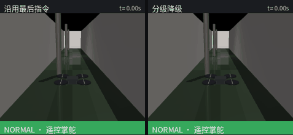
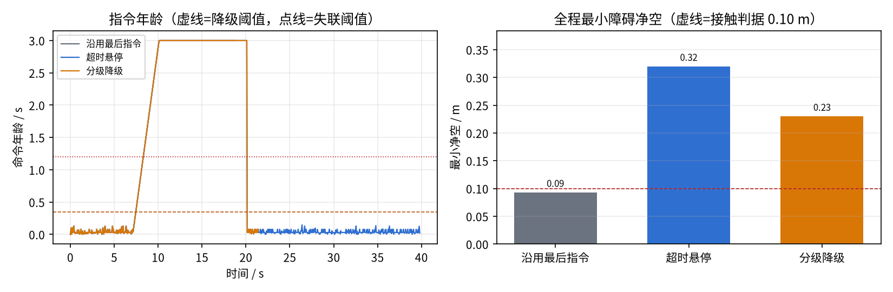

# 通信链路质量驱动的无人机分级降级与失联返航

本实验在 MuJoCo 室内走廊场景中，把“遥控链路本身”作为一等安全对象：
接收端只根据命令年龄、滑窗投递率和抖动估计链路质量，按
`NORMAL → DEGRADED → RETURN → LAND` 四态切换指令来源，
并与两种常见做法——超时后沿用最后指令、超时置零悬停——做同场对照。

源码位置：`src/air/uav_link_aware_degradation/`

## 1. 实验目标

- 在 ROS2 进程内复现上行链路损伤：单向延迟、抖动、Gilbert–Elliott 成片丢包、
  计划中断窗口；
- 设计接收端可观测的链路质量估计（不读取真实丢包标签）；
- 用带滞回的状态机把链路质量映射为指令来源与速度上限；
- 在同一场景、同一任务、同一台四旋翼上对照三种策略，
  回答“链路变差时，飞机应该改变行为，还是只把消息重发一遍”。

## 2. 系统结构

```text
地面站遥控指令                上行链路（延迟/抖动/丢包/中断）
     │  20 Hz cmd_vel                    │
     ▼                                   ▼
link_emulator_node  ──►  /link/status(JSON)
     │ /link_emulator/out_cmd
     ▼
degradation_supervisor_node  ──► /uav/cmd_vel ──► uav_mujoco_sim ──► 四旋翼
     │                                  ▲
     └── 机载自主：已装订航点 + 返航点 ──┘
```

离线实验把这条链路整体放进 `core/sim.py`：仿真进程与 ROS2 进程共用同一份
纯逻辑（`link.py` / `supervisor.py`），因此节点行为和离线指标一致。

## 3. 链路模型与质量估计

损伤模型有四个独立开关（`core/link.py`）：

| 机制 | 说明 |
|---|---|
| 单向延迟 | `one_way_delay`，叠加截断高斯抖动 `jitter_std` |
| Gilbert–Elliott 丢包 | 好态偶发丢包，坏态连续丢包，两态按概率转移，产生**成片**丢包而不是均匀丢包 |
| 计划中断 | `outages=[(t0,t1)]`，模拟遮挡、超视距、基站切换的完全失联 |
| 下行遥测 | 与上行独立种子，遥控端看到的位置同样延迟/丢包 |

接收端只维护三样量：

- **命令年龄** `age = now − 最新到达包的发送时间`（已经把延迟算进去）；
- **滑窗投递率** `pdr`（3 s 窗口）；窗口未满前标 `warm=false`，
  避免开机半窗就误判降级；
- **抖动**：到达-发送时延的标准差。

## 4. 降级状态机

| 状态 | 指令来源 | 速度上限 | 含义 |
|---|---|---|---|
| `NORMAL` | 遥控方 | 巡航 1.2 m/s | 链路新鲜，遥控掌舵 |
| `DEGRADED` | 机载自主 | 0.8 m/s | 年龄越限/投递率低，沿已装订航点慢速推进，不接收新航点 |
| `RETURN` | 机载自主 | 1.0 m/s | 年龄超过失联阈值，放弃任务直线返航；**已提交，链路恢复也不中途复飞** |
| `LAND` | 机载自主 | 0.35 m/s | 到达返航点上方，下降到约定接地高度；终态，需地面人员复位 |

切换带两道滞回：

- 退化条件必须连续成立 0.20 s 才真正降级（单次丢包不触发）；
- 恢复要求年龄与投递率连续 2.0 s 达标，阈值比退化时略宽松。

阈值按链路基线延迟设定（`degrade_age=0.45 s`、`lost_age=1.20 s`），
部署前应按真实电台的单向延迟重新标定。

## 5. 实验设置

| 项 | 配置 |
|---|---|
| 仿真器 | MuJoCo 3.17，走廊场景 24 m × 3 m，含 3 根立柱 |
| 任务 | 起点 `(-10.5,0,1.2)`，4 段去程航点，最后返航；巡航 1.2 m/s |
| 链路档 | clean / moderate / severe / outage（outage 在 7–20 s 完全中断） |
| 策略 | `hold_last`（沿用最后指令）、`hover`（超时 0.5 s 置零）、`supervised`（本模块） |
| 判据 | 净空 < 0.10 m 记为接触/撞墙；3 个种子取均值 |

## 6. 结果（3 个种子均值）

| 链路 | 策略 | 任务完成 | 安全返航 | 接触 | 最小净空/m | 用时/s | 航点进度 | 路径偏差/m |
|---|---|---|---|---|---:|---:|---:|---:|
| clean | hold_last | 1.00 | 1.00 | 0 | 0.32 | 27.7 | 1.00 | 0.00 |
| clean | hover | 1.00 | 1.00 | 0 | 0.32 | 27.7 | 1.00 | 0.00 |
| clean | supervised | 1.00 | 1.00 | 0 | 0.32 | 27.7 | 1.00 | 0.00 |
| moderate | hold_last | 1.00 | 1.00 | 0 | 0.32 | 27.3 | 1.00 | 0.00 |
| moderate | hover | 1.00 | 1.00 | 0 | 0.32 | 27.3 | 1.00 | 0.00 |
| moderate | supervised | 1.00 | 1.00 | 0 | 0.32 | 27.3 | 1.00 | 0.00 |
| severe | hold_last | 1.00 | 1.00 | 0 | 0.32 | 27.6 | 1.00 | 0.16 |
| severe | hover | 1.00 | 1.00 | 0 | 0.32 | 27.6 | 1.00 | 0.16 |
| severe | supervised | 1.00 | 1.00 | 0 | 0.32 | 27.6 | 1.00 | 0.00 |
| outage | hold_last | 0.00 | 0.00 | **1.00** | **0.07** | 18.8 | 0.80 | 5.76 |
| outage | hover | 1.00 | 1.00 | 0 | 0.32 | 39.8 | 1.00 | 0.00 |
| outage | supervised | 0.00 | 1.00 | 0 | 0.23 | 21.4 | 0.40 | 0.00 |

三个结论：

1. **零误触发**：clean / moderate / severe 三档链路下，三种策略用时完全一致，
   监督器一次都没有进入降级——滞回和“未预热”标志按设计工作。
2. **中断时**：`hold_last` 在 7 s 断链后继续按 1.2 m/s 前飞，18.8 s 撞上走廊尽头墙
   （净空 0.07 m，路径偏差 5.76 m）；`hover` 原地停 13 s，恢复后继续，39.8 s 才完成；
   `supervised` 在断链约 0.5 s 内降级、约 1.2 s 后返航，21.4 s 在返航点上方落地，
   代价是放弃剩余 60% 的航点。
3. **代价是显式的**：安全返航以“任务中止”为代价，航点进度 0.40 而不是 1.00。
   这是设计取舍，不是 bug——`RETURN` 一旦提交就不允许链路恢复后中途复飞。





## 7. 运行

```bash
# 纯逻辑自检
python3 main.py selftest

# 完整实验矩阵（4 链路 × 3 策略 × 3 种子，约 30 s）
python3 main.py run --out results --seeds 3

# 单场景 + 对比动图 + 指标图
python3 main.py demo --out results --profile outage \
    --gif results/link_degradation_demo.gif \
    --figure results/link_degradation_metrics.png

# ROS2 联调（需 uav_mujoco_sim 已编译）
ros2 launch uav_link_aware_degradation link_degradation.launch.py
```

## 8. 已知边界

- 机体模型无碰撞体，“撞墙”用几何净空 < 0.10 m 判据，不是真实接触力；
- 返航路径取直线走廊，未做障碍避让；障碍避让请与
  `uav_lidar_safety_corridor` / 神经安全过滤器组合；
- 阈值按本实验 250 ms 量级链路标定，真实电台需重新标定；
- `severe` 档链路仍能维持 age < 0.45 s，监督器不动作；
  这是“不误降级”的设计，不是覆盖所有坏链路；
- 未测风扰、多机、下行/上行不对等等情况。

## 9. AI 使用声明

使用 Codex 辅助链路模型、状态机骨架与文档整理；作者完成实验设计、
阈值标定、结果复核与动图录制，并对提交内容负责。
